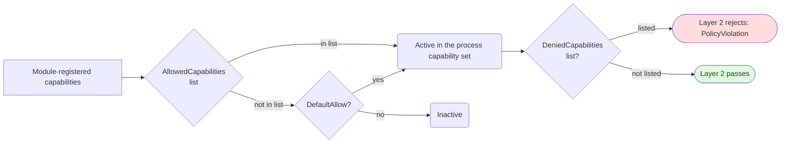

**[日本語](../ja/safety.md)** | [Back to README](../../README.md)

# Safety & Capabilities

UAIP applies per-command authorization in four layers. Understanding the layers helps you diagnose errors quickly and configure the right permissions for your workflow.

---

## Authorization layers

| Layer | Mechanism | Scope | Error on failure |
|---|---|---|---|
| 1 | `FCapabilitySet` — the process-wide capability set computed once at editor startup from SafetyPolicy | Process-wide (shared by every session) | `CapabilityNotAvailable` |
| 1.5 | `FRoleGate` — a deny-only downgrade bound to the session, resolved from an optional role token | Per-session (only narrows what Layer 1 already grants; can never add a capability) | `CapabilityNotAvailable` |
| 2 | `FSafetyPolicy` bool switches / `DeniedCapabilities` | Process-wide, immutable at runtime | `PolicyViolation` |
| 3 | Route-specific opt-in (e.g. scenario route) | Process-wide | `PolicyViolation` |
| 4 | `ICommandHandler::IsAvailable()` — a per-command, per-process self-report of whether the handler can actually run right now, evaluated after Layers 1–3 pass | Per-command (each handler answers for itself; not a session- or process-wide switch) | `AbilityUnavailable` for an environment- or build-related cause, `PolicyViolation` for the one cause that is a SafetyPolicy flag (see below) |

Layer 1 is **not** per-session — it is one capability set that every session shares, fixed at startup (or refreshed process-wide by `ReloadCapabilities`). Layer 1.5 is the only layer that varies per session: when the editor is configured with roles (see [Roles](#roles-layer-15) below) and a session is bound to one, that role's deny list is intersected with Layer 1's set for that session only. A session with no role bound behaves exactly like Layer 1 alone.

There is one exception to "a missing required capability returns `CapabilityNotAvailable`": creating a MetaHuman character (`MetaHumanAssetCreate`) or a Control Rig Blueprint (`ControlRigBlueprintCreate`) through `CreateAsset`. Those two are judged by an interceptor that stops the creation, so they return `PolicyViolation` both when the capability is merely not granted and when it is denied through `DeniedCapabilities` (the latter without advice to grant it, since a grant would not lift a denial). A role that denies `ControlRigBlueprintCreate` is refused with `PolicyViolation` as well, as described below.

Layer 4 is a different kind of check from Layers 1–3, and it's worth keeping that distinction clear: Layers 1–3 all gate on **what this session or process is allowed to do**, and every one of their rejections is fixed by an operator flipping a switch (a capability, a SafetyPolicy flag, a launch flag). Layer 4 gates on **whether the handler can do its job at all right now**, independent of permission — most of the reasons it fails (wrong engine version, a build configuration that excludes the command, missing infrastructure, an API the engine or a Toolset target never exposed) have **no ini flag or capability grant that fixes them**; see [API Reference → `UnavailableDetail`](api.md#65-command-availability-fields) for the full breakdown. The one exception is a handler gated behind a deny-by-default SafetyPolicy flag (`UnavailableDetail: SafetyPolicyDisabled`) — that one *is* fixed the same way a Layer 2 rejection is, by setting the flag in `Config/DefaultUAIP.ini` and restarting, which is why it alone maps to `PolicyViolation` rather than `AbilityUnavailable`.

```mermaid
flowchart TB
    Cmd([CommandRequest])
    L1[Layer 1: Process Capability Set]
    L15[Layer 1.5: Role Gate<br/>deny-only, session-bound]
    L2[Layer 2: SafetyPolicy + DeniedCapabilities + DeniedCommands]
    L3[Layer 3: Route opt-in flags]
    L4[Layer 4: ICommandHandler::IsAvailable&#40;&#41;<br/>per-command self-report]
    Exec([Execute on game thread])

    Cmd --> L1
    L1 -- "missing required capability" --> E1([CapabilityNotAvailable])
    L1 -- ok --> L15
    L15 -- "capability denied by the session's role" --> E15([CapabilityNotAvailable])
    L15 -- ok --> L2
    L2 -- "capability denied / ReadOnly / DisableSave / etc." --> E2([PolicyViolation])
    L2 -- ok --> L3
    L3 -- "route flag not set at launch" --> E3([PolicyViolation])
    L3 -- ok --> L4
    L4 -- "environment/build cause (no ini flag fixes it)" --> E4a([AbilityUnavailable])
    L4 -- "SafetyPolicy flag off (SafetyPolicyDisabled)" --> E4b([PolicyViolation])
    L4 -- ok --> Exec

    style E1 fill:#fdd
    style E15 fill:#fdd
    style E2 fill:#fdd
    style E3 fill:#fdd
    style E4a fill:#fdd
    style E4b fill:#fdd
```



`AllowedCapabilities` and `DeniedCapabilities` interact at Layer 1 / 2 with **deny-wins** semantics:



---

## Roles (Layer 1.5)

A role narrows the process-wide capability set (Layer 1) for the sessions bound to it. Roles are **deny-only**: a role can only take capabilities away from what the process already grants — it can never add one the process doesn't have. This makes privilege escalation through a role definition structurally impossible, not just discouraged by convention.

Roles are for running several AI agents against the same editor with different levels of trust — for example, an implementer agent that can edit assets and a reviewer agent that should never call a mutating command, even by mistake.

### Defining roles

Add one `+Role=` line per role to `[UAIP.Roles]` in `Config/DefaultUAIP.ini`:

```ini
[UAIP.Roles]
+Role=(Name="reviewer", DeniedCapabilities=("BlueprintEdit","AssetCreate","AssetDelete","EditorActorEdit"))
+Role=(Name="implementer", DeniedCapabilities=())

; Only needed if you also rely on a transport that cannot carry a role identity — see below.
; AllowRoleBlindTransports=False
```

- `Name` must match `[A-Za-z0-9_-]{1,64}` and be unique within the section. An invalid or duplicate entry is rejected at editor startup (the offending line is skipped and logged as an error) rather than silently accepted.
- `DeniedCapabilities` may be empty (`DeniedCapabilities=()`) for a role that denies nothing.
- Leaving `[UAIP.Roles]` with zero `+Role=` lines keeps the role feature **fully disabled** — every session keeps the unmodified process-wide capability set, exactly as before this feature existed.

### How a session gets bound to a role

A role is never inferred from `SessionId` — that value is a caller-supplied string over MCP and HTTP, so it can't be trusted as an identity. Instead:

- Only **MCP-mode** requests (`-uaip-mcp-enable`) can carry a role, via `Authorization: Bearer <role-token>`.
- The editor generates one token per defined role at startup and writes it to `Saved/UAIP/Roles/<RoleName>.token` (not committed to source control, same handling as the existing HTTP/WS auth tokens).
- The MCP Bridge's `config.json` supplies `role_name` (and reads the matching token from that file automatically) or, alternatively, `role_token` directly when the token is provisioned some other way. Both have environment-variable overrides, `UAIP_ROLE_NAME` and `UAIP_ROLE_TOKEN`. Leaving both empty sends requests exactly as they were before roles existed.
- The first request bearing a given `SessionId` binds that session to the resolved role; every later request for the same `SessionId` is checked against that binding, and a mismatched role is rejected — a session's role never changes mid-connection.

Because roles are configured per MCP client connection (in that client's own bridge config) rather than per request, they compose naturally with one bridge process mapping to one UAIP session — see [Session lifecycle](architecture.md#6-session-lifecycle) in Architecture.

### Transports that can't carry a role

WebSocket, CLI, and the FullHTTP mode of the HTTP transport authenticate with a single shared secret and have no way to identify a role. Once `[UAIP.Roles]` defines at least one role, those transports **refuse to start by default** — starting them would let anyone connecting through one bypass every role restriction silently. Set `AllowRoleBlindTransports=True` to start them anyway; a warning is logged at startup for each affected transport so the bypass stays visible, and commands issued through it run with the unrestricted process-wide capability set.

### How role restrictions surface to a client

- `uaip_list_commands` omits role-denied commands from its default response, the same way it omits any other unavailable command, and counts them under `HiddenReasons.RoleRestricted` (see [Commands Reference → discovery filters](commands.md)).
- `uaip_describe_command` still shows a role-denied command, with `UnavailableReason: "RoleRestricted"`.
- `uaip_query_capabilities` reflects the session's role-narrowed set in its `Capabilities` field, not the full process set — so a capability a role denies never shows up as "available" to a session bound to that role. Its `RegisteredCapabilities` catalog (requested with `IncludeUnavailable: true`) is **not** narrowed: it names every capability the loaded modules declare, with `IsGranted: false` on the ones this session cannot use. That is deliberate — a client has to be able to see that a capability exists in order to ask an operator for it, or to understand why a command it expected is missing. Only names and default policies appear there; a role still denies the operation itself.
- Calling a role-denied command returns the same `CapabilityNotAvailable` error code as a missing process capability, but `ErrorMessage` names both the role and the capability, so the remediation reads differently: a missing process capability is fixed by an operator enabling it, while a role restriction is fixed by not performing that operation under that role — there is nothing to enable.

---

## What this protects against (and what it doesn't)

Both Layer 1.5 (roles) and the token authentication that identifies a role exist to prevent **accidents**, not to hold up against an adversary. There is no way to keep credentials secret from an AI agent running under the same user account on the same machine: a token written to a file can be read, one written to an environment variable can be read from the process environment, and one written to a config file can be read from that file. This is a known, permanent limitation — not a bug to be fixed later.

| Attempted action | Effect |
|---|---|
| Retrying with a different `SessionId` | **Prevented.** The MCP Bridge overwrites every `SessionId` with the one it minted for its own connection, so an MCP client cannot express a different session at all |
| Omitting `SessionId` to fall back to an anonymous session | **Prevented.** The bridge injects its session ID on every forwarded call |
| Connecting through a transport that cannot carry a role identity (WS / CLI / FullHTTP) | **Prevented by default** once at least one role is defined — those transports refuse to start (see [Roles](#roles-layer-15) above). An operator can opt back in with `AllowRoleBlindTransports=True`; doing so makes the bypass visible in the startup log, not undone |
| Pointing an MCP client at a different bridge instance / a different token | **Not prevented technically.** Whether this is possible depends entirely on operating-system file permissions — specifically, whether the AI agent can edit the MCP client's own configuration file. If an agent has broad file-system access, this assumption does not hold automatically |
| Calling `POST /mcp` directly with `curl` or a raw HTTP client | **Not prevented.** Token authentication rejects requests with no token or the wrong one, but an agent that can read the token file can construct a valid request |
| Going around UAIP entirely (a Python script, an Editor Utility Widget, …) | **Not prevented.** Outside UAIP's authorization stack by definition |

What this feature does provide:

1. **An explicit boundary.** Working around it stops being an accident and becomes a deliberate action — one that requires reading a token file, editing a bridge config file, or launching a client another way.
2. **Observability.** Authentication failures, role-binding mismatches, and role-restricted dispatch rejections are all logged as warnings, so bypass attempts (accidental or deliberate) are visible after the fact.

---

## Capability reference

Each command declares the capabilities it requires. A command runs only when the process holds every required capability (Layer 1) and, if the session is bound to a role, that role doesn't deny any of them (Layer 1.5). Capabilities are either **DefaultAllow** (granted automatically) or **DefaultDenied** (must be explicitly enabled in `Config/DefaultUAIP.ini`).

Capabilities marked 🧩 require an optional plugin. On an editor build (source or the Fab-distributed Pro binary alike), the capability is registered whenever the plugin **exists in the engine you're running** — the project's `.uproject` no longer has to declare it, and no rebuild is needed. What still matters is whether the plugin is **enabled**: if it is disabled, the capability is never registered and commands that require it return `CommandNotFound` — enable the plugin and restart the editor to pick it up. If the plugin genuinely is not present in this engine version at all, enabling it isn't possible and `CommandNotFound` says so instead. A `CompiledOut` integration is one whose code was not built into the binary: the build did not find its plugins enabled, or the engine version is older than the integration supports; in the latter case `MissingPlugins` is empty and the `Remedy` names the minimum engine version. In a packaged game from a Fab-distributed UAIP installed in the engine, these integrations are never built in; place UAIP in the project's `Plugins` folder so it is compiled with the project. Either way, `UAIP.Core.ListIntegrations` reports every optional integration's state and what to do about it in one call, and a `CommandNotFound` response for a command that belongs to one of them names the integration and its remedy directly.

### Finding out which capabilities exist

`QueryCapabilities` answers two different questions in one response, and it is worth keeping them apart:

| Field | Question it answers |
|---|---|
| `Capabilities` | **What can this session use right now?** The effective set — the process capability set, minus anything `DeniedCapabilities` removes, minus anything the session's bound role denies |
| `RegisteredCapabilityCount` / `UngrantedCapabilityCount` | **How much is there, and how much of it can't this session use?** Always returned, including when both are what you hoped — so "nothing is ungranted" never has to be guessed from a missing field |
| `RegisteredCapabilities` | **What exists at all?** Every capability the loaded modules have declared, whether or not this session holds it. Each entry carries `Name`, `DefaultPolicy` (`Allowed` or `Denied`) and `IsGranted` (plus `UnavailableReason: "NotInThisEdition"` on a capability the running edition does not ship; see [Capabilities the demo build does not ship](#capabilities-the-demo-build-does-not-ship)) — so a name present here with `IsGranted: false` is one to ask an operator to enable, unless it carries `UnavailableReason`: no grant changes that. **Returned only when you pass `IncludeUnavailable: true`** |

The catalog is **opt-in**, for the same reason `uaip_list_commands` hides unavailable commands by default: it runs to well over a hundred entries in a normal editor, and this is the command you are told to call first. Pass `IncludeUnavailable: true` to receive it. What is *not* optional is knowing it is there — the two counts come back on every call, so a session that never opts in still learns how many capabilities it does not hold, and can then ask for the list.

**"What would an operator have to enable?" is answered from `RegisteredCapabilities` alone**: those are the entries whose `DefaultPolicy` is `Denied`, leaving out any that carries `UnavailableReason` (no grant enables it). The response carries no separate list of them, deliberately — it would repeat names already in the catalog without adding anything.

The catalog matters because a DefaultDenied capability is invisible to the effective set by definition. For most of them that is not a problem — they appear in some command's `RequiredCapabilities`, so `uaip_describe_command` names them. `PropertyReferenceEdit` and `PropertyStructuredEdit` are the exception: they are decided from the type of the property being written, long after dispatch, so no command declares them and the catalog is the only place they can be found before one is granted.

Only capability names and their default policies are disclosed. Nothing about the project's contents, and no values, are involved.

### Capabilities the demo build does not ship

The free demo build includes only part of the commands, but it still **registers** the capabilities of the commands it leaves out, with their normal default policy, so the capability catalog has the same shape in both editions. A capability that no command of the demo requires is **marked "not in this edition"**. A marked capability behaves like this:

- `QueryCapabilities` lists it in `RegisteredCapabilities` with `UnavailableReason: "NotInThisEdition"` and `IsGranted: false`, and counts it in `UngrantedCapabilityCount`.
- It is never granted, however it would have been: named in `+AllowedCapabilities`, declared by a command provider, or even DefaultAllow (so `LiveCoding`, which is DefaultAllow, is not granted in the demo). `UAIP.Core.ReloadCapabilities` does not change that.
- If `[UAIP.SafetyPolicy]` names it in `AllowedCapabilities`, the editor logs a warning at startup: `Capability '<Name>' is granted in [UAIP.SafetyPolicy] but is not available in this edition of UAIP. The grant has no effect.` Naming it in `DeniedCapabilities` matches what actually happens, so it draws no such warning.
- Pro builds mark nothing. Their catalog and effective set are unchanged.

The mark does not change a capability's default policy, and **not every capability a demo user cannot use carries it**. A capability the demo does not register at all (`CommonUIProjectCodeExecution` is an example) is not in the catalog and has no mark; naming it in the ini has no effect either. A capability that a command of the demo can require (such as `RuntimeCVarRead` or `BlackboardValueRead`) is never marked. `EditorWindowStateControl` is registered in the demo and is not marked, because `SetEditorWindowState` is part of the demo.

---

### DefaultAllow capabilities

These are active in every session without any configuration. They cover read-only observation and common non-destructive operations.

| Capability | What it unlocks |
|---|---|
| `EditorObservation` | Screenshots (`CaptureActiveWindowImage`, `CaptureEditorTabImage`, `CaptureGraphViewportImage`) and JSON state dumps (`DumpEditorState`, `DumpSlateTree`, `DumpSelectionState`, `DumpOutputLog`, `DumpMessageLog`, etc.) |
| `EditorInspect` | Read-only inspection of editor state — assets, details panel, viewport, graph info. Used by shared infrastructure commands |
| `EditorUIAutomation` | UI-driving commands — `ClickWidget`, `SelectMenuItem`, `InputText`, `SetCheckboxState`, `DragGraphNode`, `AcceptDialog`, `CancelDialog`, `InvokeContextMenuAction`, `WaitForWidget`, `FillForm`, `SnapshotUI`, `DismissMenus`, etc. — and their `Toolset.Editor.SlateInspector.*` bridge counterparts, which now require the same capability (earlier releases dispatched the bridge commands without a capability check) |
| `EditorWorkspaceControl` | Tab and panel management — open/close tabs, focus graph editors, manage editor layout |
| `EditorLifecycle` | Editor lifecycle operations — `SaveAll`, `ShutdownEditor`, `RestartEditor` |
| `EditorExecution` | Run Automation Tests and Editor Utility Blueprints from the editor |
| `LiveCoding` | Hot-reload and Live Coding compilation trigger |
| `CrashReportRead` | Access to crash report diagnostic information |
| `AssetCreate` | Create new assets in the Content Browser |
| `AssetMutate` | Modify existing asset properties |
| `AssetWindowControl` | Open and close asset editors |
| `PIEControl` | PIE session control — `StartPIE`, `StopPIE`, `PausePIE`, `ResumePIE`, `LoadMap` |
| `RuntimeInspect` | Read-only inspection of runtime world state — `DumpWorldState`, `DumpActorState`, `DumpComponentState`, `DumpRuntimeLog`, `CapturePerformanceSnapshot`, `SearchLoadedClasses`, and the six AI perception commands `DumpAIPerceptionState`, `GetPerceivedActors`, `GetActorPerceivers`, `DumpAIPerceptionSystemState`, `ExplainSightPerception` and `DumpAIPerceptionSenseConfigs` (the last one also requires `AIPerceptionConfigDump`; see [Runtime AI perception](#runtime-ai-perception)), and the fifteen behavior tree, Blackboard and StateTree commands `ListBehaviorTreeAgents`, `GetActiveBehaviorTreeNode`, `DumpBehaviorTreeState`, `GetBlackboardValues`, `DescribeBehaviorTreeWithProjectCode`, `StartBehaviorTreeCapture`, `GetBehaviorTreeEventLog`, `StopBehaviorTreeCapture`, `ListStateTreeComponents`, `GetActiveStateTreeState`, `DumpStateTreeState`, `DumpStateTreeInstanceData`, `StartStateTreeCapture`, `GetStateTreeEventLog` and `StopStateTreeCapture` (`GetBlackboardValues` also requires `BlackboardValueRead`, `DescribeBehaviorTreeWithProjectCode` also requires `BlackboardValueRead` and `AIBehaviorProjectCodeExecution`, and `DumpStateTreeInstanceData` also requires `StateTreeInstanceDataDump`; see [Runtime AI behavior trees and Blackboards](#runtime-ai-behavior-trees-and-blackboards) and [Runtime StateTree observation](#runtime-statetree-observation)), and the eight Chaos destruction commands `ListGeometryCollections`, `DumpGeometryCollectionState`, `DumpChaosFieldState`, `StartDestructionCapture`, `GetDestructionEventLog`, `StopDestructionCapture`, `CaptureGeometryCollectionStrain` and `EnableForcedDestructionNotify` (the last one also requires `ChaosDestructionForceNotify`, which the demo build does not provide; see [Runtime Chaos destruction](#runtime-chaos-destruction)), and the seven read-only navigation commands `DumpNavigationSystemState`, `FindPath`, `IsLocationReachable`, `DumpNavMeshTiles`, `QueryNavModifiers`, `GetPathFollowingState` and `WaitForNavigationBuild` (`FindPath` and `IsLocationReachable` also require `RuntimeNavigationExtendedSearch` above 8192 search nodes; see [Runtime Navigation](#runtime-navigation)), and the seven animation commands `DumpAnimInstanceState`, `GetAnimStateMachineStates`, `GetAnimBlendWeights`, `GetActiveMontages`, `GetAnimCurveValues`, `DumpAnimInstanceVariables` and `GetMotionMatchingState` (`DumpAnimInstanceVariables` also requires `AnimInstanceVariableDump`; see [Runtime Animation](#runtime-animation)), and the five network commands `GetNetDriverState`, `ListNetConnections`, `DumpActorReplication`, `DumpReplicatedPropertyValues` and `CompareReplicatedProperties` (the last two also require `RuntimeReplicatedPropertyValueRead`, and `ListNetConnections` with `IncludeRemoteAddress` also requires `RuntimeNetConnectionAddressRead`; see [Runtime network and replication](#runtime-network-and-replication)), and the two subsystem commands `ListSubsystems` and `DumpSubsystemState` (the latter also requires `SubsystemStateDump`; see [Runtime subsystems](#runtime-subsystems)), and the three game viewport UI commands `DumpGameViewportWidgets`, `FindGameViewportWidgets` and `DumpHUDState` (see [Runtime game viewport UI](#runtime-game-viewport-ui)), and the four CommonUI commands `DumpActivatableStacks`, `GetInputState`, `GetActionDisplayNames` and `DescribeActivatableWidgetsWithProjectCode` (`GetActionDisplayNames` also requires `RuntimeWidgetTextRead`, and `DescribeActivatableWidgetsWithProjectCode` also requires `CommonUIProjectCodeExecution`; see [Runtime CommonUI observation](#runtime-commonui-observation)), and `EvaluateInputGateWithProjectCode` (also requires `InputProjectCodeExecution`; see [Runtime game input gate](#runtime-game-input-gate)) |
| `RuntimeCapture` | Runtime captures — `CaptureViewportImage`, `CheckpointCapture` (the latter also requires `RuntimeInspect`) |
| `RuntimeExecution` | Run functional tests and automation tests in PIE or Standalone |
| `RuntimeGASInspect` 🧩 | Read GAS state during PIE — `GetAttributeValues`, `GetActiveEffects`, `GetGrantedAbilities`, `GetActiveTags`, `FindAttributeSetClasses` (requires `GameplayAbilities` plugin) |
| `RuntimeNiagaraInspect` 🧩 | Read Niagara component state during PIE — `GetUserVariables`, `GetVariable` (requires `Niagara` plugin) |
| `SandboxObserve` 🧩 | Observe the active sandbox — `GetSandboxStatus`, `GetSandboxChanges` (requires `FileSandbox` plugin) |
| `RuntimeInsightsInspect` | Read-only inspection of Unreal Insights tracing — `ListTraceChannels`, `GetTraceStatus`, `ListTraceFiles`. Does not allow starting, stopping or otherwise altering a trace |
| `RuntimeSaveGameInspect` | Read-only inspection of save game slots and snapshots — `ListSaveGameSlots`, `GetSaveGameInfo`, `ListSaveGameSnapshots`. Reports names, sizes, times, header metadata and content hashes; never the values stored in a slot, and never loads a class. See [Runtime SaveGame slots](#runtime-savegame-slots) |
| `ArtifactContentRead` | Read back the stored content of an artifact the session produced — `UAIP.Core.Artifacts.GetArtifact`. Another session's artifacts stay unreachable |
| `PendingInteractionInspect` | Poll and cancel a pending interaction — `GetPendingInteractionStatus`, `WaitForPendingInteraction`, `CancelPendingInteraction`. Read-only lookups only; starting an interaction (e.g. `DrawPCGSpline`) is gated separately by the interactive command's own capability plus `SafetyPolicy.AllowUserInteractionPrompt` |

---

### DefaultDenied capabilities

These must be explicitly enabled by adding `+AllowedCapabilities=<name>` entries to `[UAIP.SafetyPolicy]` in `Config/DefaultUAIP.ini`. They cover destructive or significant editing operations.

#### Blueprint & Anim Blueprint editing

| Capability | What it unlocks |
|---|---|
| `BlueprintEdit` | Compile Blueprint assets and inspect their structure |
| `BlueprintVariableEdit` | Add, remove, and modify Blueprint variables |
| `BlueprintGraphEdit` | Add, delete, and connect nodes in Blueprint graphs; add a function graph that overrides a parent class or interface function. ⚠️ Now also reaches the **level Blueprint of every map open in the editor** — see the note below |
| `BlueprintUnrestrictedNodePlace` | Required **in addition** to `BlueprintGraphEdit` to place a call to a function that can run code (running a console command, launching a URL or another application, quitting the editor, writing files to a path the caller chooses, any function of an editor-only, development-only or uncooked module — Python included — and any function whose module cannot be determined), to place any function call in an Editor Utility Blueprint, and to write a pin of or connect such a call (`SetPinDefaultValue`, `ConnectBlueprintPins`). `AddGraphNodeByAction` always requires it, whatever the action places. Decided from the resolved function while the command runs, so it is not in the declared `RequiredCapabilities` of `AddGraphNode`, `SetPinDefaultValue` or `ConnectBlueprintPins`; the refusal names it. See [Commands — Function calls that can run code](commands.md#function-calls-that-can-run-code) |
| `BlueprintComponentEdit` | Add, remove, rename, reparent, duplicate, and edit properties of Blueprint SCS components |
| `AnimBlueprintGraphEdit` | Add, delete, and connect nodes in AnimGraph; compile Anim Blueprints |
| `AnimBlueprintCustomTypeEdit` | Required by `AddAnimGraphNode` when `NodeClass` is not from one of the three modules this domain trusts (`AnimGraph`, `AnimGraphRuntime`, `Engine`) — a project- or plugin-defined `UAnimGraphNode_Base` subclass. There is no separate "dangerous node" capability for this domain: eight node kinds are refused outright regardless of any capability held, see [Commands — UAIP.Editor.AnimBlueprint](commands.md#uaipeditoranimblueprint) |
| `AnimStateMachineEdit` | Add and remove States and Transitions in Anim State Machines |
| `AnimBlueprintReferenceEdit` | Write a property, an implemented interface reference, or an embedded UAF graph reference that is — or contains — an object reference on an Anim Blueprint. `SetAnimGraphNodeProperty` asks for it dynamically, only when the write actually touches a reference; `ImplementAnimLayerInterface` and `AddUAFGraphNodeToAnimBlueprint` declare it statically, since every call writes a reference; `AddLinkedAnimLayerNode` asks for it dynamically, only when `InterfacePath` is set (a self-contained layer node writes no reference) |

> ⚠️ **`BlueprintGraphEdit`, `BlueprintVariableEdit` and `BlueprintEdit` now reach the level Blueprint of a map.** The graph, variable and compile commands accept the path of a map that is open in the editor (or one of its loaded sub-levels) and then work on its level Blueprint — see [Commands — Level Blueprints](commands.md#level-blueprints). A session granted these capabilities can therefore change the logic of the maps that are open, not only Blueprint assets. Editing a level Blueprint has side effects an ordinary Blueprint does not have:
>
> - **Compiling recreates the level script actor.** Every placement compiles unless `SkipCompile` is `true`.
> - **`AddGraphNode`, `AddBlueprintVariable` and `AddFunctionOverride` create the level Blueprint** of a map that has none, which leaves the map with unsaved changes; the response warns about it.
> - **Saving writes the whole map.** `SaveAsset` on a map saves the whole map package. When the map may have had unsaved changes that a UAIP Blueprint edit did not make, the response carries a warning in `Result.Warnings` and the map is saved anyway.
> - **What that warning cannot tell apart.** It tells UAIP Blueprint edits from everything else, so a change made by another UAIP command (an actor moved with `SetActorTransform`, for example) counts as "not made by a Blueprint edit" and triggers the warning. A change a person makes to the same map after a UAIP Blueprint edit and before the save cannot be told apart, so no warning is given for it. On a World Partition map, a change that lives only in the package of an external actor may not be caught, since the warning looks at the map package.
> - **Save before you switch maps.** The level Blueprint lives in the map, so its unsaved changes go with the map.
>
> ⚠️ **What `BlueprintUnrestrictedNodePlace` does not close.** The capability gates placing a function call that can run code and writing or connecting the pins of one. These routes stay open to a session that holds only the ordinary Blueprint capabilities; weigh them before granting `BlueprintGraphEdit` / `BlueprintVariableEdit` to a session that should not run code:
>
> - A function that can run code and is not on the list the capability judges by.
> - Changing, with `SetBlueprintVariableDefault`, the default of a variable that is already connected to an argument of a node that runs code.
> - Running an existing Editor Utility Blueprint without writing or connecting any of its pins.
> - Calling a Blueprint function or macro a person wrote that wraps something which runs code and takes its arguments as parameters, and filling in those arguments — an ordinary `FunctionCall` of the Blueprint's own function needs no extra capability.
> - Writing a pin of a pure node upstream of an argument of a node that runs code (a string append, for example). Only the function call node itself is checked.
> - A node that can run code without referring to a function, such as an async task node. Placing one needs `AddGraphNodeByAction`, which always requires the capability, but writing the pins of or connecting one that is already there is not checked.
> - The PreConstruct event of a Widget Blueprint (run for the preview in the Designer) and a construction script, both of which the editor runs without `EditorExecution`.

#### Level / Actor / Property editing

| Capability | What it unlocks |
|---|---|
| `EditorActorEdit` | Spawn, delete, and set transforms of actors in the Level Editor |
| `EditorLevelLoad` | Open and create levels in the editor viewport |
| `EditorViewportControl` | Control the level editor viewport camera — `FocusOnActors`, `GetCameraTransform`, `SetCameraTransform` |
| `ActorComponentEdit` | Add, remove and re-attach a component on an actor **placed in the level**, and write a property on one — `AddActorComponent`, `DeleteActorComponent`, `ReparentActorComponent`, `SetActorComponentProperty`. Held apart from `EditorActorEdit` because the two change different things: that one moves and removes whole actors, this one changes what an actor is made of and how it is configured. Reading a component's properties (`GetActorComponentProperty`) and listing components (`ListActorComponents`) need only `EditorInspect`. A write whose value is a reference or a composite needs `PropertyReferenceEdit` / `PropertyStructuredEdit` in addition — call `GetActorComponentProperty` first to find out which |
| `ComponentCustomTypeEdit` | Required **in addition** to the command's own capability whenever a command increases how many instances of a component class exist and that class is not declared by `/Script/Engine` or `/Script/LiveLinkComponents` — i.e. a project's own C++ component, another plugin's (engine plugins such as Niagara included), or a Blueprint-generated component class. Shared by all three such commands: `AddActorComponent` (instance side, with `ActorComponentEdit`) and `AddBlueprintComponent` / `DuplicateBlueprintComponent` (Blueprint / SCS side, with `BlueprintComponentEdit`). One name across all three so that granting it for one route cannot be used to reach the same class through another. ⚠️ **This is a change in behaviour for the two Blueprint commands** — see the note below. Deleting, renaming, reparenting a component and writing its properties are **not** gated by it, since none of them increases the number of instances |
| `PropertyEdit` | Read and write actor / asset properties via the Details panel (`GetActorProperty`, `SetActorProperty`, `GetAssetProperty`, `SetAssetProperty`, etc.). ⚠️ `SetAssetProperty` no longer writes an object inside a Blueprint that a dedicated command handles — a widget, a widget slot or animation, a component a Blueprint adds, the component structure, a graph or a node, the class defaults — so `PropertyEdit` is no longer a way around `WidgetPropertyEdit`, `BlueprintComponentEdit`, `BlueprintGraphEdit` and the other capabilities of those commands. The refusal names the command to use; see [Commands — UAIP.Editor.Property](commands.md#uaipeditorproperty) |
| `PropertyReferenceEdit` | Write a property whose value is — or contains, at any depth — an object / class / soft / weak / lazy / interface reference, a delegate or a field path. Clearing a reference needs it too, since attaching and detaching a dependency are the same kind of change |
| `PropertyStructuredEdit` | Write a struct outside the built-in value catalogue, an array, a set, a map, an optional or a fixed-size array — and operate on a single container element rather than replacing the whole value |
| `PropertyDefaultsOnlyEdit` | Write a property the editor shows only on defaults for a target of this kind — one declared `EditDefaultsOnly` being written to an instance, or `EditInstanceOnly` being written to a template. The engine's own details panel edits these: the flag decides where a row appears, not whether it can be typed into, and the graph editors that hold node objects ask for those rows outright. Refusing them flatly would be stricter than the editor being automated, so the refusal is a permission to hold rather than a wall. A property with no edit flag at all, one marked `EditConst`, and a deprecated one are refused whatever is held — no permission opens those |
| `StateTreeNodeReferenceEdit` | Write a StateTree node property whose type graph can reach a reference. Asked for instead of the generic `PropertyReferenceEdit` so that opening references on StateTree nodes does not open them everywhere else |
| `EQSNodePropertyReferenceEdit` | Write an EQS generator or test property whose type graph can reach a reference. Also required to write an `FAIDataProvider` property, which holds a `UAIDataProvider` pointer whether the value names a constant or a binding |
| `BehaviorTreeNodeReferenceEdit` | Write a Behavior Tree node property whose type graph can reach a reference. The blackboard key selector is written by a path of its own and is not governed by this |
| `WorldConditionPropertyReferenceEdit` | Write a World Condition property whose type graph can reach a reference |
| `ProjectConfigEdit` | Read and write project settings (`GetProjectSetting`, `SetProjectSetting`) |
| `EditorUndoRedo` | Undo and redo editor operations. ⚠️ Combined with the Widget Blueprint commands, it weakens the gate on password fields: turning a password field into a plain one with `SetWidgetProperties` needs the permission to read secret values, but undoing a change of `IsPassword` made earlier in the same editor session — by a person, for example — does not |

> ⚠️ **Breaking change — `ComponentCustomTypeEdit` now applies to `AddBlueprintComponent` and `DuplicateBlueprintComponent` too.** Until now only the class allow-lists of other domains behaved this way; adding or duplicating a component class on a Blueprint went through on `BlueprintComponentEdit` alone whatever the class was. A session that used to add or duplicate a project-defined component with only `BlueprintComponentEdit` granted will now be refused with `CapabilityNotAvailable` naming `ComponentCustomTypeEdit`. Add `+AllowedCapabilities=ComponentCustomTypeEdit` to restore it. The gate was extended to both routes at once because gating only the new instance-side command would have left the Blueprint route as a way around it. Because the requirement is decided from the class while the command runs, it does not appear in any of the three commands' declared `RequiredCapabilities`; `ListActorComponents` reports per class what an add would take (`Admission` / `RequiredCapabilities` / `MissingCapabilities`), and `QueryCapabilities` with `IncludeUnavailable: true` lists the name in its catalog. See [Commands — Components — SCS](commands.md#components--scs-8).

> **Note**: `PropertyReferenceEdit` and `PropertyStructuredEdit` are not confined to `UAIP.Editor.Property`. They gate reference / struct / container writes in **every** domain that writes properties — Blueprint SCS components, the widgets of a Widget Blueprint (`SetWidgetProperties`), Sequencer sections, Sound and SoundCue assets, PCG and Conversation nodes, DataTable rows, World and project settings, and more. Writing a struct that contains a reference needs both, so the structured one alone is never a way around the reference gate.
>
> A module that already governs reference writes through a capability of its own keeps that name for the reference half — `AnimNotifyReferenceEdit` for `SetAnimNotifyProperty`, `DataflowReferenceEdit` for `SetDataflowNodeProperty`, `SubsonicEventEdit` for the Subsonic property setters, `WidgetSlotReferenceEdit` for `SetSlotProperties` (the widget properties `SetWidgetProperties` writes use the shared `PropertyReferenceEdit` instead), `EnhancedInputReferenceEdit` for the Enhanced Input mapping mutators, `StateTreeParameterReferenceEdit` for `SetStateTreeParameter`, `NiagaraReferenceEdit` for a reference-typed parameter default on `AddSetParameterEntry` / `AddSetParametersModule` — while the struct / container half is always `PropertyStructuredEdit`. `SetPoseSearchSchemaChannelProperty` is the exception that grants nothing for references: it refuses a reference-bearing type outright, because writing a channel's sub-channel array directly would sidestep the class allowlist `AddPoseSearchSchemaChannel` enforces.
>
> Because both are decided from the property's type while the write runs, **neither appears in any command's declared `RequiredCapabilities`** and `uaip_describe_command` will not show them. They can still be found without attempting a write: `QueryCapabilities` lists both in its `RegisteredCapabilities` catalog — call it with `IncludeUnavailable: true` — with `DefaultPolicy: "Denied"` and `IsGranted: false` until an operator enables them (see [Finding out which capabilities exist](#finding-out-which-capabilities-exist)). To learn what a **particular** property would need, read it first — its `WriteRequirements` object names what a write would need and which of those the session already holds — or take the name out of the refusal. See [Commands — Writing references, structs and containers](commands.md#writing-references-structs-and-containers).

#### Asset management

| Capability | What it unlocks |
|---|---|
| `AssetDelete` | Permanently delete assets |
| `FolderDelete` | Permanently delete content folders |
| `AssetFolderRefactor` | Move and rename assets and folders |
| `RedirectorFixup` | Fix up stale asset redirectors |
| `ShaderCompilation` | Control shader compilation and query its status |
| `ContentBrowserNavigate` | Navigate the Content Browser and select assets — `SelectAssets`, `SetContentBrowserPath` (native and bridge) |
| `PrimaryAssetTypeAdd` | Add a `PrimaryAssetType` to `PrimaryAssetTypesToScan` (`AddPrimaryAssetType`, persisted to `DefaultGame.ini`) |
| `PrimaryAssetTypeRemove` | Remove a `PrimaryAssetType` from `PrimaryAssetTypesToScan` (`RemovePrimaryAssetType`, persisted) |
| `PrimaryAssetRulesOverride` | Temporarily override a `PrimaryAssetId`'s rules in memory (`SetPrimaryAssetRules`, not persisted) |
| `PrimaryAssetLoad` | Explicitly load `PrimaryAsset`s into memory (`LoadPrimaryAsset`) |
| `PrimaryAssetUnload` | Explicitly unload `PrimaryAsset`s from memory (`UnloadPrimaryAsset`) |

#### Material editing

| Capability | What it unlocks |
|---|---|
| `MaterialGraphEdit` | Add, delete, and connect nodes in Material graphs; compile materials |
| `MaterialParameterEdit` | Modify Material parameter values and defaults |
| `MaterialCustomNodeEdit` | Required by `AddMaterialNode` when `ExpressionClass` is `UMaterialExpressionCustom`, `UMaterialExpressionCustomOutput`, or a subclass of either (arbitrary HLSL), regardless of which module it comes from. Already registered before this change, but no command required it until now |
| `MaterialCustomTypeEdit` | Required by `AddMaterialNode` when `ExpressionClass` is not one of the engine's built-in modules (`Engine`, `RenderCore`, `MaterialEditor`, `Landscape`) — a project- or plugin-defined `UMaterialExpression` subclass. A class that is both project-defined and custom-HLSL needs this and `MaterialCustomNodeEdit` together |

> **Note**: `MaterialCustomNodeEdit`, `MaterialCustomTypeEdit`, `AnimBlueprintCustomTypeEdit` (above, under [Blueprint & Anim Blueprint editing](#blueprint--anim-blueprint-editing)), `MotionMatchingCustomTypeEdit` (below, under [Motion Matching / Pose Search editing](#motion-matching--pose-search-editing)), `SequencerCustomTypeEdit` (below, under [Sequencer editing](#sequencer-editing)), `ControlRigCustomTypeEdit` (below, under [ControlRig editing](#controlrig-editing)), `BehaviorTreeCustomTypeEdit` / `BehaviorTreeExternalBehaviorNodeEdit` / `BlackboardReferenceKeyTypeEdit` (below, under [AI systems](#ai-systems)), `StateTreeCustomTypeEdit` (below, under [StateTree editing](#statetree-editing)), `SoundCueCustomTypeEdit` (below, under [SoundCue editing](#soundcue-editing)), `EnhancedInputCustomTypeEdit` (below, under [Gameplay systems](#gameplay-systems)), and `MetaSoundCustomTypeEdit` / `EQSCustomTypeEdit` / `EQSDelegatedGeneratorEdit` / `WorldConditionsCustomTypeEdit` / `ConversationCustomTypeEdit` (below, under [Optional graph editors](#optional-graph-editors)) are not only checked when a node of the gated type is added — the same capability is re-checked for every operation that touches an existing node of that type: editing, connecting, disconnecting, compiling, reparenting, and deleting it. ⚠️ Deleting and disconnecting such a node used to be ungated entirely before this change. A type that can no longer be added is still not, by itself, a reason an existing node of it can't be deleted or disconnected. See [Commands — Capability-gated custom types](commands.md#capability-gated-custom-types) for the full explanation.

#### DataTable editing

| Capability | What it unlocks |
|---|---|
| `DataTableRowEdit` | Add and modify rows in DataTable assets |
| `DataTableRowDelete` | Delete rows from DataTable assets |
| `DataTableImport` | Import CSV/JSON data into DataTable assets |

#### Physics Asset editing

| Capability | What it unlocks |
|---|---|
| `PhysicsAssetEdit` | Add, delete, and modify shapes and constraints in Physics Assets |
| `PhysicsBodyEdit` | Add and delete Physics Asset bodies; edit per-body properties (PhysicsMode, MassScale, CollisionProfile, Damping, Offset) |

#### Skeleton / SkeletalMesh editing

| Capability | What it unlocks |
|---|---|
| `SkeletonAssetEdit` | Add, remove, and modify sockets, virtual bones, and BlendProfiles in Skeleton assets |
| `SkeletalMeshMaterialEdit` | Assign and replace material slots on Skeletal Meshes |

#### Unified Animation Framework (UAF) editing 🧩

Requires the Engine's own `UAF` plugin; if it is disabled none of the commands below are registered. **Every command gated by these three capabilities is `Stability: Experimental`**, because the UAF plugin is itself an Experimental engine feature and its API may change without notice in a future engine release. `UAFReferenceEdit` and `AnimBlueprintReferenceEdit` (above) are gated separately because they name different things: a UAF pin reference versus an implemented-interface / embedded-graph reference on an Anim Blueprint. `AddUAFGraphNodeToAnimBlueprint` (which embeds a UAF graph into an Anim Blueprint) is gated by the Anim Blueprint capabilities above, not by these three.

| Capability | What it unlocks |
|---|---|
| `UAFGraphEdit` | Graph, variable, and compile editing on a UAF asset (`AddUAFGraphNode` / `RemoveUAFGraphNode` / `ConnectUAFPins` / `DisconnectUAFPins` / `SetUAFPinValue` / `AddUAFVariable` / `RemoveUAFVariable` / `AddUAFEventGraph` / `ArrangeUAFGraph` / `CompileUAFAsset`) |
| `UAFCustomTypeEdit` | Required when a RigVM unit struct or animation trait used by an add / connect / disconnect / remove operation does not come from the framework's own packages — a type contributed by an optional UAF sub-plugin, a project module, or anything else outside that set. `GetAvailableUAFUnitStructs` and `GetAvailableUAFTraits` report which capability each entry would need |
| `UAFReferenceEdit` | Required when `SetUAFPinValue` writes an object or class reference into a pin — either the pin's own declared type, or a struct that declares a reference anywhere in its own type graph |

#### Geometry Collection (Chaos Destruction) editing

Read-only inspection (`GetGeometryCollectionInfo`, `GetGeometryCollectionClusterInfo`, `GetGeometryCollectionDestructionSettings`) is DefaultAllow (`EditorInspect`). The read-only `SelectGeometryCollectionBones` command is also gated by `EditorInspect`, but additionally requires the `Fracture` plugin — see [Commands Reference](commands.md). Every write is split across three capabilities by risk profile: creating or merging assets, fracturing/merging/deleting/splitting/validating bones (all destructive geometry operations), and everything else (cluster hierarchy, geometry attributes, damage settings).

| Capability | What it unlocks |
|---|---|
| `GeometryCollectionCreate` | Create a new `UGeometryCollection` from a Static Mesh (`CreateGeometryCollectionFromStaticMesh` 🧩, requires the `GeometryCollectionPlugin`) and merge one collection's geometry into another (`MergeGeometryCollectionAssets`, no plugin dependency) |
| `GeometryCollectionFracture` 🧩 | Fracture a collection (`FractureGeometryCollectionUniform` / `Voronoi` / `Plane` / `Slice` / `Brick` / `WithMesh` / `WithMeshArray`), merge or delete bones (`MergeGeometryCollectionBones`, `DeleteGeometryCollectionBranch`), merge tiny geometry (`FixGeometryCollectionTinyGeometry`), split disconnected islands (`SplitGeometryCollectionIslands`), and clean up structural inconsistencies (`ValidateGeometryCollection`) — 12 commands, all requiring the `Fracture` plugin |
| `GeometryCollectionEdit` | Edit the bone cluster hierarchy (`ClusterGeometryCollectionBones`, `UnclusterGeometryCollectionBones`, `RenameGeometryCollectionBone`), geometry display/derived-data attributes (visibility, material, normals, convex hulls, exploded view, bone colors), and the damage-model/clustering settings (`SetGeometryCollectionDestructionSettings`) — 11 commands. `AutoClusterGeometryCollection` and the 6 attribute-editing commands (marked 🧩) additionally require the `Fracture` plugin; the remaining 4 have no plugin dependency |

#### Motion Matching / Pose Search editing

| Capability | What it unlocks |
|---|---|
| `PoseSearchAssetEdit` 🧩 | Add, remove, reorder, and configure channels and compatible skeletons in PoseSearch Schema assets; add and remove animations, set database schema, animation settings, and Normalization Set membership on PoseSearch Database assets; start database index builds (requires `PoseSearch` plugin). Writing a struct or container through `SetPoseSearchSchemaChannelProperty` additionally requires `PropertyStructuredEdit`; a reference-bearing type is refused outright and no capability lifts that |
| `MotionMatchingCustomTypeEdit` 🧩 | Required in addition to `PoseSearchAssetEdit` when a channel class — or the class declaring a channel property — comes from outside `/Script/PoseSearch`: a project module, a plugin module, or a Blueprint generated class. One name covers both places on purpose: a project's own channel declares its own properties, so requiring a second permission for the property face would not make sense. It gates `AddPoseSearchSchemaChannel` when such a class is named, and `RemovePoseSearchSchemaChannel` / `MovePoseSearchSchemaChannel` / `SetPoseSearchSchemaChannelProperty` / `StartPoseSearchDatabaseIndexBuild` when the channel being acted on, or the class declaring the property being written, is one — removal is judged over the whole nested subtree it takes with it, a move only over the moved channel's own class, and starting an index build over every distinct channel class the target schema holds. Also required to write a property already sitting in a schema — this is a new restriction, not a migrated one: before this capability existed, a project-defined channel's properties were writable without any capability check on the declaring class at all. A Blueprint generated channel class is refused outright whatever is held — it is not the kind of custom type this capability opens. Decided from the type named in the request (or found on the target) rather than from the command, so it does not appear in any handler's declared `RequiredCapabilities`. There is no companion "dangerous type" capability for this domain: a channel class's `Finalize` / `BuildQuery` / `IndexAsset` is its own author's compiled code, never something a request supplies. See [Commands — UAIP.Editor.MotionMatching](commands.md#uaipeditormotionmatching-) |

#### Chooser table editing

Reading a chooser table is DefaultAllow (`EditorInspect`) — the eight read commands in `UAIP.Editor.Chooser` need nothing else. Every write needs `ChooserTableEdit`; the other three are decided per call from what the request actually names, so they appear in no handler's declared `RequiredCapabilities`.

| Capability | What it unlocks |
|---|---|
| `ChooserTableEdit` 🧩 | Every write in `UAIP.Editor.Chooser` — adding, removing and moving rows and columns, writing a cell, replacing a row's result or the table's fallback result, installing a column's input binding, disabling a row, and compiling the table (requires the `Chooser` plugin). Writes are refused while a play session is in progress, and for an asset outside `/Game/` |
| `ChooserCustomTypeEdit` 🧩 | Required in addition to `ChooserTableEdit` when a column type, result type or input binding type comes from outside the modules this domain ships those types from. Judged over the type already in the table as well as the one being written, so removing or moving something that already holds such a type needs it too — and `SetChooserTableCell` asks about the column's own type whether or not the request changes it. `ListChooserColumnTypes` / `ListChooserResultTypes` / `ListChooserInputTypes` report per type, under `Admission`, whether a call naming it would need this |
| `ChooserReferenceEdit` 🧩 | Required in addition to `ChooserTableEdit` when a value is supplied for a type that can hold an object reference — a cell in such a column, a `ResultValue` for such a result type, or an `InputValue` for such a binding type |
| `ChooserFunctionBindingEdit` 🧩 | Required in addition to `ChooserTableEdit` when a property chain resolves to a function the evaluation path would call rather than to plain properties. `CompileChooserTable` needs it when any binding already in the table resolves that way, since compiling puts every one of them through the same resolver. A chain reaching a function through a binding the chooser editor offers no functions for is refused with `NotAllowed` instead, which no capability lifts |

See [Commands — UAIP.Editor.Chooser](commands.md#uaipeditorchooser-).

#### AnimNotify editing

| Capability | What it unlocks |
|---|---|
| `AnimNotifyEdit` | Add / remove notify tracks; add / remove / edit AnimNotify and AnimNotifyState entries on `UAnimSequence` / `UAnimMontage` / `UAnimComposite`; fix up invalid notify guids. Required by every edit command in `UAIP.Editor.AnimSequence` |
| `AnimNotifyReferenceEdit` | Required in addition to `AnimNotifyEdit` when `SetAnimNotifyProperty` writes a property that is — or contains — a reference of any kind (object / class / soft / weak / lazy / interface, delegate, field path). Writing a struct or container additionally requires `PropertyStructuredEdit` |

#### MetaHuman character editing

These capabilities all require the `MetaHumanCharacter` plugin. They are split by risk profile rather than by command count — creating an asset, reading a file off disk, starting a minutes-long synthesis job, sending data to an external service, and running a build that deletes assets on failure each deserve a separate decision.

| Capability | What it unlocks |
|---|---|
| `MetaHumanAssetCreate` 🧩 | Create new MetaHuman character assets — `CreateMetaHumanCharacter` native and `Toolset.Editor.MetaHuman.Create` bridge. The generic `UAIP.Editor.Assets.CreateAsset` command is also blocked for `UMetaHumanCharacter` (and any subclass) unless this capability is granted, so the DefaultAllow `AssetCreate` capability cannot be used to bypass it |
| `MetaHumanEdit` 🧩 | Every local mutation of an existing character — body constraints and shape, skin, eyes, makeup, head model and face evaluation settings, face sculpting and landmark editing, conforming and fitting, wardrobe slot assignment, preview viewport settings, build prerequisite checks and state polling, and `ReleaseEditSession` — plus the reads that require an edit session and therefore cannot declare themselves read-only. Also gates every `Toolset.Editor.MetaHuman.*` bridge command except `Create` |
| `MetaHumanFileImport` 🧩 | Read a face DNA file from the OS file system — `ImportFaceFromDna`, `FitFaceFromBodyWithEyesTeethDna`. Gated separately from ordinary edits because the imported file is untrusted binary handed to an engine parser |
| `MetaHumanTextureSynthesis` 🧩 | Start high resolution face texture synthesis — `RequestTextureSources`. Runs for minutes and writes its results to disk, so it is not granted along with ordinary parameter edits |
| `MetaHumanCloudRigging` 🧩 | Start face rig generation — `RequestAutoRigging`. ⚠️ This is the only command in the module that sends character data to an external service (Epic's cloud rigging service), so it is always an explicit decision |
| `MetaHumanBuild` 🧩 | Run the MetaHuman asset build pipeline — `BuildMetaHuman`. Blocks the game thread for the whole build and deletes the assets it created when the build fails, so it carries both a responsiveness and a destructive aspect |

#### UMG / Widget editing

| Capability | What it unlocks |
|---|---|
| `WidgetTreeEdit` | Add, remove, and reparent widgets in UMG Widget Blueprints |
| `WidgetVariableEdit` | Add and remove widget variables |
| `WidgetAnimationEdit` | Create Widget Animations and add animation tracks |
| `WidgetBindingEdit` | Add and remove property bindings |
| `WidgetPropertyEdit` | Write the properties of a widget in a Widget Blueprint with `SetWidgetProperties` (the Text of a TextBlock, the range of a SpinBox, …). A value that is or contains a reference additionally requires `PropertyReferenceEdit`, and a struct outside the simple value set or a container `PropertyStructuredEdit` — decided from each property's type while the write runs, see the note under [Level / Actor / Property editing](#level--actor--property-editing). Turning a password field into a plain one (`IsPassword` from true to false) also needs `AllowSecretValueRead` and `SecretValueRead`, see [Reading secret values in plain text](#reading-secret-values-in-plain-text). Reading the properties (`GetWidgetProperties`) needs only `EditorInspect` |
| `WidgetSlotReferenceEdit` | Required when `SetSlotProperties` writes a slot property that is — or contains, at any depth — a reference of any kind (object / class / soft / weak / lazy / interface, delegate, field path). Decided from the type of the property being written, so it will not appear in `SetSlotProperties`'s declared `RequiredCapabilities` — see the note under [Level / Actor / Property editing](#level--actor--property-editing). Writing a struct or container additionally requires `PropertyStructuredEdit` |

#### Sequencer editing

| Capability | What it unlocks |
|---|---|
| `SequencerStructureEdit` | Add / remove tracks and sections; set playback range |
| `SequencerKeyframeEdit` | Add, delete, and edit keyframes on Sequencer channels |
| `SequencerBindingEdit` | Add and remove actor Possessable bindings in Level Sequences |
| `SequencerPlaybackControl` | Control Sequencer playback state (Play, Pause, SetPlayheadFrame, SetPlaybackSpeed, SetLoopMode) |
| `SequencerPropertyEdit` | Read and write `UMovieSceneSection` properties |
| `SequencerCustomTypeEdit` | Required in addition to `SequencerStructureEdit` or `SequencerKeyframeEdit` when a track class comes from outside the four modules this domain has always drawn tracks from (`/Script/MovieScene`, `/Script/MovieSceneTracks`, `/Script/LevelSequence`, `/Script/MovieSceneAnimMixer`) — a project module, a plugin module, or a Blueprint generated class. It gates `AddTrack` when such a class is named, and `RemoveTrack` / `AddSection` / `RemoveSection` / `AddKeyframe` / `RemoveKeyframe` / `SetKeyframeValue` when the owning track is one. `UMovieSceneSubTrack` and `UMovieSceneCinematicShotTrack` (each reachable only through their own dedicated command) and `UMovieSceneEventTrack` (which this domain has no command for at all) cannot be added through `AddTrack` regardless of any capability held, but removing one already sitting in a sequence needs no capability at all when it comes from a trusted module — deleting authors nothing, so the restriction that keeps it off the generic add path does not carry over to taking it back out. The same capability also gates a second, independent surface: the class of a decoration attached to a MovieScene decoration container, for a class from outside the five modules that ship decorations (`/Script/MovieScene`, `/Script/MovieSceneTracks`, `/Script/MovieSceneAnimMixer`, `/Script/MovieScenePoseSearchTracks`, `/Script/MovieSceneMixedControlRig`). It gates `AddDecoration` when such a class is named, and `RemoveDecoration` when the target is one — both the native commands and the `Toolset.Editor.SequencerAnimMixer.*` bridge versions of each. ⚠️ This is a new restriction on the decoration surface, not a migrated one: before this capability existed, the decoration commands resolved a class path with `StaticLoadClass` against no base type constraint at all, so any class that resolved — including a project's own — was force-loaded and accepted outright. Decided from the class named in the request (or found on the target) rather than from the command, so it does not appear in any handler's declared `RequiredCapabilities`. There is no companion "dangerous type" capability for either surface: a track class runs only the engine's own compiled logic against data the request supplies, and a decoration class is a plain data object whose class name is the only thing a request ever contributes. See [Commands — UAIP.Editor.Sequencer](commands.md#uaipeditorsequencer) |

#### ControlRig editing

| Capability | What it unlocks |
|---|---|
| `ControlRigHierarchyEdit` | Add / remove / transform Control elements, bones, and nulls in the ControlRig hierarchy |
| `ControlRigGraphEdit` | Add, delete, and connect nodes in RigVM graphs; compile ControlRigs |
| `ControlRigBlueprintCreate` | Create Control Rig assets (either format; see [Control Rig asset formats](commands.md#control-rig-asset-formats)) via `CreateAsset`. This is judged before the format-versus-project-setting check and before the existing-asset check, so a missing grant is reported first. Now evaluated against the calling session rather than against the process, so a session bound to a role that denies it is refused (`PolicyViolation`) where it used to be allowed. The parent class the request names in `FactoryParams.ParentClass` is a separate question — see `ControlRigCustomTypeEdit` below |
| `ControlRigComponentEdit` | Add, remove, rename, reparent, and rewrite the content of components on hierarchy elements (`FRigBaseComponent` substructs) — the generic component commands under `UAIP.Editor.ControlRig`, and every write in `UAIP.Editor.ControlRig.Dynamics` and `UAIP.Editor.ControlRig.Physics`. One capability covers all of them deliberately: creating a component with initial content reaches the same import path as replacing the content of an existing one, so granting them separately would only offer a way around the other's checks |
| `ControlRigCustomTypeEdit` | Required whenever a RigVM unit struct or a rig hierarchy component struct comes from outside the seven modules this domain accepts (`/Script/ControlRig`, `/Script/ControlRigDynamics`, `/Script/ControlRigPhysics`, `/Script/ControlRigSpline`, `/Script/ControlRigModules`, `/Script/AnimationCore`, `/Script/Engine`) — a struct a project or a plugin declares. It gates both `AddGraphNode` / `AddComponent` and every later operation on an existing node or component of such a struct. There is no separate "dangerous type" capability for this domain, and control types are not gated at all: structs marked `Deprecated` or `Hidden` are refused regardless of any capability held, see [Commands — UAIP.Editor.ControlRig](commands.md#uaipeditorcontrolrig). It also gates the parent class named in `CreateAsset`'s `FactoryParams.ParentClass`: every parent class the engine ships lives in those seven modules and stays free, while a native `UControlRig` subclass declared by the project or a third-party plugin, and the generated class of a Control Rig Blueprint in the project (`/Game/….CR_Foo_C`), require it. ⚠️ On that one path the refusal arrives as `InvalidParams` rather than `CapabilityNotAvailable`, with the missing capability names in the message — see [Commands — Capability-gated custom types](commands.md#capability-gated-custom-types) |

#### AI systems

| Capability | What it unlocks |
|---|---|
| `BehaviorTreeGraphEdit` | Add and remove Behavior Tree nodes; set node properties |
| `BlackboardEdit` | Add and remove Blackboard keys |
| `BehaviorTreeCustomTypeEdit` | Required in addition to `BehaviorTreeGraphEdit` or `BlackboardEdit` when a type comes from outside what this domain ships. Covers all three places this domain admits a type, each with its own accepted modules: a node class from outside `/Script/AIModule` / `/Script/AITestSuite`, a node property whose declaring class is from outside `/Script/AIModule` / `/Script/Engine`, and a Blackboard key type from outside `/Script/AIModule` — a project module, a plugin module (including engine plugins such as `GameplayBehaviorSmartObjects`), or a Blueprint generated class. It gates the four `Add*` node commands and `AddBlackboardKey` when such a type is named, and `RemoveBehaviorTreeNode` / `SetBehaviorTreeNodeProperty` / `RemoveBlackboardKey` when the target is one. Decided from the type named in the request (or found on the target) rather than from the command, so it does not appear in any handler's declared `RequiredCapabilities` |
| `BehaviorTreeExternalBehaviorNodeEdit` | Required in addition to `BehaviorTreeGraphEdit` for the five node kinds whose body is defined somewhere other than the class itself: `UBTTask_RunBehavior` and `UBTTask_RunBehaviorDynamic`, which execute a whole other Behavior Tree asset, and `UBTTask_BlueprintBase` / `UBTDecorator_BlueprintBase` / `UBTService_BlueprintBase`, whose subclasses carry a graph authored in the editor. Matched by inheritance, and asked for independently of where the class came from — `/Script/AIModule` ships these kinds itself, so trusting the class says nothing about what it will run. ⚠️ A Blueprint-authored node of the project's own is **both**, so it needs this and `BehaviorTreeCustomTypeEdit` together; granting only one leaves it refused with the other named as missing |
| `BlackboardReferenceKeyTypeEdit` | Required in addition to `BlackboardEdit` for the two key kinds whose stored value is a reference the writer gets to choose: `UBlackboardKeyType_Object`, which accepts any object in the project, and `UBlackboardKeyType_Class`, which names a class and has the engine resolve it. Also matched by inheritance, and a separate name from `BehaviorTreeExternalBehaviorNodeEdit` on purpose — one guards a node whose body is elsewhere, the other a key whose value points elsewhere, and sharing one name would have an operator allowing the first also allow the second without being asked. It gates `AddBlackboardKey` and `RemoveBlackboardKey`; **declaring such a key on a Blackboard does not make the Behavior Trees that reference that Blackboard need it**, so an ordinary tree stays editable without it. See [Commands — UAIP.Editor.BehaviorTree](commands.md#uaipeditorbehaviortree) |

#### StateTree editing

| Capability | What it unlocks |
|---|---|
| `StateTreeStructureEdit` | Add / remove States; compile StateTree assets |
| `StateTreeNodeEdit` | Add / remove Tasks and Transitions; edit node properties |
| `StateTreeCustomTypeEdit` | Required in addition to `StateTreeNodeEdit` when a task, evaluator or enter condition field comes from outside `/Script/StateTreeModule`, `/Script/AIModule` or `/Script/GameplayStateTreeModule` — a project module, a plugin module, or a Blueprint generated class — or when a node property is declared by a class or struct from outside those three. It gates `AddStateTask` / `AddGlobalTask` / `AddEvaluator` / `AddStateEnterCondition` and the four `Set*Property` commands when such a field or declaring type is named, and `RemoveStateTask` / `RemoveGlobalTask` / `RemoveEvaluator` / `RemoveStateEnterCondition` when the removed node is one. A property write checks the node's own class and the property's declaring type as two independent questions; either one can name this capability as missing. Decided from the type named in the request (or found on the target) rather than from the command, so it does not appear in any handler's declared `RequiredCapabilities`. Never required to compile an asset that merely contains such a field — only the type a request names or acts on is gated. See [Commands — UAIP.Editor.StateTree](commands.md#uaipeditorstatetree). It also gates the schema class named in `CreateAsset`'s `FactoryParams.SchemaClass`, which used to be accepted without any question about where the class came from. ⚠️ That includes schema classes the engine itself ships: `/Script/MassAIBehavior`, `/Script/GameplayCameras`, `/Script/GameplayInteractionsModule`, `/Script/AvalancheTransition` and `/Script/UAFStateTree` all sit outside the three modules above, so their schemas now require this capability, while `/Script/GameplayStateTreeModule` schemas continue to require nothing. ⚠️ On that one path the refusal arrives as `InvalidParams` rather than `CapabilityNotAvailable`, with the missing capability names in the message — see [Commands — Capability-gated custom types](commands.md#capability-gated-custom-types) |
| `StateTreeParameterReferenceEdit` | Required when `SetStateTreeParameter` writes a root parameter value that is — or contains — a reference of any kind. Decided from the parameter's `PropertyBag` value type at write time, so it will not appear in `SetStateTreeParameter`'s declared `RequiredCapabilities` — see the note under [Level / Actor / Property editing](#level--actor--property-editing). Writing a struct or container additionally requires `PropertyStructuredEdit` |

#### SoundCue editing

| Capability | What it unlocks |
|---|---|
| `SoundCueGraphEdit` | Add, delete, and connect nodes in SoundCue graphs; edit properties; compile SoundCues |
| `SoundCueCustomTypeEdit` | Required in addition to `SoundCueGraphEdit` when the `USoundNode` subclass a mutation touches comes from outside `/Script/Engine` — a project module, a plugin module, or a Blueprint generated class. It gates `AddSoundCueNode` when such a class is named, and `RemoveSoundCueNode` / `ConnectSoundCuePins` / `DisconnectSoundCuePins` / `SetSoundCueNodeProperty` when the node or endpoint acted on is one. `CompileSoundCue` never asks for it: it names no node class of its own, and the classes a cue already holds are judged by a separate, permission-free question a compile always answers the same way, so a cue containing a project's own node stays compilable without it. The graph's root output node owns no `USoundNode` at all and is therefore never judged by either question. Decided from the class named in the request (or found on the target) rather than from the command, so it does not appear in any handler's declared `RequiredCapabilities`. There is no companion "dangerous type" capability for this domain: a `USoundNode` subclass processes audio according to its own class implementation and never runs code the request itself supplies. See [Commands — UAIP.Editor.SoundCue](commands.md#uaipeditorsoundcue) |

#### Sound asset editing

| Capability | What it unlocks |
|---|---|
| `SoundClassEdit` | Set SoundClass asset properties; add and remove child classes (`SetSoundClassSettings`, `AddSoundClassChild`, `RemoveSoundClassChild`) |
| `SoundAttenuationEdit` | Set FSoundAttenuationSettings fields on SoundAttenuation assets (`SetSoundAttenuationSettings`) |
| `SoundMixEdit` | Set SoundMix properties; add, update, and remove SoundClassAdjuster entries (`SetSoundMixSettings`, `SetSoundMixAdjuster`, `RemoveSoundMixAdjuster`) |

#### MVVM editing

| Capability | What it unlocks |
|---|---|
| `ViewModelBindingEdit` | Add / remove / update View Bindings and View Events on WidgetBlueprints; add / remove ViewModel properties (`AddViewBinding`, `RemoveViewBinding`, `UpdateViewBinding`, `SetViewBindingEnabled`, `SetViewBindingConversionFunction`, `SetViewBindingExecutionMode`, `AddViewEvent`, `RemoveViewEvent`, `AddViewModelProperty`, `RemoveViewModelProperty`) |
| `ViewModelSourceEdit` | Wire and manage ViewModel connections in WidgetBlueprints (`AddViewModelToWidget`, `RemoveViewModelFromWidget`, `RenameViewModelInWidget`, `ReparentViewModelInWidget`, `SetViewModelSource`) |

#### Curve editing

| Capability | What it unlocks |
|---|---|
| `CurveKeyEdit` | Add, delete, and edit keys (value, interpolation, tangents) on UCurveFloat / UCurveVector / UCurveLinearColor |

#### Gameplay systems

| Capability | What it unlocks |
|---|---|
| `GameplayTagEdit` | Add, remove, and rename tags in project tag tables |
| `GameplayTagRestrictedEdit` | Add, remove, or rename a Restricted tag (`AddRestrictedGameplayTag`, and `RemoveGameplayTag` / `RenameGameplayTag` — native and Toolset bridge — whenever the tag acted on, or one of its descendants for a forced removal or a rename that carries children, is Restricted) |
| `GameplayTagExternalSourceEdit` | Required in addition to `GameplayTagEdit` / `GameplayTagRestrictedEdit` when a tag add, remove, or rename would write to an INI source outside the project's own `Config/` directory — an engine plugin, a Fab / third-party plugin, or the project's own game plugin or Game Feature plugin. Gates `AddGameplayTag`, `AddRestrictedGameplayTag`, `RemoveGameplayTag`, `RenameGameplayTag`, and the Toolset `AddTag` / `RemoveTag` / `RenameTag` bridges. A Restricted source reached through a plugin's search path whose write destination does not match where it is actually read from is refused with `NotAllowed` regardless of this capability — the write would land somewhere other than where the source is read from, so no grant lifts that refusal. See [Commands — UAIP.Editor.GameplayTags](commands.md#uaipeditorgameplaytags) |
| `GameFeatureCreate` 🧩 | Create and scaffold GameFeature Plugin definitions (requires `GameFeatures` + `GameFeaturesEditor` plugins). Refused while `DisableSave` is in force |
| `GameFeatureDelete` 🧩 | Delete a content-only GameFeature Plugin from the project's `Plugins/GameFeatures/` folder — `DeleteGameFeaturePlugin` (requires `GameFeatures` + `GameFeaturesEditor` plugins). Refused while `DisableSave` is in force |
| `GameplayCueMutation` 🧩 | Add / remove GameplayCue tags, create GameplayCueNotify assets, execute Cues on actors (requires `GameplayAbilities` plugin) |
| `EnhancedInputEdit` | Edit Input Action / Input Mapping Context assets — add / remove / modify mappings, modifiers, and triggers |
| `EnhancedInputReferenceEdit` | Required in addition to `EnhancedInputEdit` when a Trigger or Modifier property being written is — or contains — a reference of any kind (object / class / soft / weak / lazy / interface, delegate, field path). Decided from the type of the property being written, so it will not appear in the mapping mutators' declared `RequiredCapabilities` — see the note under [Level / Actor / Property editing](#level--actor--property-editing). Writing a struct or container additionally requires `PropertyStructuredEdit` |
| `EnhancedInputCustomTypeEdit` | Required in addition to `EnhancedInputEdit` when a Trigger or Modifier class comes from outside the `/Script/EnhancedInput` module — a project module, a plugin module, or a Blueprint subclass of `UInputTrigger` / `UInputModifier`. It gates `SetInputMappingTrigger` / `SetInputMappingModifier` / `SetInputActionTrigger` / `SetInputActionModifier` when such a class is named, and `RemoveInputMapping` / `DeleteInputAction` / `DeleteMappingContext` when the target holds an instance of one. Decided from the class named in the request (or found in the target) rather than from the command, so it does not appear in any handler's declared `RequiredCapabilities`. There is no separate "dangerous type" capability for this domain, and two trigger kinds — `UInputTriggerChordAction` and `UInputTriggerChordBlocker`, plus anything derived from either — are refused regardless of any capability held, see [Commands — UAIP.Editor.EnhancedInput](commands.md#uaipeditorenhancedinput) |

#### Editor operations

| Capability | What it unlocks |
|---|---|
| `EditorKeyboardInput` | Simulate keyboard input to editor UI widgets — `PressKey` native and `Toolset.Editor.SlateInspector.PressKey` bridge (the bridge also now applies `AllowKeyboardInput` / `AllowKeyboardModifierInput` and the blocked-shortcut list; see [Commands Reference](commands.md#uaipeditoruiautomation) for the one place it stays stricter than native) |
| `EditorExecCommand` | Execute low-level editor commands via `GUnrealEd->Exec` |
| `LogVerbosityEdit` | Change log verbosity levels — `SetLogVerbosity` native and `Toolset.Editor.Toolset.Logs.SetVerbosity` bridge |
| `ViewportAnnotationCapture` | Capture annotated viewport images with world-coordinate labels — `CaptureViewportImageAnnotated` |
| `EditorTabSpawn` | Open, close, and enumerate editor tabs by their Slate `FTabId` — `OpenTabById`, `CloseTabById`, `ListSpawnableTabs`. Distinct from the DefaultAllow `EditorWorkspaceControl`, which only reaches asset-editor tabs through `AssetPath`: an arbitrary `TabId` can run a third party's bound delegate — `CanSpawnTab`/`OnSpawnTab` when opening, `OnCanCloseTab`/`OnTabClosed` when closing, and the display-name/tooltip `TAttribute` accessors when listing — including internal tabs never shown in a menu. `ListSpawnableTabs` requires the same capability rather than being DefaultAllow: enumerating carries the same delegate-execution risk, and the only use for the list is deciding what to open or close. Closing is not limited to tabs this session opened — any tab currently open can be closed, including ones a human has open for their own work, and closing bypasses the tab permission list entirely so that cleanup never fails after a permission change |
| `EditorWindowStateControl` | Minimize the editor main window and restore it from the minimized state — `SetEditorWindowState`. It moves a window the user is looking at, so it is not DefaultAllow. Restoring does not take the keyboard focus from an application the user is working in: Windows keeps the editor behind it. It is registered in the demo build too and is **not** marked as unavailable there, because the command is part of the demo. The demo's `DefaultUAIP.ini` does not grant it; add `+AllowedCapabilities=EditorWindowStateControl` to use the command |
| `EditorWidgetPasswordTextRead` | Include the plain value of a password field (or of a field whose password state cannot be determined) in the response of `SnapshotUI` called with `IncludeFieldValues: true`. It has no effect unless the safety setting `AllowPasswordFieldRead` is also on — see below. The value is in the response only — up to 16 values of 256 characters — and never in the saved snapshot, the log or the completion notification |

**Reading a password field in the editor — `AllowPasswordFieldRead` and `EditorWidgetPasswordTextRead`.** `SnapshotUI` called with `IncludeFieldValues: true` returns the plain value of a password field, and of a field whose password state cannot be determined (a multi-line input box is one), only when **both** of these hold: the safety setting `AllowPasswordFieldRead` is on, and the session holds the capability `EditorWidgetPasswordTextRead`. If either is missing, the value is withheld and the snapshot says why (`PasswordValuesWithheldReason`): `PasswordTextWithheldBySafetyPolicy` when the setting is off, whatever the capability, or `PasswordTextWithheld` when the setting is on and the capability is missing. The command itself does not fail, because `SnapshotUI` does not require `EditorWidgetPasswordTextRead`.

- Set `AllowPasswordFieldRead=True` under `[UAIP.SafetyPolicy]`, or start the editor with `-uaip-policy-allow-password-field-read=True`. It is read at startup and is not reloaded by `ReloadCapabilities`, so restart the editor. Grant the capability with `+AllowedCapabilities=EditorWidgetPasswordTextRead`.
- It is independent of `AllowRuntimePasswordFieldRead` (the game viewport; see below) and of `AllowPasswordFieldWrite` (writing). `QueryCapabilities` reports the state as `OperationalConstraints.IsPasswordFieldReadAllowed` and `OperationalConstraints.IsRuntimePasswordFieldReadAllowed`.
- The value is returned in the response only (`Result.PasswordFieldValues`), never in the saved snapshot, the log or the completion notification. What the AI client does with a response after receiving it is outside UAIP.
- The `Toolset.Editor.SlateInspector.SnapshotUI` bridge does not unlock the value of an input field, whatever is granted: it hides those lines instead. That hiding is best effort, so use the native `SnapshotUI` for password fields (see [Commands](commands.md#uaipeditoruiautomation)).
- UAIP guards the boundary between the AI client and the editor. Code running inside the editor process — other plugins included — can read every Slate widget, password fields too, and is treated as trusted: a value that such code places where UAIP reads a label (an accessibility text, a hint text or a `Tag` bound to a secret, a label extractor or widget role registered with the Slate inspector toolset) is outside what UAIP protects.

#### Script execution

| Capability | What it unlocks |
|---|---|
| `ScriptExecution` 🧩 | Run Python scripts in the editor (`RunEditorPythonScript`; requires `PythonScriptPlugin`) |
| `PythonCommandExecution` 🧩 | Execute dynamically registered `@uaip_command` Python commands (requires `PythonScriptPlugin`) |
| `PythonExtensionReload` 🧩 | Rescan and reload registered Python commands (`ReloadPythonCommands`; requires `PythonScriptPlugin`). Also required for the editor's own startup scan of the project's `Scripts/UAIPCommands/**/*.py` to run — without it, no Python commands are registered at launch; grant it and call `ReloadPythonCommands` (or restart with it already granted) to pick them up |

#### Scenario execution

| Capability | What it unlocks |
|---|---|
| `ScenarioSensitiveValueToUndeclaredParam` | Lets a scenario pass a sensitive value — a part of an earlier step's response that the command declares as sensitive, such as the `PasswordFieldValues` of `SnapshotUI` — to a parameter that the receiving command has **not** declared as a destination for sensitive values. Without it such a step is refused before it runs: `PolicyViolation` with `Result.Reason: SensitiveValueToUndeclaredParam`. Keys are compared exactly, case included. See [Sensitive values and where they are masked](commands.md#sensitive-values-and-where-they-are-masked) for the declared destinations |

> ⚠️ **Granting this capability fully releases the protection of sensitive values for the scenarios of the session that holds it.** The receiving command may write the value into its response `Result` or `Data`, into its artifacts and into its own log, and a later step may read that response and carry the value on — a chain that UAIP does not check. What UAIP still guarantees is only that the `ErrorMessage` of such a step is replaced by a fixed sentence and that the recorded request stays masked. The statement that a plain password value travels by only one path does not hold for that session. Grant it only where the AI client may see the value, and only to the sessions that need it.

Enable it in `[UAIP.SafetyPolicy]`; where `AllowCapabilityReload=True` it can be applied with `UAIP.Core.ReloadCapabilities`:

```ini
[UAIP.SafetyPolicy]
; +AllowedCapabilities=ScenarioSensitiveValueToUndeclaredParam
```


#### Runtime — restricted operations

| Capability | What it unlocks |
|---|---|
| `RuntimeCVarRead` | Read engine-wide CVar values — `UAIP.Runtime.Engine.CVar.GetConsoleVariable`, `SearchConsoleVariables` (owned by `UAIPRuntimeEngineManagement`) |
| `RuntimeCVarWrite` | Set or reset CVar values — `UAIP.Runtime.Engine.CVar.SetConsoleVariable`, `ResetConsoleVariable` (sensitive names and `ECVF_ReadOnly` CVars are rejected; `ECVF_Cheat` CVars additionally require the `AllowCheatCVarWrite` SafetyPolicy switch; owned by `UAIPRuntimeEngineManagement`) |
| `CVarInspect` | Search CVars with sensitive-pattern filtering — `Toolset.Editor.Toolset.EngineManagement.SearchCVars` bridge and its deprecated alias `Toolset.Editor.Toolset.World.SearchCVars`, both under the same capability (owned by `UAIPEditorEngineManagement`) |
| `RuntimeActorManipulation` | Spawn, destroy, teleport, and possess actors during PIE |
| `RuntimeExecCommand` | Execute console commands at runtime via `UWorld` |
| `RuntimeDataLayerControl` | Change the runtime state of a World Partition Data Layer in a running play world — `UAIP.Runtime.World.SetDataLayerRuntimeState`, and that command alone. Observing that state (`ListDataLayerRuntimeStates`, `GetDataLayerRuntimeState`), waiting for streaming to settle (`WaitForDataLayerStreaming`) and enumerating play worlds (`ListPlayWorlds`) need no capability at all. Held apart from `WorldPartitionEdit` / `DataLayerEdit`, which author Data Layers in the level asset: this one changes only what a running session has loaded, and changes nothing that is saved to disk |
| `RuntimeInputInjection` | Inject keyboard / Enhanced Input / legacy input events into PIE (`InjectInputKey`, `InjectEnhancedInputAction`, `AddMappingContext`, `SetInputMode`, `FlushInput`, …)Operating the UI of a running game is a separate capability, `RuntimeUIInputInjection` (see [Runtime game viewport UI](#runtime-game-viewport-ui)) |
| `RuntimeNiagaraMutation` 🧩 | Set Niagara user variables / replace Niagara system at runtime (`SetVariable`, `SetSystem`; requires `Niagara` plugin) |
| `GauntletExecution` | Launch Gauntlet automated test sessions |
| `GauntletUnrestrictedArguments` | In `RunGauntletTest`, allow arguments that change what the test targets or how the child process behaves: the parenthesized per-test parameter syntax on a test name, dangerous keys, keys that start with the test name, and values such as absolute paths, UNC paths and URLs (also values that start with `-` and a letter). Characters that cannot be passed safely on an external process command line (spaces, quotes, symbols) are **not** unlocked by this capability either |

#### Runtime Insights trace capture

Unreal Insights tracing is split into four capabilities because reading the state of tracing, altering it, taking the raw capture file, and analysing a capture are four different decisions.

| Capability | What it unlocks |
|---|---|
| `RuntimeInsightsControl` | Start, stop, pause and resume a trace, mutate its channel set, and write bookmarks and regions into it — `StartTrace`, `StopTrace`, `PauseTrace`, `ResumeTrace`, `SetTraceChannels`, `AddTraceBookmark`, `BeginTraceRegion`, `EndTraceRegion` |
| `RuntimeInsightsAttachTraceFile` | Hand the captured `.utrace` file itself over as an artifact (`StopTrace` with `AttachTraceFile: true`). Gated separately from `RuntimeInsightsControl`, and never required to *stop* a trace — a session without it can always stop cleanly, the file is simply skipped |
| `RuntimeInsightsAnalyze` | Analyse a captured trace and read the extracted sections — `AnalyzeTrace`, `GetTraceAnalysisStatus`, `GetTraceAnalysisResult`. Only registered in builds where trace analysis is supported |

> ⚠️ **Taking the `.utrace` file discloses more than any channel setting suggests.**
> The full process command line — absolute paths, the user name and every launch option — is written through an always-on internal channel that can neither be listed nor turned off. It is therefore present in **every** trace file regardless of which channels were recorded, and setting `AllowLogDump=False` does **not** prevent it. This is the reason `RuntimeInsightsAttachTraceFile` exists as its own DefaultDenied capability.
> The analysis commands are not equivalent: the `Diagnostics` section reports a sanitised command line, so an analysis result and the raw `.utrace` disclose different things.

**Channel disclosure gating.** Trace channels are classified by what they can disclose (log text, host paths, screen content, network data, asset structure, code structure, or nothing beyond timings). `StartTrace` is rejected with `PolicyViolation` when the effective channel set records log text and `AllowLogDump` is false, so Insights cannot be used to route around the flag that gates `DumpOutputLog`.

Attaching the raw file is then decided per disclosure class, on top of the `RuntimeInsightsAttachTraceFile` capability:

| What the recorded channels could disclose | What has to be set for the file to be attached |
|---|---|
| Nothing beyond timings, asset structure, code structure | Nothing — the analysis sections report these unredacted anyway, so the file discloses nothing they do not |
| Log text (`log`, `bookmark`, `region`) | `AllowLogDump` — the same flag that decides whether those channels may record at all and whether the matching analysis sections may be extracted |
| Host paths (`file`, `cook`), screen content (`screenshot`), network addresses (`net`) | `AllowDisclosingTraceAttachment` — the analysis sections sanitise, mask or reduce these to metadata, and the raw file does none of that |
| A channel this build does not classify | Refused whatever is set — nothing knows what such a channel records, so no setting can speak for it |

Attaching is refused regardless of those settings for a channel set that was mutated while recording, for a trace recovered as an orphan, and for files larger than 64 MB.

> ⚠️ **In the editor, attaching normally needs both flags.** The engine enables `cpu`, `gpu`, `frame`, `log`, `bookmark`, `screenshot` and `region` at editor startup even without a `-trace` argument, so virtually every trace captured in the editor carries both log text and screen content. UAIP will not turn those channels off for you — channel state is process-global and disabling them would break a measurement someone else set up. Set **both** `AllowLogDump=True` and `AllowDisclosingTraceAttachment=True` if you want the `.utrace` file itself.
>
> `StartTrace` says so up front rather than letting you find out after several hundred megabytes: when the channels that would be recording carry something the policy withholds the raw file for, its `Data.Warnings[]` contains an `AttachDisabledByPolicy` entry naming those channels and the setting that would allow them. `StopTrace` still succeeds in that case — it reports `AttachSkippedReason: "DisclosureChannelPolicy"` instead of returning the file, so a cleanup step never fails and leaves a trace running.

> ⚠️ **The channel set is sampled about once per second.** A channel enabled and disabled again inside that window can be missed, which is precisely why attaching the raw file is gated by its own capability rather than by the observed channel set alone. Treat the polling loop as a safety net, not as a guarantee.

**Scope of the network-destination restriction.** No command in this module can send a trace to a network destination — the connection type is hard-coded to a file inside UAIP's own trace directory, and no parameter exposes it. The `trace.` console prefix is additionally on the `ExecuteConsoleCommand` deny-list, so `Trace.Send` / `Trace.Start` / `Trace.Enable` cannot be reached through that command. That deny-list covers one route, not every route: an editor with `PythonScriptPlugin` enabled can still reach the same console commands through `RunEditorPythonScript`, which is why `ScriptExecution` is a capability of its own. Read this as "no command here sends a trace to the network", not as "nothing in the editor can".

**Analysing traces captured outside UAIP.** By default `AnalyzeTrace` only accepts a file name that `ListTraceFiles` reported, which keeps it inside UAIP's own trace directory. To analyse a `.utrace` produced by a packaged build, another machine or a CI run, **both** of these must be set in `[UAIP.SafetyPolicy]`:

```ini
AllowExternalTraceAnalysis=True
ExternalTraceDirectory=D:/TraceDrop
```

Either one alone opens nothing. The path passed as `ExternalTracePath` is then required to resolve inside that directory.

> ⚠️ **Symbolic links and junctions are not resolved.** A link placed inside `ExternalTraceDirectory` that points somewhere else is followed. Point `ExternalTraceDirectory` at a directory kept for UAIP alone — not at a shared drop location, a user profile folder, or the project directory.

> **This is a scope limitation, not a structural guarantee.** `RunEditorPythonScript` still reaches the engine's trace system directly — Python execution is a known path around the capability layer, and it is managed by the capabilities that command requires (`EditorExecution` plus `ScriptExecution`, which is DefaultDenied) rather than by anything in this module. `GetTraceStatus` can report a networked destination such as `TracingToServer`; that is observability of something else's trace, not something UAIP can produce.

#### Runtime SaveGame slots

The save game slot commands ([`UAIP.Runtime.SaveGame`](commands.md#uaipruntimesavegame)) are split by what they expose or change. Listing slots and snapshots and reading slot metadata is DefaultAllow (`RuntimeSaveGameInspect`, above). The three capabilities below are denied by default. The module has no plugin requirement, so none of them carries 🧩.

| Capability | What it unlocks |
|---|---|
| `RuntimeSaveGameContentRead` | Read the property values stored in a slot — `DumpSaveGame`, and `WriteSaveGame` with `BaseSlotName` (patching reads and restores the base slot first). Denied by default because a save file can hold personal data and the runtime has no secret masking. For `WriteSaveGame` it is decided from the presence of `BaseSlotName`, so it does not appear in that command's `RequiredCapabilities` |
| `RuntimeSaveGameWrite` | Delete, copy, write, snapshot and restore slots, and delete snapshots — `DeleteSaveGame`, `CopySaveGameSlot`, `WriteSaveGame`, `SnapshotSaveGame`, `RestoreSaveGame`, `DeleteSaveGameSnapshot`. Denied by default because each of these either replaces or removes user data, or copies its raw bytes into the UAIP working directory. A deleted slot cannot be recovered |
| `RuntimeSaveGameUnvalidatedWrite` | Skip the header check of the bytes a copy or a restore is about to store — `SkipValidation: true` on `CopySaveGameSlot` and `RestoreSaveGame`. Required **in addition to** `RuntimeSaveGameWrite`. Decided from the parameter value, so it does not appear in either command's `RequiredCapabilities`. Not needed to restore a snapshot's unchanged bytes to the slot they were taken from, which skips the check by itself |

> ⚠️ **`RuntimeSaveGameWrite` alone is enough to take the contents of a save out.** `SnapshotSaveGame` copies the raw bytes of a slot into the `SaveGameSnapshots` folder of the UAIP working directory, and anyone who can read that directory can read them — a save in the engine's format keeps property names and string values readable in those bytes. Withholding `RuntimeSaveGameContentRead` stops `DumpSaveGame` from turning a slot into JSON; it does not stop a session that holds `RuntimeSaveGameWrite` from reaching the same contents through a snapshot file. Grant `RuntimeSaveGameWrite` only where reading the saves would be acceptable too.

> ⚠️ **There is no secret masking at run time.** Nothing available at run time tells which values in a save are secret, so `DumpSaveGame` returns every value as it is stored. The answer is to keep `RuntimeSaveGameContentRead` denied unless the saves may be read. A `DumpSaveGame` artifact stays in the artifact store until artifact garbage collection removes it (`[UAIP.ArtifactGC]` in [Configuration](config.md)), so it outlives the call that produced it.

> **Snapshots stay until they are deleted.** A snapshot holds the raw bytes of the slot as they were, and it stays in the UAIP working directory until `DeleteSaveGameSnapshot` removes it. There is no limit on the number or the total size of snapshots, and nothing deletes them automatically.

> ⚠️ **`SkipValidation` can leave a slot that stops the game.** With the check skipped, a slot in a game's own format, a damaged one, one of an unsupported version or one whose class is not loaded can be copied or restored to any slot, and the game that later loads it can stop. Only the size limit still applies.

**What the checks cover, and what remains a risk.** A slot UAIP writes is validated up to the SaveGame header — layout, versions and class — so a game that loads it is not stopped by its header. The values in the body are not checked. Two cases skip even the header check: restoring a snapshot's unchanged bytes to the slot it was taken from (that only brings back what was there), and `SkipValidation`. When UAIP itself reads the body of a slot (`DumpSaveGame`, and `WriteSaveGame` with `BaseSlotName`), it refuses, before reading, the known ways in which a property whose type changed in the class stops the engine — see [Commands — Refused before the body is read](commands.md#refused-before-the-body-is-read). It does **not** look inside structs that serialize themselves (such as `InstancedStruct`), and it does not prevent every way a damaged body can stop a load: an out-of-range value inside the body (an extreme element count, for instance) is accepted as the same risk the game takes when it reads the same file, and the file size limit mitigates it. A slot brought in by a copy or a restore can likewise stop the game that reads it when its body is damaged.

**Settings — `[UAIP.SaveGame]`.** Two settings in `Config/DefaultUAIP.ini` control the save game commands:

```ini
[UAIP.SaveGame]
bAllowWritesDuringPIE=False
MaxSaveFileBytes=67108864
```

| Key | Default | Meaning |
|---|---|---|
| `bAllowWritesDuringPIE` | `False` | Whether `DeleteSaveGame`, `CopySaveGameSlot`, `WriteSaveGame` and `RestoreSaveGame` may run while an editor Play In Editor session is running. `False` refuses them with `NotAllowed`, because the running game may read or overwrite the same slots. Set `True` when you accept that the game and these commands share the slots. Has no effect in `-game` and packaged builds, where they are never refused for this reason |
| `MaxSaveFileBytes` | `67108864` (64 MiB) | Largest save file, in bytes, that a command reads. Accepted range `1048576` (1 MiB) to `1073741824` (1 GiB). A larger file is reported as `TooLarge` by `ListSaveGameSlots` and `GetSaveGameInfo`, and refused with `NotAllowed` by the other commands — `SkipValidation` does not lift it. The limit does not apply to replacing or deleting a slot without `ExpectedHash`, because the slot is then not read |

A value outside the range, or one that cannot be read as a number, is ignored with a warning and the default stays. Neither key can be overridden from the command line. Both are read from the loaded configuration each time a command runs, so a change applies to the next command once the configuration has been reloaded — `UAIP.Core.ReloadCapabilities` re-reads `DefaultUAIP.ini` where `AllowCapabilityReload=True` — or the editor has been restarted.

#### Runtime AI perception

The AI perception commands ([`UAIP.Runtime.AI`](commands.md#uaipruntimeai)) only read: none of them changes what an AI perceives or how it is configured. Five of them need nothing beyond the DefaultAllow `RuntimeInspect`. The sense config dump also needs the capability below, which is denied by default. The module has no plugin requirement, so it carries no 🧩.

| Capability | What it unlocks |
|---|---|
| `AIPerceptionConfigDump` | Dump the values of every property of an AI's sense configs, **including the properties a project-defined sense config class declares** (a C++ subclass, or a Blueprint built on the Blueprint sense config) — `DumpAIPerceptionSenseConfigs`, required in addition to `RuntimeInspect`. Denied by default because a sense config the project defines can hold arbitrary project data, and the values are handed to the AI client and written to an artifact. Without it, `DumpAIPerceptionState` still lists those properties by name and type, and still reports the values of every property the engine declares — the sight radius of a project-derived sight config, for example |

> ⚠️ **What comes out.** `DumpAIPerceptionSenseConfigs` returns the values as they are at the moment of the call, with no masking of anything that might be secret. The amount is bounded, not the kind: a struct is expanded one level, a container keeps its first 32 elements, a string is cut at 1024 characters, a reference is written as the path of what it refers to (never followed or loaded), and once one sense config passes 64 KiB, or all of them together pass 256 KiB, the rest is left out and marked. Editor-only properties are never listed. Grant the capability only where the AI client may read whatever the project keeps in its sense configs.

> ⚠️ **An artifact that was already produced stays after the capability is taken away.** Every successful call saves its full result as a JSON artifact. Removing `AIPerceptionConfigDump` again stops new dumps; it does not remove the ones already made. They stay in the artifact store until artifact garbage collection removes them (`[UAIP.ArtifactGC]` in [Configuration](config.md)), the session that produced one can read it back with `UAIP.Core.Artifacts.GetArtifact`, and anyone who can read the UAIP working directory can read the file. Delete those files yourself when the values must not remain.

**Enabling it.** Add the capability to `[UAIP.SafetyPolicy]` in `Config/DefaultUAIP.ini`:

```ini
[UAIP.SafetyPolicy]
+AllowedCapabilities=AIPerceptionConfigDump
```

Then restart the editor, or — where `AllowCapabilityReload=True` — call `UAIP.Core.ReloadCapabilities`, which applies it without a restart. Deleting the line and reloading again takes it away. While it is not granted, `DumpAIPerceptionSenseConfigs` fails with `CapabilityNotAvailable` naming `AIPerceptionConfigDump`; that check comes before the parameters or the play session are looked at, and no artifact is produced.

**Denying it explicitly.** `+DeniedCapabilities=AIPerceptionConfigDump` refuses `DumpAIPerceptionSenseConfigs` with `PolicyViolation`, even when the same capability is also allowed (deny wins). `+DeniedCapabilities=RuntimeInspect` refuses **all six** AI perception commands with `PolicyViolation` — along with every other command that requires `RuntimeInspect`. Neither refusal produces an artifact.

#### Runtime AI behavior trees and Blackboards

The behavior tree and Blackboard commands ([`UAIP.Runtime.AI`](commands.md#behavior-tree-and-blackboard-observation)) observe the behavior tree an AI runs. Seven of the eight only read and have no 🧩 plugin requirement. Six need nothing beyond the DefaultAllow `RuntimeInspect`: `ListBehaviorTreeAgents`, `GetActiveBehaviorTreeNode`, `DumpBehaviorTreeState`, `StartBehaviorTreeCapture`, `GetBehaviorTreeEventLog` and `StopBehaviorTreeCapture`. `GetBlackboardValues` also needs `BlackboardValueRead`, and `DescribeBehaviorTreeWithProjectCode`, which runs project code, needs `BlackboardValueRead` and `AIBehaviorProjectCodeExecution`. Both capabilities are denied by default.

| Capability | What it unlocks |
|---|---|
| `BlackboardValueRead` | Read the values of a Blackboard — `GetBlackboardValues` and `DescribeBehaviorTreeWithProjectCode`, required in addition to `RuntimeInspect`. It also covers the descriptions of engine nodes that print Blackboard values, and of nodes whose parameters are bound to a Blackboard key. Denied by default because Blackboard values are project data, and they are handed to the AI client and written to an artifact. Without it, `DumpBehaviorTreeState` still returns the Blackboard key definitions (name, type, whether it is set — see below) and the descriptions the default observation may give, and says which it left out and why |
| `AIBehaviorProjectCodeExecution` | Run project code to describe a tree — `DescribeBehaviorTreeWithProjectCode`, required in addition to `RuntimeInspect` and `BlackboardValueRead`. The command calls the description functions of nodes the project or a Blueprint defined, the verdict functions of engine decorators that reach project code, the description and verdict functions of a behavior tree component class the project derived, and the value functions of Blackboard key types the project defined. Denied by default because that code is not UAIP's and can do anything the game can, including changing the tree while it runs. Unlike the other commands of the domain, that command is not read-only |

> ⚠️ **What comes out of `GetBlackboardValues`.** The values are returned as they are at the moment of the call, with no masking of anything that might be secret. The amount is bounded, not the kind: a struct is rendered field by field with a nested struct expanded one level further, a container inside it keeps its first 32 elements, a string is cut at 1024 characters, a reference is written as the path of what it refers to (never followed or loaded), and once one key passes 64 KiB, or all of them together pass 256 KiB, the rest is left out and marked. Grant the capability only where the AI client may read whatever the project keeps in its Blackboards.

> ⚠️ **`DescribeBehaviorTreeWithProjectCode` runs project code.** UAIP checks the tree again before every call and stops with `TreeChangedDuringProjectCode` when the tree or the Blackboard changed, and it skips the engine nodes it has not verified, but it cannot make arbitrary project code safe: the code can do what the game's own code can do. Because it is not read-only, the safety policy's read-only mode refuses it with `PolicyViolation`, and, like any command that is not read-only, it is refused with `NotAllowed` while a modal dialog or a long running task holds the game loop; if the operator's starved-tick allow list lets it run then anyway, it reads nothing and reports `NotAtSafePoint`.

> ⚠️ **An artifact that was already produced stays after the capability is taken away.** Every successful call saves its full result as a JSON artifact. Removing `BlackboardValueRead` or `AIBehaviorProjectCodeExecution` again stops new reads; it does not remove the ones already made. They stay in the artifact store until artifact garbage collection removes them (`[UAIP.ArtifactGC]` in [Configuration](config.md)), the session that produced one can read it back with `UAIP.Core.Artifacts.GetArtifact`, and anyone who can read the UAIP working directory can read the file. Delete those files yourself when the values must not remain.

**What the default-allowed commands still reveal.** Withholding these capabilities keeps the Blackboard values themselves from being read. It does not make the commands that need only `RuntimeInspect` blind to them. The following is accepted as the least information an AI needs to diagnose a decision:

1. **Whether a Blackboard key is set.** For `Vector`, `Rotator`, `Object` and `Class` keys only, `IsSet` is `true`, `false` or `null` (unknown). For `Object` and `Class`, an empty reference and a reference to a destroyed object both read `false`; the difference is not shown.
2. **The verdict of a decorator** (`Passed` or `Failed`). Only for the decorators the plugin has classified as safe to evaluate by default, and only those on the path from the active node to the root and the decorators of the active auxiliary nodes. A verdict combined with the comparison condition stored in the asset (which the Editor commands can read) lets a reader infer a Blackboard value one bit at a time.
3. **The execution path itself** — the active node, the active auxiliary nodes and the transitions of a recording. It reflects the result of the conditions, so together with the structure of the tree it allows inferring Blackboard values. Observing it is what these commands are for, and it cannot be closed.

**Enabling it.** Add the capabilities you need to `[UAIP.SafetyPolicy]` in `Config/DefaultUAIP.ini`:

```ini
[UAIP.SafetyPolicy]
+AllowedCapabilities=BlackboardValueRead
+AllowedCapabilities=AIBehaviorProjectCodeExecution
```

Then restart the editor, or — where `AllowCapabilityReload=True` — call `UAIP.Core.ReloadCapabilities`, which applies it without a restart. Deleting a line and reloading again takes the capability away. While one is not granted, the command that requires it fails with `CapabilityNotAvailable` naming the missing capability; that check comes before the parameters or the play session are looked at, and no artifact is produced.

**Not provided in the demo build.** `DescribeBehaviorTreeWithProjectCode` is not part of the demo binary, so the command is absent (`CommandNotFound`). `AIBehaviorProjectCodeExecution` is registered there, DefaultDenied and marked as not in this edition (see [Capabilities the demo build does not ship](#capabilities-the-demo-build-does-not-ship)): no command of the demo requires it, naming it in the ini has no effect and draws a startup warning, and `QueryCapabilities` lists it with `UnavailableReason: "NotInThisEdition"`. The other seven commands are provided. `BlackboardValueRead` is registered in the demo, but the demo's ini grants only `RuntimeCVarRead`, so `GetBlackboardValues` needs the `+AllowedCapabilities=BlackboardValueRead` line above in the demo as well.

**Denying them explicitly.** `+DeniedCapabilities=BlackboardValueRead` refuses `GetBlackboardValues` and `DescribeBehaviorTreeWithProjectCode` with `PolicyViolation`, even when the same capability is also allowed (deny wins); `+DeniedCapabilities=AIBehaviorProjectCodeExecution` refuses `DescribeBehaviorTreeWithProjectCode` alone. `+DeniedCapabilities=RuntimeInspect` refuses **all eight** behavior tree commands with `PolicyViolation` — along with every other command that requires `RuntimeInspect`. None of these refusals produces an artifact.

#### Runtime StateTree observation

The StateTree commands ([`UAIP.Runtime.StateTree`](commands.md#uaipruntimestatetree-)) 🧩 observe the StateTree an AI runs. They require the `StateTree` and `GameplayStateTree` plugins; with either disabled they are not registered and a call returns `CommandNotFound` naming the plugin (`UAIP.Core.ListIntegrations` reports the state), and they are not part of the demo binary. All seven only read. Six need nothing beyond the DefaultAllow `RuntimeInspect`; `DumpStateTreeInstanceData` also needs the capability below, which is denied by default.

| Capability | What it unlocks |
|---|---|
| `StateTreeInstanceDataDump` 🧩 | Read the values a StateTree holds — the parameters of the tree, the parameters of each active state and the instance data of each active node — `DumpStateTreeInstanceData`, required in addition to `RuntimeInspect`. Denied by default because these values are project data and are handed to the AI client and written to an artifact. The structure of a tree (states, tasks, transitions, run status) is not gated. The capability is registered only in builds that carry the StateTree commands |

> ⚠️ **What comes out.** `DumpStateTreeInstanceData` returns the values as they are at the moment of the call, with no masking. They are read by reflection, and no function of a node or other project type runs. The amount is bounded, not the kind: a struct is expanded one level, a container keeps its leading elements, a string is cut, a reference is written as a path, and what does not fit the byte budgets is cut or left out and marked. The payload of an event sent to a tree is never recorded or dumped; only its type name is. Grant the capability only where the AI client may read whatever the project keeps in its StateTrees.

> ⚠️ **An artifact that was already produced stays after the capability is taken away** — see the note under [Runtime AI behavior trees and Blackboards](#runtime-ai-behavior-trees-and-blackboards).

The same three observations listed there under *What the default-allowed commands still reveal* apply to StateTree: the active states and the transitions of a recording are the execution path, and they reflect the result of conditions, so together with the structure of the tree they allow inferring the values the capability protects. That is accepted for the same reason.

**Enabling it.**

```ini
[UAIP.SafetyPolicy]
+AllowedCapabilities=StateTreeInstanceDataDump
```

Then restart the editor, or — where `AllowCapabilityReload=True` — call `UAIP.Core.ReloadCapabilities`. Deleting the line and reloading again takes it away. While it is not granted, `DumpStateTreeInstanceData` fails with `CapabilityNotAvailable` naming `StateTreeInstanceDataDump`, before the parameters or the play session are looked at, and no artifact is produced.

**Denying it explicitly.** `+DeniedCapabilities=StateTreeInstanceDataDump` refuses `DumpStateTreeInstanceData` with `PolicyViolation`, even when the same capability is also allowed (deny wins). `+DeniedCapabilities=RuntimeInspect` refuses **all seven** StateTree commands with `PolicyViolation` — along with every other command that requires `RuntimeInspect`.

#### Runtime Chaos destruction

The Chaos destruction commands ([`UAIP.Runtime.ChaosDestruction`](commands.md#uaipruntimechaosdestruction)) observe a running game. Seven of them only read and need nothing beyond the DefaultAllow `RuntimeInspect`: `ListGeometryCollections`, `DumpGeometryCollectionState`, `DumpChaosFieldState`, `StartDestructionCapture`, `GetDestructionEventLog`, `StopDestructionCapture` and `CaptureGeometryCollectionStrain`. The eighth, `EnableForcedDestructionNotify`, changes the game's own settings and also needs the capability below, which is denied by default. The module has no plugin requirement, so it carries no 🧩.

| Capability | What it unlocks |
|---|---|
| `ChaosDestructionForceNotify` | Turn a destruction notification on for the Geometry Collection components a capture tracks — `EnableForcedDestructionNotify`, required in addition to `RuntimeInspect`. Denied by default because it changes the running game and part of the change cannot be undone, as described below |

> ⚠️ **Side effects on the game.** While a notification is forced, the game's own destruction and collision listeners receive its events too, not only the capture. The engine also unregisters and re-registers every Chaos event of the component each time a notification is turned on and when it is restored, so a listener registered through another path can be affected. Grant the capability only where the game tolerates that.

> ⚠️ **Part of it cannot be undone.** Turning a notification on raises the solver's event filters, and the engine has no way to lower them. The solver keeps producing that event data until the play session ends, even after the capture stops and the notification itself has been restored.

**What is restored.** When the capture that forced a notification stops (`StopDestructionCapture`, its duration limit, a replacement or the end of the session), each notification no capture forces any more is put back if it still carries the forced value. A notification the game turned off in the meantime is left as the game set it. One the game wrote back on cannot be told apart from ours and is restored as well. Nothing is restored when the play world is torn down, because the components go with it.

**Not provided in the demo build.** `EnableForcedDestructionNotify` is not part of the demo binary, so the command is absent (`CommandNotFound`). `ChaosDestructionForceNotify` is registered there, DefaultDenied and marked as not in this edition (see [Capabilities the demo build does not ship](#capabilities-the-demo-build-does-not-ship)): naming it in the ini has no effect and draws a startup warning. The seven read-only commands are provided.

**Enabling it.** Add the capability to `[UAIP.SafetyPolicy]` in `Config/DefaultUAIP.ini`:

```ini
[UAIP.SafetyPolicy]
+AllowedCapabilities=ChaosDestructionForceNotify
```

Then restart the editor, or — where `AllowCapabilityReload=True` — call `UAIP.Core.ReloadCapabilities`, which applies it without a restart. Deleting the line and reloading again takes it away. While it is not granted, `EnableForcedDestructionNotify` fails with `CapabilityNotAvailable` naming `ChaosDestructionForceNotify`; no notification is changed. Taking the capability away does not undo a notification that is already forced: it is restored when its capture stops.

**Denying it explicitly.** `+DeniedCapabilities=ChaosDestructionForceNotify` refuses `EnableForcedDestructionNotify` with `PolicyViolation`, even when the same capability is also allowed (deny wins). `+DeniedCapabilities=RuntimeInspect` refuses **all eight** Chaos destruction commands with `PolicyViolation` — along with every other command that requires `RuntimeInspect`.

#### Runtime Navigation

The navigation commands ([`UAIP.Runtime.Navigation`](commands.md#uaipruntimenavigation)) observe the navigation mesh and path finding of a world. Seven of them only read and need nothing beyond the DefaultAllow `RuntimeInspect`: `DumpNavigationSystemState`, `FindPath`, `IsLocationReachable`, `DumpNavMeshTiles`, `QueryNavModifiers`, `GetPathFollowingState` and `WaitForNavigationBuild`. The eighth, `RebuildNavigation`, queues a regeneration of the mesh of a running game and needs the first capability below. A path query that asks for more search nodes than the default also needs the second. Both are denied by default. The module has no plugin requirement, so it carries no 🧩.

| Capability | What it unlocks |
|---|---|
| `RuntimeNavigationRebuild` | Queue a regeneration of the navigation mesh of a play world, for the whole world or one region — `RebuildNavigation`, required instead of `RuntimeInspect` for that command. Denied by default because it changes the navigation data that every AI in the world moves on, and the regeneration it queues runs on worker threads for as long as the queued area takes to build |
| `RuntimeNavigationExtendedSearch` | Run a path query with more than 8192 search nodes, up to 65534 — `MaxSearchNodes` of `FindPath` and `IsLocationReachable`, required in addition to `RuntimeInspect`. Denied by default because the node pool that every query on a navigation mesh shares grows to the largest size ever asked for and never shrinks, and a larger search keeps the game thread busy for longer. Without it a request for 8192 nodes or fewer works as usual |

`RuntimeNavigationExtendedSearch` is not part of the declared `RequiredCapabilities` of the two commands: which capability a request needs depends on the `MaxSearchNodes` it names, so it is checked when the request runs, after the parameters are validated and before the play world is looked up. A request above 8192 without the capability fails with `CapabilityNotAvailable` naming `RuntimeNavigationExtendedSearch`; a request above 65534 is `InvalidParams` whatever is granted. A `MaxSearchNodes` left out is never refused: a filter whose own count is above 8192 is lowered to 8192 and the response says so (`Limitations: SearchNodesClamped`). `DumpNavigationSystemState` reports the ceilings, the name of the capability and whether the calling session holds it in `SearchLimits`, so a client can tell beforehand.

**What is not offered, and what to use.** A synchronous full build of the navigation mesh holds the game thread until it finishes, with no upper bound, and the editor bridge treats an editor that does not answer for 30 seconds as stopped. Regenerating a region by deleting its tiles and re-adding them discards the tiles first. Neither is offered. Use `RebuildNavigation` (the whole world, or a `Box`) followed by `WaitForNavigationBuild`: the first queues the regeneration and answers at once, the second waits until the navigation system is quiescent.

**Not provided in the demo build.** `RebuildNavigation` is not part of the demo binary, so the command is absent (`CommandNotFound`). `RuntimeNavigationRebuild` is registered there, DefaultDenied and marked as not in this edition (see [Capabilities the demo build does not ship](#capabilities-the-demo-build-does-not-ship)): naming it in the ini has no effect and draws a startup warning. The seven read-only commands are provided, and so is the extended search capability.

**Enabling it.** Add the capabilities you need to `[UAIP.SafetyPolicy]` in `Config/DefaultUAIP.ini`:

```ini
[UAIP.SafetyPolicy]
+AllowedCapabilities=RuntimeNavigationRebuild
+AllowedCapabilities=RuntimeNavigationExtendedSearch
```

Then restart the editor, or — where `AllowCapabilityReload=True` — call `UAIP.Core.ReloadCapabilities`, which applies it without a restart. Deleting the line and reloading again takes it away. While it is not granted, `RebuildNavigation` fails with `CapabilityNotAvailable` naming `RuntimeNavigationRebuild` and nothing is queued; a regeneration that was already queued is not undone.

**Denying them explicitly.** `+DeniedCapabilities=RuntimeNavigationRebuild` refuses `RebuildNavigation` with `PolicyViolation`, even when the same capability is also allowed (deny wins). `+DeniedCapabilities=RuntimeNavigationExtendedSearch` refuses a request above 8192 search nodes with `PolicyViolation` and leaves the rest of `FindPath` and `IsLocationReachable` working. `+DeniedCapabilities=RuntimeInspect` refuses **all seven** read-only navigation commands with `PolicyViolation` — along with every other command that requires `RuntimeInspect`.

#### Runtime Animation

The animation commands ([`UAIP.Runtime.Animation`](commands.md#uaipruntimeanimation)) only read: none of them changes what an animation does. Six of them need nothing beyond the DefaultAllow `RuntimeInspect`: `DumpAnimInstanceState`, `GetAnimStateMachineStates`, `GetAnimBlendWeights`, `GetActiveMontages`, `GetAnimCurveValues` and `GetMotionMatchingState` (the last one 🧩 only while the PoseSearch plugin is enabled, and not part of the demo build). The variable dump also needs the capability below, which is denied by default. The module has no plugin requirement, so it carries no 🧩.

| Capability | What it unlocks |
|---|---|
| `AnimInstanceVariableDump` | Dump the values of the variables that the project's own anim instance classes declare — `DumpAnimInstanceVariables`, required in addition to `RuntimeInspect`. Denied by default because a variable of a project-owned class can hold arbitrary project data, and the values are handed to the AI client and written to an artifact. The other commands read only the state the animation system itself defines (state machines, weights, montages, curves), never a variable the project declared |

> ⚠️ **What comes out.** `DumpAnimInstanceVariables` returns the values as they are at the moment of the call, with no masking of anything that might be secret: **the strings and paths held in the variables are written into the artifact as they are**. A variable is not recognised as secret at run time, which is why the capability is opt-in rather than a default with some values hidden. The amount is bounded, not the kind: a container keeps its first 32 elements, a string is cut at 1024 characters, a struct is expanded one level, a reference is written as the path of what it refers to (never followed or loaded), and once the size budget runs out, variables or whole anim instances are left out and marked. Only variables declared by the project's own Anim Blueprints and C++ classes, and by plugins under the project's `Plugins/` folder, are dumped — never those declared by the engine, by plugins installed in the engine, or by a parent class that lives on the engine side, and never node internals. Grant the capability only where the AI client may read whatever the project keeps in its anim instance variables.

> ⚠️ **An artifact that was already produced stays after the capability is taken away.** Every successful call saves its full result as a JSON artifact. Removing `AnimInstanceVariableDump` again stops new dumps; it does not remove the ones already made. They stay in the artifact store until artifact garbage collection removes them (`[UAIP.ArtifactGC]` in [Configuration](config.md)), the session that produced one can read it back with `UAIP.Core.Artifacts.GetArtifact`, and anyone who can read the UAIP working directory can read the file. Delete those files yourself when the values must not remain.

**Enabling it.** Add the capability to `[UAIP.SafetyPolicy]` in `Config/DefaultUAIP.ini`:

```ini
[UAIP.SafetyPolicy]
+AllowedCapabilities=AnimInstanceVariableDump
```

Then restart the editor, or — where `AllowCapabilityReload=True` — call `UAIP.Core.ReloadCapabilities`, which applies it without a restart. Deleting the line and reloading again takes it away. While it is not granted, `DumpAnimInstanceVariables` fails with `CapabilityNotAvailable` naming `AnimInstanceVariableDump`; that check comes before the parameters or the play session are looked at, and no artifact is produced.

**Denying it explicitly.** `+DeniedCapabilities=AnimInstanceVariableDump` refuses `DumpAnimInstanceVariables` with `PolicyViolation`, even when the same capability is also allowed (deny wins). `+DeniedCapabilities=RuntimeInspect` refuses **all seven** animation commands with `PolicyViolation` — along with every other command that requires `RuntimeInspect`. Neither refusal produces an artifact.

#### Runtime network and replication

The network commands ([`UAIP.Runtime.Network`](commands.md#uaipruntimenetwork)) observe the net drivers, connections and replication of a running game, and can change its packet emulation. Three of them only read and need nothing beyond the DefaultAllow `RuntimeInspect`: `GetNetDriverState`, `ListNetConnections` and `DumpActorReplication`. Reading the raw address of a connection, reading and comparing the values of replicated properties, and changing the packet emulation each need one of the capabilities below. All three are denied by default. The module has no plugin requirement, so it carries no 🧩.

| Capability | What it unlocks |
|---|---|
| `RuntimeNetConnectionAddressRead` | Write the raw remote address (IP address and port) of each connection — `ListNetConnections` with `IncludeRemoteAddress: true`, required in addition to `RuntimeInspect`. Denied by default because an IP address is personal data in most jurisdictions. Without it `ListNetConnections` works as usual and reports only the kind of address (`AddressKind`: `Loopback`, `Private`, `Public` or `Unknown`) |
| `RuntimeReplicatedPropertyValueRead` | Read the values of the replicated properties of an actor and its components, and compare them between the server and a client — `DumpReplicatedPropertyValues` and `CompareReplicatedProperties`, required in addition to `RuntimeInspect`. Denied by default because the values are handed to the AI client and written to an artifact as they are, and they can include personal data, as described below. The match or mismatch a comparison reports is derived from those values, so it is protected by this capability as well |
| `RuntimeNetworkEmulationControl` | Change and restore the packet emulation settings (latency, loss, jitter, duplication, reordering) of the net drivers of a running game and their connections — `SetNetworkEmulation` and `ResetNetworkEmulation`, required instead of `RuntimeInspect` for those commands. Denied by default because a change degrades the connections until it is undone |

`RuntimeNetConnectionAddressRead` is not part of the declared `RequiredCapabilities` of `ListNetConnections`: whether a request needs it depends on `IncludeRemoteAddress`, so it is checked when the request runs, before the play world is looked up. A request with `IncludeRemoteAddress: true` without the capability fails with `CapabilityNotAvailable` naming `RuntimeNetConnectionAddressRead`. The capability is registered in every build, the demo build included.

> ⚠️ **What the values can hold.** The replicated values that `DumpReplicatedPropertyValues` returns can include **the replicated `UniqueId` of a `PlayerState` (the platform account identifier of a player) and the names of players**, along with whatever else the project replicates. Grant `RuntimeReplicatedPropertyValueRead` only where the AI client may read them.

> ⚠️ **An artifact that was already produced stays after the capability is taken away.** This holds for `RuntimeNetConnectionAddressRead` and `RuntimeReplicatedPropertyValueRead` alike. Every successful call saves its full result as a JSON artifact. Removing the capability again stops new reads; it does not remove the artifacts already made. They stay in the artifact store until artifact garbage collection removes them (`[UAIP.ArtifactGC]` in [Configuration](config.md)), the session that produced one can read it back with `UAIP.Core.Artifacts.GetArtifact`, and anyone who can read the UAIP working directory can read the file. Delete those files yourself when the addresses or values must not remain.

> **The completion notification hides the addresses and the values; the response and the artifact do not.** The copy of a response that goes to the editor's completion notification — read by the editor's own notifications and by any code that records commands (audit records, logs) — has `"<redacted>"` in place of every `RemoteAddress` of `ListNetConnections` and every property `Value` of `DumpReplicatedPropertyValues`. The response the AI client receives and the artifact keep them, so the capabilities above remain what decides who can read them. See [Commands — What completion notifications and audit records hide](commands.md#what-completion-notifications-and-audit-records-hide).

> ⚠️ **Restore the packet emulation before taking `RuntimeNetworkEmulationControl` away.** A change stays until it is reset or the net driver is destroyed — when the PIE session ends, or when a client reconnects after travelling to another map. `ResetNetworkEmulation` needs the same capability, so call it before the grant is withdrawn; afterwards UAIP cannot restore the settings, and the change stays until the net driver is destroyed. After a change to a whole net driver the engine also stops reloading its settings from the project configuration until the net driver is destroyed, even after the reset.

**Not provided in the demo build or in Shipping builds.** `DumpReplicatedPropertyValues`, `CompareReplicatedProperties`, `SetNetworkEmulation` and `ResetNetworkEmulation` are not part of the demo binary, so they return `CommandNotFound` there. `RuntimeReplicatedPropertyValueRead` and `RuntimeNetworkEmulationControl` are registered in the demo, DefaultDenied and marked as not in this edition (see [Capabilities the demo build does not ship](#capabilities-the-demo-build-does-not-ship)): naming them in the ini has no effect and draws a startup warning. `SetNetworkEmulation`, `ResetNetworkEmulation` and `RuntimeNetworkEmulationControl` are registered only in builds that can use the engine's packet emulation, so a Shipping build has none of them: the commands return `CommandNotFound`, and the capability is not in the catalog, so naming it in the ini has no effect there either. The three read-only commands and `RuntimeNetConnectionAddressRead` are provided in the demo build.

**Enabling them.** Add the capabilities you need to `[UAIP.SafetyPolicy]` in `Config/DefaultUAIP.ini`:

```ini
[UAIP.SafetyPolicy]
+AllowedCapabilities=RuntimeNetConnectionAddressRead
+AllowedCapabilities=RuntimeReplicatedPropertyValueRead
+AllowedCapabilities=RuntimeNetworkEmulationControl
```

Then restart the editor, or — where `AllowCapabilityReload=True` — call `UAIP.Core.ReloadCapabilities`, which applies it without a restart. Deleting the line and reloading again takes it away. While one is not granted, the command that needs it fails with `CapabilityNotAvailable` naming it, and no artifact is produced. `SetNetworkEmulation` and `ResetNetworkEmulation` are not read-only, so they are also refused with `PolicyViolation` while the safety policy is in read-only mode.

**Denying them explicitly.** `+DeniedCapabilities=` on any of the three refuses the commands that need it with `PolicyViolation`, even when the same capability is also allowed (deny wins); for `RuntimeNetConnectionAddressRead` only a request with `IncludeRemoteAddress: true` is refused, and the rest of `ListNetConnections` keeps working. `+DeniedCapabilities=RuntimeInspect` refuses the five commands that require it — `GetNetDriverState`, `ListNetConnections`, `DumpActorReplication`, `DumpReplicatedPropertyValues` and `CompareReplicatedProperties` — with `PolicyViolation`, along with every other command that requires `RuntimeInspect`. No refusal produces an artifact.

#### Runtime subsystems

The subsystem commands ([`UAIP.Runtime.Observation`](commands.md#subsystems-2)) only read: neither changes a subsystem or calls a function of one. `ListSubsystems` needs nothing beyond the DefaultAllow `RuntimeInspect`, and reads no property value. `DumpSubsystemState` also needs the capability below, which is denied by default. The module has no plugin requirement, so it carries no 🧩.

| Capability | What it unlocks |
|---|---|
| `SubsystemStateDump` | Dump the value of every property of one subsystem instance (Engine, GameInstance, World or LocalPlayer), **including the properties a project-defined subsystem declares** — `DumpSubsystemState`, required in addition to `RuntimeInspect`. Denied by default because the values are whatever the project stores, and the game cannot tell which of them are secret: they are handed to the AI client and written to an artifact as they are |

> ⚠️ **What comes out.** `DumpSubsystemState` returns the values as they are at the moment of the call, with no masking of anything that might be secret — tokens, keys, account data and the like, if a subsystem keeps them. The amount is bounded, not the kind: a struct is expanded one level, a container keeps its first 32 elements, a string is cut at 1024 characters, a reference is written as the path of what it refers to (never followed or loaded), a delegate is written as the number of its live bindings, and once the properties of one request pass 256 KiB the rest is left out and marked. Editor-only properties and the properties of the common subsystem base class are never listed. Grant the capability only where the AI client may read whatever the project keeps in its subsystems.

> ⚠️ **A value that a worker thread is rewriting cannot be read safely.** UAIP cannot tell whether a subsystem lets a worker thread write to its properties at the moment they are read. If one does, the read is not safe: it can return a torn value or, in the worst case, crash the editor or the game — and UAIP has no way to detect that beforehand. Decide whether to grant `SubsystemStateDump` with the subsystems of your project in mind, and do not dump a subsystem you know is written from a worker thread while it is running.

> ⚠️ **An artifact that was already produced stays after the capability is taken away.** Every successful call saves its full result as a JSON artifact. Removing `SubsystemStateDump` again stops new dumps; it does not remove the ones already made. They stay in the artifact store until artifact garbage collection removes them (`[UAIP.ArtifactGC]` in [Configuration](config.md)), the session that produced one can read it back with `UAIP.Core.Artifacts.GetArtifact`, and anyone who can read the UAIP working directory can read the file. Delete those files yourself when the values must not remain.

**Enabling it.** Add the capability to `[UAIP.SafetyPolicy]` in `Config/DefaultUAIP.ini`:

```ini
[UAIP.SafetyPolicy]
+AllowedCapabilities=SubsystemStateDump
```

Then restart the editor, or — where `AllowCapabilityReload=True` — call `UAIP.Core.ReloadCapabilities`, which applies it without a restart. Deleting the line and reloading again takes it away. The demo build's default configuration does not grant it either, so the same line is needed there. While it is not granted, `DumpSubsystemState` fails with `CapabilityNotAvailable` naming `SubsystemStateDump`; that check comes before the parameters or the play session are looked at, and no artifact is produced.

**Denying it explicitly.** `+DeniedCapabilities=SubsystemStateDump` refuses `DumpSubsystemState` with `PolicyViolation`, even when the same capability is also allowed (deny wins). `+DeniedCapabilities=RuntimeInspect` refuses **both** subsystem commands with `PolicyViolation` — along with every other command that requires `RuntimeInspect`. Neither refusal produces an artifact.

#### Runtime game viewport UI

The game viewport UI commands let an AI read and operate the UI of a running game ([`UAIP.Runtime.Observation`](commands.md#game-viewport-ui-and-hud-4) and [`UAIP.Runtime.Input`](commands.md#game-viewport-ui-input-3)). Reading the structure of the UI is DefaultAllow: `DumpGameViewportWidgets`, `FindGameViewportWidgets` and `DumpHUDState` need only `RuntimeInspect`. Everything below is denied by default.

| Capability | What it unlocks |
|---|---|
| `RuntimeUIInputInjection` | Operate the UI of a running game through its input path — `ClickGameViewportWidget`, `PressGameViewportUIKey`, `TypeGameViewportText`. **Separate from `RuntimeInputInjection`**: that one injects input straight into the game and does not let you operate the UI, and this one does not allow `InjectInputKey` and the others. Checked when the request is accepted and again just before the input is sent |
| `RuntimeUIEditorReservedKeyInput` | In PIE inside the editor, send a UI key that the editor binds to its own PIE commands — by default Escape, which stops PIE. Required in addition to `RuntimeUIInputInjection`. The shortcut bindings are read as they are at that moment (a rebinding is followed; while a physical modifier key is held, bindings with that modifier are checked too), and if the bindings cannot be read, every UI key is refused. Standalone and packaged builds are not restricted |
| `RuntimeWidgetTextRead` | Read the text of **every** text widget and the value of every editable text, whether it is on screen or not — `DumpGameViewportWidgetTexts`. Denied by default because text that is clipped, transparent or collapsed cannot be seen in a screen capture, and the values are handed to the AI client and saved in an artifact. The ordinary dump (`DumpGameViewportWidgets` with `IncludeText`) gives plain text only for text that is on screen, and only a length class for editable text. Also required by `GetActionDisplayNames` (see [Runtime CommonUI observation](#runtime-commonui-observation)), which reads the texts the CommonUI actions are displayed with |
| `RuntimeWidgetPasswordTextRead` | Include the plain value of a password field (or of a field whose password state cannot be determined) in the response of `DumpGameViewportWidgetTexts`. Required in addition to `RuntimeWidgetTextRead`. The value is in the response only — up to 16 values of 256 characters — and never in the artifact, the completion notification or the audit record. Also requires the safety setting `AllowRuntimePasswordFieldRead` — see below |

> ⚠️ **An input the UI did not handle can reach the game.** As with a person's input, a click or key the UI does not consume can become game input (movement, attack). The response says whether the input reached the game, and every operation's response carries the warning. `Success` means the input was delivered by the path a person's input takes; it does not promise that the button's handler ran.

> ⚠️ **What an artifact of `DumpGameViewportWidgetTexts` holds.** All the text of the game's UI, including text that is not visible, is written to an artifact. By default an artifact is kept for 24 hours and, with the default HTTP settings, can be fetched by anyone who knows its ID. Removing the capability stops new dumps; it does not remove the ones already made. Grant it only where the AI client may read everything the UI holds.

**Enabling them.** Add the capabilities to `[UAIP.SafetyPolicy]` in `Config/DefaultUAIP.ini`:

```ini
[UAIP.SafetyPolicy]
+AllowedCapabilities=RuntimeUIInputInjection
; +AllowedCapabilities=RuntimeUIEditorReservedKeyInput
; +AllowedCapabilities=RuntimeWidgetTextRead
; +AllowedCapabilities=RuntimeWidgetPasswordTextRead
```

Then restart the editor, or — where `AllowCapabilityReload=True` — call `UAIP.Core.ReloadCapabilities`. While one is not granted, the command that needs it fails with `CapabilityNotAvailable` naming it. `+DeniedCapabilities=` on any of them refuses the command with `PolicyViolation`, even when the same capability is also allowed (deny wins); `+DeniedCapabilities=RuntimeInspect` also refuses the three DefaultAllow commands above.

**Typing into a password field — `AllowRuntimePasswordFieldWrite`.** `TypeGameViewportText` refuses a password field, and a field whose password state cannot be determined, with `PolicyViolation` unless this safety setting is on, even when `RuntimeUIInputInjection` is granted. It is independent of `AllowPasswordFieldWrite`, which covers the editor's own UI (`FillForm`). Set it in `[UAIP.SafetyPolicy]` or with the launch flag `-uaip-policy-allow-runtime-password-field-write=True`; `QueryCapabilities` reports the current state as `OperationalConstraints.IsRuntimePasswordFieldWriteAllowed`. The text itself is never logged, returned or recorded, but a text passed through the CLI (`-uaip-request=`, `-uaip-request-file=`) stays in that command line or file.

**Reading a password field of the game — `AllowRuntimePasswordFieldRead`.** `DumpGameViewportWidgetTexts` returns the plain value of a password field only when the session holds `RuntimeWidgetPasswordTextRead` **and** this safety setting is on. It is independent of `AllowPasswordFieldRead`, which covers the editor's own UI (`SnapshotUI`). Set it in `[UAIP.SafetyPolicy]` or with the launch flag `-uaip-policy-allow-runtime-password-field-read=True`, and restart the editor: it is read at startup. `QueryCapabilities` reports it as `OperationalConstraints.IsRuntimePasswordFieldReadAllowed`. **Compatibility:** the capability alone used to be enough. An operator who granted only `RuntimeWidgetPasswordTextRead` now gets the values withheld, with the `PasswordTextWithheldBySafetyPolicy` limitation (and the number of withheld fields) instead of a failure; with the setting on and the capability missing, the limitation is `PasswordTextWithheld`, as before.

**HUD draw statistics — `EnableHUDCanvasStats`.** `DumpHUDState` adds the canvas draw-batch statistics of the game viewport only when `EnableHUDCanvasStats=True` under `[UAIP.RuntimeObservation]` in `DefaultUAIP.ini`. The default is `False`, there is no launch flag, and the setting is read at startup, so it takes effect after the editor or game is restarted. It grants nothing and changes no command's permission: while it is off the result explains how to turn it on.

#### Runtime game input gate

The input injection commands ([`UAIP.Runtime.Input`](commands.md#the-injection-gate)) refuse to inject while the game is not taking game input. To decide that they read the game viewport client the way real input does, so a project's overrides of it run. `DumpInputState` reports the gate's verdict without running them. Seeing the verdict an injection itself gets, project code included, without injecting anything needs the capability below.

| Capability | What it unlocks |
|---|---|
| `InputProjectCodeExecution` | Evaluate the injection gate with the project's overrides of the game viewport client — `EvaluateInputGateWithProjectCode`, required in addition to `RuntimeInspect`. Denied by default because that code is not UAIP's and can do anything the game can. The command is not read-only: the read-only safety mode refuses it with `PolicyViolation`, and it is refused with `NotAllowed` while a modal dialog or a long running task holds the game loop. Granting it does not allow any injection; the injection commands still need `RuntimeInputInjection` |

```ini
[UAIP.SafetyPolicy]
+AllowedCapabilities=InputProjectCodeExecution
```

Then restart the editor, or — where `AllowCapabilityReload=True` — call `UAIP.Core.ReloadCapabilities`. `+DeniedCapabilities=InputProjectCodeExecution` refuses the command with `PolicyViolation`.

**Not provided in the demo build.** `EvaluateInputGateWithProjectCode` is not part of the demo binary (`CommandNotFound`). `InputProjectCodeExecution` is registered there, DefaultDenied and marked as not in this edition (see [Capabilities the demo build does not ship](#capabilities-the-demo-build-does-not-ship)); in the demo, `DumpInputState` names `NotInThisEdition` instead of the capability and does not point to the command. `RuntimeInputInjection`, `RuntimeUIInputInjection` and `RuntimeUIEditorReservedKeyInput` are registered in the demo in the same way, DefaultDenied and marked as not in this edition: no command of the demo requires them, so naming them in the ini has no effect and draws a startup warning.

#### Runtime CommonUI observation

The CommonUI commands ([`UAIP.Runtime.CommonUI`](commands.md#uaipruntimecommonui-)) 🧩 observe the activatable widgets and the input state of CommonUI. They require the `CommonUI` plugin; with it disabled they are not registered and a call returns `CommandNotFound` naming the plugin, and they are not part of the demo binary. `DumpActivatableStacks` and `GetInputState` need nothing beyond the DefaultAllow `RuntimeInspect`. `GetActionDisplayNames` also needs `RuntimeWidgetTextRead` (see [Runtime game viewport UI](#runtime-game-viewport-ui)), because the texts are what the game shows. The capability below is denied by default.

| Capability | What it unlocks |
|---|---|
| `CommonUIProjectCodeExecution` 🧩 | Run project code to read what an activatable widget asks for — `DescribeActivatableWidgetsWithProjectCode`, required in addition to `RuntimeInspect`. The command calls the getters a project's activatable widget may override (the input configuration and the focus target it asks for), which the other CommonUI commands leave out and name in `ProjectCodeFields`. Denied by default because that code is not UAIP's and can do anything the game can, including changing the screen while it runs; UAIP checks the world and the widget again around every call and stops with `ScreenChangedDuringProjectCode` when they changed, but it cannot make arbitrary project code safe. The command is not read-only: the read-only safety mode refuses it with `PolicyViolation`, and it is refused with `NotAllowed` while a modal dialog or a long running task holds the game loop |

```ini
[UAIP.SafetyPolicy]
+AllowedCapabilities=CommonUIProjectCodeExecution
```

Then restart the editor, or — where `AllowCapabilityReload=True` — call `UAIP.Core.ReloadCapabilities`. While it is not granted, the command fails with `CapabilityNotAvailable` naming it. `+DeniedCapabilities=CommonUIProjectCodeExecution` refuses the command with `PolicyViolation`; `+DeniedCapabilities=RuntimeInspect` refuses all four CommonUI commands.

The demo build does not contain the CommonUI integration at all, so `CommonUIProjectCodeExecution` is not registered there: it is not in the catalog and naming it in the ini has no effect (see [Capabilities the demo build does not ship](#capabilities-the-demo-build-does-not-ship)).

#### Optional graph editors

These capabilities depend on specific optional plugins. If the plugin is not enabled, the capability is never registered.

| Capability | Plugin required | What it unlocks |
|---|---|---|
| `MetaSoundGraphEdit` 🧩 | `Metasound` | Add, delete, and connect nodes in MetaSound graphs |
| `MetaSoundCustomTypeEdit` 🧩 | `Metasound` | Required in addition to `MetaSoundGraphEdit` when a node class comes from outside the four namespaces this domain has always drawn nodes from (`UE`, `Metasound`, `MetasoundStandardNodes`, `MetasoundEditor`) — a class registered by a project or plugin module under its own namespace, **and the graph class every MetaSound asset is itself registered as, which is what a referenced subgraph or a preset target appears as**. It gates `AddMetaSoundNode` when such a class is named, and `RemoveMetaSoundNode` / `ConnectMetaSoundPins` / `DisconnectMetaSoundPins` / `SetMetaSoundNodeProperty` when the node being worked on is one. ⚠️ **Because a subgraph or preset node is always one of these, a session without this capability cannot edit a graph that uses either — this bites harder here than in the other gated domains, where subgraph reuse is not the norm.** `CompileMetaSound` is never gated by it, and neither is the implicit re-registration every mutating command performs, so an asset that merely *contains* such a node still compiles without it. Decided from the class named in the request (or found on the node) rather than from the command, so it does not appear in any handler's declared `RequiredCapabilities`. There is no separate "dangerous type" capability for this domain: a MetaSound node evaluates the fixed signal operation its registry entry describes and runs nothing the caller supplied. See [Commands — UAIP.Editor.MetaSound](commands.md#uaipeditormetasound-) |
| `DataflowGraphEdit` 🧩 | `Dataflow` | Add, delete, and connect nodes in Dataflow graphs; get/set node properties |
| `DataflowReferenceEdit` 🧩 | `Dataflow` | Write a reference property of any kind — object / class / soft / weak / lazy / interface, delegate, field path — on Dataflow nodes, including one nested inside a struct or container. Required **in addition to** `DataflowGraphEdit`; a struct or container additionally requires `PropertyStructuredEdit`. A hard reference's target must already be loaded (a write never loads an asset as a side effect), while a soft one is validated against the asset registry. Gated separately because it can repoint a graph at a different asset |
| `ClothAssetEdit` 🧩 | `ChaosClothAsset` | Create/convert Chaos Cloth Assets, create legacy Clothing Assets, bind/unbind them to Skeletal Mesh sections, set Weight Map vertex values, and set Import node mesh references (all destructive operations) |
| `PCGGraphEdit` 🧩 | `PCG` | Add, delete, connect, and reposition nodes; edit graph/instance parameters; manage comment boxes and subgraph nodes in PCG graphs |
| `PCGCustomNodeEdit` 🧩 | `PCG` | Write properties on C++ custom PCG nodes (`SetCustomCppPCGNodeProperty`) |
| `PCGBlueprintNodeEdit` 🧩 | `PCG` | Write properties on Blueprint custom PCG nodes — Class CDO and per-Instance modes (`SetCustomBlueprintPCGNodeProperty`) |
| `PCGGraphAssetCreate` 🧩 | `PCG` | Create new UPCGGraph assets (`CreatePCGGraph`) |
| `PCGGraphExecute` 🧩 | `PCG` | Fire-and-forget PCG graph execution without an actor (`RunPCGInstantGraph`) |
| `PCGVolumeSpawn` 🧩 | `PCG` | Spawn APCGVolume actors into the world (`SpawnPCGGraphInstance`) — ⚠️ do not add to `AllowedCapabilities` in DefaultUAIP.ini (world mutation risk) |
| `PCGNodeInspect` 🧩 | `PCG` | Inspect PCG node execution data views (`GetPCGNodeDataView`) — only functional when `PCG_PROFILING_ENABLED=1` |
| `PCGToolsetUnsafeNodeAdd` 🧩 | `PCG` + `PCGToolset` | Bypass the node-type allowlist guard in `Toolset.Editor.PCG.AddNode` — ⚠️ do not add to `AllowedCapabilities` in DefaultUAIP.ini (allowlist bypass risk) |
| `PCGSplineDraw` 🧩 | `PCG` | Start an interactive spline-draw pending interaction that hands the level viewport over to the human — `DrawPCGSpline` native and `Toolset.Editor.PCG.DrawSpline` bridge. Also requires `SafetyPolicy.AllowUserInteractionPrompt`: this capability states *what* may be touched, the policy flag states that starting one at all takes over the human's viewport and input focus |
| `ConversationGraphEdit` 🧩 | `CommonConversation` | Structurally edit `UConversationDatabase` assets |
| `ConversationCustomTypeEdit` 🧩 | `CommonConversation` | Required in addition to `ConversationGraphEdit` when a `UConversationNode` subclass a mutation touches comes from outside `/Script/CommonConversationRuntime` — a project module, a plugin module, or a Blueprint generated subclass of `UConversationTaskNode` / `UConversationRequirementNode` / `UConversationSideEffectNode` / `UConversationChoiceNode`, all four of which the stock graph editor's own "Add Node" menu offers as Blueprintable bases. It gates `AddConversationNode` / `AddConversationSubNode` when such a class is named, and `RemoveConversationNode` / `ConnectConversationNodes` / `DisconnectConversationNodes` / `SetConversationNodeProperty` when the node or endpoint acted on is one — removing a top-level node also judges every SubNode removed along with it. The implicit bank rebuild every mutation performs never asks for it on the classes a database already holds: rebuilding runs no code the request itself supplies, so a database containing a project's own node stays compilable and repairable without a grant. Decided from the class named in the request (or found on the target) rather than from the command, so it does not appear in any handler's declared `RequiredCapabilities`. There is no companion "dangerous type" capability for this domain: a `UConversationNode` subclass runs the behaviour its own class implements and never runs code the request itself supplies. See [Commands — UAIP.Editor.Conversation](commands.md#uaipeditorconversation-) |
| `EQSAssetEdit` 🧩 | `EnvironmentQueryEditor` | Add / remove EQS Generators and Tests; set their properties |
| `EQSCustomTypeEdit` 🧩 | `EnvironmentQueryEditor` | Required in addition to `EQSAssetEdit` when a Generator class, a Test class, or the class declaring a Generator/Test property, comes from outside `/Script/AIModule` — a project module, a plugin module (including an engine plugin such as `SmartObjects` or `MassEQS`), or a Blueprint generated Test class. One name covers all three places on purpose: which place a project's own type is reached through is not something an operator granting this permission would want to decide separately. Decided from the type named in the request (or found on the target) rather than from the command, so it does not appear in any handler's declared `RequiredCapabilities` |
| `EQSDelegatedGeneratorEdit` 🧩 | `EnvironmentQueryEditor` | Required in addition to `EQSAssetEdit` for a Generator kind whose item production is not its own compiled code — `UEnvQueryGenerator_Composite`, which runs a set of nested Generator instances held inside it, and `UEnvQueryGenerator_BlueprintBase`, whose subclasses carry a graph authored in the editor — and for a property such a Generator declares. Matched by inheritance, and asked for independently of where the class came from — `/Script/AIModule` ships both kinds itself, so trusting the class says nothing about what it will run. ⚠️ A project-defined Composite-derived Generator is **both**, so it needs this and `EQSCustomTypeEdit` together; granting only one leaves it refused with the other named as missing. There is no companion "dangerous type" capability for the Test surface: nothing this domain accepts as a Test runs code somewhere other than its own compiled class. See [Commands — UAIP.Editor.EQS](commands.md#uaipeditoreqs-) |
| `WorldConditionStructureEdit` 🧩 | `WorldConditions` | Add and remove conditions in WorldCondition assets |
| `WorldConditionNodeEdit` 🧩 | `WorldConditions` | Edit WorldCondition operator, expression depth, and properties |
| `WorldConditionsCustomTypeEdit` 🧩 | `WorldConditions` | Required in addition to `WorldConditionStructureEdit` or `WorldConditionNodeEdit` when a condition struct — or the struct declaring a condition property — comes from outside `/Script/WorldConditions`: a project module, a plugin module (including an engine plugin such as `SmartObjects`), or a Blueprint generated struct. One name covers both places on purpose: a project's own condition declares its own properties, so requiring a second permission for the property face would not make sense. It gates `AddWorldCondition` / `ReplaceWorldCondition` when such a struct is named, and `RemoveWorldCondition` / `ClearWorldConditionQuery` / `MoveWorldCondition` / `DuplicateWorldCondition` / `SetWorldConditionOperator` / `SetWorldConditionExpressionDepth` / `SetWorldConditionProperty` / `SetMultipleWorldConditionProperties` when the target condition, or the property being written, is one. Also required to write a property already sitting in an asset — this is a new restriction, not a migrated one: before this capability existed, a project-defined condition's properties were writable without any capability check on the declaring struct at all. Decided from the type named in the request (or found on the target) rather than from the command, so it does not appear in any handler's declared `RequiredCapabilities`. There is no companion "dangerous type" capability for this domain: a condition's `IsTrue()` is its own author's compiled code, never something a request supplies. See [Commands — UAIP.Editor.WorldConditions](commands.md#uaipeditorworldconditions-) |

#### Semantic search

| Capability | Plugin required | What it unlocks |
|---|---|---|
| `SemanticSearchEdit` 🧩 | `SemanticSearch` (UE 5.8+) | Trigger and cancel semantic index rebuilds — `StartIndexing`, `CancelIndexing` |

#### Niagara editing

These capabilities all require the `Niagara` plugin.

| Capability | What it unlocks |
|---|---|
| `NiagaraAssetCreate` 🧩 | Create Niagara System and Parameter Collection assets |
| `NiagaraBlueprintCreate` 🧩 | Generate Blueprint wrapper classes from Niagara Systems and Components |
| `NiagaraEmitterEdit` 🧩 | Add, remove, and configure emitters in Niagara Systems |
| `NiagaraStackEdit` 🧩 | Add / remove modules, set stack input parameters, and write renderer data (`SetRendererData`, native and bridge) on Niagara emitters |
| `NiagaraStackAutoFix` 🧩 | Automatically resolve Niagara stack diagnostic issues |
| `NiagaraReferenceEdit` 🧩 | Required in addition to `NiagaraStackEdit` when `AddSetParameterEntry` or `AddSetParametersModule` supplies a `DefaultValue` for a parameter whose type is a data interface or an object reference. The value is given as an object path and is stored in the dedicated data-interface / object slot of `FNiagaraVariant`, so the reference is retained properly — it is not packed into the byte payload the other parameter types use. Decided from the parameter's type while the write runs, so it will not appear in either command's declared `RequiredCapabilities` — see the note under [Level / Actor / Property editing](#level--actor--property-editing). Leaving `DefaultValue` unset needs nothing extra. ⚠️ In practice only **data interface** types are reachable: an ordinary object type such as `UTexture2D` is refused at the parameter type-name stage by the type allowlist, before this capability is ever consulted |

#### World Partition editing

| Capability | What it unlocks |
|---|---|
| `WorldPartitionEdit` | Modify World Partition settings — `SetWorldPartitionStreamingEnabled`, `SetRuntimeGridSettings`, `SetActorIsSpatiallyLoaded`, `SetActorRuntimeGrid`, `PinActorInWorldPartition`, `UnpinActorFromWorldPartition` |
| `DataLayerEdit` | Create, delete, and modify Data Layer assets and instances — `CreateDataLayerAsset`, `DeleteDataLayerAsset`, `CreateDataLayerInstance`, `DeleteDataLayerInstance`, `SetDataLayerType`, `SetDataLayerInitialRuntimeState`, `SetDataLayerIsLoadedInEditor`, `SetDataLayerVisibility`, `SetParentDataLayerInstance`, `AddActorToDataLayer`, `RemoveActorFromDataLayer` |
| `HLODBuild` | Build and manage HLOD data — `CreateHLODLayer`, `DeleteHLODs`, `SetActorHLODLayer`, `BuildHLODs`, `CancelHLODBuild` |

#### Foliage editing

| Capability | What it unlocks |
|---|---|
| `FoliageTypeEdit` | Register and configure foliage types on a level — `AddFoliageTypeToLevel`, `RemoveFoliageTypeFromLevel`, `SetFoliageTypeSettings` |
| `FoliageInstanceEdit` | Add and remove individual foliage instances — `AddFoliageInstances`, `RemoveFoliageInstances`, `ResimulateProceduralFoliage` |
| `FoliageBulkDelete` | Delete all instances of a foliage type at once — `DeleteAllFoliageInstances` |

#### ConfigSettings editing

| Capability | What it unlocks |
|---|---|
| `ConfigSettingsEdit` | Modify Project Settings / Editor Preferences and write raw ini keys — `SetSettingsValues` (also required for `DryRun` calls), `SetConfigValue` (runtime) |
| `ConfigSettingsSave` | Persist settings to disk via `ISettingsSection::Save()` — `SaveSettings` (blocked when `bDisableSave` is set) |
| `ConfigSettingsReset` | Revert settings to class defaults — `ResetSettingsToDefaults` |

#### Reading secret values in plain text

| Capability | What it unlocks |
|---|---|
| `SecretValueRead` | Returning the plain value of a secret setting in `Result.SecretFieldValues` when a call passes `IncludeSecretValues: true`. Not part of the demo build (`NotInThisEdition`) |

Every command that returns a setting hides a secret value as `"***"` and puts `IsMasked: true` next to it. The plain value comes back only when **all three** of the following hold:

1. The call passes `IncludeSecretValues: true`. The argument is boolean only: a string or a number is refused with `InvalidParams`.
2. `AllowSecretValueRead=True` under `[UAIP.SafetyPolicy]` (or the launch flag `-uaip-policy-allow-secret-value-read=True`). It is read at startup and is not reloaded by `ReloadCapabilities`, so restart the editor. `QueryCapabilities` reports it as `OperationalConstraints.IsSecretValueReadAllowed`.
3. The session holds `SecretValueRead` (`+AllowedCapabilities=SecretValueRead`; `ReloadCapabilities` applies it without a restart). A session bound to a role needs a role that includes it.

`SecretValueRead` is not a required capability of these commands, so a call without it still succeeds and returns the values hidden. The setting is judged first.

- **Where the plain value goes.** It is returned in `Result.SecretFieldValues` only, never in an artifact, the audit log or the completion notification; those keep `"***"`. Each element has `Key` (the same path as in `MaskedFields`) and a field named after the field that was hidden: `Value`, `OldValue` / `NewValue`, or `CurrentValue` / `DefaultValue`. At most 64 elements are returned, and a value longer than 4096 characters is replaced by the string `"<truncated>"`. `SecretFieldValuesTruncatedCount` and `SecretFieldValuesOmittedCount` count what was cut and are absent when they are 0.
- **When the plain value is not returned.** `Result.SecretValuesWithheldReason` says why: `SecretValuesWithheldBySafetyPolicy` when the setting is off, `SecretValuesWithheld` when the setting is on but the session does not hold the capability. It is reported whenever the plain value was asked for and not allowed, even if nothing in the response was secret. When it is allowed and nothing was secret, `SecretFieldValues` is an empty list, so "asked and allowed" can be told from "not asked". In the demo build the capability does not exist, so the reason is the same as for a missing capability.
- **Never unlocked.** A value that was hidden only because the command could not tell whether it is secret (`UnverifiedMaskedFields` of `Toolset.ConfigSettings.GetSectionPropertyValues`) is not unlocked by this.

**Commands that accept `IncludeSecretValues`**

| Command | What is unlocked |
|---|---|
| `Toolset.ConfigSettings.GetSectionPropertyValues` | The values of the requested properties |
| `UAIP.Editor.Engine.ConfigSettings.GetSettingsValues` | The values |
| `UAIP.Editor.Engine.ConfigSettings.SetSettingsValues` | `OldValue` / `NewValue` of a `DryRun`. A call without `DryRun` returns no secret value, so the argument does nothing there |
| `UAIP.Editor.Engine.ConfigSettings.ResetSettingsToDefaults` | `CurrentValue` / `DefaultValue` of a `DryRun`, and the `OldValue` snapshot of a real run |
| `UAIP.Editor.Engine.ConfigSettings.GetSettingsSchema` | `DefaultValue` |
| `UAIP.Runtime.Engine.Config.GetConfigValue` | The ini `Value` |
| `UAIP.Runtime.Engine.Config.SetConfigValue` | `OldValue` of the response |
| `UAIP.Editor.Property.GetProjectSetting`, `GetAssetProperty`, `GetActorProperty`, `GetBlueprintDefault`, `GetWorldSetting`, `GetDataTableRow` | `Value` |
| `UAIP.Editor.Level.GetActorComponentProperty`, `UAIP.Editor.Blueprint.GetBlueprintComponentProperty` | `Value` |
| `UAIP.Editor.UMG.GetWidgetProperties` | The values of the properties, the text of a password field included |
| `UAIP.Editor.Blueprint.GetPinDefaultValue` | The pin's default value |
| `UAIP.Editor.Mass.DumpMassEntityConfig` | The properties of the traits that are in the response (a trait cut off by the response limit is not unlocked) |
| `UAIP.Editor.ControlRig.GetComponent`, `GetPinValue`, `Toolset.Editor.ControlRig.GetPinValue`, `ListVariables`, `GetVariable` | The component's plain `ContentText` and `Content`, and the pin and variable values |
| `Toolset.Editor.ControlRig.SetPinValue` | Takes it only as a permission to run, not to return a value: a `Pin` that addresses an element of a secret array pin (an array whose secrecy could not be checked counts) is refused with `PolicyViolation` before the Toolset is called unless all three layers allow it, with the same wording as the native `SetPinValue`. The response and artifact are unchanged (it never returned a value). A failure message that the engine builds inside the Toolset is outside this protection and can quote the value the caller sent |
| `UAIP.Editor.Sequencer.GetSectionProperty`, `UAIP.Editor.Dataflow.GetDataflowNodeProperty`, `UAIP.Editor.AnimBlueprint.GetAnimGraphNodeDetails` | The property value |
| `UAIP.Editor.Subsonic.GetSubsonicEventCollectionInfo` | The values of parameters, and of action and modifier properties |
| `UAIP.Editor.SoundSettings.GetSoundMixInfo`, `GetSoundClassInfo`, `GetSoundAttenuationInfo` | The property values |
| `UAIP.Editor.BehaviorTree.GetBehaviorTreeNodeProperties`, `UAIP.Editor.EnhancedInput.GetInputActionInfo`, `GetMappingContextInfo`, `UAIP.Editor.StateTree.GetStateTreeParameters`, `UAIP.Editor.Niagara.GetStackInputData` (and its Toolset bridge version), `UAIP.Editor.UMG.GetSlotProperties`, `UAIP.Editor.EQS.GetEQSQueryInfo` | The values |

`Toolset.ConfigSettings.GetSectionSchema` is not on the list: it returns property types, descriptions, ranges and enum names, never a value. The reads listed under **Masked but never unlocked** below hide a secret value and cannot unlock it.

**Commands that accept `IncludeSecretValues` only as a permission to run.** The commands that write a property (`SetActorProperty`, `SetAssetProperty`, `SetBlueprintDefault`, `SetWorldSetting`, `SetProjectSetting`, `SetDataTableRow`, `SetActorComponentProperty`, `SetBlueprintComponentProperty`, `SetAnimNotifyProperty`, `SetPoseSearchSchemaChannelProperty`, `SetEQSGeneratorProperty`, `SetEQSTestProperty`, `SetSectionProperty`, `SetDataflowNodeProperty`, `SetAnimGraphNodeProperty`, the three Subsonic setters, `SetSoundCueNodeProperty`, `SetSoundMixSettings`, `SetSoundClassSettings`, `SetSoundAttenuationSettings`), the Control Rig `SetPinValue`, `AssertActorProperty` / `AssertWorldState` / `WaitForCondition`, and `ExportDataTableToCSV` / `DeleteDataTableRow` / `ImportDataTableFromCSV` take `IncludeSecretValues`, but **not to return a plain value**. It is the argument that lets the call run when it would reveal the shape or the value of a secret:

- an element operation (`Insert` / `Remove`, or `Replace` by index or key) on a secret array, set or map, and a property path that indexes a secret array (`SecretList[5]`), in a read as well as a write;
- comparing a secret property in an assertion;
- exporting, deleting a row of, or importing into a DataTable whose row struct holds a secret (a file-path column counts).

All three layers (the argument, the `SecretValueRead` capability, `AllowSecretValueRead=True`) are needed. If one is missing, the call is refused with `PolicyViolation` before the target is inspected — nothing is written, no undo record is made, and the message names the three permissions but none of the path, column or value (an assertion instead fails the way it does for an unreadable property). With them, the call runs as before, and a write still returns no plain value.

**Writes hide secrets in their response.** A write command's response and artifact show the previous value, the new value, the echoed value and the element key of a secret target as `***` with `IsMasked: true`, and the `Changed` field is not emitted (it would reveal whether a secret changed). The previous value is not read before the write, and the failure messages UAIP builds carry no value, element count or range. Read the plain value with the matching read command and all three layers. Set commands have no unlock of their own (`SetConfigValue`'s existing `OldValue` unlock is unchanged).

**Masked but never unlocked.** Some commands mask a secret and have no plain-value route: the PoseSearch channel schema (`GetPoseSearchChannelClassSchema`, and the value `SetPoseSearchSchemaChannelProperty` writes), `GetDataTableRowStruct`, the key and value echoes of `SetSoundCueNodeProperty` and `SetAnimNotifyProperty`, and `GetAnimNotifyProperty`.

**What is unverified is never unlocked.** A value the command could not prove to be non-secret (the pin or Control Rig could not be resolved, or the property that defines it could not be found) is masked, listed in `UnverifiedMaskedFields` and not returned even when all three layers allow it.

**What counts as secret.** A property is secret when any one of the following matches: the metadata `Password`, `Secret` or `PasswordField=true`; a name pattern (password, API key, token and the like); a file or directory path type (`FFilePath` / `FDirectoryPath`); or an entry of a fixed list that currently holds the CryptoKeys settings `EncryptionKey`, `SigningPrivateExponent` and `SecondaryEncryptionKeys`. For a path such as `MyPath.FilePath`, one secret step anywhere in the path hides the whole value. For the widgets of a Widget Blueprint, the `Text` of a text-entry widget whose `IsPassword` is set counts as secret too, judged from the state of the widget at the time of the call; `SetWidgetProperties` hides the previous value when the text was secret before the write or is after it. The same judgement applies to the hiding and to the unlocking, so what is hidden is exactly what can be unlocked. The `Properties` you write with `SetSettingsValues` and `Toolset.ConfigSettings.SetSectionProperties` are masked in the audit log and the completion notification whether they are secret or not.

**In a packaged game** the property metadata (`Password`, `Secret`, `PasswordField`) does not exist, so only the name patterns, the path types and the fixed list decide. A secret setting that relies on metadata alone is not hidden there.

**Routes this does not cover.**

- The commands that run arbitrary code (`RunEditorPythonScript`, `UAIP.Editor.Python.*`, `RunNamedEditorCommand`, `ExecuteConsoleCommand`) cannot be stopped by masking. Each needs its own DefaultDenied capability, and granting one already allows more than reading a secret.
- The UI routes (the input-field values of `SnapshotUI`, the strings of `DumpSlateTree`, screen captures) cannot tell which property an input field shows. To protect a secret setting of your own, mark the property with `meta=(PasswordField=true)`: the engine then draws it as a password field and the existing password-field handling hides it (see `AllowPasswordFieldRead` and `EditorWidgetPasswordTextRead` under **Editor operations**).
- A secret that has no metadata, no secret-looking name, no path type and no entry in the fixed list is not recognised. Put `PasswordField=true` on your own settings.
- The value you write with `SetConfigValue` is not hidden from the audit log; only the `OldValue` of its response is.

#### Plugin management

Write commands for plugin state and descriptors. Engine and Marketplace plugins are always read-only regardless of capability. Write commands require an editor restart to take effect.

| Capability | What it unlocks |
|---|---|
| `PluginEnableToggle` | Enable or disable a project plugin — `SetPluginEnabled` native and `Toolset.Plugin.SetPluginEnabled` bridge. Always returns `RestartRequired: true`. ⚠️ GameFeature plugins are blocked regardless of this capability |
| `PluginDescriptorEdit` | Overwrite selected fields of a plugin's `.uplugin` file — `UpdatePluginDescriptor` native and `Toolset.Plugin.UpdatePluginDescriptor` bridge. Also required for `DryRun` calls |
| `PluginDependencyEdit` | Add or remove dependency entries in a plugin's `.uplugin` — `AddPluginDependency`, `RemovePluginDependency` native and their Toolset bridge counterparts |

#### Sandbox session management

These capabilities all require the `FileSandbox` plugin.

| Capability | What it unlocks |
|---|---|
| `SandboxSessionControl` 🧩 | Open and close FileSandbox sessions — `BeginSandboxSession`, `EndSandboxSession` |
| `SandboxPersist` 🧩 | Flush sandbox changes to disk — `CommitSandboxChanges` |
| `SandboxRevert` 🧩 | Discard pending sandbox changes — `RevertSandboxChanges` |

#### Subsonic editing & audition

These capabilities all require UE 5.8+ and the `Subsonic` plugin (Experimental).

| Capability | What it unlocks |
|---|---|
| `SubsonicEventEdit` 🧩 | Every mutating event / action / modifier / parameter / property-binding command on a `USubsonicEventCollection` asset — 16 commands. All of them mutate a single asset within a single transaction, so they are bundled at the same granularity as `PhysicsAssetEdit`. It also serves as the reference capability for the three property setters, so no separate grant is needed to write a reference; writing a struct or container through them additionally requires `PropertyStructuredEdit` |
| `SubsonicEventAudition` 🧩 | Audition an event and stop the current audition — `AuditionSubsonicEvent`, `StopSubsonicAudition`. Kept separate from `SubsonicEventEdit` because auditioning does not mutate the asset, but drives audio device side effects and executes the `Execute()` of loaded action types |

#### Groom editing

These capabilities all require the `HairStrands` plugin (Optional, disabled by default); the whole `UAIP.Editor.GroomAsset` domain is unavailable when it is disabled. Split by what a failure can destroy, not by command count — settings changes leave the source curve data untouched and can be restored by writing the old values back, new-asset generation destroys nothing at all, and curve/binding rebuilds can permanently lose data the caller cannot get back.

| Capability | What it unlocks |
|---|---|
| `GroomAssetEdit` 🧩 | Group/LOD/interpolation/rendering settings patches, asset-wide settings, LOD slot add/remove, Cards/Meshes source configuration and derived-data builds, and non-destructive Dataflow graph assignment — 12 commands. Every affected value is a saved setting the caller can restore by writing the prior value back; the source curve data itself is never touched |
| `GroomAssetCreate` 🧩 | Create a new asset from a Groom without modifying the source — follicle-mask and strands texture generation (`GenerateGroomFollicleMaskTexture`, `GenerateGroomStrandsTextures`) and RBF deformation baking into a new `UGroomAsset` (`BakeGroomRBFDeformation`) — 3 commands. Nothing existing is ever lost, but the commands are heavy (GPU texture generation, or a bake whose engine-side root-data generation can crash the editor process on failure — see the `BakeGroomRBFDeformation` entry in the [Commands Reference](commands.md)) |
| `GroomCurveEdit` 🧩 | Everything that can overwrite guide/strand curve control points — direct writes (`SetGroomGuideCurves`, `SetGroomStrandCurves`), Dataflow graph evaluation (`EvaluateGroomDataflow`), and reimporting a Groom from its source file (`ReimportGroom`) — 4 commands. Curve data lost this way cannot be recovered by writing settings back; a failed reimport in particular is not guaranteed to leave the asset's prior content intact |
| `GroomBindingEdit` 🧩 | Create a `UGroomBindingAsset` against a target SkeletalMesh or GeometryCache, and rebuild an existing binding's derived data in place — 3 commands (`CreateGroomBinding`, `CreateGeometryCacheGroomBinding`, `RebuildGroomBinding`). Creation destroys nothing; a failed rebuild does, because the engine discards the binding's prior derived data before regenerating it |

#### Asset validation

These capabilities require the `DataValidation` plugin — on an editor build, UAIP compiles support for it in automatically (the engine ships it enabled by default), so the only thing that has to be true is that the project hasn't turned it off; see the `UAIP.Editor.Validation` section of the [Commands Reference](commands.md). Listing the validators, following a validation job and reading its result are DefaultAllow (`EditorInspect`); only running validators and applying their fixes are gated here.

| Capability | What it unlocks |
|---|---|
| `AssetValidation` 🧩 | Run the validators the project registered over assets — `ValidateAssets` (synchronous, up to 8 assets) and `StartValidationJob` (a folder or a list, validated in steps). Denied by default because validation executes project-supplied C++ / Blueprint / Python code that the engine does not forbid from having side effects, and because it loads assets and can trigger shader compilation. Both commands declare themselves read-only so an unrelated session holding a sandbox open cannot block them, but they evaluate the `ReadOnly` policy themselves and refuse while it is in force |
| `AssetValidationFix` 🧩 | Apply one fix a validator offered for a message it produced — `ApplyValidationFix`. Denied by default because it rewrites a real asset and the fixer may leave it saved to disk. Refused outright while `DisableSave` is in force, whatever the fix would do, and refused for an asset under a root UAIP will not write to — validation reads from engine content, repair does not reach it |

#### LiveLink

Reading LiveLink state is DefaultAllow — the observation commands in `UAIP.Runtime.LiveLink` require `RuntimeInspect`, and the two read-only editor commands require `EditorInspect`. Everything below is denied by default and split by **what a failure costs**, not by command count: a Subject you disabled can be re-enabled, a Source you removed cannot be recreated under the same identity, and a preset you applied cannot be rolled back at all.

The five names owned by `UAIP.Runtime.LiveLink` carry no 🧩 — that module has no plugin requirement and its commands are always registered. The seven owned by `UAIP.Editor.LiveLink` are only registered when both the `LiveLink` and the `Takes` plugins were enabled at build time.

| Capability | What it unlocks |
|---|---|
| `LiveLinkClientControl` | Change which Subjects the client evaluates — `SetLiveLinkSubjectEnabled`, `AddLiveLinkVirtualSubject`, `RemoveLiveLinkVirtualSubject`. Kept apart from `LiveLinkSourceDelete` because every one of these is reversible by another call of the same kind |
| `LiveLinkSourceDelete` | Remove a Source from the client — `RemoveLiveLinkSource`. Its own name because **a removed Source cannot be recreated under the same Guid**; this is the one irreversible mutation in the group, and a single grant is deliberately not allowed to cover both the reversible and the irreversible ones |
| `LiveLinkSyntheticSource` | Create and remove the minimal, UAIP-owned Sources used to exercise LiveLink without hardware — `CreateLiveLinkSyntheticSource`, `RemoveLiveLinkSyntheticSource`. Denied by default because registering a Source is a change to the client's configuration even when UAIP owns it |
| `LiveLinkFrameInjection` | Push frames into a synthetic Source this session created — `PushLiveLinkSyntheticFrame`. Deliberately separate from `LiveLinkSyntheticSource`: creating a Source and feeding data into one are different privileges, so a session can be given test data injection without also being allowed to create or remove Sources |
| `LiveLinkSourceInspectSensitive` | Read the fields a Source or a discovered provider controls that can carry host addresses or credentials — `ListLiveLinkSources` with `IncludeSensitiveDetails: true` (`ConnectionString` / `StatusText` / `MachineName`) and `DiscoverLiveLinkMessageBusProviders` with the same flag (`MachineName`). Without it those fields are simply omitted and the rest of the response is unaffected. **Decided from a parameter value rather than declared statically**, so it does not appear in either command's `RequiredCapabilities`; both echo the name under `SensitiveDetailsRequiredCapability` on every response, asked for or not |
| `LiveLinkNetworkDiscovery` 🧩 | Broadcast a MessageBus discovery ping and read what replies — `DiscoverLiveLinkMessageBusProviders`. Denied by default because it puts traffic on the network and holds the process-wide discovery slot for up to 30 seconds. Kept apart from `LiveLinkSourceConnect` so a session can be allowed to see what is on the network without being allowed to attach any of it |
| `LiveLinkSourceConnect` 🧩 | Attach a discovered provider to the client as a new Source — `ConnectLiveLinkMessageBusSource`. A connected Source is real client configuration and is **not** cleaned up when the session ends |
| `LiveLinkPresetApply` 🧩 | Replace the client's whole configuration from a preset — `ApplyLiveLinkPreset` — and additionally required for `AddLiveLinkPresetToClient`'s `RecreateExisting` flag. ⚠️ **The most destructive operation in this domain**: every existing Source is removed before the preset is rebuilt, and a run that does not finish leaves a partially removed configuration rather than the previous one. The engine keeps nothing to roll back to |
| `LiveLinkPresetAdd` 🧩 | Add a preset's Sources and Subjects to the current configuration — `AddLiveLinkPresetToClient`. A lesser permission than `LiveLinkPresetApply` because it only extends the configuration, so a session may be allowed to add without being allowed to replace |
| `LiveLinkPresetSave` 🧩 | Write the current configuration out as a preset asset — `SaveLiveLinkPreset`. Deliberately **not** covered by the DefaultAllow `AssetCreate`: a preset records the connection settings of every Source the client holds, so producing one is a disclosure step to permit on purpose rather than to inherit |
| `LiveLinkComponentEdit` 🧩 | Bind a Subject to a LiveLink controller component on a placed actor — `SetLiveLinkComponentSubject`. Kept apart from `ActorComponentEdit` because this only changes a component's settings: a session that maintains Subject assignments need not also be able to change what components an actor has |
| `LiveLinkRecording` 🧩 | Start, stop and cancel a Take Recorder recording of LiveLink Subjects — `StartLiveLinkRecording`, `StopLiveLinkRecording`, `CancelLiveLinkRecording`. Starting one holds the domain's mutation state for as long as it runs, and stopping or cancelling acts on a real recording and the LevelSequence it produces. `GetLiveLinkRecordingStatus` is read-only and uses `EditorInspect` instead, since observing whether a recording is in progress carries none of that risk |

> **Stopping and cancelling only ever act on a recording UAIP started.** A recording begun from the Take Recorder panel or by another plugin is observable through `GetLiveLinkRecordingStatus` but is never stopped or cancelled by these commands, whatever capabilities are held.

#### Mass observation and editing

The Mass commands observe a running Mass simulation ([`UAIP.Runtime.Mass`](commands.md#uaipruntimemass)) and read or edit the assets it is built from ([`UAIP.Editor.Mass`](commands.md#uaipeditormass-)). Reading the structure of a simulation is DefaultAllow: the six runtime commands need `RuntimeInspect` (archetypes, entity counts, the processor graph, the element types an entity carries), and the three reading commands of the editor domain need `EditorInspect`. Everything below is denied by default, and the Mass commands are not part of the demo build.

| Capability | What it unlocks |
|---|---|
| `RuntimeMassFragmentValueRead` | Read the values of the fragments, shared fragments and const shared fragments of one entity in a play world — `GetMassEntityFragments`, required in addition to `RuntimeInspect`. Denied by default because these values are project data and are handed to the AI client and written to an artifact. The structure of the simulation is not gated |
| `MassAssetEdit` | Write to the assets this domain edits — Mass entity configs and spawners: `AddMassEntityConfigTrait`, `RemoveMassEntityConfigTrait`, `SetMassEntityConfigTraitProperty`, `ConfigureMassSpawner`. It also gates **generic property writes** to a Mass asset (see the last note below). Denied by default because every one of them rewrites an asset the simulation is built from. Writes are refused while a play session is in progress |
| `MassCustomTypeEdit` | Required in addition to `MassAssetEdit` to bring in a trait or a spawn data generator class this domain does not ship with: a class from a project module, another plugin or a Blueprint generated class. Without it, the classes a session can place are exactly the ones the engine's own Mass modules declare. It is asked while a command runs and appears in no command's `RequiredCapabilities`; `ListMassEntityTraits` reports per class, under `Admission`, whether adding it needs it |
| `MassProjectCodeExecution` | Allow a call to make project code run: evaluating the build of a trait the project declares (to read its elements, `DumpMassEntityConfig`, `ValidateMassEntityConfig`, `ListMassEntityTraits`), passing `InitialProperties` to `AddMassEntityConfigTrait`, writing any trait property (`SetMassEntityConfigTraitProperty`, whatever the trait class), and `ConfigureMassSpawner` when replacing the entity types makes the editor world register a template that resolves to such a trait. Adding a project's generator class alone does not need it, because a generator runs only while entities are spawned in play. Denied by default because it turns an editor operation into the execution of code this plugin did not ship |

The three editor capabilities are registered whether or not the `MassGameplay` plugin was compiled in, so an operator can grant them in either build and they carry no 🧩. The editor commands themselves need the `MassGameplay` plugin (see [`UAIP.Editor.Mass`](commands.md#uaipeditormass-)); `RuntimeMassFragmentValueRead` belongs to the runtime commands, which do not.

> ⚠️ **What `MassProjectCodeExecution` exposes you to.** Granting it lets the project's own trait code run in two places: a private, empty world created for the length of one call to work out what a config builds, and the editor world, where the engine registers templates when a spawner's entity types are replaced. A trait that is written to stop in an unexpected state can bring **the whole editor down**. Grant it only where the AI client may cause that. Also keep in mind:
>
> - **"Project's own" is decided per trait class.** A trait shipped with the engine is judged as an engine trait. When a command inspects one, the trait's code does not reach project code: the engine itself skips the steps that touch the classes and assets it refers to during an inspection call. The engine's Mass modules are the only trusted origin: a trait from another engine plugin (such as `UAFMass`) counts as a project type and needs `MassCustomTypeEdit` and `MassProjectCodeExecution` like any other.
> - **Loading an asset can run project code, and this capability does not stop it.** When a command loads a config asset that is not loaded yet, the StateTrees it refers to are loaded too, and the engine's ordinary loading steps (post-load, link and, in the editor, compile) can run on StateTree nodes the project wrote in C++. That comes with loading assets in general.
> - **Generic commands can still run trait code.** Starting PIE, deleting an actor, saving and Undo / Redo make the engine itself run custom trait code in reaction, and this capability cannot stop that. It is a property of those commands, not of Mass.
> - **A project's own struct nested in a trait is not caught by the generic write gate.** The gate judges the declared type being written. A write that reaches a struct the project declares (nested inside a project trait or an engine-shipped one) passes with the usual `PropertyEdit` alone, and that struct's import hooks may run.

> ⚠️ **What comes out of `GetMassEntityFragments`.** The values are returned as they are at the moment of the call, with no masking, and written to an artifact. The amount is bounded, not the kind: 16 KiB for one fragment's value and 256 KiB for one response; strong object references are never read, a struct whose type is chosen at run time is not expanded, and members that are not reflected are not output. Grant the capability only where the AI client may read whatever the project keeps in its fragments. The structure-only commands, which stay available, still let a client infer which entities exist and how they are composed.

> ⚠️ **Generic property writes to Mass assets now need two more capabilities (behavior change).** Writing a property of a Mass entity config, a spawner, a trait, a spawn data generator, or the structs that carry their settings through a generic property command now requires `MassAssetEdit` and `MassProjectCodeExecution`, always, on top of what the generic command already asked for. The structs covered are those the Mass plugins (MassGameplay, MassAI, MassCrowd) declare and that can be reached from the properties of a config, a spawner, a trait or a generator. A struct used only by Mass project settings (movement styles, crowd lane density, look-at priorities and the like) or only by StateTree nodes is not covered; a struct used both by a trait and by another asset (a data table row, for example) is covered whichever way it is written. A procedure that wrote such a property with `PropertyEdit` alone must add the two capabilities. A value that holds a reference or a nested object can need `PropertyReferenceEdit` or `PropertyStructuredEdit` as before.

**Enabling them.**

```ini
[UAIP.SafetyPolicy]
+AllowedCapabilities=RuntimeMassFragmentValueRead
+AllowedCapabilities=MassAssetEdit
+AllowedCapabilities=MassCustomTypeEdit
+AllowedCapabilities=MassProjectCodeExecution
```

Grant only the ones you need. Then restart the editor, or — where `AllowCapabilityReload=True` — call `UAIP.Core.ReloadCapabilities`. While one is not granted, a command that needs it fails with `CapabilityNotAvailable` naming the capability (a write also lists `RequiredCapabilities` and `MissingCapabilities`) and changes nothing.

**Denying them explicitly.** `+DeniedCapabilities=<Name>` for any of the four refuses the commands that need it with `PolicyViolation`, even when the same capability is also allowed (deny wins). `+DeniedCapabilities=RuntimeInspect` refuses all six runtime Mass commands, and `+DeniedCapabilities=EditorInspect` the three reading commands of the editor domain, along with every other command that requires them.

---

## Enabling DefaultDenied capabilities

Edit `Config/DefaultUAIP.ini` in your project and add one `+AllowedCapabilities` line per capability:

```ini
[UAIP.SafetyPolicy]
+AllowedCapabilities=BlueprintEdit
+AllowedCapabilities=BlueprintVariableEdit
+AllowedCapabilities=BlueprintGraphEdit
+AllowedCapabilities=EditorActorEdit
```

After editing, either restart the editor or (if `AllowCapabilityReload=True` is set) call:

```
uaip_execute(CommandName="UAIP.Core.ReloadCapabilities")
```

Any registered capability can be named here, including one that no command declares in its
`RequiredCapabilities` because the write path asks for it only when the value in hand needs it —
`PropertyDefaultsOnlyEdit` and `PropertyStructuredEdit` are the two of those. Deleting a line takes the
capability away again on the next reload, so the add–use–delete cycle works for every name.

A capability named in `DeniedCapabilities` is refused with `PolicyViolation` by every command that requires it, including a check a handler makes on its own after dispatch (for example `CancelPendingInteraction`, the property-write commands, `AddLiveLinkPresetToClient`, `RunGauntletTest`, the SaveGame commands) — not with `CapabilityNotAvailable`, and not even when `AllowedCapabilities` also names it (deny wins). A denial added by `ReloadCapabilities` takes effect immediately; a denial that was already in force when the editor started stays in force even after the line is removed and the configuration reloaded — lifting it takes a restart.

`ReloadCapabilities` reports three arrays: `AddedCapabilities` and `RemovedCapabilities` for what the
reload actually changed, and **`UnknownCapabilities`** for names the ini states that are not registered
capabilities at all. A misspelled name lands in the third array rather than silently doing nothing, which
is what tells a typo apart from a name that was already in the state the ini asks for.

---

## SafetyPolicy settings

In addition to capability gates, `FSafetyPolicy` provides process-wide coarse switches. All default to `False`.

```ini
[UAIP.SafetyPolicy]
ReadOnly=False
DisableSave=False
AllowLogDump=False
AllowContextMenuMutation=False
AllowKeyboardInput=False
AllowKeyboardModifierInput=False
AllowPasswordFieldWrite=False
AllowRuntimePasswordFieldWrite=False
AllowPasswordFieldRead=False
AllowRuntimePasswordFieldRead=False
AllowSecretValueRead=False
AllowInputModeBypass=False
DisablePIEStart=False
AllowCheatCVarWrite=False
AllowExternalTraceAnalysis=False
AllowDisclosingTraceAttachment=False
AllowUserInteractionPrompt=False
AllowProjectNetDriverNetModeQuery=False

; Directory externally captured .utrace files may be analysed from.
; Has no default; AllowExternalTraceAnalysis alone opens nothing.
; ExternalTraceDirectory=D:/TraceDrop

; Lift DefaultDenied capabilities:
; +AllowedCapabilities=BlueprintEdit

; Remove DefaultAllow capabilities from sessions:
; +DeniedCapabilities=EditorUIAutomation

; Block specific commands by fully-qualified name:
; +DeniedCommands=UAIP.Editor.Level.PlaceActorInLevel

; Enable runtime capability reload without editor restart:
; AllowCapabilityReload=True
```

| Key | Default | Effect |
|---|---|---|
| `ReadOnly` | `False` | Reject mutating commands. The two editor lifecycle commands are the one exception — see below |
| `DisableSave` | `False` | Reject disk-writing commands, including those that delete, move or rename files — see below Applies to the Toolset commands that write to disk as well — `Toolset.ConfigSettings.SaveSection`, the four `Toolset.Plugin.*` writers and the Toolset `CreateGameFeaturePlugin` — and to the persisting ChaosCloth and MetaHuman commands, native and Toolset |
| `AllowLogDump` | `False` | Allow `DumpOutputLog` / `DumpMessageLog` and `GetLogEntries` (`UAIP.Editor.Engine.Log.GetLogEntries` and `Toolset.Editor.Toolset.Logs.GetLogEntries`). `QueryCapabilities` reports it as `OperationalConstraints.IsLogDumpAllowed` Also decides whether the WebSocket log stream may be subscribed to (`SubscribeOutputLog`; a refused request gets a `PolicyViolation` response and no log line is ever sent) and whether `GetLastCrashReport` returns the log tail. `+DeniedCommands=...DumpOutputLog` does **not** stop the WebSocket stream; only this flag does |
| `AllowContextMenuMutation` | `False` | Allow `InvokeContextMenuAction` |
| `AllowKeyboardInput` | `False` | Allow `PressKey` (also requires `EditorKeyboardInput` capability) |
| `AllowKeyboardModifierInput` | `False` | Allow Ctrl/Alt/Shift modifier keys inside `PressKey` |
| `AllowPasswordFieldWrite` | `False` | Allow `FillForm` to write into password fields Applies to the Toolset `InputText` / `FillForm` as well. While it is `False`, they also refuse a target whose password state cannot be determined (a stale ref, a ref that is not a text field, a wrong-typed argument). The Toolset `PressKey` takes no widget reference, so this flag cannot be checked there |
| `AllowRuntimePasswordFieldWrite` | `False` | Allow `TypeGameViewportText` to type into password fields of a running game's UI, and into fields whose password state cannot be determined (also requires `RuntimeUIInputInjection`). Independent of `AllowPasswordFieldWrite`. CLI flag: `-uaip-policy-allow-runtime-password-field-write=True` |
| `AllowPasswordFieldRead` | `False` | Allow `SnapshotUI` to return the plain value of password fields of the editor's UI, and of fields whose password state cannot be determined (also requires `EditorWidgetPasswordTextRead`). Independent of `AllowRuntimePasswordFieldRead`. Read at startup, not reloadable. CLI flag: `-uaip-policy-allow-password-field-read=True` |
| `AllowRuntimePasswordFieldRead` | `False` | Allow `DumpGameViewportWidgetTexts` to return the plain value of password fields of a running game's UI, and of fields whose password state cannot be determined (also requires `RuntimeWidgetTextRead` and `RuntimeWidgetPasswordTextRead`). Independent of `AllowPasswordFieldRead`. Read at startup, not reloadable. CLI flag: `-uaip-policy-allow-runtime-password-field-read=True` |
| `AllowSecretValueRead` | `False` | Allow the commands that accept `IncludeSecretValues` to return a secret setting's plain value (also requires `SecretValueRead`). Read at startup, not reloadable. CLI flag: `-uaip-policy-allow-secret-value-read=True`. See [Reading secret values in plain text](#reading-secret-values-in-plain-text) |
| `AllowInputModeBypass` | `False` | Allow `BypassInputMode=true` in Inject commands |
| `DisablePIEStart` | `False` | Reject PIE startup Applies to the Toolset `Toolset.Editor.Toolset.PIE.StartPIE` too, with the same wording as `StartPIE`; the refusal comes first even when PIE could not start anyway |
| `AllowCheatCVarWrite` | `False` | Allow `SetConsoleVariable` / `ResetConsoleVariable` to write `ECVF_Cheat`-flagged CVars (also requires `RuntimeCVarWrite`) |
| `AllowExternalTraceAnalysis` | `False` | Allow `AnalyzeTrace` to read a `.utrace` captured outside UAIP. **Grants nothing on its own** — `ExternalTraceDirectory` must be set as well |
| `ExternalTraceDirectory` | unset | Root directory an externally captured `.utrace` must live under. ini only (no CLI override), and deliberately has no default |
| `AllowDisclosingTraceAttachment` | `False` | Allow `StopTrace` to hand a captured `.utrace` over as an artifact when its channels could have recorded **host paths, screen content or network addresses**. The analysis sections sanitise, mask or reduce those to metadata; the raw file does not, which is why handing it over is a separate decision. Disclosure of **log text** is governed by `AllowLogDump` instead, and an unclassified channel is refused whatever both are set to. Also requires the `RuntimeInsightsAttachTraceFile` capability. In the editor both this and `AllowLogDump` are normally needed, because the engine enables the log and screenshot channels by itself |
| `AllowUserInteractionPrompt` | `False` | Allow a pending interaction (a command that hands off to a human in the editor instead of finishing on its own, e.g. `DrawPCGSpline`) to start at all. Rejected with `PolicyViolation` before it ever reserves a resource or changes anything in the editor. A separate axis from the interactive command's own DefaultDenied capability (e.g. `PCGSplineDraw`): the capability states *what* may be touched, this flag states that taking over the human's viewport and input focus is allowed in the first place. Independently of this flag, starting one is also refused when nothing registered can currently show the human a prompt — see the `UAIP.Editor.PCG` section of the [Commands Reference](commands.md) |
| `AllowProjectNetDriverNetModeQuery` | `False` | Let the Runtime commands ask the engine for a play world's net mode (and whether it is paused) the ordinary way, which reaches the net driver's overridable server check. By default UAIP works out the net mode from the engine's own, non-overridable state instead, so that a project net driver's code never runs inside a read-only command; the answer is the same unless the project's net driver changes what being a server means. Turn it on only for such a driver. While it is on, read-only Runtime commands run that project code, even under `ReadOnly` and while the game loop is held, and the editor or game logs a warning once when it loads. CLI flag: `-uaip-policy-allow-project-net-driver-net-mode-query=True`. Takes effect after a restart; not reported in `QueryCapabilities`' `OperationalConstraints` |
| `AllowedCapabilities` | empty | DefaultDenied capabilities to grant (one `+` entry per line) |
| `DeniedCapabilities` | empty | Remove DefaultAllow capabilities from all sessions |
| `DeniedCommands` | empty | Block commands by fully-qualified name. Blocked commands are hidden from the default `ListCommands` response and counted in `HiddenReasons.DeniedCommand`; pass `IncludeUnavailable=true` to list them explicitly (`Available: false`, `UnavailableReason: "DeniedCommand"`), or use `DescribeCommand`, which always shows them Naming `DumpOutputLog` here does not stop the WebSocket log stream; use `AllowLogDump` |
| `AllowCapabilityReload` | `False` | Enable `UAIP.Core.ReloadCapabilities` for hot-reload of capability settings |

### DisableSave and the commands that delete, move or rename

`DisableSave` stops UAIP from changing files on disk. Besides the commands that save, the following commands are refused with `PolicyViolation` while it is `True`, because deleting, moving or renaming an asset removes or rewrites files on disk (the engine saves while it does so):

- `DeleteAsset`, `DeleteFolder`, `ForceDeleteFolder`
- `RenameAsset`, `MoveAsset`, `MoveFolder`
- `FixAssetRedirectors`, `FixUpRedirectorsInFolder`
- `DeleteInputAction`, `DeleteMappingContext`
- `DeleteDataLayerAsset`, `DeleteHLODs`
- `DeleteGameFeaturePlugin`, and `CreateGameFeaturePlugin` (it writes a new plugin to disk)
- `SetProjectSetting` (it saves the settings object to its ini file; it used to refuse with `ExecutionFailed` and its own message, and now uses the common message below)
- The Toolset commands that write to disk, refused before the Toolset is called: `Toolset.ConfigSettings.SaveSection`; `Toolset.Plugin.SetPluginEnabled`, `UpdatePluginDescriptor`, `AddPluginDependency`, `RemovePluginDependency`; and the Toolset `CreateGameFeaturePlugin`. The persisting ChaosCloth and MetaHuman commands, native and Toolset, are refused too. Every command that checks `DisableSave` uses the same test and the same wording, so a native command and its Toolset counterpart can no longer differ. ⚠️ The five native MetaHuman commands that persist used to refuse with a `Persisting operations ...` message; they now use the wording below.

The refusal message is "Disk write operations are disabled by the current safety policy.", and nothing is deleted, moved or renamed. For these commands the check comes before the PIE check and before the editor-state checks, so asking during PIE returns `PolicyViolation`, not `NotAllowed`. `RestartEditor` and `ShutdownEditor` are refused only when `SaveAll: true` is given explicitly. Commands that already refused under `DisableSave` keep their own messages. Commands that write to disk in other ways — for example the GameplayTag and PrimaryAssetType settings files, committing sandbox changes, or creating Niagara Blueprint wrappers and Grooms — do not check `DisableSave`.

### ReadOnly and the editor lifecycle commands

What `ReadOnly` protects is **project data** — assets, levels, config files. Two commands are exempt from it and stay callable while `ReadOnly=True`: `UAIP.Editor.Workspace.ShutdownEditor` and `UAIP.Editor.Workspace.RestartEditor`. `ListCommands` and `DescribeCommand` report them as `Available: true` in that mode, matching what a dispatch actually does.

They are exempt because neither writes anything `ReadOnly` exists to protect; what they change is the lifetime of the editor process itself. Refusing them costs something that has nothing to do with safety: an editor launched with `ReadOnly=True` holds the policy in memory, so editing the ini back does not reach the running process, and with both lifecycle commands refused there is no supported way left to shut that editor down or restart it through UAIP at all.

The exemption removes the `ReadOnly` gate and nothing else:

- Both commands still require the `EditorLifecycle` capability, so `+DeniedCapabilities=EditorLifecycle` still takes them away from every session.
- `+DeniedCommands=UAIP.Editor.Workspace.ShutdownEditor` still blocks either of them by name. That is the switch to reach for when you want them gone but want the rest of `ReadOnly` left as it is.
- Their optional `SaveAll` is governed by `DisableSave`, not by `ReadOnly`, so `DisableSave=True` still stops them from writing packages to disk.

Every other mutating command is rejected under `ReadOnly` exactly as before. A handler has to declare the exemption for itself, it defaults to off, and no command other than these two declares it.

---

## UnavailableDetail — the eight reasons behind a HandlerUnavailable refusal

A command can report itself unavailable for reasons `CapabilityNotAvailable` and `PolicyViolation` above don't cover: an engine version mismatch, a build configuration gap, a missing piece of runtime infrastructure, a compiled-out optional plugin, or a forwarding target that never existed on any engine version. All of these surface through the same `ICommandHandler::IsAvailable() == false` path and the same `UnavailableReason: "HandlerUnavailable"` — which by itself only says a handler refused, not why. `UnavailableDetail` narrows that down to one of eight values, visible from `uaip_describe_command` regardless of whether the command is currently available. It is **not** part of `uaip_list_commands`'s `HiddenReasons` object, which stays at the five fixed `UnavailableReason` keys (`DeniedCommand` / `MissingCapability` / `RoleRestricted` / `ReadOnlyPolicy` / `HandlerUnavailable`) — call `uaip_describe_command` by name to see the detail behind a specific `HandlerUnavailable` entry, or pass `IncludeUnavailable: true` to `uaip_list_commands`, whose hidden rows now carry the same per-command `UnavailableDetail` string (never `UnavailableDetailMessage`, which stays a `describe_command`-only field so list responses stay bounded). When a handler reports one of the seven non-`Unspecified` values below, a matching `UnavailableDetailMessage` string is usually present alongside it — the handler's own free-text elaboration; quote it back to the user rather than re-deriving your own wording.

| `UnavailableDetail` | Meaning | What resolves it |
|---|---|---|
| `Unspecified` | No detail beyond `HandlerUnavailable` itself — the default for a handler that predates this field, and also what every handler reports once `Available` is `true` again | — |
| `EngineVersion` | The command needs an engine version other than the one currently running (an API only introduced in, or only surviving up to, a specific release) | Raising or lowering the engine version |
| `BuildConfiguration` | The command needs a build configuration this process was not built with (e.g. Developer Tools, an Editor target) | Rebuilding with the required configuration |
| `ExecutionEnvironment` | The command needs infrastructure this execution environment does not provide (e.g. a render hardware interface, an interactive session, a modular-feature client an optional runtime plugin registers) | Running under a different execution environment |
| `OptionalPluginDisabled` | The command depends on an optional plugin this binary has no compiled-in support for at all — the plugin was absent from the engine this UAIP build was compiled against | **Enabling the plugin and restarting fixes nothing here.** On an editor build, the fix is a UAIP build for an engine version that includes the plugin (for a source build: add the plugin to that engine and rebuild). On a packaged game, enable the plugin in the `.uproject` and package again. If UAIP is installed in the engine (for example from Fab), its prebuilt game binaries cannot include the integration; move UAIP into the project's `Plugins` folder so it is compiled with the project. A plugin that is merely *disabled*, not absent, never produces this value — that shows up as `CommandNotFound` (with a hint) or, for a Toolset bridge, `ExecutionEnvironment` instead — see [Capability reference](#capability-reference) above and `UAIP.Core.ListIntegrations` |
| `EngineApiNotExported` | The command depends on an engine-side API that is never exported to a plugin, on any supported engine version | Nothing an engine-version change or a plugin toggle fixes — look for a different code path (e.g. a Toolset bridge command reaching the same effect through editor scripting) |
| `DelegationTargetMissing` | The command forwards to a function on an external surface (a Toolset bridge target) that no supported engine version actually declares, so the call could never reach an implementation | Nothing here either — the plugin owning that surface may already be enabled; use a native command covering the same operation, where one exists |
| `SafetyPolicyDisabled` | Nothing about the environment or the build is missing: the command is gated behind a deny-by-default SafetyPolicy flag that is off in this process | Setting that flag in `Config/DefaultUAIP.ini` and restarting — the `ErrorMessage` names the flag. Where `AllowCapabilityReload=True`, `UAIP.Core.ReloadCapabilities` applies the edit without a restart |

`EngineVersion` / `BuildConfiguration` / `ExecutionEnvironment` / `OptionalPluginDisabled` all name something a human can change. `EngineApiNotExported` and `DelegationTargetMissing` do not — no ini flag, capability grant, engine version, or plugin toggle changes either of them; the only way forward is a different code path. `SafetyPolicyDisabled` is the odd one out: it is the one value that *is* an ini question, and the only one an `AllowedCapabilities` / `DeniedCapabilities`-style edit to `Config/DefaultUAIP.ini` resolves. **With that one exception, no `UnavailableDetail` value is fixed by an `AllowedCapabilities` / `DeniedCapabilities` edit** — unlike `CapabilityNotAvailable` and `PolicyViolation` above, `UnavailableDetail` is otherwise never a capability question.

Calling a command by name while it is `Available: false` fails, and **which error code comes back depends on the detail**. The six values that name something about the environment or the build — `EngineVersion` / `BuildConfiguration` / `ExecutionEnvironment` / `OptionalPluginDisabled` / `EngineApiNotExported` / `DelegationTargetMissing` — fail with `AbilityUnavailable` (HTTP 501, "this cannot be done here"). `SafetyPolicyDisabled` and `Unspecified` fail with `PolicyViolation` (HTTP 403), because those are the two cases where flipping a setting really is the answer. `ErrorMessage` restates the same information either way: `"Command '<name>' is not available (<UnavailableDetail>): <UnavailableDetailMessage>"` — or, when `UnavailableDetail` is `Unspecified`, the older generic sentence `"... is not available in the current SafetyPolicy configuration."`.

Three concrete examples, all from [Commands Reference](commands.md#unavailabledetail--the-eight-reasons-behind-a-handlerunavailable-refusal): all 14 `UAIP.Runtime.LiveLink.*` commands report `ExecutionEnvironment` when no `ILiveLinkClient` is registered as a modular feature in this process; `UAIP.Editor.AnimSequence.SelectAnimNotify` reports `EngineVersion` on UE 5.7 (it is UE 5.8+ only); and `UAIP.Core.ReloadCapabilities` reports `SafetyPolicyDisabled`, naming the ini key to set, while `AllowCapabilityReload` is left at its default `False`.

---

## Diagnosing errors

| ErrorCode | Diagnosis | Action |
|---|---|---|
| `CapabilityNotAvailable` | Process lacks the capability | Read the name from `ErrorMessage`; add it to `AllowedCapabilities` in the ini and restart (or call `ReloadCapabilities`) |
| `CapabilityNotAvailable` with a role name in `ErrorMessage` | The session's role denies this capability (Layer 1.5) | Nothing to enable — perform the operation from a session bound to a different role, or ask the operator to change the role's `DeniedCapabilities` and restart |
| `PolicyViolation: ... denied by SafetyPolicy` | SafetyPolicy ini flag is blocking | Set the corresponding flag to `True` in `[UAIP.SafetyPolicy]` and restart |
| `PolicyViolation: Capability '<name>' is denied by SafetyPolicy` (or `Capability is denied by SafetyPolicy: <name>`) | The capability is listed in `DeniedCapabilities` (deny wins over any grant, and over a role) | Remove the line from `DeniedCapabilities` in `[UAIP.SafetyPolicy]` and restart — a role change or an `AllowedCapabilities` line does not lift it |
| `PolicyViolation: Scenario execution is not enabled` | Scenario route opt-in missing | Add `"enable_scenario": true` to `config.json` |
| `PolicyViolation: Command is denied` | Command is in `DeniedCommands` | Remove it from `DeniedCommands` in the ini |
| `PolicyViolation: ... is not available (<UnavailableDetail>): ...` | A `HandlerUnavailable` refusal narrowed by `UnavailableDetail` (see above) | Depends on the detail: `EngineVersion` / `BuildConfiguration` / `ExecutionEnvironment` / `OptionalPluginDisabled` name something you can change; `EngineApiNotExported` / `DelegationTargetMissing` do not — look for a different code path |
| `CommandNotFound` for a 🧩 command | Optional plugin not enabled, absent from this engine version, or (state `CompiledOut`) not built into this binary because the build did not find it enabled or the engine version is too old | Read the `ErrorMessage` — it names the integration, its state and the exact remedy. Usually: enable the plugin and restart the editor. If the plugin isn't in this engine at all, no toggle fixes it. `UAIP.Core.ListIntegrations` shows every integration's state at once |

---

## Other ini sections

`[UAIP.SafetyPolicy]` is the only section covered in full on this page; `[UAIP.SaveGame]` is described with the capabilities it belongs to, under [Runtime SaveGame slots](#runtime-savegame-slots). The other ini sections (`[UAIP.Session]`, `[UAIP.ArtifactGC]`, `[UAIP.CommandNotification]`, `[UAIP.PythonExtension]`), along with every `-uaip-*` CLI launch flag and the MCP Bridge `config.json`, are documented in [Configuration](config.md).
