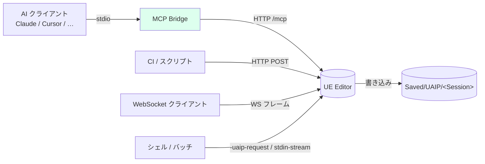
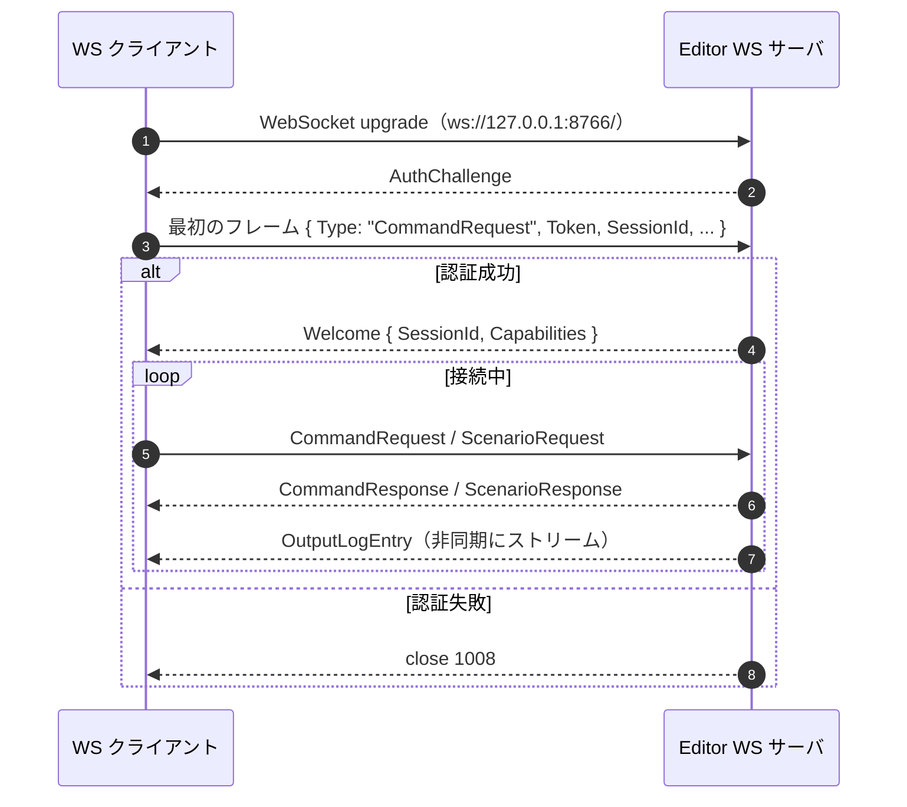
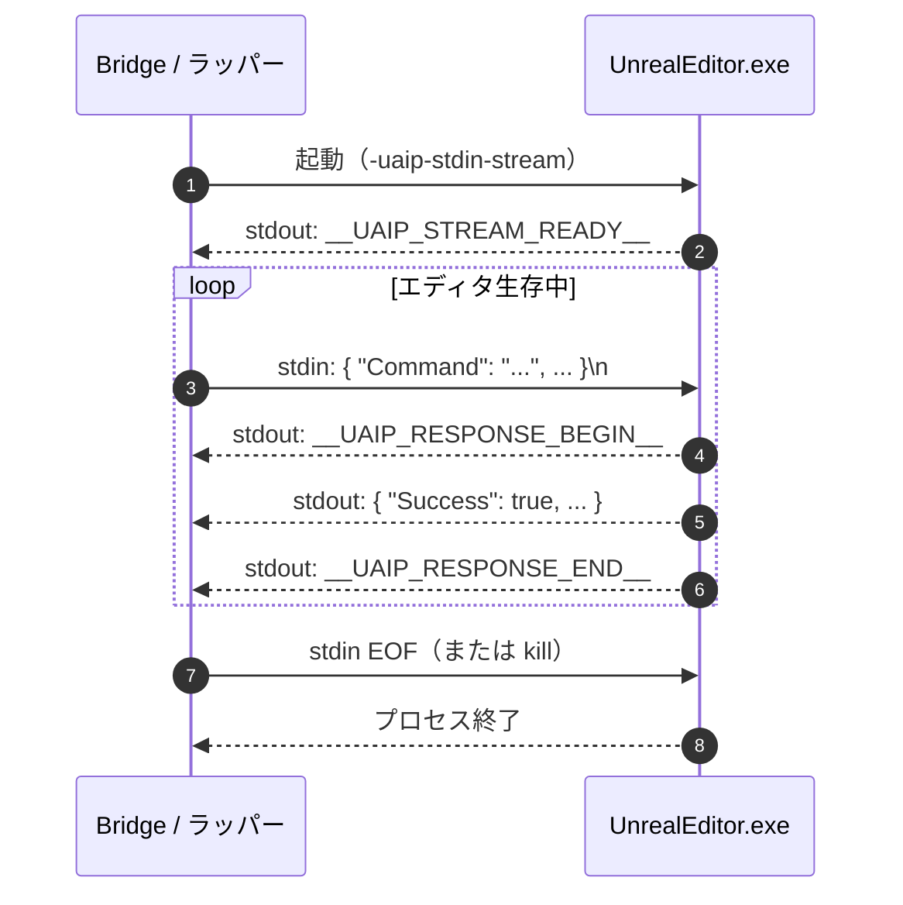

**[English](../en/connections.md)** | [概要に戻る](overview.md)

# 接続方法

UAIP には 4 つのトランスポートが用意されています。用途に合ったものを選んでください。

| トランスポート | ポート（Editor） | ポート（Packaged） | 主な用途 |
|---|---|---|---|
| **MCP Bridge** | — | — | AI クライアント（Claude Code・Cursor・Windsurf・Copilot など） |
| **HTTP API** | 8765 | 8767 | 独自ツール連携・REST クライアント・CI/CD パイプライン |
| **WebSocket** | 8766 | 8768 | リアルタイムストリーミングと永続接続 |
| **CLI** | — | — | 単発の自動化やシェルスクリプト |

> **デモ版の制限**：デモバイナリは **MCP トランスポートのみ** に対応しています。HTTP・WebSocket・CLI を使うには製品版が必要です。

> **Claude Code を使っていて MCP サーバーを立てたくない場合**: [Claude Code Plugin](claude-code-plugin.md) は、MCP を使わずに Claude Code から UAIP へ到達する別の方法です。少数の事前承認済みスクリプトを通じて、下記の HTTP API へ直接アクセスします。この後に続く MCP Bridge の節の代替であり、同じエディタセッションに対して両方を同時に使うものではありません。

---

## トランスポート比較



4 つのトランスポートはエディタ内の同じディスパッチコアに終端するので（[アーキテクチャ](architecture.md) を参照）、どれを使っても Capability と Policy の挙動は同じです。

---

## MCP Bridge

AI クライアントと連携するなら MCP Bridge がおすすめです。`thin_proxy.py` という Python プロキシが AI クライアントと UE Editor の間に立ち、MCP のツール呼び出しを内部で UAIP の HTTP リクエストに変換します。AI クライアント ↔ Bridge は MCP の stdio、Bridge ↔ UE Editor はループバック HTTP で通信します。

5 分で動かす最短ルートは [クイックスタート](quickstart.md) を参照してください。

> MCP Bridge は **プラグイン本体とは別配布** で、ドキュメントリポジトリの [Releases](../../../releases) から `UAIP-MCPBridge-<version>.zip` をダウンロードします（Fab のパッケージング規約によりプラグインには同梱しません）。UE バージョン非依存の単一 zip です。

> **UAIP 1.2.0 以降**: Bridge は、ロールトークンの資格情報をリクエストに付ける前に、[instance proof](security.md#instance-proof) 経由でエディタの身元を照合します。新規接続の最初のリクエスト、および再接続・再起動・config reload の後に毎回行われます。これ自体に追加の設定は不要ですが、`config.json` の `uproject_path`（元々どのモードでも無条件で必須。[設定](config.md#mcp-bridge-configjson) 参照）は、Bridge がこの照合用の起動ごとの秘密値ファイルを読む起点でもあります。`role_token` / `role_name` でロールを設定する場合、`uproject_path` は単に存在するだけでなく正しい値である必要があります。

### 前提条件

- UAIP プラグインがプロジェクトの `Plugins` 配下（またはエンジンの `Engine/Plugins` 配下）に配置されている。インストーラは `UnrealAIIntegrationPlatform.uplugin` というファイルで検出するため、それを含むフォルダの名前は問わない
- UE プロジェクトで **UnrealAIIntegrationPlatform** プラグインが有効になっている
- Python 3.10 以降がインストールされ `PATH` に通っている
- 対応 AI クライアントのいずれか（Claude Code・Codex CLI・Claude Desktop・Cursor・Windsurf・GitHub Copilot）

### ステップ 1 — Bridge zip をダウンロードして展開

ドキュメントリポジトリの [Releases](../../../releases) から `UAIP-MCPBridge-<version>.zip` をダウンロードし、任意の場所（例：`Downloads/UAIPMCPBridge/`）に展開してください。展開先は **インストーラの実行元** であり、最終的なデプロイ先ではありません。

> **zip はデプロイ先の外に展開してください。** `Downloads` などのフォルダを使い、プロジェクトやエンジンの `Plugins` フォルダには展開しません。zip のトップフォルダは `UAIPMCPBridge/` なので、`Plugins` に展開するとデプロイ先そのものに置くことになります。詳しくは下の「[デプロイ先の中でインストーラを実行したとき](#デプロイ先の中でインストーラを実行したとき)」を参照してください。

### ステップ 2 — インストーラを実行

展開したフォルダから `install/install.ps1`（Windows）または `install/install.cmd`（PowerShell 実行ポリシー制限時のラッパー）を実行：

```powershell
.\install\install.ps1
```

引数なしで起動すると **対話形式** になり、プロジェクトプラグインの隣に置くかエンジンプラグインの隣に置くかを尋ね、対応するパスを聞いてきます。

| 選択 | 入力 | デプロイ先 |
|---|---|---|
| `1` プロジェクトインストール | `.uproject` パス | `<Project>/Plugins/UAIPMCPBridge/` |
| `2` エンジンインストール | エンジンルート | `<Engine>/Engine/Plugins/.../UAIPMCPBridge/` |

引数で直接指定すれば対話なしで実行できます：

```powershell
.\install\install.ps1 -ProjectPath "F:\MyProjects\MyGame\MyGame.uproject"
.\install\install.ps1 -EnginePath  "F:\Epic Games\UE_5.8"
```

インストーラは `UnrealAIIntegrationPlatform.uplugin` を `<Project>/Plugins`（プロジェクトインストール）または `<Engine>/Engine/Plugins`（エンジンインストール）から探します。プラグインが別の場所にある場合（例：`AdditionalPluginDirectories` に挙げたディレクトリ配下）や、複数見つかった場合は、そのファイルを直接含むフォルダを指定してください。Bridge はそのフォルダの隣、`<folder>/../UAIPMCPBridge/` にデプロイされます：

```powershell
.\install\install.ps1 -UAIPPluginDir "F:\MyProjects\MyGame\Plugins\UnrealAIIntegrationPlatform"
```

macOS / Linux（および Git Bash）の `install.sh` では代わりに `--uaip-plugin-dir "<folder>"` を使います。

インストーラの動作：

| ステップ | アクション |
|---|---|
| 1 | UAIP プラグインを探索（`UnrealAIIntegrationPlatform.uplugin` で検出するのでフォルダ名は問わない。`-UAIPPluginDir` を渡したときはそのフォルダ）し、デプロイ先を解決 |
| 2 | Bridge ファイルを `<UAIP-parent>/UAIPMCPBridge/` にコピー |
| 3 | Python 3.10+ の存在を確認 |
| 4 | `<bridge-root>/.venv/` に Python 仮想環境を作成 |
| 5 | venv 内で `pip install -r requirements.txt` |
| 6 | デフォルトの `<bridge-root>/config.json` を生成 |
| 7 | 検出済みパスを埋めた MCP クライアント登録スニペットを表示 |

完了後、Bridge は `<UAIP-parent>/UAIPMCPBridge/`（`UnrealAIIntegrationPlatform/` と同階層）に配置され、venv Python は `<bridge-root>/.venv/Scripts/python.exe`（Windows）または `<bridge-root>/.venv/bin/python`（macOS / Linux）に作成されます。

インストーラが「The deployment was refused (exit N)」と表示してデプロイを拒否した場合、何も削除されていません。終了コードごとの対処は [トラブルシューティング](troubleshooting.md) を参照してください。

#### デプロイ先の中でインストーラを実行したとき

どこのインストーラを実行するかで、結果が更新になるか修復になるかが分かれます：

| 実行するもの | 結果 |
|---|---|
| **新しく展開した zip の、デプロイ先の外**にあるインストーラ | デプロイ、つまり**更新**。Bridge のファイルがその zip のものに置き換わる |
| すでに**デプロイ済み**の `<bridge-root>/install/` にあるインストーラ（1.3.0 以降） | **修復**。「Repair mode: ...」と表示し、デプロイ済みのファイルは残して `.venv/` と `config.json` だけを作り直す（既存の設定は残る）。Bridge は更新されない |
| `Plugins` の中に展開した zip のインストーラで、パッケージとデプロイ先が互いを含んでいる場合 | 拒否される（終了コード 15）。zip をデプロイ先の外に展開し直し、そこから実行する |

新しいリリースに移るときは、必ず新しい zip をデプロイ先の外に展開し、そのインストーラを実行してください。デプロイ済みの Bridge の上に新しい zip を展開しないでください。古いリリースのファイルが残り、venv も作り直されません。

> **1.2.0 のインストーラの注意**：この保護がありません。デプロイ先の中から実行すると自分自身のファイルを削除します。1.2.0 のインストーラは必ず外から実行してください。

> **既存インストールを手動で更新する場合の注意**：ステップ 6（新しく追加された `config.json` キーの補完と、旧インストーラが残した値の新既定値への移行）はインストーラスクリプト経由でのみ実行されます。`install.ps1` / `install.sh` を再実行せず、新しいファイルを既存のデプロイ先へ手動でコピーして更新した場合、`config.json` はそのまま手つかずになります — 新規キーは追加されず、移行も走りません。`config.json` を最新の状態にするには、新しいリリースの zip をデプロイ先の外に展開してそのインストーラを実行する（上の「[ステップ 2](#ステップ-2--インストーラを実行)」を参照）か、`config.json.example` と手動で見比べてください。Bridge の中にデプロイ済みのインストーラを再実行するのは更新ではなく修復です。デプロイ済みのファイルと `config.json` の設定は残ります。

### ステップ 3 — MCP サーバーキーを決定

サーバーキーは AI クライアント設定内で本 Bridge インスタンスを識別するための名前です。インストーラが既定値を選んで表示するので、別の値が必要な場合のみ参照してください。

| プラグイン配置 | キー形式 | 例 |
|---|---|---|
| プロジェクトプラグイン（Bridge が `<Project>/Plugins/` 配下） | `uaip-<プロジェクト名>` | `uaip-MyGame` |
| エンジンプラグイン（Bridge が `<Engine>/Engine/Plugins/` 配下） | `uaip-<エンジンフォルダ名>` | `uaip-UE_5.8` |

AI クライアント上での表示にしか影響しないので、ユニークなら任意の名前で構いません。

### ステップ 4 — AI クライアントに MCP サーバーを登録

インストーラが venv Python のパスと自動検出した `UAIP_UE_EDITOR_PATH` / `UAIP_UPROJECT_PATH` を含む JSON スニペットを表示します。それをそのままクライアントの設定ファイルに貼り付けてください。

```json
{
  "mcpServers": {
    "<key>": {
      "command": "<bridge-root>/.venv/Scripts/python.exe",
      "args":    ["<bridge-root>/thin_proxy.py"],
      "env": {
        "UAIP_UE_EDITOR_PATH": "<UnrealEditor.exe の絶対パス>",
        "UAIP_UPROJECT_PATH":  "<your.uproject の絶対パス>"
      }
    }
  }
}
```

> インストーラは venv の Python を `command` に指定するため、MCP クライアント側に system-wide Python が `PATH` に通っている必要はありません。

使用するクライアントを選び、対応ページで設定ファイルの場所とクライアント固有の流儀を確認してください：

| クライアント | ページ | 備考 |
|---|---|---|
| **Claude Code**（CLI / VS Code 拡張） | [claude-code.md](clients/claude-code.md) | 最良サポート。プロジェクト毎の `.mcp.json` またはグローバル `~/.claude.json` |
| **Codex CLI** | [codex.md](clients/codex.md) | OpenAI の公式 CLI。`~/.codex/config.toml`（TOML 形式） |
| **Claude Desktop** | [claude-desktop.md](clients/claude-desktop.md) | `claude_desktop_config.json` |
| **Cursor** | [cursor.md](clients/cursor.md) | `~/.cursor/mcp.json` または `.cursor/mcp.json` |
| **Windsurf** | [windsurf.md](clients/windsurf.md) | `~/.codeium/windsurf/mcp_config.json` |
| **GitHub Copilot（VS Code）** | [copilot.md](clients/copilot.md) | `.vscode/mcp.json` |

各クライアント別ページには、設定 JSON のサンプル、AI 利用ガイド（`<bridge-root>/install/guides/`）の配置方法、動作確認の手順（「AI に HealthCheck を実行させる」）がそろっています。

インストーラとパスの詳細リファレンス：Bridge と一緒にデプロイされる `<bridge-root>/install/SETUP.md`。

### シナリオ実行を有効化（オプション）

`uaip_run_scenario` はデフォルトでは無効です。有効化するには `<bridge-root>/config.json` の `enable_scenario` を `true` にしてください：

```json
{
  "editor_path":                  "",
  "uproject_path":                "",
  "http_startup_timeout_seconds": 120,
  "command_timeout_seconds":      180,
  "log_level":                    "INFO",
  "enable_scenario":              true,
  "inline_artifacts": { "image": false, "json": false, "text": false }
}
```

`config.json` の `editor_path` / `uproject_path` はフォールバック値で、MCP クライアントの `env`（`UAIP_UE_EDITOR_PATH` / `UAIP_UPROJECT_PATH`）が優先されます。シナリオで何ができるかは [シナリオ実行](scenario.md)、`config.json` の全キーは [設定リファレンス](config.md#mcp-bridge-configjson) を参照。

### ゲストモード接続

ゲストモードは、Bridge が自分でエディタを起動する代わりに、人間が既に開いているエディタへアタッチできるようにする仕組みです。エディタ内蔵の Terminal パネルから AI CLI を起動し、その AI にホスト側のエディタそのものを操作させるワークフローの土台になります。

**ゲストモードで変わること:**

- Bridge は `launch_editor()` を一切呼びません — 最初のツール呼び出しでも、クラッシュからの自動復旧でも、`uaip_reload_config` の副作用としても起動しません。応答するエディタが見つからない場合は、起動する代わりに状況を報告します。
- `config.json` の `editor_path` が不要になります — 詳細は [設定リファレンス → MCP Bridge config.json](config.md#mcp-bridge-configjson) を参照。
- ポート解決は、まずエディタが書き出す[接続情報の記述子ファイル](config.md#接続情報の記述子ファイル)を試し、駄目なら `http_port` へフォールバックします。

**設定手順:**

1. `Config/DefaultUAIP.ini` で `[UAIP.Transport].AutoStartMCP=True` を有効にする（[設定リファレンス](config.md#uaiptransport--通常起動のエディタで-mcp-transport-を自動起動する) を参照）。共有 ini を変更したくない場合は、`-uaip-mcp-enable` フラグを明示してエディタを起動してもかまいません。
2. エディタを通常どおり起動する — Epic Games Launcher・`.uproject` のダブルクリック・IDE のデバッグ実行など。`AutoStartMCP` を有効にしていれば特別なフラグは不要です。
3. ゲスト側 Bridge の `config.json` で `attach_only: true` を設定する（または環境変数 `UAIP_ATTACH_ONLY=1`）。`uproject_path` は引き続き同じプロジェクトを指す必要がありますが、`editor_path` は空のままでかまいません。
4. AI クライアントをいつもどおりその Bridge へ向ける。最初の `uaip_execute` 呼び出しでポートが解決され、`HealthCheck` でプロジェクトの同一性が検証されてからアタッチします — 新しいエディタプロセスは起動しません。

> **推奨**: `[UAIP.Roles]` を未定義のままにせず、ゲスト側 Bridge には制限付きの[役割](safety.md#役割layer-15)を割り当ててください。役割を設定していない場合、ゲスト接続は一次接続と同じことを何でも実行できます。詳細は [Security → 運用上のセキュリティ注意点](security.md#運用上のセキュリティ注意点) を参照。

アタッチ先のエディタが応答しなくなっても、ゲストモードは代わりのエディタを起動しません。これは、たまたま他人のエディタへ `ATTACHED` になっている通常（非ゲスト）の Bridge でも同じです。どちらも、黙って 2 つ目のエディタを起動する代わりに `RecommendedAction`（下記「[エディタ状態の確認](#エディタ状態の確認uaip_get_editor_status)」を参照）を通じて状況を報告します。

### エディタ状態の確認（`uaip_get_editor_status`）

`uaip_get_editor_status` は、**自動起動を一切トリガーせず**、Bridge から見た現在のエディタ接続状態を返します。通常の `uaip_execute` 呼び出しと異なり、エディタの起動やアタッチは行わず、観測のみを行います。

```
uaip_get_editor_status()
→ {
    "IsConnected":      false,
    "IsPortListening":  true,
    "State":            "UNRESPONSIVE",
    "Ownership":        "ATTACHED",
    "IsAttachOnly":     false,
    "RecommendedAction": "WAIT: the editor port is open but the game thread is not responding. Do not restart or kill the process; a long-running command is likely in progress."
  }
```

| フィールド | 意味 |
|---|---|
| `IsConnected` | 呼び出し時点で実行される**実測の HTTP ヘルス ping** — キャッシュ値ではない |
| `IsPortListening` | 呼び出し時点で実行される**実測の TCP connect チェック** — キャッシュ値ではない |
| `State` | Bridge のライフサイクル状態機械を表す診断用ラベル（`STOPPED` / `STARTING` / `RUNNING` / `UNRESPONSIVE` / `PORT_OCCUPIED` / `CRASHED` / `RESTARTING`） |
| `Ownership` | この Bridge がエディタを自分で起動したか（`OWNED`）、自分では起動していないエディタへアタッチしたか（`ATTACHED`）、まだどちらも行っていないか（`NONE`）。あくまで呼び出し時点の観測値であり履歴ではない。詳細は [ゲストモード接続](#ゲストモード接続) を参照 |
| `IsAttachOnly` | この Bridge がゲストモード（`config.json` の `attach_only`）で設定されているか |
| `RecommendedAction` | 呼び出し側が実際に取るべき行動 |
| `Lock` | このプロジェクトのディスク上の `mcp_proxy.lock` ファイルの診断スナップショット。詳細は下記「[ロック診断](#ロック診断)」を参照 |
| `Config` | Bridge の現在の設定を生み出した `config.json` 読み込みの診断スナップショット。詳細は下記「[Config 診断](#config-診断)」を参照 |

ゲストモードの Bridge、および他人のエディタへたまたま `ATTACHED` になっている通常の Bridge では、`RecommendedAction` が自動起動を約束することは決してありません。オーナーモードの Bridge なら `RETRY: ... The next tool call launches a fresh one automatically` と返す場面でも、これらはそのエディタが応答しなくなった時点で代わりに `CHECK CONFIGURATION: ...` を返します — 代わりのエディタを起動することこそが、してはならない動作だからです。

このツールは**呼び出しごとに**トランスポートをプローブするため、`IsConnected` と `IsPortListening` はどちらも都度の実測値であり、陳腐化しうるバックグラウンドポーリングの値を読んでいるわけではありません。

> **重要 — 判定には `State` ではなく `RecommendedAction` を使ってください。** `State` はログを読む人間向けの診断用文字列であり、将来のリリースで値が追加される可能性があります（それは破壊的変更として扱いません）。安定した機械可読の契約は `RecommendedAction` の方です。先頭は必ず `WAIT:` / `PROCEED:` / `RETRY:` / `CHECK CONFIGURATION:` / `CHECK TRANSPORT SETTINGS:` のいずれかで始まり、呼び出し側は `State` の値集合で分岐するのではなくこの先頭の動詞で分岐してください。

`State` が `UNRESPONSIVE` で `RecommendedAction` が `WAIT:` から始まっている場合は、**エディタを再起動したりプロセスを終了したりしないでください。** ポートは開いていますがゲームスレッドがビジー状態にあるだけで、多くの場合は長時間コマンド（下記「[長時間コマンドと 120 秒の非同期タイムアウト](#長時間コマンドと-120-秒の非同期タイムアウト)」を参照）がまだ実行中です。待ってから再度 `uaip_get_editor_status` で確認してください。

このツールは PID を一切返しません — PID を返すと、それを終了させたくなる誘惑を生むため、`UNRESPONSIVE` の扱いとして避けるべきものです。

#### ロック診断

`Data.Lock` は、このプロジェクトの `mcp_proxy.lock` ファイルについて Bridge が現在把握している内容を報告します。`State` / `Ownership` とは独立した情報です：

```json
"Lock": {
  "Present": true,
  "HeldByThisBridge": false,
  "RecordedPort": 8765,
  "RecordedProject": "F:/Projects/MyProject/MyProject.uproject",
  "RecordedAt": "2026-09-02T10:15:00Z",
  "RecordedPortListening": true
}
```

| フィールド | 意味 |
|---|---|
| `Present` | ロックファイルがディスク上に存在するか。**存在すること自体は、現在誰かが保持していることを意味しません** — Bridge が終了する（正常終了・強制終了のどちらでも）とロックは解放されますが、ファイル自体が残ることはあり、次に起動する Bridge がそのまま上書きして取得します。 |
| `HeldByThisBridge` | 現在このロックを保持しているのが、このブリッジプロセス自身かどうか。 |
| `RecordedPort` | ロックファイルに記録されている HTTP ポート。ファイルが存在しない、または解釈できない場合は `null`。 |
| `RecordedProject` | ロックファイルに記録されている `.uproject` パス。取得できない場合は `null`。 |
| `RecordedAt` | ロックファイルが書き込まれた時刻。取得できない場合は `null`。表示専用であり、ロックが古いかどうかの判定には使わないでください。 |
| `RecordedPortListening` | `RecordedPort` に現在何かが listening しているか。判定できない場合は `null` になります： `RecordedPort` がこのブリッジ自身の設定ポートと一致しない場合（診断プローブは自分自身のポートしか観測できず、任意の別ポートは観測できません）、または `RecordedPort` 自体をロックファイルから読み取れなかった場合のいずれかです。 |

`RecommendedAction` と併せて読んでください。別の Bridge が本当にロックを保持している場合、`RecommendedAction` はそのセッションの切断・停止を指します — ロックファイルの削除を指すことは決してありません。`Present` が `true` で `HeldByThisBridge` が `false`、かつ `RecordedPortListening` が `false` の組み合わせは、多くの場合ファイルが単に残っているだけで、次の起動がそのまま問題なく引き継ぐことを意味します。

主な用途:

- `UAIP.Editor.Workspace.ShutdownEditor` や `UAIP.Editor.Workspace.RestartEditor` のようなライフサイクルコマンドを発行する前に、実際にそれが意味を持つ状態かを確認する。
- コマンド呼び出しが `Timeout` エラーを返した後、再実行するかどうかを判断する前にエディタがまだ処理中かを確認する。

#### Config 診断

`Data.Config` は、Bridge の現在の設定を生み出した読み込み — プロセス起動時の読み込み、または直近の `uaip_reload_config` 呼び出しのどちらか新しい方 — で `config.json` から実際に読み取った内容を報告します：

```json
"Config": {
  "Path": "F:/Projects/MyProject/Plugins/UAIPMCPBridge/config.json",
  "Status": "Loaded",
  "KeyCount": 7,
  "Keys": ["editor_path", "uproject_path", "http_port", "command_timeout_seconds", "log_level", "enable_scenario", "inline_artifacts"],
  "LastReloadError": "",
  "LastReloadApplyFailure": "",
  "EditorExtraArgs": []
}
```

| フィールド | 意味 |
|---|---|
| `Path` | Bridge が読み取りを試みた `config.json` のパス。 |
| `Status` | ファイルが存在し解析できた場合は `"Loaded"`、そのパスに存在しなかった場合は `"Absent"`（この場合 Bridge は既定値と環境変数のみで動作する）。ここに `"Unreadable"` は存在しない — ファイルが存在するが解析できない場合、Bridge はそもそも起動を拒否する（下記「[MCP セットアップのトラブルシューティング](#mcp-セットアップのトラブルシューティング)」を参照）ため、その状態が稼働中のセッションに報告として届くことはない。 |
| `KeyCount` | `config.json` に実際に含まれていたトップレベルキーの数。 |
| `Keys` | それらキーの**名前のみ** — 値は一切含まれない。この項目は診断用のサーフェスであり、稼働中の Bridge から `role_token` のようなシークレットを読み出す手段ではない。 |
| `LastReloadError` | 直近の `uaip_reload_config` 呼び出し（あれば）が成功した場合、またはまだ一度も呼ばれていない場合は空文字列。直近のリロード試行が `config.json` の解析に失敗した場合は非空になり、メッセージにファイルと理由が記される — このとき Bridge は既に持っていた設定のまま動作を続ける（リロード失敗が現在のセッションを止めることはない）。上記「[MCP クライアントを再起動せずに config をリロード](#mcp-クライアントを再起動せずに-config-をリロード)」を参照。 |
| `LastReloadApplyFailure` | 新しい設定を反映する途中で `uaip_reload_config` が失敗した場合（例：ブリッジを構成するファイルの編集中で、読み直せなかった）だけ非空になります。メッセージに原因が記され、ブリッジは古い設定・新しい設定・混ざったもののどれで動いているか分かりません。原因を直してから MCP を再接続（`/mcp`）してください。次にリロードが成功すると空に戻ります。設定がまったく適用されなかったことを表す `LastReloadError` とは別の項目です。反映の途中で失敗したリロードは設定の検証を通っているので、`LastReloadError` を空にします。両方が非空になるのは、その後のリロードが拒否された場合だけです。 |
| `EditorExtraArgs` | Bridge が次にエディタを起動するときに追加するコマンドライン引数。無ければ空配列。`Keys` と違いこれは値そのもので、`config.json` からは読まれず、環境変数 `UAIP_EDITOR_EXTRA_ARGS` か `uaip_reload_config(EditorExtraArgs=[...])` の呼び出しだけが設定する。置き換えるまで有効なまま残り、クラッシュ後の再起動にも引き継がれるため、エディタが普段どおりのコマンドラインで動いていると決めつける前にここを確認する。「[設定 → 実行時の config リロード](config.md#実行時の-config-リロードuaip_reload_config)」を参照。 |

上記の `RecommendedAction` にも、`Config` に報告すべき事項がある場合 — `Status` が `"Absent"` か、`LastReloadError` が非空、または `LastReloadApplyFailure` が非空 — は追加の一文が付与されます。`RecommendedAction` しか読まない呼び出し側でも、毎回 `Data.Config` を読まなくてもこの事実に気づける仕組みです。`LastReloadApplyFailure` と `LastReloadError` が両方とも非空のときは、反映の失敗を先にして両方の一文が付きます。設定ファイルが壊れたまま再接続すると Bridge が起動できないので、再接続の前に `config.json` を直してください。

### 長時間コマンドと 120 秒の非同期タイムアウト

HTTP トランスポートは、Bridge の `command_timeout_seconds` 設定とは独立して、それ自身の非同期コマンドタイムアウト（**120 秒**）を持っています（[設定リファレンス → タイムアウトの不変条件](config.md#タイムアウトの不変条件) を参照）。ゲームスレッドをそれより長く占有するコマンド — 現時点では `UAIP.Editor.MetaHuman.BuildMetaHuman` が代表例 — は、処理自体は正当に継続中であっても、これを超過することがあります。

**UAIP 1.2.0 以降**、`uaip_execute` は任意の引数 `TimeoutSeconds` を受け付けます — `CommandName` や `Params` と同じ階層に置く 1〜1800 の JSON 数値（`Params` の中ではありません）で、この呼び出しに限り 120 秒の待ちを上書きします。省略すれば既定の 120 秒のままです。範囲外の値・型違いはコマンドの実行前に拒否され、その JSON-RPC の invalid-params エラーのメッセージには「execution timeout」という文言が含まれません — そのため、この拒否と、下記の「コマンドがまだ実行中かもしれない」ケースを取り違えることはありません。Bridge は自分自身の読み取りタイムアウトと、健全性ポーリングを抑止する時間の両方を、要求された待ち時間に合わせて自動的に延長します。これにより、既定より正当に長くかかる呼び出しが Bridge 側で打ち切られることも、その呼び出しにまだ応答しているだけのビジーなエディタを途中で無応答と誤判定することもありません。詳細は [API リファレンス → リクエスト形式](api.md#2-リクエスト形式)（§2.4）を参照してください。

120 秒の窓（`TimeoutSeconds` を指定した場合はその窓）を超えた場合:

1. 呼び出しは `Timeout` を返しますが、**コマンドはエディタ側で実行を継続している可能性があります**。
2. 同じコマンドをすぐに再実行しないでください — 同じ対象に対する 2 度目の同時実行を整合させる設計にはなっていません。
3. `uaip_get_editor_status` を呼んで `RecommendedAction` に従ってください。コマンドがまだ実行中の間は `State: "UNRESPONSIVE"` と `WAIT:` で始まる `RecommendedAction` が返ることが想定されます。
4. エディタが再び応答するようになった時点で、コマンドが artifact を生成するものであれば、そこで初めて artifact が現れる場合があります。`Timeout` が返ったからといって何も起きていないと決めつけず、確認してください。

### 応答待ちの間に送られる進捗通知

AI クライアントが `uaip_execute` の呼び出しに MCP の進捗トークン（`_meta.progressToken`）を添えると、Bridge はその呼び出しが返るまでおよそ 5 秒おきに `notifications/progress` を送出します。内容は Bridge がエディタの外側から観測できる情報だけです：

- その呼び出しが何秒応答待ちになっているか
- エディタの状態を `STARTING` / `RUNNING` / `UNRESPONSIVE` の 3 値に畳んだもの（1 つの呼び出しを待つ間に必要なのはこの区別だけです）

ここから 3 点が導かれます：

- **エディタ内部の情報は一切含まれません。** 監査が何件目を走査しているか、いまどのレポートを処理しているか、トレース解析がどこまで進んだか — いずれも通知には載りません。それを知るには、その情報を持つコマンドを呼びます（監査ジョブなら `UAIP.Editor.Assets.GetAssetAuditStatus`、トレース解析なら `UAIP.Runtime.Insights.Analysis.GetTraceAnalysisStatus`）。
- **対象は `uaip_execute` のみで、要求された場合にのみ送られます。** `uaip_run_scenario` は対象外です（独自の実行時間上限とステップ構造を持ち、経過秒数のカウンタ 1 本では説明できないため）。進捗トークンが無ければ何も送られません。
- **その通知が表示されるかどうかはクライアント側の判断です。** Bridge は送出しますが、描画するかは MCP クライアントの実装次第で、`notifications/progress` を扱わないクライアントでは応答待ちの間に何も表示されません。本ドキュメント執筆時点の Claude Code がその一例で、応答待ちの表示は通常のスピナーのみ、経過秒数もエディタ状態も表示されません。これは Bridge の送出が失敗している兆候ではありません。

クライアントが表示しない場合でも、「エディタは動いているのか」という同じ問いには `uaip_get_editor_status` が必要なときに答えられます — 上の [エディタ状態の確認](#エディタ状態の確認uaip_get_editor_status) を参照してください。

### MCP クライアントを再起動せずに config をリロード

`config.json` を編集した後、AI から `uaip_reload_config` を呼び出すことで変更を即時反映できます。Bridge がファイルを読み直し、起動パラメータが変わっていればエディタをシャットダウンして次回コマンド時に再起動します：

```
uaip_reload_config()
```

`config.json` を編集せずに現セッション限りでエンジンバージョンやプロジェクトを切り替えるには：

```
uaip_reload_config(EditorPath="F:\\Epic Games\\UE_5.9\\Engine\\Binaries\\Win64\\UnrealEditor.exe")
```

詳細は [設定リファレンス → 実行時の config リロード](config.md#実行時の-config-リロードuaip_reload_config) を参照。

リロードがどのエディタを止めてよいかは、そのエディタを誰が起動したかで決まります。Bridge が止めるのは、自分で起動したエディタ（`uaip_get_editor_status` の `Ownership` が `OWNED`）だけです。`RestartEditor` の後や、MCP 再接続で既に動いているエディタにつないだ後のエディタは `ATTACHED` で、Bridge が起動したものではなく、確実には止められません。そのため、エディタのパス・uproject のパス・HTTP ポート・`enable_scenario`・`launch_attended` を変えるリロードは何も変えずに拒否され、応答に手順が書かれます（AI 側の操作でエディタを起動したと分かっている場合だけ `ShutdownEditor` を送る。そうでなければ持ち主に閉じてもらうか、変更を見送る）。その間も接続は使えます。新しいエディタが要らない設定は、従来どおり反映されます。[設定 → 実行時の config リロード](config.md#リロードがエディタを止めることになる場合) を参照。

### MCP セットアップのトラブルシューティング

| 症状 | 原因 | 対処 |
|---|---|---|
| `install.ps1` が実行ポリシーでブロック | PowerShell 実行ポリシー | `install.cmd` を使うか、`Set-ExecutionPolicy -Scope CurrentUser RemoteSigned` を実行して再試行 |
| インストーラが UAIP プラグインを見つけられない、または複数見つける | `.uproject` / エンジンパスが誤り、プラグインが `Plugins` の外にある、コピーが複数ある | 正しい `-ProjectPath` / `-EnginePath` を指定して再実行するか、`UnrealAIIntegrationPlatform.uplugin` を含むフォルダを `-UAIPPluginDir` で指定。拒否ごとの対処は [トラブルシューティング](troubleshooting.md) にあります |
| AI クライアントでツールが見つからない | MCP サーバ未接続 | スニペット内のキーと `thin_proxy.py` のパスを確認し、クライアントを再起動 |
| 初回コマンドで 120 秒タイムアウト | エディタ起動失敗 | MCP `env` の `UAIP_UE_EDITOR_PATH` / `UAIP_UPROJECT_PATH` を確認 |
| Python 起動エラー | venv 内の依存不足 | Bridge の中にデプロイ済みのインストーラ（`<bridge-root>/install/install.ps1`）を実行する。これは修復（1.3.0 以降）で、venv を作り直し、`config.json` の設定は残す。Bridge は更新されない |
| `PolicyViolation` が返る | Capability 未付与 / SafetyPolicy フラグ OFF | [Safety & Capabilities](safety.md) を参照 |
| `CommandNotFound` | コマンド名の間違い | `uaip_list_commands(ProviderPrefix="UAIP.Core")` で確認 |
| Bridge がそもそも起動しない（ツールが一つも使えるようにならない） | `config.json` は存在するが解析できない（JSON が壊れている・エンコーディングが不正・1 MiB のサイズ上限超過）— 誰も選んでいない既定値へ黙ってフォールバックする代わりに、Bridge は起動そのものを拒否し、どの MCP ツール呼び出しも可能になる前に終了する | AI のコンテキストではなく **MCP クライアントのサーバーログ** を確認する — Bridge は正確なパスと理由を stderr に出力して終了コード 2 で終了する。ツール呼び出しに一度も応答しないため `uaip_get_editor_status` でこれを読み取ることはできない |

より広範な診断は [トラブルシューティング](troubleshooting.md) を参照してください。

---

## HTTP API（製品版）

HTTP API は REST インターフェースを公開します。AI クライアントを介さない独自スクリプト・CI/CD・独自ツール連携に向いています。FullHTTP モードでも socket 層はループバック（`127.0.0.1`）にバインドされ、別 PC から到達するにはエンジン設定層での bind アドレス上書きを運用者が明示的に行う必要があります（UAIP 側にはそのための設定項目はありません）。詳細は [セキュリティ → ネットワーク面](security.md#ネットワーク面) を参照。

### 有効化

エディタを `-uaip-http-enable` フラグ付きで起動します：

```
UnrealEditor.exe MyProject.uproject -uaip-http-enable
```

ポートを変更する場合（デフォルト：Editor `8765`・Packaged `8767`）：

```
UnrealEditor.exe MyProject.uproject -uaip-http-enable -uaip-http-port=9000
```

### 認証

起動時に UAIP がランダムな 32 文字の Bearer トークンを以下に書き込みます：

```
Saved/UAIP/EditorHttpAuthToken.txt
```

すべてのリクエストにこのトークンを含めてください：

```http
Authorization: Bearer <token>
```

開発環境・CI 環境で認証を無効にする場合（本番環境では使用しないこと）：

```
-uaip-http-no-auth
```

**UAIP 1.2.0 以降**、きちんとした振る舞いのクライアントは、このトークンをリクエストに付ける**前に**、新設の未認証ルート `GET /uaip/instance-proof`（下表参照）で、自分が本当にこのプロジェクトのエディタと話しているか（再起動後に同じポートに居座った別プロジェクトのエディタや無関係なプログラムではないか）を確かめます。MCP Bridge・[Claude Code Plugin](claude-code-plugin.md) はどちらもこれを自動で行います。プロトコルの詳細は [セキュリティ → Instance proof](security.md#instance-proof) を参照してください。

### エンドポイント

| メソッド | パス | 説明 |
|---|---|---|
| GET | `/uaip/health` | ヘルスチェック — `{"status":"ok"}` を返す |
| GET | `/uaip/instance-proof?challenge=<64桁の小文字16進>` | 資格情報を送る**前に**、このポートがこのプロジェクトのエディタかを確認する — 認証不要。[セキュリティ → Instance proof](security.md#instance-proof) 参照 |
| GET | `/uaip/capabilities` | 現在のセッションで利用可能な Capability 一覧 |
| POST | `/uaip/sessions` | セッション作成 — `{"SessionId":"..."}` を返す |
| DELETE | `/uaip/sessions/:sessionId` | セッション終了 |
| POST | `/uaip/commands` | コマンド実行 |
| POST | `/uaip/scenarios` | シナリオ実行（完了まで待機） |
| GET | `/uaip/artifacts/:artifactId` | Artifact のダウンロード |
| GET | `/uaip/sessions/:sessionId/artifacts` | セッションの Artifact 一覧 |

### コマンド実行例

```http
POST /uaip/commands
Content-Type: application/json
Authorization: Bearer <token>

{
  "Command": "UAIP.Core.HealthCheck",
  "Params": {},
  "SessionId": "my-session",
  "TimeoutSeconds": 300
}
```

`TimeoutSeconds` は任意のトップレベルフィールド（`Params` の中ではない）です。1〜1800 の JSON 数値を指定すると、このリクエストに限り下記の既定 120 秒を上書きします。長時間かかる Automation Test の実行など、コマンドがまだ正当に処理を続けているのに打ち切られてしまう事態を避けられます。省略すれば既定の 120 秒のままです。範囲外の値・型違い・数値の文字列（`"300"` のような）を指定すると、コマンドの実行前に HTTP 400・`ErrorCode: "InvalidParams"` で拒否されます。全フィールドの一覧は [API リファレンス → リクエスト形式](api.md#2-リクエスト形式)（§2.1）を参照してください。

レスポンス：

```json
{
  "Success": true,
  "Result": { ... },
  "Artifacts": [...],
  "ErrorCode": "Success",
  "ErrorMessage": ""
}
```

### 制限値

| 項目 | 上限 |
|---|---|
| 最大リクエストボディ | 64 KiB |
| 最大 Artifact レスポンス | 100 MiB |
| 最大同時コマンド数 | 1（既定。ini で受動的待機コマンドを除外可能 — HTTP / MCP のみ。[設定リファレンス → `[UAIP.Transport]` 受動的待機の同時実行](config.md#uaiptransport--受動的待機の同時実行既定オフ) 参照） |
| コマンドタイムアウト | 120 秒（既定。任意のトップレベルフィールド `TimeoutSeconds`（1〜1800 秒）でリクエストごとに上書き可 — 上記 [コマンド実行例](#コマンド実行例) 参照） |

---

## WebSocket（製品版）

WebSocket トランスポートはリアルタイムログストリーミングに対応した永続的な双方向接続を提供します。

### 有効化

```
UnrealEditor.exe MyProject.uproject -uaip-ws-enable
```

ポートを変更する場合（デフォルト：Editor `8766`・Packaged `8768`）：

```
UnrealEditor.exe MyProject.uproject -uaip-ws-enable -uaip-ws-port=9001
```

### 接続 URL

```
ws://127.0.0.1:8766/
```

接続はローカルホスト（`127.0.0.1` および `::1`）に限定されます。

### 認証

起動時に UAIP がトークンを以下に書き込みます：

```
Saved/UAIP/EditorWsAuthToken.txt
```

最初のリクエストフレームにトークンを含めてください：

```json
{
  "Type": "CommandRequest",
  "ClientProtocolVersion": "1.0",
  "Token": "<token>",
  "RequestId": "req-001",
  "SessionId": "my-session",
  "Command": "UAIP.Core.HealthCheck",
  "Params": {}
}
```

認証を無効にする場合（開発・CI 環境のみ）：

```
-uaip-ws-no-auth
```

### ハンドシェイクとメッセージフロー



### メッセージタイプ

**Inbound（クライアント → サーバー）：**

| `Type` | 用途 |
|---|---|
| `CommandRequest` | コマンド実行 |
| `ScenarioRequest` | シナリオ実行 |

**Outbound（サーバー → クライアント）：**

| `Event` | 用途 |
|---|---|
| `AuthChallenge` | 認証要求 |
| `Welcome` | 接続確立 — `SessionId` と `Capabilities` を含む |
| `CommandResponse` | コマンド結果 |
| `ScenarioResponse` | シナリオ結果 |
| `OutputLogEntry` | ストリーミングログ行（リアルタイム） |

### 出力ログのストリーミング

サーバーは UE の全ログ出力をリアルタイムで `OutputLogEntry` イベントとして送信します。無効にする場合：

```
-uaip-ws-no-output-log
```

### 制限値

| 項目 | 上限 |
|---|---|
| 最大受信メッセージサイズ | 64 KiB |
| 最大シナリオペイロード | 1 MiB |
| 最大同時接続数 | 4 |
| ハンドシェイクタイムアウト | 5 秒 |
| コマンドタイムアウト | 12 秒 |

---

## CLI（製品版）

CLI トランスポートはエディタを特定の引数付きで起動することでコマンドを実行します。永続サーバーを必要としない単発自動化やシェルスクリプト・CI パイプラインに適しています。

### 単発実行（One-shot）

コマンドを実行し、結果を出力してエディタが終了します。

**インライン JSON：**

```
UnrealEditor.exe MyProject.uproject -uaip-request="{\"Command\":\"UAIP.Core.HealthCheck\",\"Params\":{}}"
```

**JSON ファイルから：**

```
UnrealEditor.exe MyProject.uproject -uaip-request-file="Saved/UAIP/Requests/cmd.json"
```

**結果をファイルに書き出す：**

```
UnrealEditor.exe MyProject.uproject -uaip-request-file="..." -uaip-response-file="Saved/UAIP/Responses/result.json"
```

**シナリオをファイルから実行：**

```
UnrealEditor.exe MyProject.uproject -uaip-scenario-file="Saved/UAIP/Requests/scenario.json"
```

リクエストファイルとシナリオファイルは `Saved/UAIP/Requests/` の下からしか読み込めず、レスポンスファイルは `Saved/UAIP/Responses/` の下にしか書き出せません。パスはプロジェクトのルートからの相対パスでも絶対パスでもかまいませんが、いずれもそのディレクトリの下にある必要があります。コマンド名のキーは `Command` です（MCP ツールの引数名 `CommandName` はここでは受け付けません）。

**大きなリクエスト。** コマンドライン全体にはオペレーティングシステムの上限（16,383 文字）があるため、`-uaip-request=` や `-uaip-scenario=` でインライン渡しするリクエストはその範囲に収める必要があります。大きなリクエストは `-uaip-request-file=` や `-uaip-scenario-file=` でファイルとして渡してください。リクエストの大きさにはすべての経路（インライン・ファイル・stdin・ストリーム）で上限があり、1 MiB（1,048,576 バイト）です。数えるのは文字数ではなく UTF-8 のバイト数です。日本語などの非 ASCII 文字は 1 文字が 3 バイトになるため、文字数から想像するより早く上限に達します。

CLI は、何も実行する前にリクエストを拒否した場合、失敗レスポンスを返して終了コード 2 で終了します。`ErrorCode` は誤りの種類を表します。`InvalidParams` はリクエストの誤り（レスポンスファイルのパスを含む許可ディレクトリの外のパス、壊れた JSON、読めないファイルやサイズ超過のファイル、併用できないフラグ）、`NotFound` は存在しない `SessionId`、`PolicyViolation` はロールのゲートがこの transport を止めた場合です。拒否されたレスポンスファイルのパスは、コマンドやシナリオを実行する前に拒否され、レスポンスは stdout に出ます。一発実行のコマンドが 120 秒以内に終わらなかった場合は、終了コード 1 で `Timeout` を返します。`InternalError` は、サーバー側の障害のために残してあります。その 1 つはコマンドの実行後に起きます。レスポンスファイルのパスは許可されているがファイルを書き込めない場合は、レスポンスを `InternalError` で stdout に出し、コマンド自体が成功していても終了コードは 2 になります。

### ストリームモード

エディタが stdin から JSON リクエストを読み取り、stdout にレスポンスを書き込む永続モードです。シェルスクリプトや CI ラッパーから常駐プロセスとして使う用途を想定しています（現在の MCP Bridge はループバック HTTP 経由でエディタと通信するため、このモードは使用していません）。

```
UnrealEditor.exe MyProject.uproject -uaip-stdin-stream
```



マーカー（`__UAIP_*__`）により、通常の UE ログ出力と request/response を同じ stdout で混在させられます。

リクエストは 1 行が 1 件です。1 行が 1 MiB（1,048,576 バイト、UTF-8 で数えます）を超えた場合、その行は `InvalidParams`（`Request line exceeds maximum size of 1048576 bytes.`）で拒否されます。この拒否のレスポンスには `SessionId` が付きません。その行はセッションの割り当てに到達していないためです。ストリームは続き、次の行は通常どおり読み込まれます。

**stdout マーカー：**

| マーカー | 意味 |
|---|---|
| `__UAIP_STREAM_READY__` | エディタがリクエストを受け付ける準備完了 |
| `__UAIP_RESPONSE_BEGIN__` | JSON レスポンスの開始 |
| `__UAIP_RESPONSE_END__` | JSON レスポンスの終了 |

### CLI フラグ一覧

| フラグ | 説明 |
|---|---|
| `-uaip-request=<json>` | インライン JSON からコマンドを実行 |
| `-uaip-stdin` | stdin から単一リクエストを読み取る |
| `-uaip-request-file=<path>` | JSON ファイルからコマンドを読み取る |
| `-uaip-response-file=<path>` | レスポンスをファイルに書き出す |
| `-uaip-scenario=<json>` | インライン JSON からシナリオを実行 |
| `-uaip-scenario-file=<path>` | JSON ファイルからシナリオを読み取る |
| `-uaip-stdin-stream` | 永続ストリームモードを有効化 |

### 制限値

| 項目 | 上限 |
|---|---|
| 最大リクエストサイズ | 1 MiB（1,048,576 バイト、UTF-8 で数える） |
| コマンドラインの最大長（`-uaip-request=` / `-uaip-scenario=`） | 16,383 文字（OS の上限） |
| コマンドタイムアウト | 120 秒 |
