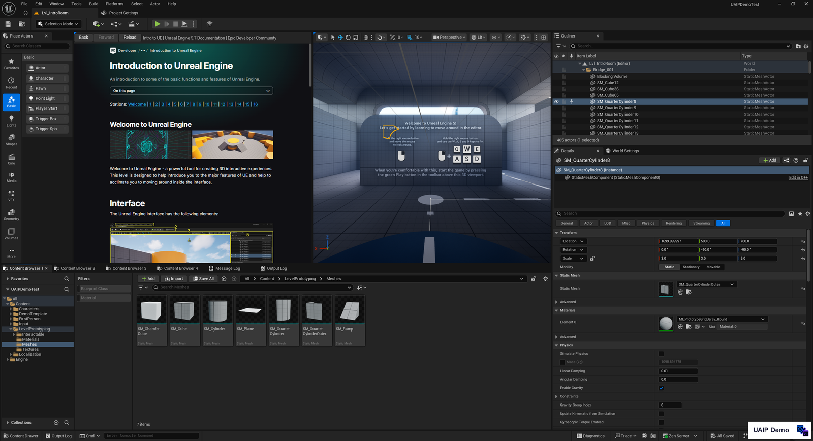
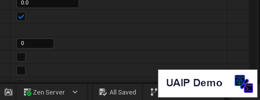

**[English](../en/demo.md)** | [概要に戻る](overview.md)

# デモ版ガイド

UAIP のデモ版は GitHub Releases で無償配布している、機能を絞ったバイナリです。観測・PIE 制御・アサーション・シナリオ実行・UI 自動化に加えて、アセット・レベル上のアクター・プロパティ・プラグイン・設定・ログ・コンソール変数・Unreal Insights トレースの読み取り専用コマンドと、実行中のゲームの AI 知覚・Chaos 破壊・ナビゲーション・入力状態の読み取り専用の観測コマンドを利用できるので、AI エージェントをレビューやテストのワークフローに組み込むには十分な機能がそろっています。

> **ライセンス**：デモ版は **個人利用・評価目的のみ** での利用を許諾しています。商用利用は対象外で、リリースアーカイブ同梱の `EULA.txt` に従ってください。商用利用の場合は、製品版（[Fab で公開中](https://www.fab.com/listings/0eedf909-00ac-4d95-b109-8fda51800fff)）をご利用ください。

---

## デモ版と製品版の比較

| | デモ版 | 製品版（Fab） |
|---|:---:|:---:|
| **接続方式** | | |
| MCP | ✅ | ✅ |
| HTTP API（`/uaip/commands` など） | — | ✅ |
| WebSocket | — | ✅ |
| CLI | — | ✅ |
| Artifact 取得（`/uaip/artifacts/*`） | ✅ | ✅ |
| **コマンド** | | |
| Core（HealthCheck、ListCommands など） | ✅ | ✅ |
| Editor 観測（スクリーンショット・ダンプ） | ✅ | ✅ |
| Editor ワークスペース操作（タブのフォーカス・グラフの表示調整・エディタ再起動・メインウィンドウの最小化と復元など） | ✅ | ✅ |
| PIE 制御（StartPIE、StopPIE、LoadMap など） | ✅ | ✅ |
| Runtime 観測（ビューポートキャプチャ・ワールドダンプ・HUD とウィジェットの状態） | ✅ | ✅ |
| Runtime の AI 知覚・Chaos 破壊・ナビゲーションの観測（読み取り専用の一部） | ✅ | ✅ |
| Runtime のアニメーション状態の観測（AnimInstance の状態・ステートマシン・ブレンドのウェイト・モンタージュ・カーブ。読み取り専用の一部） | ✅ | ✅ |
| Runtime のネットワークの観測（NetDriver・コネクション・アクターのレプリケーション設定。読み取り専用の一部。`ListNetConnections` が生のアドレスを書くのは、利用者が許可する `RuntimeNetConnectionAddressRead` があるときだけ） | ✅ | ✅ |
| Runtime のレプリケートされるプロパティの値と比較、パケットエミュレーション（`DumpReplicatedPropertyValues`、`CompareReplicatedProperties`、`SetNetworkEmulation`、`ResetNetworkEmulation`） | — | ✅ |
| Runtime の Subsystem の観測（`ListSubsystems`。`DumpSubsystemState` は利用者が許可する `SubsystemStateDump` も必要） | ✅ | ✅ |
| Runtime の入力状態の観測（`DumpInputState`、`GetEnhancedInputActionValue`） | ✅ | ✅ |
| Runtime の入力注入（`InjectInputKey`、`InjectEnhancedInputAction`、`ClickGameViewportWidget` など） | — | ✅ |
| シナリオ実行（`uaip_run_scenario`） | ✅ | ✅ |
| UI 自動化（ClickWidget、PressKey、FillForm など） | ✅ | ✅ |
| Runtime アサーション（WaitSeconds、AssertActorProperty など） | ✅ | ✅ |
| Editor の読み取り専用コマンド（アセット・レベル上のアクターとコンポーネント・プロパティ・プラグイン・設定・ログ・CVar） | ✅ | ✅ |
| Unreal Insights トレースの参照（チャンネル・状態・取得済みファイル） | ✅ | ✅ |
| Unreal Insights トレースの記録・解析 | — | ✅ |
| Editor 編集（Blueprint、Level、Assets、Material など） | — | ✅ |
| Runtime ワールド編集（SpawnActor、GAS、Input inject など） | — | ✅ |
| Python スクリプト実行（`RunEditorPythonScript`） | — | ✅ |
| **その他** | | |
| キャプチャ画像への透かし | ✅ | — |
| ユーザー拡張ポイント（`ICommandProvider`） | ✅ | ✅ |
| オプションプラグイン連携（Toolset、GAS、Niagara など） | — | ✅ |
| 対応 UE バージョン | 5.7 / 5.8 | 5.7 / 5.8 |

---

## インストール

1. [Releases](../../../releases) ページから `UAIP-Demo-UE<version>-Win64.zip` をダウンロード
2. zip を UE プロジェクトの `Plugins/` フォルダに展開（製品版と同じ `Plugins/UnrealAIIntegrationPlatform/` として展開されます）。以前のデモ版が `Plugins/UnrealAIIntegrationPlatformDemo/` に残っている場合は、先にそのフォルダを削除してください。同じプラグインを 2 つ並べて有効にすることはできません
3. 展開したフォルダ内の `Config/DefaultUAIP.ini` をプロジェクトの `Config/` フォルダにコピー（`AllowLogDump` / `AllowContextMenuMutation` / `AllowKeyboardInput` / `AllowKeyboardModifierInput` が有効で、コンソール変数の読み取り用に `RuntimeCVarRead` Capability を許可済みの設定）。観測・UI 自動化・PIE 制御は既定で許可されているため追記は不要です。下のコマンド表で Capability 名が書かれた一部のコマンドだけは、`[UAIP.SafetyPolicy]` に `+AllowedCapabilities=<Name>` の行を追加してください
4. AI クライアントに MCP サーバーを登録（[接続方法 → MCP Bridge](connections.md#mcp-bridge) を参照）

### 製品版への移行

`Config/DefaultUAIP.ini` の設定形式はデモ版と製品版で共通です。デモ版でコピーした `DefaultUAIP.ini` はそのまま引き継げるため、ini の差し替えは不要です。プラグインフォルダの構造も MCP サーバの登録方法も同じなので、他に変更は必要ありません。

---

## 有効なコマンド一覧

以下はすべてデモ版に登録されているコマンドです。**読み取り専用の一部** と書かれた名前空間では、エディタを変更するコマンドは製品版のみです（[除外コマンド](#除外コマンド) を参照）。備考欄に Capability 名があるコマンドは既定で拒否されるため、`+AllowedCapabilities=<Name>` で許可してから呼び出してください。

### `UAIP.Core.*`

| コマンド | 説明 | 備考 |
|---|---|---|
| `UAIP.Core.HealthCheck` | 接続状態と UAIP バージョンを返す | |
| `UAIP.Core.GetSystemInfo` | プロジェクト名・プラットフォーム・エンジン版・ビルド設定を返す | |
| `UAIP.Core.ListCommands` | 登録済みコマンド一覧を返す（ProviderPrefix・キーワードフィルター対応）。一覧から除外したコマンドの件数と理由も返す（`HiddenCount` / `HiddenReasons`） | |
| `UAIP.Core.DescribeCommand` | コマンドの詳細（説明・パラメータスキーマ・必要 Capability）を返す | |
| `UAIP.Core.QueryCapabilities` | 現在のセッションの Capability セットを返す。`IncludeUnavailable: true` で登録済みの全 Capability も返す | |
| `UAIP.Core.ListIntegrations` | オプションプラグイン連携それぞれの状態を返す（[除外コマンド](#除外コマンド) を参照） | |
| `UAIP.Core.ListPlugins` | UE プラグイン情報（名前・バージョン・有効化状態）を返す | 非推奨。`UAIP.Runtime.Engine.Plugin.ListPlugins` を使用 |
| `UAIP.Core.EndSession` | セッション終了・ウィジェット参照解放・Artifact GC | |
| `UAIP.Core.ReloadCapabilities` | `DefaultUAIP.ini` から Capability を再読み込み | `AllowCapabilityReload=True` が必要 |
| `UAIP.Core.GetPendingInteractionStatus` | 保留中の対話の状態を返す | 対話を開始するコマンドがデモ版に無いため、この 3 つは常に `NotFound` を返す |
| `UAIP.Core.WaitForPendingInteraction` | 保留中の対話が終わるまで待機する | 同上 |
| `UAIP.Core.CancelPendingInteraction` | 自セッションが開始した対話を中止する | 同上 |

### `UAIP.Core.Artifacts.*`

| コマンド | 説明 |
|---|---|
| `UAIP.Core.Artifacts.GetArtifact` | 自セッションが生成した Artifact の保存内容を返す |

### `UAIP.Editor.Observation.*`

| コマンド | 説明 | 備考 |
|---|---|---|
| `UAIP.Editor.Observation.CaptureActiveWindowImage` | アクティブウィンドウのスクリーンショット | 透かしあり |
| `UAIP.Editor.Observation.CaptureEditorTabImage` | 指定エディタータブのスクリーンショット | 透かしあり |
| `UAIP.Editor.Observation.CaptureGraphViewportImage` | グラフビューポート（Blueprint 等）のスクリーンショット | 透かしあり |
| `UAIP.Editor.Observation.CaptureViewportImageAnnotated` | ワールド座標のラベルを描き込んだビューポートのスクリーンショット | 透かしあり。`ViewportAnnotationCapture` |
| `UAIP.Editor.Observation.DumpEditorState` | エディター状態（開いているアセット・アクティブタブ等）を JSON で返す | |
| `UAIP.Editor.Observation.DumpSelectionState` | 現在の選択状態を JSON で返す | |
| `UAIP.Editor.Observation.DumpOpenTabs` | 開いているタブ一覧を JSON で返す | |
| `UAIP.Editor.Observation.DumpOutputLog` | 出力ログを取得する | |
| `UAIP.Editor.Observation.DumpMessageLog` | メッセージログを取得する | |
| `UAIP.Editor.Observation.DumpSlateTree` | Slate ウィジェット階層を JSON で返す | |
| `UAIP.Editor.Observation.InspectMenu` | メニュー構造情報を返す | |
| `UAIP.Editor.Observation.InspectContextMenu` | コンテキストメニュー情報を返す | |
| `UAIP.Editor.Observation.ObserveWidget` | ウィジェットを監視登録（キャッシュ）する | |
| `UAIP.Editor.Observation.ListGraphNodes` | グラフのノード一覧を返す | |
| `UAIP.Editor.Observation.GetLogCategories` | 登録済みのログカテゴリ名を返す | |

### `UAIP.Editor.Workspace.*`

| コマンド | 説明 | 備考 |
|---|---|---|
| `UAIP.Editor.Workspace.FocusEditorTab` | アセットのエディタータブを前面に出す（`AssetPath` で指定） | |
| `UAIP.Editor.Workspace.CloseEditorTab` | アセットのエディタータブを閉じる（`AssetPath` で指定） | |
| `UAIP.Editor.Workspace.ListSpawnableTabs` | 開くことのできるエディタータブを Slate のレイアウト ID 付きで返す | `EditorTabSpawn` |
| `UAIP.Editor.Workspace.OpenTabById` | Slate のレイアウト ID でエディタータブを開く | `EditorTabSpawn` |
| `UAIP.Editor.Workspace.CloseTabById` | Slate のレイアウト ID でエディタータブを閉じる | `EditorTabSpawn` |
| `UAIP.Editor.Workspace.NormalizeEditorLayout` | メイングラフのタブにフォーカスし、一時的なパネルを隠す | |
| `UAIP.Editor.Workspace.SetEditorWindowState` | エディタのメインウィンドウを最小化する、または最小化から復元する | `EditorWindowStateControl`。ユーザーが別のアプリで作業しているときは、復元してもエディタはそのアプリの後ろに残り、キーボードフォーカスを奪わない |
| `UAIP.Editor.Workspace.SetGraphZoom` | グラフビューのズーム倍率を設定する | |
| `UAIP.Editor.Workspace.FrameGraphAll` | グラフ全体をビューに収める | |
| `UAIP.Editor.Workspace.FrameGraphSelection` | 選択ノードをビューに収める | |
| `UAIP.Editor.Workspace.SetGraphSelection` | グラフノードを ID で選択する | |
| `UAIP.Editor.Workspace.GetUndoHistory` | アンドゥ／リドゥの履歴を変更せずに読み取る | |
| `UAIP.Editor.Workspace.Undo` | 直前のエディタ操作をアンドゥする | `EditorUndoRedo` |
| `UAIP.Editor.Workspace.Redo` | アンドゥした操作をリドゥする | `EditorUndoRedo` |
| `UAIP.Editor.Workspace.SaveAllPackages` | 変更のあるパッケージをすべて保存する | |
| `UAIP.Editor.Workspace.ShutdownEditor` | エディタを終了する | |
| `UAIP.Editor.Workspace.RestartEditor` | エディタを再起動する | |
| `UAIP.Editor.Workspace.GetRestartStatus` | 再起動の試行の状態を読む | |
| `UAIP.Editor.Workspace.GetLastCrashReport` | 最新のクラッシュレポートを取得する | |

### `UAIP.Runtime.PIE.*`

| コマンド | 説明 |
|---|---|
| `UAIP.Runtime.PIE.StartPIE` | Play in Editor（PIE）を起動する |
| `UAIP.Runtime.PIE.StopPIE` | PIE を停止する |
| `UAIP.Runtime.PIE.PausePIE` | PIE を一時停止する |
| `UAIP.Runtime.PIE.ResumePIE` | PIE を再開する |
| `UAIP.Runtime.PIE.LoadMap` | マップを読み込む |
| `UAIP.Runtime.PIE.GetPIEState` | 現在の PIE の状態（`Running` / `Stopped` / `Paused` / `Simulating`）を返す |

### `UAIP.Runtime.Observation.*`

| コマンド | 説明 | 備考 |
|---|---|---|
| `UAIP.Runtime.Observation.CaptureViewportImage` | ゲームビューポートのスクリーンショット | 透かしあり |
| `UAIP.Runtime.Observation.DumpWorldState` | ワールド状態（全アクター・コンポーネント・トランスフォーム）を JSON で返す | |
| `UAIP.Runtime.Observation.DumpActorState` | 指定アクターの状態を JSON で返す | |
| `UAIP.Runtime.Observation.DumpComponentState` | 指定コンポーネントの状態を JSON で返す | |
| `UAIP.Runtime.Observation.DumpRuntimeLog` | ランタイムログを取得する | |
| `UAIP.Runtime.Observation.CapturePerformanceSnapshot` | FPS・メモリ等のパフォーマンス統計を取得する | |
| `UAIP.Runtime.Observation.CheckpointCapture` | スクリーンショット＋状態ダンプの複合観測（シナリオ primitive） | 透かしあり |
| `UAIP.Runtime.Observation.SearchLoadedClasses` | ロード済みクラスを検索する | |
| `UAIP.Runtime.Observation.DumpGameViewportWidgets` | ゲームビューポートのウィジェットツリーを JSON で返す | |
| `UAIP.Runtime.Observation.FindGameViewportWidgets` | ゲームビューポートのウィジェットツリーを、クラス・名前・所有プレイヤーで検索する | |
| `UAIP.Runtime.Observation.DumpGameViewportWidgetTexts` | ゲームビューポートの全テキストウィジェットの文字列を JSON で返す | `RuntimeWidgetTextRead`（パスワード欄の平文は加えて `RuntimeWidgetPasswordTextRead` が必要） |
| `UAIP.Runtime.Observation.DumpHUDState` | ローカルプレイヤーごとの HUD の状態を JSON で返す | |
| `UAIP.Runtime.Observation.ListSubsystems` | エンジン・GameInstance・プレイワールド・ローカルプレイヤーの下で生きている Subsystem を、実体ごとに 1 行で返す | |
| `UAIP.Runtime.Observation.DumpSubsystemState` | 1 つの Subsystem の実体のプロパティの値を JSON で返す | `SubsystemStateDump`（`RuntimeInspect` に加えて必要。デモ版でも DefaultDenied で、利用者が `+AllowedCapabilities=SubsystemStateDump` を追加して許可する） |

### `UAIP.Runtime.Input.*`（読み取り専用の一部）

| コマンド | 説明 |
|---|---|
| `UAIP.Runtime.Input.DumpInputState` | プレイヤーコントローラーの入力状態（押下中のキー・軸の値・有効な Enhanced Input のマッピングコンテキスト）を JSON で返す |
| `UAIP.Runtime.Input.GetEnhancedInputActionValue` | Enhanced Input アクションの現在値を返す |

入力を注入するコマンドは製品版のみです（[除外コマンド](#除外コマンド) を参照）。

### `UAIP.Runtime.AI.*`

| コマンド | 説明 | 備考 |
|---|---|---|
| `UAIP.Runtime.AI.DumpAIPerceptionState` | 1 体の AI の知覚コンポーネントが持つ状態をすべて返す | |
| `UAIP.Runtime.AI.GetPerceivedActors` | 1 体の AI が現在知覚している（または記憶している）アクターを返す | |
| `UAIP.Runtime.AI.GetActorPerceivers` | 指定したアクターを知覚している AI を返す | |
| `UAIP.Runtime.AI.DumpAIPerceptionSystemState` | ワールドの知覚システム全体の状態を返す | |
| `UAIP.Runtime.AI.ExplainSightPerception` | 視覚が対象を捉える（捉えない）理由を、順序のある 14 段階で説明する | |
| `UAIP.Runtime.AI.DumpAIPerceptionSenseConfigs` | 1 体の AI の知覚コンポーネントにある全 Sense 設定の、全プロパティの値を返す | `AIPerceptionConfigDump`（`RuntimeInspect` に加えて必要） |
| `UAIP.Runtime.AI.DumpBehaviorTreeState` | 1 つのアクターの BehaviorTree の全体像を返す | |
| `UAIP.Runtime.AI.GetActiveBehaviorTreeNode` | 1 つのアクターの BehaviorTree のアクティブなノードとルートまでの経路を返す | |
| `UAIP.Runtime.AI.ListBehaviorTreeAgents` | プレイワールドで BehaviorTree を実行しているアクターを列挙する | |
| `UAIP.Runtime.AI.GetBlackboardValues` | 1 つのアクターの Blackboard の全キーの値を返す | `BlackboardValueRead`（`RuntimeInspect` に加えて必要。デモ版でも DefaultDenied） |
| `UAIP.Runtime.AI.StartBehaviorTreeCapture` | 1 つのアクターの BehaviorTree の時間変化の記録を開始する | |
| `UAIP.Runtime.AI.StopBehaviorTreeCapture` | BehaviorTree の記録を止めて最終状態を返す | |
| `UAIP.Runtime.AI.GetBehaviorTreeEventLog` | BehaviorTree の記録のエントリを古いものから読む | |

### `UAIP.Runtime.ChaosDestruction.*`（読み取り専用の一部）

| コマンド | 説明 |
|---|---|
| `UAIP.Runtime.ChaosDestruction.ListGeometryCollections` | プレイワールドの Geometry Collection コンポーネントと、それぞれの壊れ具合を返す |
| `UAIP.Runtime.ChaosDestruction.DumpGeometryCollectionState` | 1 つの Geometry Collection の破片ごとの状態・位置・速度を返す |
| `UAIP.Runtime.ChaosDestruction.DumpChaosFieldState` | ワールドに作用する物理フィールドを返す |
| `UAIP.Runtime.ChaosDestruction.StartDestructionCapture` | 破壊イベントを、呼び出したセッションが所有するキャプチャへ記録し始める |
| `UAIP.Runtime.ChaosDestruction.GetDestructionEventLog` | キャプチャのイベントを古い順に読む（プレイ終了後もしばらく読める） |
| `UAIP.Runtime.ChaosDestruction.StopDestructionCapture` | キャプチャを止めて最終状態を返す |
| `UAIP.Runtime.ChaosDestruction.CaptureGeometryCollectionStrain` | 各破片が次の物理ステップで負うひずみを返す |

### `UAIP.Runtime.Navigation.*`（読み取り専用の一部）

| コマンド | 説明 | 備考 |
|---|---|---|
| `UAIP.Runtime.Navigation.DumpNavigationSystemState` | ナビゲーションシステムの設定と状態を返す | |
| `UAIP.Runtime.Navigation.FindPath` | 2 点間の経路と、終点に到達できるかどうかを返す | `MaxSearchNodes` が 8192 を超える場合のみ `RuntimeNavigationExtendedSearch` |
| `UAIP.Runtime.Navigation.IsLocationReachable` | `FindPath` と同じ問いに、経路を付けずに答える | 同上 |
| `UAIP.Runtime.Navigation.DumpNavMeshTiles` | 1 つのナビメッシュのタイルを返す | |
| `UAIP.Runtime.Navigation.QueryNavModifiers` | 指定した範囲に触れるナビゲーションモディファイアと、そこのポリゴンのエリア別の内訳を返す | |
| `UAIP.Runtime.Navigation.GetPathFollowingState` | 1 体の AI の経路追従コンポーネントの状態を返す（プレイワールドのみ） | |
| `UAIP.Runtime.Navigation.WaitForNavigationBuild` | ナビゲーションの生成が終わるまで待つ | |

### `UAIP.Runtime.Animation.*`

| コマンド | 説明 | 備考 |
|---|---|---|
| `UAIP.Runtime.Animation.DumpAnimInstanceState` | 1 つのスケルタルメッシュコンポーネントの更新状態・ステートマシン・ブレンドのウェイト・モンタージュ・カーブを、1 回の読み取りでまとめて返す | |
| `UAIP.Runtime.Animation.GetAnimStateMachineStates` | ステートマシンごとのアクティブな State・その State にいる経過時間・進行中の遷移を返す | |
| `UAIP.Runtime.Animation.GetAnimBlendWeights` | 再生中のアセット・ブレンドスペース・レイヤードブレンドの最終ブレンドウェイトを返す | |
| `UAIP.Runtime.Animation.GetActiveMontages` | 有効なモンタージュ（ブレンドアウト中を含む）を返す | |
| `UAIP.Runtime.Animation.GetAnimCurveValues` | アニメーションカーブの値と種別を返す | |
| `UAIP.Runtime.Animation.DumpAnimInstanceVariables` | プロジェクト自身の AnimInstance クラスが宣言した変数の値を返す | `AnimInstanceVariableDump`（`RuntimeInspect` に加えて必要。デモ版でも DefaultDenied） |

### `UAIP.Runtime.Network.*`（読み取り専用の一部）

| コマンド | 説明 | 備考 |
|---|---|---|
| `UAIP.Runtime.Network.GetNetDriverState` | ワールドの NetDriver とその設定・通信量の合計を返す | |
| `UAIP.Runtime.Network.ListNetConnections` | 1 つの NetDriver のコネクションと、それぞれの往復時間・損失・通信量を返す | `IncludeRemoteAddress` が `true` の場合のみ `RuntimeNetConnectionAddressRead`（デモ版でも DefaultDenied） |
| `UAIP.Runtime.Network.DumpActorReplication` | 1 つのアクターのレプリケーション設定と、その送信についてサーバーが把握している状態を返す | |

### `UAIP.Runtime.Assertion.*`

| コマンド | 説明 |
|---|---|
| `UAIP.Runtime.Assertion.WaitSeconds` | 指定秒数待機する（シナリオ primitive） |
| `UAIP.Runtime.Assertion.WaitForCondition` | 条件評価ループで待機する（シナリオ primitive） |
| `UAIP.Runtime.Assertion.AssertActorProperty` | アクタープロパティをアサートする（失敗時も Artifact を出力） |
| `UAIP.Runtime.Assertion.AssertWorldState` | 複数プロパティをバッチアサートする |

### `UAIP.Editor.UIAutomation.*`

| コマンド | 説明 | 備考 |
|---|---|---|
| `UAIP.Editor.UIAutomation.SnapshotUI` | UI 構造スナップショットを取得する | |
| `UAIP.Editor.UIAutomation.ClickWidget` | ウィジェットをクリックする | |
| `UAIP.Editor.UIAutomation.SelectMenuItem` | メニューアイテムを選択する | |
| `UAIP.Editor.UIAutomation.InputText` | テキストを入力する | |
| `UAIP.Editor.UIAutomation.SetCheckboxState` | チェックボックスの状態を設定する | |
| `UAIP.Editor.UIAutomation.SetComboSelection` | コンボボックスを選択する | |
| `UAIP.Editor.UIAutomation.DragGraphNode` | グラフノードをドラッグする | |
| `UAIP.Editor.UIAutomation.ConnectGraphPins` | グラフピンを接続する | |
| `UAIP.Editor.UIAutomation.AcceptDialog` | ダイアログを OK で閉じる | |
| `UAIP.Editor.UIAutomation.CancelDialog` | ダイアログをキャンセルで閉じる | |
| `UAIP.Editor.UIAutomation.InvokeContextMenuAction` | コンテキストメニューアクションを呼び出す | |
| `UAIP.Editor.UIAutomation.HoverWidget` | ウィジェットをホバーする | |
| `UAIP.Editor.UIAutomation.PressKey` | キー入力を送る | `EditorKeyboardInput` |
| `UAIP.Editor.UIAutomation.WaitForWidget` | ウィジェットの出現を待機する | |
| `UAIP.Editor.UIAutomation.FillForm` | フォームを自動入力する | |
| `UAIP.Editor.UIAutomation.DismissMenus` | 開いているメニューやポップアップを閉じる | |
| `UAIP.Editor.UIAutomation.OpenPasswordTestWindow` | パスワード欄を持つ小さなテスト用ウィンドウを開く（パスワード欄のポリシー検証用） | 窓を開くだけで何も変更しない。デモ版にも製品版にも含まれる（[デモ版が制限するもの・しないもの](#デモ版が制限するものしないもの)） |

### `UAIP.Editor.Assets.*`（読み取り専用の一部）

| コマンド | 説明 | 備考 |
|---|---|---|
| `UAIP.Editor.Assets.SearchAssets` | パス・クラス・タグでアセットを検索する | |
| `UAIP.Editor.Assets.GetOpenAssets` | アセットエディタで開いているアセットを返す | |
| `UAIP.Editor.Assets.GetSelectedAssets` | コンテンツブラウザで選択中のアセットを返す | |
| `UAIP.Editor.Assets.GetContentBrowserPath` | コンテンツブラウザで表示中のフォルダを返す | |
| `UAIP.Editor.Assets.ListDirtyPackages` | 未保存の変更があるパッケージを返す | |
| `UAIP.Editor.Assets.ListAssetRedirectors` | フォルダ配下のアセットリダイレクタを返す | |
| `UAIP.Editor.Assets.ListCreatableAssetClasses` | `CreateAsset` で作成できるアセットクラスを返す | |
| `UAIP.Editor.Assets.ListFactoriesForClass` | アセットクラスに対応するファクトリ候補を返す | |
| `UAIP.Editor.Assets.GetAssetReferences` | アセットの参照グラフ（参照元・依存先）をたどる | |
| `UAIP.Editor.Assets.GetAssetDependencyPath` | 2 つのアセット間の最短依存パスを求める | |
| `UAIP.Editor.Assets.GetAssetSizeMap` | フォルダ配下のアセットごとのサイズを集計する | |
| `UAIP.Editor.Assets.GetAssetSizeMapByClass` | フォルダ配下のサイズをアセットクラスごとに集計する | |
| `UAIP.Editor.Assets.StartAssetAudit` | アセット監査をバックグラウンドのジョブとして開始する（エディタは応答し続ける） | |
| `UAIP.Editor.Assets.GetAssetAuditStatus` | 監査ジョブの進捗を取得する | |
| `UAIP.Editor.Assets.GetAssetAuditResult` | 完了した監査ジョブのレポートを取得する | |
| `UAIP.Editor.Assets.FindUnreferencedAssets` | フォルダ配下の参照されていないアセットを探す | 非推奨。`StartAssetAudit` を使用 |
| `UAIP.Editor.Assets.FindCircularReferences` | フォルダ配下の循環依存を探す | 非推奨。`StartAssetAudit` を使用 |
| `UAIP.Editor.Assets.FindBrokenReferences` | 存在しないパッケージへの依存を探す | 非推奨。`StartAssetAudit` を使用 |
| `UAIP.Editor.Assets.RunAssetAudit` | 複合監査を 1 回の呼び出しで実行する | 非推奨。`StartAssetAudit` を使用 |
| `UAIP.Editor.Assets.ListPrimaryAssetTypes` | 登録済みの Primary Asset Type を返す | |
| `UAIP.Editor.Assets.GetPrimaryAssetTypeInfo` | Primary Asset Type 1 件の詳細を返す | |
| `UAIP.Editor.Assets.ListPrimaryAssets` | Primary Asset Type に属する Primary Asset を返す | |
| `UAIP.Editor.Assets.GetPrimaryAssetIdForPath` | アセットパスを `PrimaryAssetId` に解決する | |
| `UAIP.Editor.Assets.GetPrimaryAssetRules` | Primary Asset に適用されるルールを返す | |
| `UAIP.Editor.Assets.GetAssetBundle` | Primary Asset の Asset Bundle を返す | |
| `UAIP.Editor.Assets.GetManagedPackageList` | Primary Asset が管理するパッケージを返す | |
| `UAIP.Editor.Assets.GetPrimaryAssetLoadList` | Primary Asset で実際にロードされる対象を解決する | |
| `UAIP.Editor.Assets.GetLoadedPrimaryAssets` | ロード中の Primary Asset を返す | |
| `UAIP.Editor.Assets.GetAssetTags` | アセットの Asset Registry タグを返す | |

### `UAIP.Editor.Level.*`（読み取り専用の一部）

| コマンド | 説明 |
|---|---|
| `UAIP.Editor.Level.ListLevelActors` | 開いているレベルの全アクターを返す |
| `UAIP.Editor.Level.ListSelectedActors` | エディタで選択中のアクターを返す |
| `UAIP.Editor.Level.GetActorTransform` | アクターのトランスフォームを返す |
| `UAIP.Editor.Level.GetVisibleActors` | アクティブなビューポートに映っているアクターを返す |
| `UAIP.Editor.Level.GetCameraTransform` | レベルエディタのビューポートカメラの位置と回転を返す |
| `UAIP.Editor.Level.ProjectWorldToScreen` | ワールド座標をスクリーン座標に投影する |
| `UAIP.Editor.Level.ProjectScreenToWorld` | スクリーン座標からワールドへレイを飛ばす |
| `UAIP.Editor.Level.ListActorComponents` | レベルに配置したアクターの全コンポーネントを返す |
| `UAIP.Editor.Level.GetActorComponentProperty` | 配置したアクターのコンポーネントのプロパティを読み取る |
| `UAIP.Editor.Level.GetTransformGizmoSize` | トランスフォームギズモの大きさの設定と、使用中のギズモがどれを読むかを返す |

### `UAIP.Editor.Property.*`（読み取り専用の一部）

| コマンド | 説明 |
|---|---|
| `UAIP.Editor.Property.GetActorProperty` | アクターのプロパティ値を取得する |
| `UAIP.Editor.Property.GetAssetProperty` | アセットのプロパティ値を取得する |
| `UAIP.Editor.Property.GetBlueprintDefault` | Blueprint のクラスデフォルトのプロパティを取得する |
| `UAIP.Editor.Property.GetWorldSetting` | World Settings のプロパティを取得する |
| `UAIP.Editor.Property.GetProjectSetting` | プロジェクト設定オブジェクトのプロパティを取得する |
| `UAIP.Editor.Property.GetDataTableRow` | DataTable の行のプロパティを取得する |

秘密情報と思われるプロパティの値はマスクして返します。

### `UAIP.Editor.Engine.*`（読み取り専用の一部）

| コマンド | 説明 |
|---|---|
| `UAIP.Editor.Engine.Plugin.GetPluginDescriptor` | プラグインの `.uplugin` 記述子を読み取る |
| `UAIP.Editor.Engine.Plugin.GetPluginDependents` | 指定プラグインに依存しているプラグインを返す |
| `UAIP.Editor.Engine.Plugin.GetPluginTemplateDescriptions` | 利用できるプラグインテンプレートを返す |
| `UAIP.Editor.Engine.Plugin.IsPluginCreationAllowed` | プラグインを新規作成できるかを確認する |
| `UAIP.Editor.Engine.Plugin.IsPluginModificationAllowed` | プラグインを変更できるかを確認する |
| `UAIP.Editor.Engine.ConfigSettings.ListSettingsContainers` | 設定コンテナ（`Project`・`Editor` など）を返す |
| `UAIP.Editor.Engine.ConfigSettings.ListSettingsCategories` | 設定コンテナのカテゴリを返す |
| `UAIP.Editor.Engine.ConfigSettings.ListSettingsSections` | 設定カテゴリのセクションを返す |
| `UAIP.Editor.Engine.ConfigSettings.GetSettingsSchema` | 設定セクションの編集可能なプロパティを返す |
| `UAIP.Editor.Engine.ConfigSettings.GetSettingsValues` | 設定セクションの現在値を返す（秘密情報はマスク） |
| `UAIP.Editor.Engine.Log.GetLogEntries` | エディタログの最近のエントリを取得する（パターンで絞り込み可） |

### `UAIP.Runtime.Engine.*`（読み取り専用の一部）

| コマンド | 説明 | 備考 |
|---|---|---|
| `UAIP.Runtime.Engine.Plugin.ListPlugins` | 検出済み・有効なプラグインを返す | |
| `UAIP.Runtime.Engine.Plugin.GetPluginInfo` | プラグインの詳細を返す | |
| `UAIP.Runtime.Engine.Plugin.IsEnabled` | プラグインが有効かを確認する | |
| `UAIP.Runtime.Engine.Plugin.GetPluginDependencies` | プラグインの直接の依存先を返す | |
| `UAIP.Runtime.Engine.Plugin.GetPluginForAsset` | アセットパスを所有するプラグインを解決する | |
| `UAIP.Runtime.Engine.Log.GetLogCategories` | 登録済みのログカテゴリ名を返す | |
| `UAIP.Runtime.Engine.Log.GetLogVerbosity` | ログカテゴリの詳細度を返す | |
| `UAIP.Runtime.Engine.Config.GetConfigValue` | セクションとキーを指定して ini の値を読み取る | |
| `UAIP.Runtime.Engine.CVar.GetConsoleVariable` | コンソール変数の値・型・ヘルプを返す | `RuntimeCVarRead`（デモ版の ini で許可済み） |
| `UAIP.Runtime.Engine.CVar.SearchConsoleVariables` | ワイルドカードでコンソール変数を検索する | `RuntimeCVarRead`（デモ版の ini で許可済み） |

### `UAIP.Runtime.Insights.Trace.*`（読み取り専用の一部）

| コマンド | 説明 |
|---|---|
| `UAIP.Runtime.Insights.Trace.ListTraceChannels` | トレースチャンネルと、それぞれの有効状態・記録しうる情報を返す |
| `UAIP.Runtime.Insights.Trace.GetTraceStatus` | トレースを記録中かどうかと、UAIP が開始したトレースの詳細を返す |
| `UAIP.Runtime.Insights.Trace.ListTraceFiles` | UAIP が取得したトレースファイルを返す |

---

## 制限事項

### 接続方式

デモ版は **MCP 専用モード** で動作します。`-uaip-http-enable` を指定しても HTTP API ルート（`/uaip/commands` 等）は登録されません（警告ログが出て無視されます）。有効なエンドポイントは `/mcp`・`/uaip/artifacts/*`・`/uaip/instance-proof` のみです。

### キャプチャ画像への透かし

以下のキャプチャコマンドが出力する PNG には **「UAIP Demo」** の透かしが入ります：

- `CaptureActiveWindowImage`
- `CaptureEditorTabImage`
- `CaptureGraphViewportImage`
- `CaptureViewportImageAnnotated`
- `CaptureViewportImage`（これを使う `CheckpointCapture` のスクリーンショットも含む）

<p align="center">
  
</p>

<p align="center">
  
</p>

レビューやテストの証跡として共有された画像が、デモ版で取得されたものだと分かるようにするための表示です。製品版では入りません。

### デモ版が制限するもの・しないもの

デモ版が制限するのは、存在する**コマンド**です。コマンドがエディタに作用した後で、エディタが何をするかまでは止めません。ここから次の 4 点になります。

1. **意味的な編集コマンドは提供しません。** アセット・アクター・プロパティ・設定を意味の単位で書き換えるコマンド（アセットの作成・リネーム・削除、アクターの配置、`Set*Property` など）はデモ版にありません。[除外コマンド](#除外コマンド) を参照してください。
2. **保存・終了・再起動は、観測の前提として残しています。** `SaveAllPackages`・`ShutdownEditor`・`RestartEditor` は、UI 操作の結果をエディタの再起動で確かめる流れを成り立たせるためのものです。`SaveAll` を指定しなければ（`DisableSave` が既定の `false` なら）、`ShutdownEditor` と `RestartEditor` は終了・再起動の前に、変更のあるパッケージをすべて保存します。
3. **UI 自動化はアセットを変更・保存しうる。** `ConnectGraphPins` と `DragGraphNode` は、開いているエディタのアセットを実際に変更します。`ClickWidget` は実際のクリックを送るため、保存ボタンも押せます。要求するのは DefaultAllow の `EditorUIAutomation` だけで、`DisableSave` は見ません。止まるのは `ReadOnly=True` のときだけです。「編集コマンドが無い」を「デモ版ではプロジェクトに書き込めない」と読まないでください。
4. **`SaveAsset` は除外し、`SaveAllPackages` は残します。** `SaveAsset` は、アセットを 1 件開き・直し・保存する編集の流れの一部で、作成・リネーム・削除のコマンドと同じ系統です。`SaveAllPackages` は `ShutdownEditor` / `RestartEditor` と同じ `EditorLifecycle` に属し、終了・再起動がすでに行っている「全て保存」を単独で呼べるようにしただけなので、書き込みの手段は増えません。

`OpenPasswordTestWindow` は、別の理由でデモ版にも製品版にも含まれます。パスワード欄を持つ小さなウィンドウを開くだけのコマンドで、`InputText` やパスワード欄のポリシーがパスワード欄をどう扱うかを確かめるためのターゲットです。アセット・設定・保存済みの状態は何も変更しません。すでに公開されているコマンドであり、公開済みのコマンドを外すと破壊的変更になるためです。

### 除外コマンド

製品版には存在するが、デモ版では利用できないコマンド：

| コマンド | 理由・デモ版での応答 |
|---|---|
| デモ版に含まれないモジュールのコマンド（Blueprint、Material、Sequencer、Runtime ワールド編集、`UAIP.Editor.Execution.RunEditorPythonScript` などの Python 実行など） | 製品版のみ。`CommandNotFound` を返す |
| オプションプラグイン連携のコマンド（Niagara、StateTree、PCG、GAS、MetaHuman、LiveLink など） | 製品版のみ。`CommandNotFound` に「無償のデモ版には含まれず、Fab の製品版で利用できる」旨の案内が付く。`UAIP.Core.ListIntegrations` ではこれらの連携が `NotInThisEdition` と表示される |
| Toolset ブリッジのコマンド（`Toolset.*`）と `UAIP.Editor.Engine.Toolset.DumpToolsetParameterSchemas` | デモ版に含まれない Toolset 連携が必要。デモ版に含まれるモジュールのものは登録されているが常に利用不可で、`ListCommands` には出ず（`IncludeUnavailable: true` では `Available: false` として出る）、呼び出しても拒否される |
| デモ版に含まれる Assets・Level・Property・Engine・Insights の名前空間のうち、エディタを変更するコマンド（`CreateAsset`、`SaveAsset`、`PlaceActorInLevel`、`AddActorComponent`、`Set*Property`、`SetPluginEnabled`、`SetSettingsValues`、`SetConsoleVariable`、`StartTrace` など） | デモ版は上に挙げた読み取り専用の一部だけを提供する。`CommandNotFound` を返す |
| `UAIP.Editor.Workspace` の `WaitForShaderCompilation`・`RecompileGlobalShaders` と Live Coding 系コマンド | シェーダー・Live Coding の開発操作は製品版のみ。`CommandNotFound` を返す |
| トレース解析（`UAIP.Runtime.Insights.Analysis.*`） | デモ版ではコンパイル対象外。`CommandNotFound` を返す |
| `UAIP.Runtime.Input` の入力注入（`InjectInputKey`、`InjectLegacyAction`、`InjectLegacyAxisInput`、`InjectLegacySpeechInput`、`FlushInput`、`SetInputMode`、`InjectEnhancedInputAction`、`AddMappingContext`、`RemoveMappingContext`、`ClickGameViewportWidget`、`PressGameViewportUIKey`、`TypeGameViewportText`） | 実行中のゲームへ入力を送るため製品版のみ。`CommandNotFound` を返す |
| `UAIP.Runtime.Input.EvaluateInputGateWithProjectCode` | プロジェクト自身のコード（ゲームビューポートクライアントの override）を走らせるため製品版のみ。`CommandNotFound` を返す |
| `UAIP.Runtime.ChaosDestruction.EnableForcedDestructionNotify` と `UAIP.Runtime.Navigation.RebuildNavigation` | 実行中のゲーム（破壊通知・ナビメッシュの再生成）を変更するため製品版のみ。`CommandNotFound` を返す |
| `UAIP.Runtime.Animation.GetMotionMatchingState` | PoseSearch プラグインが必要で、デモ版には含まれないため製品版のみ。`CommandNotFound` を返す |
| `UAIP.Runtime.Network.DumpReplicatedPropertyValues`・`UAIP.Runtime.Network.CompareReplicatedProperties`・`UAIP.Runtime.Network.SetNetworkEmulation`・`UAIP.Runtime.Network.ResetNetworkEmulation` | プレイヤーのアカウント識別子や名前が入りうるレプリケートされるプロパティの値を読む、または実行中のゲームのパケットエミュレーションを変更するため製品版のみ。`CommandNotFound` を返す |

デモ版で Toolset ブリッジのコマンドを呼ぶと、エラー文は対処を述べる前に、連携の名前とその状態を示すので、何が足りないのかが分かります: `This command runs through the Toolset integration 'UAIPCoreToolsetRegistry', which is not loaded (state: NotInThisEdition). The integration is not included in the free demo edition of UAIP. Its commands are available in the Pro edition on Fab.`

### デモ版が「使えない」と示す Capability

デモ版は、含まれないコマンドの Capability も登録するため、Capability の一覧は製品版と同じ形に見えます。デモ版のどのコマンドも要求しない Capability には、**この版では使えない**の印が付きます。`UAIP.Core.QueryCapabilities`（`IncludeUnavailable: true`）は、それを `UnavailableReason: "NotInThisEdition"` と `IsGranted: false` で列挙し、`+AllowedCapabilities` に書いても付与されず、書くと起動時にエディタが警告を出します。これは何かを解禁する手段ではありません。そのコマンドを持つのは製品版だけです。デモ版の利用者が使えない Capability のすべてに印が付くわけではなく、デモ版がそもそも登録しないもの（たとえば `CommonUIProjectCodeExecution`）は、一覧に現れません。詳しくは [Safety & Capabilities](safety.md#デモ版が提供しない-capability) を参照してください。

`EditorWindowStateControl` は、`SetEditorWindowState` がデモ版に含まれるので、印が付きません。デモ版の `DefaultUAIP.ini` は付与しないため、AI にエディタのメインウィンドウを最小化・復元させるには、`+AllowedCapabilities=EditorWindowStateControl` を追加してください。

### ロード対象

デモ版はエディタ専用のバイナリです。パッケージビルドやランタイム（スタンドアロン・配布ビルド）には載りません。ランタイム側に UAIP を組み込みたい場合（Gauntlet テストや配布後の観測など）は、製品版を利用してください。

---

## シナリオ実行

シナリオ実行（`uaip_run_scenario`）はデモ版でも利用できます。`config.json` で有効化してください：

```json
{
  "editor_path":    "...",
  "uproject_path":  "...",
  "enable_scenario": true
}
```

詳細は [シナリオ実行](scenario.md) を参照してください。
