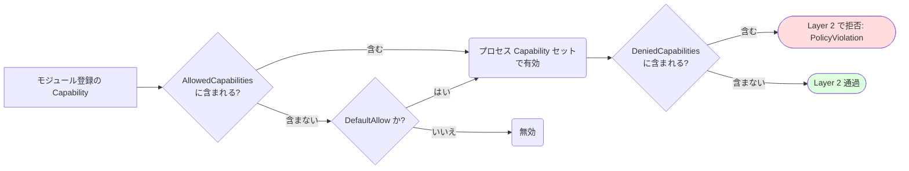

**[English](../en/safety.md)** | [概要に戻る](overview.md)

# Safety & Capabilities

UAIP はコマンドごとの認可を 4 つの層で管理します。層を理解することで、エラーの原因を素早く特定し、ワークフローに合った適切な権限を設定できます。

---

## 認可の 4 層構造

| 層 | メカニズム | スコープ | 失敗時のエラー |
|---|---|---|---|
| 1 | `FCapabilitySet` — エディタ起動時に SafetyPolicy から一度だけ確定するプロセス全体の Capability セット | プロセス全体（全セッションが共有） | `CapabilityNotAvailable` |
| 1.5 | `FRoleGate` — セッションに束縛された deny-only の降格。任意の役割トークンから解決される | セッション単位（Layer 1 が許可した範囲を狭めるだけで、Capability を追加することは無い） | `CapabilityNotAvailable` |
| 2 | `FSafetyPolicy` のブールスイッチ / `DeniedCapabilities` | プロセス全体（実行時不変） | `PolicyViolation` |
| 3 | ルート単位のオプトイン（シナリオルートなど） | プロセス全体 | `PolicyViolation` |
| 4 | `ICommandHandler::IsAvailable()` — Layer 1〜3 を通過した後に評価される、ハンドラが「今この場で実際に動けるか」のコマンド単位・プロセス単位の自己申告 | コマンド単位（各ハンドラが自分自身について答える。セッション単位・プロセス単位のスイッチではない） | 環境・ビルド起因の理由なら `AbilityUnavailable`、SafetyPolicy フラグが理由の唯一のケースなら `PolicyViolation`（後述） |

Layer 1 は「セッション単位」**ではありません** — 起動時に確定し（または `ReloadCapabilities` でプロセス全体として再読込され）、すべてのセッションが共有する単一の Capability セットです。セッションごとに変わるのは Layer 1.5 だけです。役割（後述の [役割](#役割layer-15)）が設定されており、あるセッションがその役割に束縛されている場合、そのセッションに限って役割の deny リストが Layer 1 のセットと積を取られます。役割が束縛されていないセッションは、Layer 1 単独と全く同じ挙動をします。

「必要な Capability が無いと `CapabilityNotAvailable`」には例外が 1 つあります。`CreateAsset` による MetaHuman キャラクター（`MetaHumanAssetCreate`）と Control Rig Blueprint（`ControlRigBlueprintCreate`）の作成です。この 2 つは作成を止めるインターセプターが判定するため、Capability が単に許可されていない場合も、`DeniedCapabilities` で拒否されている場合も `PolicyViolation` を返します（後者は、許可を足しても拒否は解けないため、許可を勧める文言は付きません）。`ControlRigBlueprintCreate` を拒否する役割に束縛されたセッションも、後述のとおり `PolicyViolation` で拒否されます。

Layer 4 は Layer 1〜3 とは性質の異なるチェックであり、この区別ははっきりさせておく価値があります。Layer 1〜3 はどれも「このセッション・このプロセスに何が許可されているか」を判定するもので、そこでの拒否はすべて運用者がどこかのスイッチ（Capability、SafetyPolicy フラグ、起動フラグ）を切り替えれば直ります。Layer 4 は権限とは別に「ハンドラが今この場で実際に仕事をこなせるか」を判定するもので、失敗理由の大半（対応していないエンジンバージョン、対象を除外するビルド構成、必要なインフラが無い、エンジンや Toolset の転送先がその API をそもそも公開していない）には**それを直す ini フラグも Capability 付与も存在しません**。内訳の全体は [API リファレンス → `UnavailableDetail`](api.md#65-コマンド可用性フィールド) を参照してください。唯一の例外は、既定で無効な SafetyPolicy フラグでゲートされているハンドラ（`UnavailableDetail: SafetyPolicyDisabled`）です。これは Layer 2 の拒否と同じ形で、`Config/DefaultUAIP.ini` でフラグを設定して再起動すれば直ります。この 1 件だけが `AbilityUnavailable` ではなく `PolicyViolation` に写像される理由もここにあります。

```mermaid
flowchart TB
    Cmd([CommandRequest])
    L1[Layer 1: プロセス Capability セット]
    L15[Layer 1.5: Role Gate<br/>deny-only・セッション単位]
    L2[Layer 2: SafetyPolicy + DeniedCapabilities + DeniedCommands]
    L3[Layer 3: ルート opt-in フラグ]
    L4[Layer 4: ICommandHandler::IsAvailable&#40;&#41;<br/>コマンド単位の自己申告]
    Exec([ゲームスレッドで実行])

    Cmd --> L1
    L1 -- "必要 Capability 不足" --> E1([CapabilityNotAvailable])
    L1 -- ok --> L15
    L15 -- "セッションの役割が Capability を拒否" --> E15([CapabilityNotAvailable])
    L15 -- ok --> L2
    L2 -- "Capability 拒否 / ReadOnly / DisableSave 等" --> E2([PolicyViolation])
    L2 -- ok --> L3
    L3 -- "起動時にルートフラグなし" --> E3([PolicyViolation])
    L3 -- ok --> L4
    L4 -- "環境・ビルド起因（ini フラグでは直らない）" --> E4a([AbilityUnavailable])
    L4 -- "SafetyPolicy フラグが無効（SafetyPolicyDisabled）" --> E4b([PolicyViolation])
    L4 -- ok --> Exec

    style E1 fill:#fdd
    style E15 fill:#fdd
    style E2 fill:#fdd
    style E3 fill:#fdd
    style E4a fill:#fdd
    style E4b fill:#fdd
```



`AllowedCapabilities` と `DeniedCapabilities` は Layer 1 / 2 で **deny-wins** セマンティクスで相互作用します：



---

## 役割（Layer 1.5）

役割（role）は、それに束縛されたセッションについて、プロセス全体の Capability セット（Layer 1）を狭めます。役割は **deny-only** です — プロセスが既に持っている Capability を取り上げることしかできず、プロセスが持たない Capability を追加することは決してできません。これにより、役割定義による権限昇格は「規約で避ける」ものではなく「構造的に不可能」になっています。

役割は、同じエディタに対して信頼レベルの異なる複数の AI エージェントを同時に動かす用途を想定しています。例えば、アセットを編集できる実装役のエージェントと、誤操作であっても変更系コマンドを一切呼ばないレビュー役のエージェントを分けたい場合です。

### 役割の定義

`Config/DefaultUAIP.ini` の `[UAIP.Roles]` に、役割ごとに 1 行 `+Role=` を追加します。

```ini
[UAIP.Roles]
+Role=(Name="reviewer", DeniedCapabilities=("BlueprintEdit","AssetCreate","AssetDelete","EditorActorEdit"))
+Role=(Name="implementer", DeniedCapabilities=())

; 役割を運べない Transport（後述）も併用する場合のみ必要
; AllowRoleBlindTransports=False
```

- `Name` は `[A-Za-z0-9_-]{1,64}` に一致し、このセクション内で一意である必要があります。不正な形式・重複する名前はエディタ起動時に拒否されます（該当行はスキップされ、エラーとしてログに記録されます。実行時まで持ち越して黙って受理することはありません）。
- `DeniedCapabilities` は何も拒否しない役割のために空（`DeniedCapabilities=()`）にできます。
- `[UAIP.Roles]` に `+Role=` 行が 1 つも無い場合、役割機能は**完全に無効**のままです — 全セッションが、本機能導入前と同じ、プロセス全体の Capability セットをそのまま保持します。

### セッションが役割に束縛される仕組み

役割は `SessionId` から推測されることはありません。この値は MCP / HTTP 経由で呼び出し側が自由に指定できる文字列であり、身元の根拠にはできないためです。代わりに次の仕組みを使います。

- **MCP モード**（`-uaip-mcp-enable`）のリクエストだけが `Authorization: Bearer <role-token>` で役割を運べます。
- エディタは起動時に定義済みの役割ごとに 1 つトークンを生成し、`Saved/UAIP/Roles/<RoleName>.token` へ書き出します（バージョン管理対象外。既存の HTTP/WS 認証トークンと同じ扱いです）。
- MCP Bridge の `config.json` は `role_name` を渡すと（対応するトークンファイルを自動で読み込みます）、あるいはトークンを別の方法で払い出している場合は `role_token` を直接渡すこともできます。どちらも環境変数 `UAIP_ROLE_NAME` / `UAIP_ROLE_TOKEN` で上書きできます。両方とも空のままなら、役割導入前と全く同じリクエストが送られます。
- ある `SessionId` を最初に運んできたリクエストが、そのセッションを解決済みの役割へ束縛します。以降の同じ `SessionId` のリクエストはすべてこの束縛と照合され、不一致の役割は拒否されます — 接続の途中でセッションの役割が変わることはありません。

役割は（リクエストごとではなく）MCP クライアントの接続ごとに、そのクライアント自身の Bridge 設定で構成されるため、「1 つの Bridge プロセスが 1 つの UAIP セッションに対応する」という仕組みと自然に組み合わさります。詳細は Architecture の [セッションライフサイクル](architecture.md#6-セッションライフサイクル) を参照してください。

### 役割を運べない Transport

WebSocket・CLI・HTTP Transport の FullHTTP モードは単一の共有シークレットで認証しており、役割を識別する手段がありません。`[UAIP.Roles]` が 1 つでも役割を定義すると、これらの Transport は**既定で起動を拒否**します — 起動を許すと、これら経由で接続した人が役割の制限をすべて黙って迂回できてしまうためです。`AllowRoleBlindTransports=True` を設定すればそれでも起動しますが、影響を受ける Transport ごとに起動時に警告がログへ出るため、迂回の存在は見える形のままになります。そしてそこ経由で発行されたコマンドは、役割による制限を受けないプロセス全体の Capability セットで実行されます。

### 役割による制限がクライアントにどう見えるか

- `uaip_list_commands` は、役割で拒否されたコマンドを、他の不可用コマンドと同じ扱いで既定応答から除外し、`HiddenReasons.RoleRestricted` に計上します（詳細は [コマンドリファレンス → discovery フィルタ](commands.md) を参照）。
- `uaip_describe_command` は役割で拒否されたコマンドも隠さず表示し、`UnavailableReason: "RoleRestricted"` を付けます。
- `uaip_query_capabilities` の `Capabilities` フィールドは、プロセス全体のセットではなく **セッションの役割で絞り込んだ後**のセットを返します。したがって役割が拒否している Capability が、その役割のセッションに対して「使える」と表示されることはありません。一方 `RegisteredCapabilities` カタログ（`IncludeUnavailable: true` で要求します）は**絞り込みません** — ロード済みモジュールが宣言したすべての Capability を列挙し、このセッションが使えないものには `IsGranted: false` を付けます。これは意図的な設計です。ある Capability の存在を見られなければ、クライアントは運用者へ有効化を依頼することも、期待したコマンドが無い理由を理解することもできません。カタログに現れるのは名前と既定方針だけで、操作そのものは引き続き役割が拒否します。
- 役割で拒否されたコマンドを呼ぶと、プロセス側の Capability 不足と同じ `CapabilityNotAvailable` エラーコードが返りますが、`ErrorMessage` には役割名と Capability 名の両方が入るため、対処の読み方が変わります。プロセス側の Capability 不足は運用者が有効化することで解消しますが、役割による制限は「その役割ではその操作を行わない」ことが解消であり、有効化すべき設定はありません。

---

## この機能が防ぐもの・防がないもの

Layer 1.5（役割）も、役割を識別するトークン認証も、**事故を防ぐための仕組み**であり、敵対者に対する防御境界ではありません。同一ユーザーアカウント・同一マシンで動く AI エージェントに対して資格情報を秘匿する手段は存在しません。トークンをファイルへ書けば読まれ、環境変数へ書けばプロセス環境から読まれ、設定ファイルへ書けば設定ファイルを読まれます。これは既知の恒久的な制約であり、いずれ修正されるバグではありません。

| 想定行動 | 効果 |
|---|---|
| 別の `SessionId` を指定して再試行する | **防ぐ**。MCP Bridge が自分の接続用に発行した `SessionId` で毎回上書きするため、MCP クライアント経由では別のセッションをそもそも表現できません |
| `SessionId` を省略して匿名セッションへ逃げる | **防ぐ**。Bridge が転送するすべての呼び出しへ自分のセッション ID を注入します |
| 役割を運べない Transport（WS / CLI / FullHTTP）へ接続する | 役割が 1 つでも定義されていれば**既定で防ぐ**（該当 Transport が起動を拒否します。詳細は前述の [役割](#役割layer-15) を参照）。運用者が `AllowRoleBlindTransports=True` で明示的に併用を許可した場合は防げませんが、その場合は迂回の存在が起動ログで可視化されます |
| 別の Bridge インスタンス・別のトークンへ MCP クライアントを向け直す | **技術的には防ぎません**。これが可能かどうかは、AI エージェントが MCP クライアント自身の設定ファイルを編集できるかという **OS のファイル権限に完全に依存**します。エージェントが広いファイルシステムアクセス権を持つ環境では、この前提は自動的には成立しません |
| `curl` や生の HTTP クライアントで `POST /mcp` を直接叩く | **防ぎません**。トークン認証はトークンが無い・間違っているリクエストを拒否しますが、トークンファイルを読めるエージェントであれば正しいリクエストを組み立てられます |
| UAIP を経由しない操作（Python スクリプト、Editor Utility Widget など） | **防ぎません**。定義上 UAIP の認可スタックの管轄外です |

本機能が実際に提供するのは次の2点です。

1. **境界の明示**。迂回はもはや事故ではなく、トークンファイルを読む・Bridge の設定ファイルを書き換える・別の方法でクライアントを起動するといった**意図的な行為**になります。
2. **可観測性**。認証失敗・役割束縛の不一致・役割制限による dispatch 拒否はすべて警告としてログに記録されるため、迂回の試み（偶発的であれ意図的であれ）は事後に確認できます。

---

## Capability リファレンス

各コマンドは必要な Capability を宣言しています。プロセスが必要な Capability をすべて持っており（Layer 1）、かつセッションが役割に束縛されている場合はその役割がいずれも拒否していないとき（Layer 1.5）だけコマンドを実行できます。Capability には **DefaultAllow**（自動付与）と **DefaultDenied**（`Config/DefaultUAIP.ini` で明示的に有効化が必要）の 2 種類があります。

🧩 付きの Capability はオプションプラグインへの依存があります。エディタビルド（ソースビルドでも Fab 配布の製品版バイナリでも同じ）では、**利用しているエンジンにそのプラグインが存在する限り** Capability は登録されます — プロジェクトの `.uproject` での明示宣言もリビルドも不要です。問題になるのはそのプラグインが**有効かどうか**だけです。無効なら Capability は登録されず、必要とするコマンドは `CommandNotFound` を返します — プラグインを有効にしてエディタを再起動すれば読み込まれます。プラグイン自体がこのエンジン版に存在しない場合は有効化のしようがなく、`CommandNotFound` はその旨を案内します。`CompiledOut` の統合は、コードがバイナリに組み込まれていない統合です。ビルド時に統合先のプラグインが有効と判定されなかったか、エンジン版が統合の対応版より古い場合で、後者では `MissingPlugins` が空になり、`Remedy` に必要な最小エンジン版が書かれます。エンジンにインストールした Fab 配布版の UAIP からパッケージしたゲームでは、これらの統合は組み込まれません。UAIP をプロジェクトの `Plugins` フォルダーに置き、プロジェクトと一緒にコンパイルしてください。いずれの場合も `UAIP.Core.ListIntegrations` を呼べば、すべてのオプション統合の状態と対処が一度に分かり、該当コマンドの `CommandNotFound` 応答にも統合名と対処が直接付きます。

### どんな Capability が存在するかを調べる

`QueryCapabilities` は 1 つの応答で異なる 2 つの問いに答えます。両者は区別して読んでください。

| フィールド | 答える問い |
|---|---|
| `Capabilities` | **このセッションが今使えるものは何か。** 実効セット — プロセスの Capability セットから `DeniedCapabilities` の分を引き、さらにセッションが束縛されている役割が拒否する分を引いたもの |
| `RegisteredCapabilityCount` / `UngrantedCapabilityCount` | **どれだけ存在し、そのうちこのセッションが使えないものは何件か。** 常に返します（0 件のときも返します）。フィールドが無いことから「未付与は無い」を推測する必要がありません |
| `RegisteredCapabilities` | **そもそも何が存在するか。** ロード済みモジュールが宣言したすべての Capability を、このセッションが保有しているかどうかに関わらず列挙します。各要素は `Name`・`DefaultPolicy`（`Allowed` / `Denied`）・`IsGranted` を持ち、実行中の版が提供しない Capability にはさらに `UnavailableReason: "NotInThisEdition"` が付きます（[デモ版が提供しない Capability](#デモ版が提供しない-capability)）。ここに `IsGranted: false` で現れる名前が、運用者へ有効化を依頼すべきものです。ただし `UnavailableReason` が付いているものは、付与しても変わりません。**`IncludeUnavailable: true` を渡したときだけ返ります** |

カタログは**オプトイン**です。`uaip_list_commands` が既定で利用不可のコマンドを隠すのと同じ理由で、通常のエディタでは 100 件を優に超えるうえ、このコマンドは「最初に呼べ」と案内しているものだからです。受け取るには `IncludeUnavailable: true` を渡します。一方で、**カタログの存在自体は隠しません** — 2 つの件数は毎回返るため、一度もオプトインしていないセッションでも「保有していない Capability が何件あるか」を知り、そのうえで一覧を要求できます。

**「運用者が有効化しなければならないものは何か」は `RegisteredCapabilities` だけで分かります** — `DefaultPolicy` が `Denied` の要素がそれにあたります（`UnavailableReason` が付いた要素は、付与しても有効にならないので除きます）。この一覧を別フィールドとして返すことは意図的にしていません。カタログに既にある名前を繰り返すだけで、新しい情報を持たないからです。

このカタログが必要なのは、DefaultDenied な Capability が定義上そもそも実効セットに現れないためです。多くの場合これは問題になりません — いずれかのコマンドの `RequiredCapabilities` に現れるので `uaip_describe_command` で名前が分かります。例外が `PropertyReferenceEdit` と `PropertyStructuredEdit` で、この 2 つは書き込み対象プロパティの型から dispatch のはるか後に判定されるため、どのコマンドも宣言しません。付与される前にこの 2 つを見つけられる場所は、このカタログだけです。

開示されるのは Capability の名前と既定方針だけです。プロジェクトの内容も値も含まれません。

### デモ版が提供しない Capability

無償のデモ版は含まれるコマンドが一部だけですが、含まれないコマンドの Capability も、通常の既定ポリシーのまま**登録**します。そのため、Capability のカタログの形はどちらの版でも同じです。デモ版のどのコマンドも要求しない Capability には、**「この版では使えない」の印**が付きます。印の付いた Capability は次のように振る舞います。

- `QueryCapabilities` は、`RegisteredCapabilities` に `UnavailableReason: "NotInThisEdition"` と `IsGranted: false` を付けて列挙し、`UngrantedCapabilityCount` にも数えます。
- 付与される経路が何であっても付与されません。`+AllowedCapabilities` への記載、コマンド Provider の宣言、DefaultAllow のいずれでも同じです（DefaultAllow の `LiveCoding` も、デモ版では付与されません）。`UAIP.Core.ReloadCapabilities` を呼んでも変わりません。
- `[UAIP.SafetyPolicy]` の `AllowedCapabilities` に書くと、起動時にエディタが警告を出します: `Capability '<Name>' is granted in [UAIP.SafetyPolicy] but is not available in this edition of UAIP. The grant has no effect.` `DeniedCapabilities` に書いた場合は実際の状態と一致するので、この警告は出ません。
- 製品版は何にも印を付けません。カタログも実効セットも従来と同じです。

印は Capability の既定ポリシーを変えません。また、**デモ版の利用者が使えない Capability のすべてに印が付くわけではありません**。デモ版がそもそも登録しない Capability（`CommonUIProjectCodeExecution` が例）はカタログに現れず、印もありません。ini に書いても効果がない点は同じです。デモ版のコマンドが要求しうる Capability（`RuntimeCVarRead`、`BlackboardValueRead` など）には印が付きません。`EditorWindowStateControl` は、`SetEditorWindowState` がデモ版に含まれるので、デモ版にも登録され、印は付きません。

---

### DefaultAllow（デフォルトで有効）

設定不要で全セッションに付与されます。読み取り専用の観測と、一般的な非破壊操作をカバーします。

| Capability | 有効になる操作 |
|---|---|
| `EditorObservation` | スクリーンショット（`CaptureActiveWindowImage`、`CaptureEditorTabImage`、`CaptureGraphViewportImage`）および JSON 状態ダンプ（`DumpEditorState`、`DumpSlateTree`、`DumpSelectionState`、`DumpOutputLog`、`DumpMessageLog` など） |
| `EditorInspect` | Editor 状態の読み取り専用検査 — アセット・詳細パネル・ビューポート・グラフ情報。共有インフラコマンドが使用 |
| `EditorUIAutomation` | UI 駆動コマンド — `ClickWidget`、`SelectMenuItem`、`InputText`、`SetCheckboxState`、`DragGraphNode`、`AcceptDialog`、`CancelDialog`、`InvokeContextMenuAction`、`WaitForWidget`、`FillForm`、`SnapshotUI`、`DismissMenus` など、およびその `Toolset.Editor.SlateInspector.*` ブリッジ版。ブリッジ版も同じ Capability を要求するようになった（旧リリースでは Capability チェックなしにディスパッチされていた） |
| `EditorWorkspaceControl` | タブ・パネル管理 — タブの開閉、グラフエディタのフォーカス、エディタレイアウトの制御 |
| `EditorLifecycle` | エディタライフサイクル操作 — `SaveAll`、`ShutdownEditor`、`RestartEditor` |
| `EditorExecution` | エディタからの Automation Test 実行・Editor Utility Blueprint の実行 |
| `LiveCoding` | ホットリロード・Live Coding コンパイルのトリガー |
| `CrashReportRead` | クラッシュレポート診断情報へのアクセス |
| `AssetCreate` | コンテンツブラウザでの新規アセット作成 |
| `AssetMutate` | 既存アセットのプロパティ変更 |
| `AssetWindowControl` | アセットエディタの開閉 |
| `PIEControl` | PIE セッション制御 — `StartPIE`、`StopPIE`、`PausePIE`、`ResumePIE`、`LoadMap` |
| `RuntimeInspect` | ランタイムワールド状態の読み取り専用検査 — `DumpWorldState`、`DumpActorState`、`DumpComponentState`、`DumpRuntimeLog`、`CapturePerformanceSnapshot`、`SearchLoadedClasses`、および AI の感知を観測する 6 コマンド `DumpAIPerceptionState`、`GetPerceivedActors`、`GetActorPerceivers`、`DumpAIPerceptionSystemState`、`ExplainSightPerception`、`DumpAIPerceptionSenseConfigs`（最後の 1 つは `AIPerceptionConfigDump` も必要。[Runtime AI の感知](#runtime-ai-の感知) を参照）、BehaviorTree・Blackboard・StateTree の 15 コマンド `ListBehaviorTreeAgents`・`GetActiveBehaviorTreeNode`・`DumpBehaviorTreeState`・`GetBlackboardValues`・`DescribeBehaviorTreeWithProjectCode`・`StartBehaviorTreeCapture`・`GetBehaviorTreeEventLog`・`StopBehaviorTreeCapture`・`ListStateTreeComponents`・`GetActiveStateTreeState`・`DumpStateTreeState`・`DumpStateTreeInstanceData`・`StartStateTreeCapture`・`GetStateTreeEventLog`・`StopStateTreeCapture`（`GetBlackboardValues` は `BlackboardValueRead` も、`DescribeBehaviorTreeWithProjectCode` は `BlackboardValueRead` と `AIBehaviorProjectCodeExecution` も、`DumpStateTreeInstanceData` は `StateTreeInstanceDataDump` も必要。[Runtime AI のビヘイビアツリーと Blackboard](#runtime-ai-のビヘイビアツリーと-blackboard) と [Runtime StateTree の観測](#runtime-statetree-の観測) を参照）、および Chaos 破壊の 8 コマンド `ListGeometryCollections`、`DumpGeometryCollectionState`、`DumpChaosFieldState`、`StartDestructionCapture`、`GetDestructionEventLog`、`StopDestructionCapture`、`CaptureGeometryCollectionStrain`、`EnableForcedDestructionNotify`（最後の 1 つは `ChaosDestructionForceNotify` も必要で、これはデモ版では提供されない。[Runtime Chaos 破壊](#runtime-chaos-破壊) を参照）、および読み取り専用のナビゲーション 7 コマンド `DumpNavigationSystemState`、`FindPath`、`IsLocationReachable`、`DumpNavMeshTiles`、`QueryNavModifiers`、`GetPathFollowingState`、`WaitForNavigationBuild`（`FindPath` と `IsLocationReachable` は、8192 を超える探索ノードでは `RuntimeNavigationExtendedSearch` も必要。[Runtime ナビゲーション](#runtime-ナビゲーション) を参照）、およびアニメーションの 7 コマンド `DumpAnimInstanceState`、`GetAnimStateMachineStates`、`GetAnimBlendWeights`、`GetActiveMontages`、`GetAnimCurveValues`、`DumpAnimInstanceVariables`、`GetMotionMatchingState`（`DumpAnimInstanceVariables` は `AnimInstanceVariableDump` も必要。[Runtime アニメーション](#runtime-アニメーション) を参照）、およびネットワークの 5 コマンド `GetNetDriverState`、`ListNetConnections`、`DumpActorReplication`、`DumpReplicatedPropertyValues`、`CompareReplicatedProperties`（後ろの 2 つは `RuntimeReplicatedPropertyValueRead` も、`IncludeRemoteAddress` を指定した `ListNetConnections` は `RuntimeNetConnectionAddressRead` も必要。[Runtime ネットワークとレプリケーション](#runtime-ネットワークとレプリケーション) を参照）、および Subsystem の 2 コマンド `ListSubsystems`、`DumpSubsystemState`（後者は `SubsystemStateDump` も必要。[Runtime Subsystem](#runtime-subsystem) を参照）、およびゲームビューポートの UI の 3 コマンド `DumpGameViewportWidgets`、`FindGameViewportWidgets`、`DumpHUDState`（[Runtime ゲームビューポートの UI](#runtime-ゲームビューポートの-ui) を参照）、CommonUI の 4 コマンド `DumpActivatableStacks`、`GetInputState`、`GetActionDisplayNames`、`DescribeActivatableWidgetsWithProjectCode`（`GetActionDisplayNames` は `RuntimeWidgetTextRead` も、`DescribeActivatableWidgetsWithProjectCode` は `CommonUIProjectCodeExecution` も必要。[Runtime CommonUI の観測](#runtime-commonui-の観測) を参照）、および `EvaluateInputGateWithProjectCode`（`InputProjectCodeExecution` も必要。[Runtime ゲーム入力のゲート](#runtime-ゲーム入力のゲート) を参照） |
| `RuntimeCapture` | ランタイムキャプチャ — `CaptureViewportImage`、`CheckpointCapture`（後者は `RuntimeInspect` も必要） |
| `RuntimeExecution` | PIE または Standalone での機能テスト・Automation Test の実行 |
| `RuntimeGASInspect` 🧩 | PIE 中の GAS 状態読み取り — `GetAttributeValues`、`GetActiveEffects`、`GetGrantedAbilities`、`GetActiveTags`、`FindAttributeSetClasses`（`GameplayAbilities` プラグイン必須） |
| `RuntimeNiagaraInspect` 🧩 | PIE 中の Niagara コンポーネント状態読み取り — `GetUserVariables`、`GetVariable`（`Niagara` プラグイン必須） |
| `SandboxObserve` 🧩 | アクティブな Sandbox の観測 — `GetSandboxStatus`、`GetSandboxChanges`（`FileSandbox` プラグイン必須） |
| `RuntimeInsightsInspect` | Unreal Insights トレースの読み取り専用検査 — `ListTraceChannels`、`GetTraceStatus`、`ListTraceFiles`。トレースの開始・停止・変更は一切できません |
| `RuntimeSaveGameInspect` | セーブスロットとスナップショットの読み取り専用の確認 — `ListSaveGameSlots`、`GetSaveGameInfo`、`ListSaveGameSnapshots`。名前・サイズ・日時・ヘッダのメタ情報・内容のハッシュを返します。スロットに保存された値は返さず、クラスも読み込みません。[Runtime SaveGame スロット](#runtime-savegame-スロット) を参照 |
| `ArtifactContentRead` | セッションが生成した成果物の保存内容を読み出す — `UAIP.Core.Artifacts.GetArtifact`。他のセッションの成果物には届かない |
| `PendingInteractionInspect` | 保留中の対話の状態照会・キャンセル — `GetPendingInteractionStatus`、`WaitForPendingInteraction`、`CancelPendingInteraction`。読み取り専用の照会のみで、対話の開始（`DrawPCGSpline` など）は対話型コマンド自身の Capability と `SafetyPolicy.AllowUserInteractionPrompt` によって別途ゲートされます |

---

### DefaultDenied（デフォルトで無効）

`Config/DefaultUAIP.ini` の `[UAIP.SafetyPolicy]` に `+AllowedCapabilities=<名前>` を追加して明示的に有効化する必要があります。破壊的な操作や重大な編集操作をカバーします。

#### Blueprint・AnimBlueprint 編集

| Capability | 有効になる操作 |
|---|---|
| `BlueprintEdit` | Blueprint アセットのコンパイルと構造検査 |
| `BlueprintVariableEdit` | Blueprint 変数の追加・削除・変更 |
| `BlueprintGraphEdit` | Blueprint グラフへのノード追加・削除・接続、親クラスまたはインターフェースの関数をオーバーライドする関数グラフの追加 |
| `BlueprintComponentEdit` | Blueprint SCS コンポーネントの追加・削除・リネーム・親変更・複製・プロパティ編集 |
| `AnimBlueprintGraphEdit` | AnimGraph へのノード追加・削除・接続、Anim Blueprint のコンパイル |
| `AnimBlueprintCustomTypeEdit` | `AddAnimGraphNode` の `NodeClass` が、このドメインが信頼する 3 モジュール（`AnimGraph` / `AnimGraphRuntime` / `Engine`）以外 — プロジェクトやプラグインが定義した `UAnimGraphNode_Base` 派生クラス — のとき必要。このドメインには対になる「危険なノード」用の Capability はない。8 種のノードは、どの Capability を持っていても無条件で拒否される。[コマンド — UAIP.Editor.AnimBlueprint](commands.md#uaipeditoranimblueprint) を参照 |
| `AnimStateMachineEdit` | Anim ステートマシンへの State・Transition の追加・削除 |
| `AnimBlueprintReferenceEdit` | Anim Blueprint 上でオブジェクト参照を含む（または参照そのものである）プロパティ・実装済みインターフェース参照・埋め込み UAF グラフ参照を書き込むときに必要。`SetAnimGraphNodeProperty` は書き込みが実際に参照へ触れるときだけ動的に確認する。`ImplementAnimLayerInterface` と `AddUAFGraphNodeToAnimBlueprint` は毎回参照を書き込むため静的に宣言する。`AddLinkedAnimLayerNode` は `InterfacePath` 指定時だけ動的に確認する（自己完結型レイヤーノードは参照を書き込まない） |

#### Level / アクター / プロパティ編集

| Capability | 有効になる操作 |
|---|---|
| `EditorActorEdit` | Level Editor でのアクターの生成・削除・トランスフォーム変更 |
| `EditorLevelLoad` | エディタビューポートでのレベルオープン・新規作成 |
| `EditorViewportControl` | Level Editor ビューポートカメラの操作 — `FocusOnActors`、`GetCameraTransform`、`SetCameraTransform` |
| `ActorComponentEdit` | **レベルに配置済みのアクター**に対するコンポーネントの追加・削除・付け替えと、そのプロパティの書き込み — `AddActorComponent`、`DeleteActorComponent`、`ReparentActorComponent`、`SetActorComponentProperty`。`EditorActorEdit` と分けてあるのは、変えるものが違うため — あちらはアクターそのものを動かし・消すもので、こちらはアクターが何でできていて、どう設定されているかを変えるもの。コンポーネントのプロパティの読み取り（`GetActorComponentProperty`）と一覧取得（`ListActorComponents`）には `EditorInspect` だけで足りる。値が参照や複合型である書き込みには、加えて `PropertyReferenceEdit` / `PropertyStructuredEdit` が必要 — どちらが要るかは先に `GetActorComponentProperty` を呼べば分かる |
| `ComponentCustomTypeEdit` | そのクラスのコンポーネントの**インスタンス数が増える**操作で、かつそのクラスが `/Script/Engine` と `/Script/LiveLinkComponents` のいずれでも宣言されていない場合に、コマンド自身の Capability に**加えて**必要になる（プロジェクトの C++ が定義したコンポーネント、他プラグイン（Niagara などエンジン同梱プラグインを含む）が定義したもの、Blueprint 由来のコンポーネントクラスが該当）。該当する 3 コマンドが共有する — `AddActorComponent`（インスタンス側。`ActorComponentEdit` と併用）と `AddBlueprintComponent` / `DuplicateBlueprintComponent`（Blueprint / SCS 側。`BlueprintComponentEdit` と併用）。1 つの名前に統一しているのは、片方の経路にだけ付与しても、もう一方から同じクラスへ到達できてしまわないようにするため。⚠️ **Blueprint 側の 2 コマンドにとっては挙動の変更です** — 下の Note を参照。コンポーネントの削除・リネーム・付け替え・プロパティ書き込みは対象**外**（いずれもインスタンス数を増やさないため） |
| `PropertyEdit` | 詳細パネル経由でのアクター / アセットプロパティの読み書き（`GetActorProperty`、`SetActorProperty`、`GetAssetProperty`、`SetAssetProperty` など） |
| `PropertyReferenceEdit` | 値がオブジェクト / クラス / ソフト / ウィーク / レイジー / インターフェース参照、デリゲート、フィールドパスであるか、それらを（どの深さであれ）内包するプロパティの書き込み。参照を空にする操作にも必要 — 依存関係を付けることと外すことは同じ種類の変更であるため |
| `PropertyStructuredEdit` | 組み込みの値カタログ外の構造体・配列・セット・マップ・オプショナル・固定長配列の書き込みと、値全体を置き換える代わりにコンテナの要素 1 つを操作すること |
| `PropertyDefaultsOnlyEdit` | エディタがその種類の対象では「既定値の側でだけ」見せるプロパティの書き込み（インスタンスへ書く `EditDefaultsOnly`、テンプレートへ書く `EditInstanceOnly`）。エディタ本体の詳細パネルはこれらを実際に編集できる。この指定はパネルのどこに行が出るかを決めるものであって編集できるかを決めるものではなく、ノードを保持するグラフエディタは明示的にその行を出している。一律に拒否すると自動化しようとしているエディタより厳しくなるため、拒否は「壁」ではなく「権限で開く」形にしてある。編集フラグを持たないプロパティ・`EditConst`・非推奨は、どの権限を持っていても拒否される |
| `StateTreeNodeReferenceEdit` | 参照へ到達しうる型を持つ StateTree ノードプロパティの書き込み。汎用の `PropertyReferenceEdit` ではなくこちらを要求するのは、StateTree の参照を開くことが他のすべての参照を開くことにならないようにするため |
| `EQSNodePropertyReferenceEdit` | 参照へ到達しうる型を持つ EQS の生成器・テストのプロパティの書き込み。`FAIDataProvider` のプロパティにも必要で、これは値が定数を表すかバインディングを表すかに関わらず `UAIDataProvider` のポインタを保持するため |
| `BehaviorTreeNodeReferenceEdit` | 参照へ到達しうる型を持つビヘイビアツリーのノードプロパティの書き込み。ブラックボードのキー選択は専用の経路で書かれるため対象外 |
| `WorldConditionPropertyReferenceEdit` | 参照へ到達しうる型を持つ World Condition のプロパティの書き込み |
| `ProjectConfigEdit` | プロジェクト設定の読み書き（`GetProjectSetting`、`SetProjectSetting`） |
| `EditorUndoRedo` | エディタ操作の Undo / Redo |

> ⚠️ **破壊的変更 — `ComponentCustomTypeEdit` が `AddBlueprintComponent` と `DuplicateBlueprintComponent` にも適用されるようになりました。** これまでこの種の判定は他ドメインのクラス許可リストだけのもので、Blueprint 上でのコンポーネントクラスの追加・複製はクラスに関わらず `BlueprintComponentEdit` だけで通っていました。これまで `BlueprintComponentEdit` だけでプロジェクト定義のコンポーネントを追加・複製できていたセッションは、`ComponentCustomTypeEdit` を名指しした `CapabilityNotAvailable` で拒否されるようになります。`+AllowedCapabilities=ComponentCustomTypeEdit` を追加すると従来どおりに戻ります。両方の経路を同時に対象にしたのは、新設のインスタンス側コマンドだけをゲートしても Blueprint 側が迂回路として残ってしまうためです。この要件はコマンド実行中にクラスから決まるため、3 コマンドいずれの `RequiredCapabilities` にも現れません。`ListActorComponents` がクラスごとに「追加に何が要るか」を返し（`Admission` / `RequiredCapabilities` / `MissingCapabilities`）、`QueryCapabilities` を `IncludeUnavailable: true` で呼べばカタログにこの名前が載ります。[コマンドリファレンス — コンポーネント — SCS](commands.md#コンポーネント--scs8) を参照。

> **Note**: `PropertyReferenceEdit` と `PropertyStructuredEdit` は `UAIP.Editor.Property` 限定ではありません。Blueprint SCS コンポーネント、Sequencer セクション、Sound / SoundCue アセット、PCG / 会話ノード、DataTable 行、World / プロジェクト設定など、**プロパティを書き込むすべてのドメイン**で参照・構造体・コンテナの書き込みを制御します。参照を内包する構造体の書き込みには両方が必要なので、構造側だけで参照のゲートを迂回することはできません。
>
> すでに独自の Capability で参照の書き込みを管理しているモジュールは、参照側についてはその名前を使い続けます — `SetAnimNotifyProperty` は `AnimNotifyReferenceEdit`、`SetDataflowNodeProperty` は `DataflowReferenceEdit`、Subsonic のプロパティ setter 群は `SubsonicEventEdit`、`SetSlotProperties` は `WidgetSlotReferenceEdit`、Enhanced Input のマッピング mutator 群は `EnhancedInputReferenceEdit`、`SetStateTreeParameter` は `StateTreeParameterReferenceEdit`、`AddSetParameterEntry` / `AddSetParametersModule` で参照型パラメータの既定値を書く場合は `NiagaraReferenceEdit` です。構造・コンテナ側は常に `PropertyStructuredEdit` です。例外は `SetPoseSearchSchemaChannelProperty` で、参照については付与できる Capability がありません — 参照を内包する型を一律拒否します。チャンネルのサブチャンネル配列へ直接書けると `AddPoseSearchSchemaChannel` のクラス許可リストを迂回できてしまうためです。
>
> どちらも書き込み実行時にプロパティの型から決まるため、**いずれのコマンドの `RequiredCapabilities` にも現れず**、`uaip_describe_command` にも表示されません。ただし書き込みを試さずに見つけることはできます — `QueryCapabilities` を `IncludeUnavailable: true` で呼ぶと `RegisteredCapabilities` カタログがこの 2 つを列挙し、運用者が有効化するまで `DefaultPolicy: "Denied"` / `IsGranted: false` を返します（[どんな Capability が存在するかを調べる](#どんな-capability-が存在するかを調べる) 参照）。**個別のプロパティ**に何が必要かを知るには、先にそのプロパティを読む（`WriteRequirements` オブジェクトが、書き込みに必要なものと、そのうちセッションが既に保有しているものを返します）か、拒否の返答から名前を読み取ってください。[コマンドリファレンス — 参照・構造体・コンテナの書き込み](commands.md#参照構造体コンテナの書き込み) を参照。

#### アセット管理

| Capability | 有効になる操作 |
|---|---|
| `AssetDelete` | アセットの永続削除 |
| `FolderDelete` | コンテンツフォルダの永続削除 |
| `AssetFolderRefactor` | アセットとフォルダの移動・リネーム |
| `RedirectorFixup` | 古いアセットリダイレクタの修正 |
| `ShaderCompilation` | シェーダーコンパイルの制御とステータス照会 |
| `ContentBrowserNavigate` | Content Browser のナビゲートとアセット選択 — `SelectAssets`、`SetContentBrowserPath`（native および bridge） |
| `PrimaryAssetTypeAdd` | `PrimaryAssetType` を `PrimaryAssetTypesToScan` に追加（`AddPrimaryAssetType`、`DefaultGame.ini` へ永続化） |
| `PrimaryAssetTypeRemove` | `PrimaryAssetType` を `PrimaryAssetTypesToScan` から削除（`RemovePrimaryAssetType`、永続化） |
| `PrimaryAssetRulesOverride` | 指定 `PrimaryAssetId` の Rule をメモリ内で一時的に上書き（`SetPrimaryAssetRules`、非永続） |
| `PrimaryAssetLoad` | `PrimaryAsset` を明示的にメモリへロード（`LoadPrimaryAsset`） |
| `PrimaryAssetUnload` | `PrimaryAsset` を明示的にメモリからアンロード（`UnloadPrimaryAsset`） |

#### マテリアル編集

| Capability | 有効になる操作 |
|---|---|
| `MaterialGraphEdit` | Material グラフへのノード追加・削除・接続、マテリアルのコンパイル |
| `MaterialParameterEdit` | Material パラメータ値とデフォルト値の変更 |
| `MaterialCustomNodeEdit` | `AddMaterialNode` の `ExpressionClass` が `UMaterialExpressionCustom` / `UMaterialExpressionCustomOutput`、またはそのいずれかの派生クラス（任意の HLSL を含められる）のとき、どのモジュール由来かに関わらず必要。この変更以前から登録されていたが、これまでどのコマンドも要求していなかった |
| `MaterialCustomTypeEdit` | `AddMaterialNode` の `ExpressionClass` がエンジン組み込みモジュール（`Engine` / `RenderCore` / `MaterialEditor` / `Landscape`）以外 — プロジェクトやプラグインが定義した `UMaterialExpression` 派生クラス — のとき必要。プロジェクト定義かつカスタム HLSL のクラスは `MaterialCustomNodeEdit` とあわせて両方が必要 |

> **Note**: `MaterialCustomNodeEdit` / `MaterialCustomTypeEdit`、（上の [Blueprint・AnimBlueprint 編集](#blueprintanimblueprint-編集) にある）`AnimBlueprintCustomTypeEdit`、（下の [Motion Matching / Pose Search 編集](#motion-matching--pose-search-編集) にある）`MotionMatchingCustomTypeEdit`、（下の [Sequencer 編集](#sequencer-編集) にある）`SequencerCustomTypeEdit`、（下の [ControlRig 編集](#controlrig-編集) にある）`ControlRigCustomTypeEdit`、（下の [AI システム](#ai-システム) にある）`BehaviorTreeCustomTypeEdit` / `BehaviorTreeExternalBehaviorNodeEdit` / `BlackboardReferenceKeyTypeEdit`、（下の [StateTree 編集](#statetree-編集) にある）`StateTreeCustomTypeEdit`、（下の [SoundCue 編集](#soundcue-編集) にある）`SoundCueCustomTypeEdit`、（下の [ゲームプレイシステム](#ゲームプレイシステム) にある）`EnhancedInputCustomTypeEdit`、および（下の [オプショングラフエディタ](#オプショングラフエディタ) にある）`MetaSoundCustomTypeEdit` / `EQSCustomTypeEdit` / `EQSDelegatedGeneratorEdit` / `WorldConditionsCustomTypeEdit` / `ConversationCustomTypeEdit` は、ゲートされた型のノードを追加するときだけでなく、その既存ノードに触るあらゆる操作 — 編集・接続・切断・コンパイル・Reparent・削除 — でも同じ Capability があらためて確認されます。⚠️ この変更以前は、こうしたノードの削除・切断は無条件でゲートされていませんでした。もう追加できない型であることは、それ自体では既存ノードを削除・切断できない理由にはなりません。詳細は [コマンドリファレンス — Capability でゲートされたカスタム型](commands.md#capability-でゲートされたカスタム型) を参照してください。

#### DataTable 編集

| Capability | 有効になる操作 |
|---|---|
| `DataTableRowEdit` | DataTable アセットへの行追加・変更 |
| `DataTableRowDelete` | DataTable アセットからの行削除 |
| `DataTableImport` | DataTable アセットへの CSV/JSON データインポート |

#### 物理アセット編集

| Capability | 有効になる操作 |
|---|---|
| `PhysicsAssetEdit` | Physics Asset のシェイプと制約の追加・削除・変更 |
| `PhysicsBodyEdit` | Physics Asset ボディの追加・削除およびボディプロパティの変更（PhysicsMode、MassScale、CollisionProfile、Damping、Offset） |

#### Skeleton / SkeletalMesh 編集

| Capability | 有効になる操作 |
|---|---|
| `SkeletonAssetEdit` | Skeleton アセットのソケット・バーチャルボーン・BlendProfile の追加・削除・変更 |
| `SkeletalMeshMaterialEdit` | SkeletalMesh のマテリアルスロットの割り当て・置換 |

#### Unified Animation Framework（UAF）編集 🧩

Engine 本体の `UAF` プラグインが必要で、無効な場合は以下のコマンドは一切登録されません。**この 3 つの Capability でゲートされるコマンドはすべて `Stability: Experimental` です** — UAF プラグイン自体がエンジン側の Experimental 機能であり、将来のエンジンリリースで API が予告なく変わりうるためです。`UAFReferenceEdit` と（上記の）`AnimBlueprintReferenceEdit` は別々にゲートされています — 前者は UAF ピン参照、後者は Anim Blueprint 上の実装済みインターフェース参照・埋め込みグラフ参照と、指す対象が異なるためです。`AddUAFGraphNodeToAnimBlueprint`（UAF グラフを Anim Blueprint に埋め込むコマンド）は上記の Anim Blueprint 系 Capability でゲートされ、この 3 つでは制御されません。

| Capability | 有効になる操作 |
|---|---|
| `UAFGraphEdit` | UAF アセットのグラフ・変数・コンパイル編集（`AddUAFGraphNode` / `RemoveUAFGraphNode` / `ConnectUAFPins` / `DisconnectUAFPins` / `SetUAFPinValue` / `AddUAFVariable` / `RemoveUAFVariable` / `AddUAFEventGraph` / `CompileUAFAsset`） |
| `UAFCustomTypeEdit` | 追加・接続・切断・削除操作が対象とする RigVM Unit 構造体またはアニメーション Trait が、フレームワーク自身のパッケージ由来でないとき必要 — オプションの UAF サブプラグイン・プロジェクトモジュール・その他このセット外から提供された型。`GetAvailableUAFUnitStructs` と `GetAvailableUAFTraits` は各エントリに必要な Capability を報告する |
| `UAFReferenceEdit` | `SetUAFPinValue` がピンへオブジェクト参照・クラス参照を書き込むとき必要 — ピン自身の宣言型、またはその型グラフのどこかで参照を宣言する構造体のいずれか |

#### Geometry Collection（Chaos Destruction）編集

読み取り専用の観測コマンド（`GetGeometryCollectionInfo`・`GetGeometryCollectionClusterInfo`・`GetGeometryCollectionDestructionSettings`）は DefaultAllow の `EditorInspect` です。読み取り専用の `SelectGeometryCollectionBones` も同じく `EditorInspect` ですが、追加で `Fracture` プラグインが必要です — 詳細は [Commands Reference](commands.md) を参照してください。書き込み系はリスクの性質ごとに 3 つの capability へ分割されています: アセットの作成・マージ、ボーンのフラクチャ・マージ・削除・分割・検証（いずれも破壊的なジオメトリ操作）、それ以外（クラスタ階層・ジオメトリ属性・ダメージ設定）。

| Capability | 有効になる操作 |
|---|---|
| `GeometryCollectionCreate` | Static Mesh から新規 `UGeometryCollection` を作成（`CreateGeometryCollectionFromStaticMesh` 🧩、`GeometryCollectionPlugin` が必要）、および片方のコレクションのジオメトリをもう片方へマージ（`MergeGeometryCollectionAssets`、プラグイン依存なし） |
| `GeometryCollectionFracture` 🧩 | コレクションをフラクチャ（`FractureGeometryCollectionUniform` / `Voronoi` / `Plane` / `Slice` / `Brick` / `WithMesh` / `WithMeshArray`）、ボーンのマージ・削除（`MergeGeometryCollectionBones`・`DeleteGeometryCollectionBranch`）、微小ジオメトリのマージ（`FixGeometryCollectionTinyGeometry`）、非連結アイランドの分割（`SplitGeometryCollectionIslands`）、構造的不整合のクリーンアップ（`ValidateGeometryCollection`）— 計 12 コマンド、いずれも `Fracture` プラグインが必要 |
| `GeometryCollectionEdit` | ボーンのクラスタ階層編集（`ClusterGeometryCollectionBones`・`UnclusterGeometryCollectionBones`・`RenameGeometryCollectionBone`）、ジオメトリの表示 / 派生データ属性編集（可視性・マテリアル・法線・凸包・分解ビュー・ボーンカラー）、ダメージモデル / クラスタリング設定（`SetGeometryCollectionDestructionSettings`）— 計 11 コマンド。`AutoClusterGeometryCollection` と属性編集系 6 コマンド（🧩 印）は追加で `Fracture` プラグインが必要、残る 4 コマンドにプラグイン依存は無い |

#### Motion Matching / Pose Search 編集

| Capability | 有効になる操作 |
|---|---|
| `PoseSearchAssetEdit` 🧩 | PoseSearch Schema アセットへのチャンネル・互換 Skeleton の追加・削除・並べ替え・設定、PoseSearch Database アセットへのアニメーション追加・削除、データベーススキーマ・アニメーション設定・Normalization Set 所属の変更、データベースインデックスビルドの開始（`PoseSearch` プラグイン必須）。`SetPoseSearchSchemaChannelProperty` で構造体・コンテナを書き込むにはさらに `PropertyStructuredEdit` が必要。参照を内包する型は一律拒否され、これを解除できる Capability は存在しない |
| `MotionMatchingCustomTypeEdit` 🧩 | チャンネルクラス、または書き込み対象のチャンネルプロパティを宣言するクラスが `/Script/PoseSearch` 以外（プロジェクトモジュール、プラグインモジュール、Blueprint 生成クラス）の場合、`PoseSearchAssetEdit` に加えて必要。1 つの名前が両方の面をカバーするのは意図的 — プロジェクト自身のチャンネルは自分自身のプロパティを宣言するため、プロパティ面に別の Capability を要求する理由がない。そのようなクラスが指定された場合の `AddPoseSearchSchemaChannel` と、対象のチャンネルまたは書き込み対象プロパティを宣言するクラスがそれに該当する場合の `RemovePoseSearchSchemaChannel` / `MovePoseSearchSchemaChannel` / `SetPoseSearchSchemaChannelProperty` / `StartPoseSearchDatabaseIndexBuild` をゲートする — 削除はそれが持ち去るネストしたサブツリー全体について、移動は移動対象のチャンネル自身のクラスのみについて、インデックスビルドの開始は対象 Schema が保持する全チャンネルクラスについて判定される。Schema に既に置かれているプロパティへの書き込みにも必要 — これは既存の制限の維持ではなく新規の制限であり、この Capability が存在する以前は、プロジェクト定義チャンネルのプロパティは宣言クラスに関する Capability チェックなしに書き込めていた。Blueprint 生成のチャンネルクラスは、何を保有していても拒否される — このドメインが解禁できる種類のカスタム型ではない。リクエストで指定された型（または対象から見つかった型）から判定されるため、いかなるハンドラの宣言済み `RequiredCapabilities` にも現れない。このドメインには「危険な型」用の対になる Capability は存在しない — チャンネルクラスの `Finalize` / `BuildQuery` / `IndexAsset` はそのクラスの作者が書いたコードであり、リクエストが持ち込むものではない。[コマンド — UAIP.Editor.MotionMatching](commands.md#uaipeditormotionmatching-) を参照 |

#### Chooser テーブル編集

chooser テーブルの読み取りは DefaultAllow（`EditorInspect`）であり、`UAIP.Editor.Chooser` の読み取り系 8 コマンドはそれ以外を必要としない。書き込みはすべて `ChooserTableEdit` を必要とする。残り 3 つはリクエストが実際に何を指定したかから呼び出しごとに判定されるため、いかなるハンドラの宣言済み `RequiredCapabilities` にも現れない。

| Capability | 有効になる操作 |
|---|---|
| `ChooserTableEdit` 🧩 | `UAIP.Editor.Chooser` の全書き込み — 行・列の追加/削除/移動、セルの書き込み、行の結果またはテーブルのフォールバック結果の差し替え、列の入力バインディングの設定、行の無効化、テーブルのコンパイル（`Chooser` プラグインが必要）。書き込みはプレイセッション実行中および `/Game/` 外のアセットに対して拒否される |
| `ChooserCustomTypeEdit` 🧩 | 列の型・結果の型・入力バインディングの型が、本ドメインが標準で提供するモジュール群の外から来ている場合、`ChooserTableEdit` に加えて必要。書き込む型だけでなく、すでにテーブルに入っている型についても判定されるため、そのような型を保持しているものを削除・移動する場合にも必要になる。`SetChooserTableCell` は、リクエストがその列の型を変更するかどうかに関わらず列自身の型について判定する。`ListChooserColumnTypes` / `ListChooserResultTypes` / `ListChooserInputTypes` が、型ごとに `Admission` として「その型を指定した呼び出しにこれが必要かどうか」を報告する |
| `ChooserReferenceEdit` 🧩 | オブジェクト参照を保持できる型に対して値を指定する場合、`ChooserTableEdit` に加えて必要 — そのような列のセル、そのような結果型への `ResultValue`、そのようなバインディング型への `InputValue` |
| `ChooserFunctionBindingEdit` 🧩 | プロパティチェーンが、プレーンなプロパティではなく評価パスが呼び出す関数へ解決される場合、`ChooserTableEdit` に加えて必要。`CompileChooserTable` は、テーブルが既に保持するバインディングのいずれかがそのように解決される場合に必要となる（コンパイルは全バインディングを同じ解決器に通すため）。chooser エディタが関数を提示しないバインディング経由で関数に到達するチェーンは、Capability では解除できない `NotAllowed` として拒否される |

[コマンド — UAIP.Editor.Chooser](commands.md#uaipeditorchooser-) を参照。

#### AnimNotify 編集

| Capability | 有効になる操作 |
|---|---|
| `AnimNotifyEdit` | 通知トラックの追加・削除、`UAnimSequence` / `UAnimMontage` / `UAnimComposite` 上の AnimNotify・AnimNotifyState エントリの追加・削除・編集、無効な通知 guid の修復。`UAIP.Editor.AnimSequence` の全編集系コマンドで必須 |
| `AnimNotifyReferenceEdit` | `SetAnimNotifyProperty` が、あらゆる種類の参照（オブジェクト / クラス / ソフト / ウィーク / レイジー / インターフェース参照、デリゲート、フィールドパス）であるか、それを内包するプロパティへ書き込む場合に `AnimNotifyEdit` に加えて必要。構造体・コンテナの書き込みにはさらに `PropertyStructuredEdit` が必要 |

#### MetaHuman キャラクター編集

以下の Capability はいずれも `MetaHumanCharacter` プラグインを必要とします。コマンド数ではなくリスクの性質で分割しています — アセットの新規作成、ディスク上のファイル読み込み、数分かかる合成処理の開始、外部サービスへのデータ送信、失敗時にアセットを削除するビルドの実行は、それぞれ個別に判断すべき事項だからです。

| Capability | 有効になる操作 |
|---|---|
| `MetaHumanAssetCreate` 🧩 | MetaHuman キャラクターアセットの新規作成 — ネイティブ `CreateMetaHumanCharacter` とブリッジ `Toolset.Editor.MetaHuman.Create`。汎用の `UAIP.Editor.Assets.CreateAsset` も、この Capability がない限り `UMetaHumanCharacter`（およびその派生クラス）に対しては拒否されるため、DefaultAllow の `AssetCreate` で迂回することはできません |
| `MetaHumanEdit` 🧩 | 既存キャラクターへのローカルな変更すべて — 体型制約・体型、肌・眼・メイク・ヘッドモデル・顔評価設定、顔の造形とランドマーク編集、コンフォーム / フィッティング、ワードローブスロットの割り当て、プレビュービューポート設定、ビルド前提条件の確認と状態ポーリング、`ReleaseEditSession` — に加え、編集セッションを必要とするため読み取り専用を宣言できない読み取り系コマンド。`Create` を除く全ての `Toolset.Editor.MetaHuman.*` ブリッジコマンドもこの Capability でゲートされます |
| `MetaHumanFileImport` 🧩 | OS ファイルシステム上の顔 DNA ファイルの読み込み — `ImportFaceFromDna`・`FitFaceFromBodyWithEyesTeethDna`。読み込むファイルはエンジン側パーサへ渡される信頼できないバイナリであるため、通常の編集とは別にゲートしています |
| `MetaHumanTextureSynthesis` 🧩 | 高解像度フェイステクスチャ合成の開始 — `RequestTextureSources`。数分間実行され結果をディスクへ書き出すため、通常のパラメータ編集とはまとめて付与しません |
| `MetaHumanCloudRigging` 🧩 | フェイスリグ生成の開始 — `RequestAutoRigging`。⚠️ 本モジュールで唯一、キャラクターデータを外部サービス（Epic のクラウドリギングサービス）へ送信するコマンドであるため、常に明示的な判断を必要とします |
| `MetaHumanBuild` 🧩 | MetaHuman アセットビルドパイプラインの実行 — `BuildMetaHuman`。ビルド完了までゲームスレッドをブロックし、失敗時には作成したアセットを削除するため、応答性と破壊性の両面を持ちます |

#### UMG / Widget 編集

| Capability | 有効になる操作 |
|---|---|
| `WidgetTreeEdit` | UMG Widget Blueprint のウィジェット追加・削除・親子変更 |
| `WidgetVariableEdit` | ウィジェット変数の追加・削除 |
| `WidgetAnimationEdit` | Widget Animation の作成・アニメーショントラックの追加 |
| `WidgetBindingEdit` | プロパティバインディングの追加・削除 |
| `WidgetSlotReferenceEdit` | `SetSlotProperties` が、あらゆる種類の参照（オブジェクト / クラス / ソフト / ウィーク / レイジー / インターフェース参照、デリゲート、フィールドパス）であるか、それを（どの深さであれ）内包するスロットプロパティへ書き込む場合に必要。書き込み実行時にプロパティの型から決まるため `SetSlotProperties` の宣言する `RequiredCapabilities` には現れない — [Level / アクター / プロパティ編集](#level--アクター--プロパティ編集) の Note を参照。構造体・コンテナの書き込みにはさらに `PropertyStructuredEdit` が必要 |

#### Sequencer 編集

| Capability | 有効になる操作 |
|---|---|
| `SequencerStructureEdit` | トラック・セクションの追加・削除、再生範囲の設定 |
| `SequencerKeyframeEdit` | Sequencer チャンネルへのキーフレーム追加・削除・値編集 |
| `SequencerBindingEdit` | Level Sequence へのアクター Possessable バインドの追加・削除 |
| `SequencerPlaybackControl` | Sequencer 再生状態の制御（Play、Pause、SetPlayheadFrame、SetPlaybackSpeed、SetLoopMode） |
| `SequencerPropertyEdit` | `UMovieSceneSection` プロパティの読み書き |
| `SequencerCustomTypeEdit` | トラックのクラスが、このドメインが常にトラックを供給してきた 4 モジュール（`/Script/MovieScene`、`/Script/MovieSceneTracks`、`/Script/LevelSequence`、`/Script/MovieSceneAnimMixer`）の外から来た場合に、`SequencerStructureEdit` または `SequencerKeyframeEdit` に**追加で**必要になります。プロジェクトのモジュール、プラグインのモジュール、Blueprint 生成クラスが該当します。そのようなクラスが名指しされたときの `AddTrack`、対象トラックがそのようなクラスであるときの `RemoveTrack` / `AddSection` / `RemoveSection` / `AddKeyframe` / `RemoveKeyframe` / `SetKeyframeValue` をゲートします。`UMovieSceneSubTrack` と `UMovieSceneCinematicShotTrack`（それぞれ専用コマンドからのみ到達可能）、および `UMovieSceneEventTrack`（このドメインには追加するコマンドが一切ない）は、どの Capability を保有していても `AddTrack` から追加できませんが、既にシーケンスに置かれているものを削除するときは、信頼済みモジュール由来である限り Capability を一切要求しません — 削除は内容を持ち込まないため、汎用の追加経路を塞ぐ制限が撤去には引き継がれないためです。同じ Capability はもう一つの独立した面もゲートします — MovieScene の decoration コンテナに取り付ける decoration のクラスで、decoration を出荷している 5 モジュール（`/Script/MovieScene`、`/Script/MovieSceneTracks`、`/Script/MovieSceneAnimMixer`、`/Script/MovieScenePoseSearchTracks`、`/Script/MovieSceneMixedControlRig`）の外から来た場合です。そのようなクラスが名指しされたときの `AddDecoration`、対象がそのようなクラスであるときの `RemoveDecoration` をゲートします — native コマンドと `Toolset.Editor.SequencerAnimMixer.*` ブリッジ版の両方が対象です。⚠️ decoration 面はこの Capability の新設であり、移行ではありません — この Capability が存在する前は、decoration コマンドはクラスパスを `StaticLoadClass` で基底型の制約なしに解決していたため、解決できたクラスはプロジェクト製のものも含めて強制ロードされ無条件で受理されていました。コマンドではなくリクエストで名指しされた型（または対象が持つ型）から判定されるため、どのハンドラーの宣言 `RequiredCapabilities` にも現れません。どちらの面にも対になる「危険な型」用の Capability はありません — トラックのクラスが実行するのはリクエストが供給したデータに対するエンジン自身のコンパイル済みロジックのみであり、decoration のクラスはリクエストが唯一持ち込む要素がクラス名だけの単なるデータオブジェクトであるためです。[コマンドリファレンス — UAIP.Editor.Sequencer](commands.md#uaipeditorsequencer) を参照 |

#### ControlRig 編集

| Capability | 有効になる操作 |
|---|---|
| `ControlRigHierarchyEdit` | ControlRig ヒエラルキーの Control 要素・ボーン・Null の追加・削除・トランスフォーム設定 |
| `ControlRigGraphEdit` | RigVM グラフへのノード追加・削除・ピン接続、ControlRig のコンパイル |
| `ControlRigBlueprintCreate` | `CreateAsset` 経由での Control Rig アセット作成（どちらの形式も。[Control Rig アセットの形式](commands.md#control-rig-アセットの形式) を参照）。この判定は、形式とプロジェクト設定の一致の確認や既存アセットの確認より先に行われるため、権限が無い場合はそちらが先に報告されます。この確認はプロセス全体ではなく呼び出し元セッションに対して行われるようになったため、この Capability を拒む role に紐づいたセッションは、従来通っていたところで拒否されます（`PolicyViolation`）。リクエストが `FactoryParams.ParentClass` で名指しする親クラスは別の問題です — 下の `ControlRigCustomTypeEdit` を参照 |
| `ControlRigComponentEdit` | ヒエラルキー要素に付くコンポーネント（`FRigBaseComponent` 派生構造体）の追加・削除・改名・付け替え・内容の書き換え — `UAIP.Editor.ControlRig` の汎用コンポーネントコマンドと、`UAIP.Editor.ControlRig.Dynamics` / `UAIP.Editor.ControlRig.Physics` のすべての書き込みが対象。1 つの capability でまとめているのは意図的で、初期内容付きでコンポーネントを作る経路は既存コンポーネントの内容を置き換える経路と同じインポート処理に到達するため、個別に付与できると一方が他方の検査を迂回する手段になる |
| `ControlRigCustomTypeEdit` | RigVM unit 構造体または rig ヒエラルキー component 構造体が、このドメインの受け入れる 7 モジュール（`/Script/ControlRig` / `/Script/ControlRigDynamics` / `/Script/ControlRigPhysics` / `/Script/ControlRigSpline` / `/Script/ControlRigModules` / `/Script/AnimationCore` / `/Script/Engine`）の外に由来する場合に必要 — プロジェクトやプラグインが宣言した構造体が該当します。`AddGraphNode` / `AddComponent` だけでなく、そうした構造体の既存ノード・既存コンポーネントに対するその後の操作すべてをゲートします。このドメインには「危険な型」用の別 Capability は存在せず、control type はゲートされません。`Deprecated` / `Hidden` が付いた構造体はどの Capability を持っていても拒否されます。[コマンドリファレンス — UAIP.Editor.ControlRig](commands.md#uaipeditorcontrolrig) を参照。`CreateAsset` の `FactoryParams.ParentClass` で名指しする親クラスもこの Capability の対象です。エンジン同梱の親クラスはすべて上記 7 モジュール内にあるため従来どおり権限不要で、Capability が要るのは、プロジェクトやサードパーティプラグインが宣言するネイティブの `UControlRig` 派生クラスと、プロジェクト内の Control Rig ブループリントの生成クラス（`/Game/….CR_Foo_C`）です。⚠️ この経路だけは、拒否が `CapabilityNotAvailable` ではなく `InvalidParams` で返り、不足している Capability 名はメッセージ本文に入ります — [コマンド — Capability でゲートされたカスタム型](commands.md#capability-でゲートされたカスタム型) を参照 |

#### AI システム

| Capability | 有効になる操作 |
|---|---|
| `BehaviorTreeGraphEdit` | Behavior Tree グラフへのノード追加・削除・プロパティ設定 |
| `BlackboardEdit` | Blackboard キーの追加・削除 |
| `BehaviorTreeCustomTypeEdit` | 型がこのドメインの出荷物の外から来た場合に、`BehaviorTreeGraphEdit` または `BlackboardEdit` に加えて必要です。このドメインが型を受理する 3 か所すべてを対象とし、受け入れモジュールはそれぞれ異なります — `/Script/AIModule` / `/Script/AITestSuite` 以外のノードクラス、`/Script/AIModule` / `/Script/Engine` 以外のクラスが宣言したノードプロパティ、`/Script/AIModule` 以外の Blackboard キー型。プロジェクトのモジュール、プラグインのモジュール（`GameplayBehaviorSmartObjects` などエンジンプラグインを含む）、Blueprint 生成クラスが該当します。そうした型が名指しされたときの 4 つの `Add*` ノードコマンドと `AddBlackboardKey`、対象がそうした型であるときの `RemoveBehaviorTreeNode` / `SetBehaviorTreeNodeProperty` / `RemoveBlackboardKey` をゲートします。コマンドではなくリクエストで名指しされた型（または対象が持つ型）から判定されるため、どのハンドラーの宣言 `RequiredCapabilities` にも現れません |
| `BehaviorTreeExternalBehaviorNodeEdit` | ノードの本体がクラス自身ではない場所にある 5 系統について、`BehaviorTreeGraphEdit` に加えて必要です — 別の Behavior Tree アセットをまるごと実行する `UBTTask_RunBehavior` / `UBTTask_RunBehaviorDynamic` と、サブクラスがエディタで組まれたグラフを持つ `UBTTask_BlueprintBase` / `UBTDecorator_BlueprintBase` / `UBTService_BlueprintBase`。継承で判定し、クラスの出自とは独立に要求されます — これらの系統は `/Script/AIModule` 自身が出荷しているため、クラスを信頼できることは「そのクラスが何を実行するか」について何も語らないからです。⚠️ プロジェクト製の Blueprint ノードは**両方**に該当するため、これと `BehaviorTreeCustomTypeEdit` が同時に必要です。片方だけを付与しても拒否され、もう一方が不足として名指しされます |
| `BlackboardReferenceKeyTypeEdit` | 保持する値が「書き込む側が指す先を選べる参照」である 2 種のキー型について、`BlackboardEdit` に加えて必要です — プロジェクト内の任意の UObject を受け付ける `UBlackboardKeyType_Object` と、クラス名を保持してエンジンに解決させる `UBlackboardKeyType_Class`。これも継承で判定します。`BehaviorTreeExternalBehaviorNodeEdit` とは意図的に別の名前です — 一方は本体が外にあるノード、他方は値の指す先が外にあるキーを守っており、名前を共有すると前者を許可した運用者が知らないうちに後者も許可してしまうためです。`AddBlackboardKey` と `RemoveBlackboardKey` をゲートします。**Blackboard にそうしたキーが宣言されていても、その Blackboard を参照する Behavior Tree 側でこの Capability が要ることにはなりません**ので、通常のツリー編集はこれなしで通ります。[コマンドリファレンス — UAIP.Editor.BehaviorTree](commands.md#uaipeditorbehaviortree) を参照してください |

#### StateTree 編集

| Capability | 有効になる操作 |
|---|---|
| `StateTreeStructureEdit` | StateTree への State 追加・削除、アセットのコンパイル |
| `StateTreeNodeEdit` | Task・Transition の追加・削除、ノードプロパティの編集 |
| `StateTreeCustomTypeEdit` | Task・Evaluator・Enter Condition フィールドが `/Script/StateTreeModule`・`/Script/AIModule`・`/Script/GameplayStateTreeModule` のいずれでもないモジュール由来（プロジェクトのモジュール、プラグインのモジュール、Blueprint 生成クラス）である場合、またはノードプロパティを宣言しているクラス・struct がこの 3 つの外にある場合に、`StateTreeNodeEdit` に加えて必要。そのようなフィールドまたは宣言型が名指しされたときの `AddStateTask` / `AddGlobalTask` / `AddEvaluator` / `AddStateEnterCondition` と 4 つの `Set*Property` コマンド、削除対象がそのようなノードであるときの `RemoveStateTask` / `RemoveGlobalTask` / `RemoveEvaluator` / `RemoveStateEnterCondition` をゲートする。プロパティの書き込みでは、ノード自身のクラスとプロパティの宣言型を 2 つの独立した問いとして確認し、どちらの不足としても名指しされうる。コマンドではなくリクエストで名指しされた型（または削除対象のノードで見つかった型）から決まるため、いずれのハンドラの宣言する `RequiredCapabilities` にも現れない。そのようなフィールドを単に含んでいるだけのアセットのコンパイルには一切要らない — ゲートされるのは、リクエストが名指しした型、またはリクエストが操作対象にした型だけ。[コマンド — UAIP.Editor.StateTree](commands.md#uaipeditorstatetree) を参照。`CreateAsset` の `FactoryParams.SchemaClass` で名指しする Schema クラスもこの Capability の対象です。従来は出自を一切問わずに受け入れていました。⚠️ これにはエンジン同梱の Schema クラスも含まれます。`/Script/MassAIBehavior`・`/Script/GameplayCameras`・`/Script/GameplayInteractionsModule`・`/Script/AvalancheTransition`・`/Script/UAFStateTree` はいずれも上記 3 モジュールの外にあるため、これらの Schema にはこの Capability が必要になります。`/Script/GameplayStateTreeModule` の Schema は従来どおり何も要求しません。⚠️ この経路だけは、拒否が `CapabilityNotAvailable` ではなく `InvalidParams` で返り、不足している Capability 名はメッセージ本文に入ります — [コマンド — Capability でゲートされたカスタム型](commands.md#capability-でゲートされたカスタム型) を参照 |
| `StateTreeParameterReferenceEdit` | `SetStateTreeParameter` が、あらゆる種類の参照であるか、それを内包するルートパラメータ値へ書き込む場合に必要。書き込み実行時にパラメータの `PropertyBag` 値型から決まるため `SetStateTreeParameter` の宣言する `RequiredCapabilities` には現れない — [Level / アクター / プロパティ編集](#level--アクター--プロパティ編集) の Note を参照。構造体・コンテナの書き込みにはさらに `PropertyStructuredEdit` が必要 |

#### SoundCue 編集

| Capability | 有効になる操作 |
|---|---|
| `SoundCueGraphEdit` | SoundCue グラフへのノード追加・削除・接続、プロパティ編集、SoundCue のコンパイル |
| `SoundCueCustomTypeEdit` | mutation が触れる `USoundNode` 派生クラスが `/Script/Engine` の外から来る場合（プロジェクトのモジュール、プラグインのモジュール、Blueprint 生成クラス）に、`SoundCueGraphEdit` に加えて必要。そのようなクラスが名指しされたときの `AddSoundCueNode`、操作対象のノードまたは端点がそのようなクラスであるときの `RemoveSoundCueNode` / `ConnectSoundCuePins` / `DisconnectSoundCuePins` / `SetSoundCueNodeProperty` をゲートする。`CompileSoundCue` はこれを一切要求しない — このコマンド自体はノードクラスを一切名指しせず、cue が既に保持しているクラス群は権限を要求しない別の判定でコンパイルのたびに同じ答えを返すため、プロジェクト製のノードを含む cue でも権限なしでコンパイルし続けられる。グラフのルート出力ノードは `USoundNode` を一切持たないため、どちらの問いによっても判定されない。コマンドではなくリクエストで名指しされた型（または対象で見つかった型）から決まるため、いずれのハンドラの宣言する `RequiredCapabilities` にも現れない。このドメインに「危険な型」に対応する Capability は無い — `USoundNode` 派生クラスは自身のクラス実装に従って音声を処理するだけで、リクエスト自身が持ち込んだコードを実行することは一切ない。[コマンド — UAIP.Editor.SoundCue](commands.md#uaipeditorsoundcue) を参照 |

#### サウンドアセット編集

| Capability | 有効になる操作 |
|---|---|
| `SoundClassEdit` | SoundClass アセットのプロパティ設定・子クラス追加・削除（`SetSoundClassSettings`、`AddSoundClassChild`、`RemoveSoundClassChild`） |
| `SoundAttenuationEdit` | SoundAttenuation の FSoundAttenuationSettings フィールド設定（`SetSoundAttenuationSettings`） |
| `SoundMixEdit` | SoundMix のプロパティ設定・SoundClassAdjuster の追加・更新・削除（`SetSoundMixSettings`、`SetSoundMixAdjuster`、`RemoveSoundMixAdjuster`） |

#### MVVM 編集

| Capability | 有効になる操作 |
|---|---|
| `ViewModelBindingEdit` | WidgetBlueprint への View Binding / View Event の追加・削除・更新、ViewModel プロパティの追加・削除（`AddViewBinding`、`RemoveViewBinding`、`UpdateViewBinding`、`SetViewBindingEnabled`、`SetViewBindingConversionFunction`、`SetViewBindingExecutionMode`、`AddViewEvent`、`RemoveViewEvent`、`AddViewModelProperty`、`RemoveViewModelProperty`） |
| `ViewModelSourceEdit` | WidgetBlueprint への ViewModel 接続管理（`AddViewModelToWidget`、`RemoveViewModelFromWidget`、`RenameViewModelInWidget`、`ReparentViewModelInWidget`、`SetViewModelSource`） |

#### Curve 編集

| Capability | 有効になる操作 |
|---|---|
| `CurveKeyEdit` | UCurveFloat / UCurveVector / UCurveLinearColor のキー追加・削除・値・補間・接線の編集 |

#### ゲームプレイシステム

| Capability | 有効になる操作 |
|---|---|
| `GameplayTagEdit` | プロジェクトタグテーブルへのタグ追加・削除・リネーム |
| `GameplayTagRestrictedEdit` | Restricted タグの追加・削除・リネーム（`AddRestrictedGameplayTag`、および `RemoveGameplayTag` / `RenameGameplayTag`（ネイティブと Toolset ブリッジの両方）で、対象タグ、または強制削除・子を含むリネームではその子孫のいずれかが Restricted の場合） |
| `GameplayTagExternalSourceEdit` | タグの追加・削除・リネームが、プロジェクト自身の `Config/` の外にある INI 置き場（エンジンのプラグイン、Fab やサードパーティのプラグイン、プロジェクト自身のゲームプラグインや Game Feature プラグイン）へ書き込む場合に、`GameplayTagEdit` / `GameplayTagRestrictedEdit` に加えて必要。`AddGameplayTag`・`AddRestrictedGameplayTag`・`RemoveGameplayTag`・`RenameGameplayTag`、および Toolset の `AddTag` / `RemoveTag` / `RenameTag` をゲートする。プラグインの検索パス経由で見つかる Restricted な置き場で、書き込み先が実際の読み込み元と一致しないものは、この Capability の有無に関係なく `NotAllowed` で拒否される — 書き込み先が読み込み元と異なる場所になってしまうため、付与しても解消しない。[コマンド — UAIP.Editor.GameplayTags](commands.md#uaipeditorgameplaytags) を参照 |
| `GameFeatureCreate` 🧩 | GameFeature Plugin 定義の作成・スキャフォールディング（`GameFeatures` + `GameFeaturesEditor` プラグイン必須）。`DisableSave` が有効なときは拒否 |
| `GameFeatureDelete` 🧩 | プロジェクトの `Plugins/GameFeatures/` にあるコンテンツのみの GameFeature Plugin を削除 — `DeleteGameFeaturePlugin`（`GameFeatures` + `GameFeaturesEditor` プラグイン必須）。`DisableSave` が有効なときは拒否 |
| `GameplayCueMutation` 🧩 | GameplayCue タグの追加・削除、GameplayCueNotify アセットの作成、アクターへの Cue 実行（`GameplayAbilities` プラグイン必須） |
| `EnhancedInputEdit` | Input Action / Input Mapping Context アセットの編集 — マッピング・Modifier・Trigger の追加・削除・変更 |
| `EnhancedInputReferenceEdit` | Trigger または Modifier のプロパティが、あらゆる種類の参照（オブジェクト / クラス / ソフト / ウィーク / レイジー / インターフェース参照、デリゲート、フィールドパス）であるか、それを内包する値へ書き込む場合に `EnhancedInputEdit` に加えて必要。書き込み実行時にプロパティの型から決まるため、マッピング mutator 群の宣言する `RequiredCapabilities` には現れない — [Level / アクター / プロパティ編集](#level--アクター--プロパティ編集) の Note を参照。構造体・コンテナの書き込みにはさらに `PropertyStructuredEdit` が必要 |
| `EnhancedInputCustomTypeEdit` | Trigger / Modifier のクラスが `/Script/EnhancedInput` モジュールの外に由来する場合に `EnhancedInputEdit` に加えて必要 — プロジェクトモジュール、プラグインモジュール、`UInputTrigger` / `UInputModifier` の Blueprint 派生クラスが該当する。そうしたクラスを名指しする `SetInputMappingTrigger` / `SetInputMappingModifier` / `SetInputActionTrigger` / `SetInputActionModifier` に加えて、そのインスタンスを保持する対象に対する `RemoveInputMapping` / `DeleteInputAction` / `DeleteMappingContext` もゲートする。コマンドではなくリクエストが名指しした（あるいは対象が保持していた）クラスから決まるため、どのハンドラの宣言する `RequiredCapabilities` にも現れない。このドメインに「危険な型」用の別 Capability は存在せず、2 種の Trigger — `UInputTriggerChordAction` / `UInputTriggerChordBlocker` およびその派生 — はどの Capability を持っていても拒否される。[コマンドリファレンス — UAIP.Editor.EnhancedInput](commands.md#uaipeditorenhancedinput) を参照 |

#### エディタ操作

| Capability | 有効になる操作 |
|---|---|
| `EditorKeyboardInput` | Editor UI ウィジェットへのキーボード入力シミュレート — ネイティブ `PressKey` と `Toolset.Editor.SlateInspector.PressKey` ブリッジ（ブリッジ版も `AllowKeyboardInput` / `AllowKeyboardModifierInput` と危険ショートカットのブロックリストを適用するようになった。ネイティブより厳格な唯一の点は [コマンドリファレンス](commands.md#uaipeditoruiautomation) 参照） |
| `EditorExecCommand` | `GUnrealEd->Exec` 経由の低レベル Editor コマンド実行 |
| `LogVerbosityEdit` | ログ詳細レベルの変更 — `SetLogVerbosity` native および `Toolset.Editor.Toolset.Logs.SetVerbosity` bridge |
| `ViewportAnnotationCapture` | ワールド座標ラベル付きビューポート画像のキャプチャ — `CaptureViewportImageAnnotated` |
| `EditorTabSpawn` | Slate の `FTabId` でエディタタブを開く・閉じる・列挙する — `OpenTabById`、`CloseTabById`、`ListSpawnableTabs`。DefaultAllow の `EditorWorkspaceControl`（`AssetPath` でアセットエディタタブのみに到達する）とは別物です。任意の `TabId` を指定できるということは第三者プラグインが登録したデリゲートを実行しうるということであり、該当するのは開く側の `CanSpawnTab` / `OnSpawnTab`、閉じる側の `OnCanCloseTab` / `OnTabClosed`、読み取り専用の列挙側の表示名・ツールチップ取得（`TAttribute` の bound デリゲート）です。これはメニューに一切表示されない内部タブも対象に含みます。`ListSpawnableTabs` を DefaultAllow にせず同じ Capability を要求するのは、列挙自体が同じデリゲート実行リスクを持つことと、一覧の唯一の用途が開閉の判断であることによります。閉じる操作は**このセッションが開いたタブに限定されません** — 人間が作業のために開いているものを含め、いま開いている任意のタブを閉じられます。また閉じる操作はタブ許可リストを一切通さないため、許可設定を変更した後でも後始末が失敗することはありません |
| `EditorWindowStateControl` | エディタのメインウィンドウの最小化と、最小化からの復元 — `SetEditorWindowState`。ユーザーが見ているウィンドウを動かすため、DefaultAllow にしない。ユーザーが別のアプリで作業しているときは、Windows がエディタをそのアプリの後ろに置くので、復元してもキーボードフォーカスは奪わない。デモ版にも登録され、コマンドがデモ版に含まれるので「使えない」の印は付かない。デモ版の `DefaultUAIP.ini` は付与しないため、使うには `+AllowedCapabilities=EditorWindowStateControl` を足す |
| `EditorWidgetPasswordTextRead` | `IncludeFieldValues: true` で呼んだ `SnapshotUI` の応答に、パスワード欄（とパスワード欄かどうか判定できない欄）の平文を含めます。安全設定 `AllowPasswordFieldRead` もオンでなければ効きません（下記参照）。値は応答の中だけに入り（最大 16 件・各 256 文字）、保存されるスナップショット・ログ・完了通知には出ません |

**エディタでパスワード欄を読む — `AllowPasswordFieldRead` と `EditorWidgetPasswordTextRead`。** `IncludeFieldValues: true` で呼んだ `SnapshotUI` が、パスワード欄と、パスワード欄かどうか判定できない欄（複数行の入力欄はこれに当たります）の平文を返すのは、次の**両方**が成り立つときだけです。安全設定 `AllowPasswordFieldRead` がオンであること、セッションが Capability `EditorWidgetPasswordTextRead` を持つこと。どちらかが欠けていると値は伏せられ、スナップショットが理由を示します（`PasswordValuesWithheldReason`）。設定がオフなら Capability の有無によらず `PasswordTextWithheldBySafetyPolicy`、設定がオンで Capability が無ければ `PasswordTextWithheld` です。`SnapshotUI` 自体は `EditorWidgetPasswordTextRead` を要求しないので、コマンドは失敗しません。

- `[UAIP.SafetyPolicy]` の `AllowPasswordFieldRead=True` にするか、エディタを `-uaip-policy-allow-password-field-read=True` で起動します。起動時に読まれ、`ReloadCapabilities` では再読み込みされないので、エディタを再起動してください。Capability は `+AllowedCapabilities=EditorWidgetPasswordTextRead` で付与します。
- `AllowRuntimePasswordFieldRead`（ゲームビューポート用。後述）や、書き込みの `AllowPasswordFieldWrite` とは独立しています。`QueryCapabilities` は状態を `OperationalConstraints.IsPasswordFieldReadAllowed` と `OperationalConstraints.IsRuntimePasswordFieldReadAllowed` として報告します。
- 値は応答（`Result.PasswordFieldValues`）にだけ入り、保存されるスナップショット・ログ・完了通知には出ません。応答を受け取った AI クライアントがそれをどうするかは、UAIP の外の話です。
- ブリッジの `Toolset.Editor.SlateInspector.SnapshotUI` は、何を許可しても入力欄の値を返しません。その行をすべて伏せます。

#### スクリプト実行

| Capability | 有効になる操作 |
|---|---|
| `ScriptExecution` 🧩 | エディタでの Python スクリプト実行（`RunEditorPythonScript`；`PythonScriptPlugin` 必須） |
| `PythonCommandExecution` 🧩 | `@uaip_command` で動的登録された Python コマンドの実行（`PythonScriptPlugin` 必須） |
| `PythonExtensionReload` 🧩 | 登録済み Python コマンドの再スキャン・リロード（`ReloadPythonCommands`；`PythonScriptPlugin` 必須）。エディタ起動時にプロジェクトの `Scripts/UAIPCommands/**/*.py` を自動スキャンするのにもこの Capability が必要です — 許可されていなければ起動時に Python コマンドは 1 つも登録されません。許可してから `ReloadPythonCommands` を呼ぶ（または、既に許可した状態で再起動する）と読み込まれます |

#### シナリオ実行

| Capability | 有効になる操作 |
|---|---|
| `ScenarioSensitiveValueToUndeclaredParam` | シナリオが機微な値（前のステップの応答のうち、コマンドが機微と宣言した部分。`SnapshotUI` の `PasswordFieldValues` など）を、受け取るコマンドが機微な値の行き先として宣言して**いない**引数へ渡せるようにします。無ければ、そのステップは実行される前に拒否されます（`PolicyViolation`、`Result.Reason: SensitiveValueToUndeclaredParam`）。キーは大文字小文字も含めて完全一致で比べます。宣言されている行き先は [機微な値と伏せる場所](commands.md#機微な値と伏せる場所) を参照してください |

> ⚠️ **この Capability を付与すると、付与されたセッションのシナリオについて、機微な値の保護が完全に解除されます。** 受け取ったコマンドは、値を応答の `Result` や `Data`、artifact、自身のログに書くことができ、後のステップがその応答を読んで値を運び直すこともできます（この連鎖を UAIP は検査しません）。UAIP が引き続き保証するのは、そのステップの `ErrorMessage` が固定の文に置き換わることと、記録された要求が伏せられたままであることだけです。パスワードの平文が通る経路は 1 つだけ、という説明は、そのセッションでは成り立ちません。AI クライアントがその値を見てよい場合に限り、必要なセッションにだけ付与してください。

`[UAIP.SafetyPolicy]` で有効にします。`AllowCapabilityReload=True` の環境では `UAIP.Core.ReloadCapabilities` で反映できます。

```ini
[UAIP.SafetyPolicy]
; +AllowedCapabilities=ScenarioSensitiveValueToUndeclaredParam
```


#### Runtime — 制限付き操作

| Capability | 有効になる操作 |
|---|---|
| `RuntimeCVarRead` | エンジン全体の CVar 値の読み取り — `UAIP.Runtime.Engine.CVar.GetConsoleVariable`、`SearchConsoleVariables`（`UAIPRuntimeEngineManagement` 所有） |
| `RuntimeCVarWrite` | CVar 値の設定・リセット — `UAIP.Runtime.Engine.CVar.SetConsoleVariable`、`ResetConsoleVariable`（機密名・`ECVF_ReadOnly` は拒否、`ECVF_Cheat` 付きはさらに `AllowCheatCVarWrite` SafetyPolicy スイッチが必要、`UAIPRuntimeEngineManagement` 所有） |
| `CVarInspect` | センシティブパターンフィルタリング付き CVar 検索 — `Toolset.Editor.Toolset.EngineManagement.SearchCVars` bridge と、その非推奨の別名 `Toolset.Editor.Toolset.World.SearchCVars`（どちらも同じ Capability で動作。`UAIPEditorEngineManagement` 所有） |
| `RuntimeActorManipulation` | PIE 中のアクタースポーン・破棄・テレポート・Possess |
| `RuntimeExecCommand` | `UWorld` 経由のランタイムコンソールコマンド実行 |
| `RuntimeDataLayerControl` | 実行中のプレイワールドにおける World Partition Data Layer のランタイム状態変更 — `UAIP.Runtime.World.SetDataLayerRuntimeState` のみが要求します。状態の観測（`ListDataLayerRuntimeStates`、`GetDataLayerRuntimeState`）、ストリーミング完了の待機（`WaitForDataLayerStreaming`）、プレイワールドの列挙（`ListPlayWorlds`）には Capability は一切不要です。レベルアセット側の Data Layer を編集する `WorldPartitionEdit` / `DataLayerEdit` とは別に切り出しています — こちらは実行中セッションのロード状態だけを変更し、ディスクには何も保存しません |
| `RuntimeInputInjection` | PIE へのキーボード / Enhanced Input / レガシー入力イベントの注入（`InjectInputKey`、`InjectEnhancedInputAction`、`AddMappingContext`、`SetInputMode`、`FlushInput` など）実行中のゲームの UI を操作するのは別の Capability `RuntimeUIInputInjection` です（[Runtime ゲームビューポートの UI](#runtime-ゲームビューポートの-ui) を参照） |
| `RuntimeNiagaraMutation` 🧩 | Runtime での Niagara ユーザー変数設定・Niagara システム差し替え（`SetVariable`、`SetSystem`；`Niagara` プラグイン必須） |
| `GauntletExecution` | Gauntlet 自動テストセッションの起動 |
| `GauntletUnrestrictedArguments` | `RunGauntletTest` で、テストの対象や子プロセスの動作を変える引数を許可します。テスト名に付ける括弧のテストごとのパラメータの構文、危険なキー、テスト名で始まるキー、絶対パス / UNC / URL などの値（`-` と英字で始まる値を含む）が対象です。外部プロセスのコマンドラインに安全に渡せない文字（空白・引用符・記号）は、この Capability でも解禁されません |

#### Runtime Insights トレース採取

Unreal Insights のトレースは 4 つの Capability に分割されています。トレースの状態を読むこと・トレースを操作すること・生の採取ファイルを受け取ること・採取済みトレースを解析することは、それぞれ別の判断だからです。

| Capability | 有効になる操作 |
|---|---|
| `RuntimeInsightsControl` | トレースの開始・停止・一時停止・再開、チャネル集合の変更、ブックマークと区間の書き込み — `StartTrace`、`StopTrace`、`PauseTrace`、`ResumeTrace`、`SetTraceChannels`、`AddTraceBookmark`、`BeginTraceRegion`、`EndTraceRegion` |
| `RuntimeInsightsAttachTraceFile` | 採取した `.utrace` ファイル自体を artifact として引き渡す（`StopTrace` の `AttachTraceFile: true`）。`RuntimeInsightsControl` とは別にゲートされ、トレースの**停止**には不要です（本 Capability を持たないセッションでも常に正常に停止でき、ファイルがスキップされるだけです） |
| `RuntimeInsightsAnalyze` | 採取済みトレースの解析と抽出結果の読み取り — `AnalyzeTrace`、`GetTraceAnalysisStatus`、`GetTraceAnalysisResult`。トレース解析が有効なビルド構成でのみ登録されます |

> ⚠️ **`.utrace` ファイルの受け取りは、チャネル設定から想像される以上の情報を開示します。**
> プロセスのフルコマンドライン（絶対パス・ユーザー名・すべての起動オプション）は、列挙も無効化もできない常時オンの内部チャネルを通じて書き込まれます。したがって記録したチャネルに関わらず**すべての**トレースファイルに含まれ、`AllowLogDump=False` にしていても防げません。`RuntimeInsightsAttachTraceFile` が独立した DefaultDenied Capability として存在するのはこのためです。
> 解析コマンドは等価ではありません。`Diagnostics` セクションはサニタイズ済みのコマンドラインを返すため、**解析結果と生の `.utrace` では開示レベルが異なります**。

**チャネル開示クラスによるゲート。** トレースチャネルは開示しうる内容（ログテキスト・ホスト側パス・画面内容・ネットワークデータ・アセット構造・コード構造・タイミングのみ）で分類されています。実効チャネル集合がログテキストを記録し `AllowLogDump` が false の場合、`StartTrace` は `PolicyViolation` で拒否されます。Insights を `DumpOutputLog` のゲートを迂回する経路として使えないようにするためです。

生ファイルの添付可否は、`RuntimeInsightsAttachTraceFile` Capability に加えて、記録したチャネルの開示クラスごとに判定されます。

| 記録したチャネルが開示しうる内容 | 添付に必要な設定 |
|---|---|
| タイミングのみ / アセット構造 / コード構造 | 不要 — これらは解析セクションが無加工で返す内容であり、生ファイルがそれ以上に開示するものはありません |
| ログテキスト（`log` / `bookmark` / `region`） | `AllowLogDump` — これらのチャネルがそもそも記録してよいか、対応する解析セクションを抽出してよいかを決めているのと同じフラグです |
| ホスト側パス（`file` / `cook`）・画面内容（`screenshot`）・ネットワークアドレス（`net`） | `AllowDisclosingTraceAttachment` — 解析セクションはこれらをサニタイズ / マスク / メタデータ化して返しますが、生ファイルはその加工を一切行いません |
| このビルドが分類していないチャネル | 設定に関わらず拒否 — そのチャネルが何を記録するかを知るものが無い以上、どの設定もそれを代弁できません |

上記の設定に関わらず、採取中にチャネル集合が変更された場合・孤児トレースとして回収された場合・ファイルが 64 MB を超える場合は添付が拒否されます。

> ⚠️ **エディタでは通常、両方のフラグが必要です。** エンジンは `-trace` 引数が無くてもエディタ起動時に `cpu` / `gpu` / `frame` / `log` / `bookmark` / `screenshot` / `region` を有効化するため、エディタで採取したトレースはほぼ必ずログテキストと画面内容の両方を含みます。UAIP はこれらのチャネルを勝手に無効化しません（チャネル状態はプロセスグローバルであり、無効化すると他の人が仕掛けた計測を壊すため）。`.utrace` ファイル自体が必要な場合は、**`AllowLogDump=True` と `AllowDisclosingTraceAttachment=True` の両方**を設定してください。
>
> `StartTrace` はこれを事前に通知します。数百 MB を採り終えてから判明するのを避けるため、記録されるチャネルにポリシーが生ファイルを渡さないクラスが含まれる場合、`Data.Warnings[]` に該当チャネル名と設定名を含む `AttachDisabledByPolicy` エントリが入ります。その場合でも `StopTrace` は成功し、ファイルを返す代わりに `AttachSkippedReason: "DisclosureChannelPolicy"` を報告します（cleanup ステップが失敗してトレースが回り続けることが無いようにするためです）。

> ⚠️ **チャネル集合の確認は約 1 秒間隔のポーリングです。** その間隔より短い時間で有効化・無効化されたチャネルの変化は取りこぼしえます。生ファイルの添付が「観測されたチャネル集合」だけでなく専用 Capability でゲートされているのは、まさにこのためです。ポーリングループはセーフティネットであって保証ではありません。

**ネットワーク宛先制限のスコープ。** 本モジュールのどのコマンドもトレースをネットワーク宛先へ送出できません。接続種別は UAIP 専用トレースディレクトリ内のファイルにハードコードされており、それを露出するパラメータも存在しません。加えて `trace.` プレフィックスは `ExecuteConsoleCommand` の deny-list に含まれているため、`Trace.Send` / `Trace.Start` / `Trace.Enable` に**そのコマンド経由では**到達できません。ただしこの deny-list が塞ぐのは 1 経路であってすべてではありません。`PythonScriptPlugin` が有効なエディタでは `RunEditorPythonScript` から同じコンソールコマンドに到達できます（`ScriptExecution` が独立した Capability になっているのはこのためです）。「本モジュールのコマンドはネットワークへ送出しない」と読むべきであり、「エディタ内のどこからも到達できない」ではありません。

**UAIP 以外が採取したトレースの解析。** `AnalyzeTrace` は既定では `ListTraceFiles` が報告したファイル名しか受け付けず、UAIP 専用トレースディレクトリの内側に閉じています。パッケージ版ビルド・別マシン・CI が生成した `.utrace` を解析するには、`[UAIP.SafetyPolicy]` に**両方**を設定する必要があります。

```ini
AllowExternalTraceAnalysis=True
ExternalTraceDirectory=D:/TraceDrop
```

どちらか一方だけでは何も開きません。設定後、`ExternalTracePath` に渡すパスはそのディレクトリの内側に解決されることが要求されます。

> ⚠️ **シンボリックリンクとジャンクションは解決されません。** `ExternalTraceDirectory` の中に置かれた、外を指すリンクはそのまま辿られます。`ExternalTraceDirectory` には **UAIP 専用の隔離ディレクトリ**を指定してください（共有のドロップ先・ユーザープロファイル配下・プロジェクトディレクトリを指定しないこと）。

> **これはスコープの限定であり、構造的な保証ではありません。** `RunEditorPythonScript` からはエンジンのトレースシステムへ依然として到達できます。Python 実行は capability 層を迂回する既知の経路であり、本モジュールではなく当該コマンドが要求する Capability（`EditorExecution` と、DefaultDenied の `ScriptExecution`）の付与判断で管理されます。`GetTraceStatus` は `TracingToServer` のようなネットワーク宛先を報告しえますが、これは他者のトレースに対する可観測性であって、UAIP 自身が作り出せる状態ではありません。

#### Runtime SaveGame スロット

セーブスロットのコマンド（[`UAIP.Runtime.SaveGame`](commands.md#uaipruntimesavegame)）の Capability は、何を見せるか・何を変えるかで分かれています。スロットとスナップショットの一覧、スロットのメタ情報の取得は DefaultAllow（上記の `RuntimeSaveGameInspect`）です。以下の 3 つは既定で無効です。このモジュールはプラグインに依存しないため、どれにも 🧩 は付きません。

| Capability | 有効になる操作 |
|---|---|
| `RuntimeSaveGameContentRead` | スロットに保存されたプロパティの値の読み出し — `DumpSaveGame` と、`BaseSlotName` を指定した `WriteSaveGame`（一部書き換えは、先に元のスロットを読んで復元するため）。セーブファイルには個人情報が入りうるうえ、ランタイムには秘密の値を伏せる仕組みが無いため、既定で無効です。`WriteSaveGame` では `BaseSlotName` の有無で判定するため、そのコマンドの `RequiredCapabilities` には現れません |
| `RuntimeSaveGameWrite` | スロットの削除・複製・書き込み・退避・復元と、スナップショットの削除 — `DeleteSaveGame`、`CopySaveGameSlot`、`WriteSaveGame`、`SnapshotSaveGame`、`RestoreSaveGame`、`DeleteSaveGameSnapshot`。どれもユーザーのデータを置き換える・消す、またはその生のバイト列を UAIP の作業ディレクトリへ複製するため、既定で無効です。削除したスロットは元に戻せません |
| `RuntimeSaveGameUnvalidatedWrite` | 複製・復元で保存しようとするバイト列の、ヘッダの確認を省く — `CopySaveGameSlot` と `RestoreSaveGame` の `SkipValidation: true`。`RuntimeSaveGameWrite` に**加えて**必要です。引数の値で判定するため、どちらのコマンドの `RequiredCapabilities` にも現れません。スナップショットの変わっていないバイト列を退避元のスロットへ戻す場合は、確認が自動的に省かれるため不要です |

> ⚠️ **`RuntimeSaveGameWrite` だけで、セーブの中身を取り出せます。** `SnapshotSaveGame` はスロットの生のバイト列を UAIP 作業ディレクトリの `SaveGameSnapshots` フォルダへ複製し、そのディレクトリを読める人なら誰でも読めます。エンジンの形式のセーブでは、そのバイト列の中にプロパティ名や文字列の値が読める形で入っています。`RuntimeSaveGameContentRead` を与えなければ `DumpSaveGame` でスロットを JSON にすることはできませんが、`RuntimeSaveGameWrite` を持つセッションがスナップショットのファイル経由で同じ中身に届くことは防げません。`RuntimeSaveGameWrite` は、セーブを読まれても構わない環境でだけ与えてください。

> ⚠️ **ランタイムには秘密の値を伏せる仕組みがありません。** 実行時には、セーブのどの値が秘密かを判別する情報が無いため、`DumpSaveGame` はすべての値を保存されたとおりに返します。対処は、セーブを読まれてよい場合を除いて `RuntimeSaveGameContentRead` を無効のままにしておくことです。`DumpSaveGame` の artifact は Artifact の自動 GC が消すまで artifact ストアに残る（[設定リファレンス](config.md) の `[UAIP.ArtifactGC]`）ため、呼び出しが終わった後も残ります。

> **スナップショットは削除するまで残ります。** スナップショットはスロットの生のバイト列をそのまま持ち、`DeleteSaveGameSnapshot` で削除するまで UAIP の作業ディレクトリに残ります。件数や合計サイズの上限は無く、自動では削除されません。

> ⚠️ **`SkipValidation` を使うと、ゲームを止めるスロットができることがあります。** 確認を省くと、ゲーム独自形式・壊れている・対応していない版・クラスが読み込まれていないスロットでも任意のスロットへ複製・復元でき、それを後で読み込んだゲームが止まることがあります。省けないのはサイズの上限だけです。

**確かめる範囲と、残るリスク。** UAIP が書くスロットは、SaveGame のヘッダ（形式・バージョン・クラス）まで確かめるため、ゲームが読み込んだときにヘッダが原因で止まることはありません。本体の値は確かめません。ヘッダの確認も省くのは 2 つの場合です。スナップショットの変わっていないバイト列を退避元のスロットへ戻す場合（以前そこにあった中身を戻すだけ）と、`SkipValidation` の場合です。UAIP 自身がスロットの本体を読むとき（`DumpSaveGame` と、`BaseSlotName` を指定した `WriteSaveGame`）は、クラス側で型が変わったプロパティによってエンジンが止まる既知の経路を、読む前に拒否します — [コマンドリファレンス — 本体を読む前に拒否するもの](commands.md#本体を読む前に拒否するもの) を参照してください。ただし、独自の方法で直列化する構造体（`InstancedStruct` など）の内側までは**確かめません**。また、壊れた本体による読み込みの停止をすべて防ぐわけではありません。本体の中の範囲外の値（極端な要素数など）は、ゲーム自身が同じファイルを読む場合と同じリスクとして受け入れ、ファイルサイズの上限で緩和します。複製・復元で持ち込んだスロットも、本体が壊れていれば、それを読んだゲームが止まることがあります。

**設定 — `[UAIP.SaveGame]`。** `Config/DefaultUAIP.ini` の 2 つの設定で、セーブスロットのコマンドを調整できます。

```ini
[UAIP.SaveGame]
bAllowWritesDuringPIE=False
MaxSaveFileBytes=67108864
```

| キー | 既定値 | 意味 |
|---|---|---|
| `bAllowWritesDuringPIE` | `False` | エディタでプレイ中（PIE）に `DeleteSaveGame`・`CopySaveGameSlot`・`WriteSaveGame`・`RestoreSaveGame` を実行してよいか。`False` では、実行中のゲームが同じスロットを読んだり上書きしたりしうるため、`NotAllowed` で拒否します。ゲームとこれらのコマンドがスロットを共有することを受け入れる場合に `True` にします。`-game` 起動やパッケージ版には影響しません（この理由で拒否されることはありません） |
| `MaxSaveFileBytes` | `67108864`（64 MiB） | コマンドが読むセーブファイルの最大バイト数。範囲は `1048576`（1 MiB）〜`1073741824`（1 GiB）。超えるファイルは、`ListSaveGameSlots` と `GetSaveGameInfo` では `TooLarge` として報告し、それ以外のコマンドでは `NotAllowed` で拒否します（`SkipValidation` でも省けません）。`ExpectedHash` を渡さずにスロットを置き換える・削除する場合は、スロットを読まないためこの上限はかかりません |

範囲外の値や数値として読めない値は、警告を出して無視し、既定値のままになります。どちらのキーもコマンドラインからは上書きできません。どちらもコマンドを実行するたびに読み込み済みの設定から読むため、設定を読み直した後（`AllowCapabilityReload=True` なら `UAIP.Core.ReloadCapabilities` が `DefaultUAIP.ini` を読み直します）またはエディタを再起動した後の次のコマンドから反映されます。

#### Runtime AI の感知

AI の感知を観測するコマンド（[`UAIP.Runtime.AI`](commands.md#uaipruntimeai)）は読み取るだけで、AI が何を感知するかも、その設定も変えません。6 つのうち 5 つは DefaultAllow の `RuntimeInspect` だけで使えます。センス設定のダンプには、さらに以下の Capability が必要で、これは既定で無効です。このモジュールはプラグインに依存しないため、🧩 は付きません。

| Capability | 有効になる操作 |
|---|---|
| `AIPerceptionConfigDump` | AI のセンス設定の全プロパティを、**プロジェクトが定義したセンス設定クラスが宣言したプロパティも含めて**値までダンプする（C++ の派生クラスや、Blueprint 用のセンス設定を元にした Blueprint） — `DumpAIPerceptionSenseConfigs`。`RuntimeInspect` に**加えて**必要です。プロジェクトが定義したセンス設定には任意のプロジェクトのデータを持たせられ、その値が AI クライアントへ渡り artifact にも書かれるため、既定で無効です。この Capability が無くても、`DumpAIPerceptionState` はそれらのプロパティを名前と型で示し、エンジンが宣言したプロパティの値（たとえばプロジェクトが派生させた視覚の設定の視認距離）は返します |

> ⚠️ **何が出るか。** `DumpAIPerceptionSenseConfigs` は、呼び出した時点の値をそのまま返し、秘密かもしれない値を伏せる仕組みはありません。上限があるのは量であって種類ではありません。構造体は 1 段だけ展開し、コンテナは先頭 32 要素まで、文字列は 1024 文字で切り、参照は参照先のパスだけを書きます（たどることも読み込むこともしません）。1 つのセンス設定が 64 KiB、全体が 256 KiB を超えると、残りを省いてそのことを示します。エディタ専用のプロパティは出しません。プロジェクトがセンス設定に持たせているものを AI クライアントに読まれてよい環境でだけ与えてください。

> ⚠️ **一度作られた artifact は、Capability を外しても残ります。** 成功した呼び出しはどれも、結果の全体を JSON の artifact として保存します。`AIPerceptionConfigDump` を外すと新しいダンプは作れなくなりますが、作られたものは消えません。Artifact の自動 GC が消すまで artifact ストアに残り（[設定リファレンス](config.md) の `[UAIP.ArtifactGC]`）、作ったセッションは `UAIP.Core.Artifacts.GetArtifact` で読み直せ、UAIP の作業ディレクトリを読める人なら誰でもファイルを読めます。値を残してはならない場合は、それらのファイルを自分で削除してください。

**有効にする。** `Config/DefaultUAIP.ini` の `[UAIP.SafetyPolicy]` に追加します。

```ini
[UAIP.SafetyPolicy]
+AllowedCapabilities=AIPerceptionConfigDump
```

そのあとエディタを再起動するか、`AllowCapabilityReload=True` なら `UAIP.Core.ReloadCapabilities` を呼びます（再起動なしで反映されます）。行を消してもう一度読み直せば外れます。与えられていない間、`DumpAIPerceptionSenseConfigs` は `AIPerceptionConfigDump` の名前を示した `CapabilityNotAvailable` で失敗します。この判定はパラメータやプレイセッションを見るより前に行われ、artifact は作られません。

**明示的に拒否する。** `+DeniedCapabilities=AIPerceptionConfigDump` は、同じ Capability が許可されていても、`DumpAIPerceptionSenseConfigs` を `PolicyViolation` で拒否します（拒否が優先）。`+DeniedCapabilities=RuntimeInspect` は、AI の感知を観測する **6 コマンドすべて**を `PolicyViolation` で拒否します — `RuntimeInspect` を要求するほかのコマンドも同様です。どちらの拒否でも artifact は作られません。

#### Runtime AI のビヘイビアツリーと Blackboard

BehaviorTree と Blackboard のコマンド（[`UAIP.Runtime.AI`](commands.md#behaviortree-と-blackboard-の観測)）は、AI が実行している BehaviorTree を観測します。8 つのうち 7 つは読むだけで、🧩 のプラグイン要件はありません。6 つは DefaultAllow の `RuntimeInspect` だけで使えます — `ListBehaviorTreeAgents`・`GetActiveBehaviorTreeNode`・`DumpBehaviorTreeState`・`StartBehaviorTreeCapture`・`GetBehaviorTreeEventLog`・`StopBehaviorTreeCapture`。`GetBlackboardValues` はさらに `BlackboardValueRead` が必要で、プロジェクトのコードを実行する `DescribeBehaviorTreeWithProjectCode` は `BlackboardValueRead` と `AIBehaviorProjectCodeExecution` が必要です。この 2 つの Capability はどちらも既定で無効です。

| Capability | 有効になる操作 |
|---|---|
| `BlackboardValueRead` | Blackboard の値を読む — `GetBlackboardValues` と `DescribeBehaviorTreeWithProjectCode`。`RuntimeInspect` に**加えて**必要です。Blackboard の値を表示するエンジンのノードの説明文や、Blackboard キーに結び付けたパラメータを持つノードの説明文もこの Capability の対象です。Blackboard の値はプロジェクトのデータで、AI クライアントに渡され、artifact に書き込まれるため、既定で無効です。これが無くても `DumpBehaviorTreeState` は、Blackboard のキー定義（名前・型・設定済みかどうか — 下記）と、既定の観測が出してよい説明を返し、省いたものとその理由を示します |
| `AIBehaviorProjectCodeExecution` | プロジェクトのコードを実行して BehaviorTree を説明する — `DescribeBehaviorTreeWithProjectCode`。`RuntimeInspect` と `BlackboardValueRead` に**加えて**必要です。このコマンドは、プロジェクトや Blueprint が定義したノードの説明関数、プロジェクトのコードに届くエンジンの Decorator の判定関数、プロジェクトが派生させた BehaviorTree コンポーネントクラスの説明・判定関数、プロジェクトが定義した Blackboard キー型の値の関数を呼びます。そのコードは UAIP のものではなく、実行中にツリーを変えることを含め、ゲームのコードにできることは何でもできるため、既定で無効です。このドメインの他のコマンドと違い、このコマンドは読み取り専用ではありません |

> ⚠️ **`GetBlackboardValues` で出てくるもの。** 値は呼び出した時点のものがそのまま返り、秘密かもしれない値を伏せる仕組みはありません。上限があるのは量であって種類ではありません。構造体はフィールドごとに書き出して入れ子の構造体をさらに 1 段だけ展開し、その中のコンテナは先頭 32 要素まで、文字列は 1024 文字で切り、参照は参照先のパスだけを書きます（たどることも読み込むこともしません）。1 つのキーが 64 KiB を超えるか、全体が 256 KiB を超えると、残りは省かれてその旨の印が付きます。AI クライアントがプロジェクトの Blackboard に入れているものを読んでよい場合にだけ、この Capability を付与してください。

> ⚠️ **`DescribeBehaviorTreeWithProjectCode` はプロジェクトのコードを実行します。** UAIP は呼び出しの前にそのつどツリーを確かめ直し、ツリーや Blackboard が変わったら `TreeChangedDuringProjectCode` で打ち切り、確かめていないエンジンのノードは呼びません。しかし、任意のプロジェクトのコードを安全にすることはできません。そのコードはゲーム自身のコードにできることをできます。読み取り専用ではないので、安全ポリシーの読み取り専用モードでは `PolicyViolation` で拒否され、読み取り専用でないコマンドと同様に、モーダルダイアログや長い処理がゲームループを止めている間は `NotAllowed` で拒否されます。運用者の starved tick 許可リストでその間も実行できるようにしていても、何も読まず `NotAtSafePoint` を返します。

> ⚠️ **一度作られた artifact は、Capability を外しても残ります。** 成功した呼び出しはどれも、結果の全体を JSON の artifact として保存します。`BlackboardValueRead` や `AIBehaviorProjectCodeExecution` を外すと新しい読み取りはできなくなりますが、作られたものは消えません。Artifact の自動 GC が消すまで artifact ストアに残り（[設定リファレンス](config.md) の `[UAIP.ArtifactGC]`）、作ったセッションは `UAIP.Core.Artifacts.GetArtifact` で読み戻せ、UAIP の作業ディレクトリを読める人ならそのファイルを読めます。値を残したくない場合は、そのファイルを自分で削除してください。

**既定で許可されたコマンドが、それでも明かすもの。** これらの Capability を与えないことは、Blackboard の値そのものを読ませないことであって、`RuntimeInspect` だけで使えるコマンドがそれを一切知り得ないようにするものではありません。AI の判断を診断するのに必要な最小限の情報として、次を許容します。

1. **Blackboard キーが設定済みかどうか。** `Vector`・`Rotator`・`Object`・`Class` のキーに限り、`IsSet` が `true`・`false`・`null`（不明）で出ます。`Object` / `Class` では、空の参照も、破棄済みのオブジェクトを指す参照も `false` で、その違いは出ません。
2. **Decorator の判定結果**（`Passed` / `Failed`）。プラグインが既定の経路で評価してよいと分類した Decorator のうち、アクティブノードからルートまでの経路上のものと、有効な補助ノードのものだけです。判定結果と、アセットに書かれた比較条件（Editor のコマンドで読める）を組み合わせると、Blackboard の値について 1 ビットずつ推測できます。
3. **実行経路そのもの** — アクティブなノード、有効な補助ノード、記録の遷移。条件の評価結果を反映しているので、ツリーの構造と合わせれば Blackboard の値を推測できます。これらの観測こそがコマンドの目的であり、塞げません。

**有効にする。** `Config/DefaultUAIP.ini` の `[UAIP.SafetyPolicy]` に、必要な Capability を追加します。

```ini
[UAIP.SafetyPolicy]
+AllowedCapabilities=BlackboardValueRead
+AllowedCapabilities=AIBehaviorProjectCodeExecution
```

そのあとエディタを再起動するか、`AllowCapabilityReload=True` なら `UAIP.Core.ReloadCapabilities` を呼びます（再起動なしで反映されます）。行を消してもう一度読み直せば外れます。与えられていない間、それを要するコマンドは、足りない Capability の名前を示した `CapabilityNotAvailable` で失敗します。この判定はパラメータやプレイセッションを見るより前に行われ、artifact は作られません。

**デモ版には含まれません。** `DescribeBehaviorTreeWithProjectCode` はデモバイナリに含まれず、コマンドは存在しません（`CommandNotFound`）。`AIBehaviorProjectCodeExecution` はデモ版にも DefaultDenied で登録され、「この版では使えない」の印が付きます（[デモ版が提供しない Capability](#デモ版が提供しない-capability)）。デモ版のどのコマンドも要求しないので、ini に書いても効果はなく、起動時に警告が出ます。`QueryCapabilities` は `UnavailableReason: "NotInThisEdition"` を付けて列挙します。残りの 7 コマンドは含まれます。`BlackboardValueRead` はデモにも登録されていますが、デモの ini が付与するのは `RuntimeCVarRead` だけなので、デモ版でも `GetBlackboardValues` には上の `+AllowedCapabilities=BlackboardValueRead` の行が要ります。

**明示的に拒否する。** `+DeniedCapabilities=BlackboardValueRead` は、同じ Capability が許可されていても、`GetBlackboardValues` と `DescribeBehaviorTreeWithProjectCode` を `PolicyViolation` で拒否します（拒否が優先）。`+DeniedCapabilities=AIBehaviorProjectCodeExecution` は `DescribeBehaviorTreeWithProjectCode` だけを拒否します。`+DeniedCapabilities=RuntimeInspect` は、BehaviorTree の **8 コマンドすべて**を `PolicyViolation` で拒否します — `RuntimeInspect` を要求するほかのコマンドも同様です。どの拒否でも artifact は作られません。

#### Runtime StateTree の観測

StateTree のコマンド（[`UAIP.Runtime.StateTree`](commands.md#uaipruntimestatetree-)）🧩 は、AI が実行している StateTree を観測します。`StateTree` と `GameplayStateTree` の両プラグインが必要で、どちらかが無効だとコマンドは登録されず、呼ぶとプラグイン名を添えた `CommandNotFound` を返します（状態は `UAIP.Core.ListIntegrations` で分かります）。デモバイナリには含まれません。7 つすべてが読むだけです。6 つは DefaultAllow の `RuntimeInspect` だけで使えます。`DumpStateTreeInstanceData` には、さらに以下の Capability が必要で、これは既定で無効です。

| Capability | 有効になる操作 |
|---|---|
| `StateTreeInstanceDataDump` 🧩 | StateTree が持つ値 — ツリーのパラメータ、各アクティブな状態のパラメータ、各アクティブなノードのインスタンスデータ — を読む — `DumpStateTreeInstanceData`。`RuntimeInspect` に**加えて**必要です。これらの値はプロジェクトのデータで、AI クライアントに渡され、artifact に書き込まれるため、既定で無効です。ツリーの構造（状態・タスク・遷移・実行状態）は対象外です。この Capability は、StateTree のコマンドを含むビルドでだけ登録されます |

> ⚠️ **何が出るか。** `DumpStateTreeInstanceData` は、呼び出した時点の値をそのまま返し、伏せる仕組みはありません。値はリフレクションで読み、ノードやその他のプロジェクトの型の関数は実行しません。上限があるのは量であって種類ではありません。構造体は 1 段展開し、コンテナは先頭の要素を残し、文字列は切り、参照はパスで書き、バイト予算に収まらないものは切るか省いてその旨の印を付けます。ツリーに送られたイベントの中身は記録にも Dump にも出さず、型名だけを出します。AI クライアントがプロジェクトの StateTree に入れているものを読んでよい場合にだけ、この Capability を付与してください。

> ⚠️ **一度作られた artifact は、Capability を外しても残ります** — [Runtime AI のビヘイビアツリーと Blackboard](#runtime-ai-のビヘイビアツリーと-blackboard) の注意書きを参照してください。

そこに挙げた「既定で許可されたコマンドが、それでも明かすもの」の 3 つは StateTree にも当てはまります。アクティブな状態と記録の遷移は実行経路であり、条件の評価結果を反映しているので、ツリーの構造と合わせれば Capability が守る値を推測できます。同じ理由で許容します。

**有効にする。**

```ini
[UAIP.SafetyPolicy]
+AllowedCapabilities=StateTreeInstanceDataDump
```

そのあとエディタを再起動するか、`AllowCapabilityReload=True` なら `UAIP.Core.ReloadCapabilities` を呼びます。行を消してもう一度読み直せば外れます。与えられていない間、`DumpStateTreeInstanceData` は `StateTreeInstanceDataDump` の名前を示した `CapabilityNotAvailable` で失敗します。この判定はパラメータやプレイセッションを見るより前に行われ、artifact は作られません。

**明示的に拒否する。** `+DeniedCapabilities=StateTreeInstanceDataDump` は、同じ Capability が許可されていても、`DumpStateTreeInstanceData` を `PolicyViolation` で拒否します（拒否が優先）。`+DeniedCapabilities=RuntimeInspect` は、StateTree の **7 コマンドすべて**を `PolicyViolation` で拒否します — `RuntimeInspect` を要求するほかのコマンドも同様です。

#### Runtime Chaos 破壊

Chaos 破壊のコマンド（[`UAIP.Runtime.ChaosDestruction`](commands.md#uaipruntimechaosdestruction)）は、実行中のゲームを観測します。8 つのうち 7 つ（`ListGeometryCollections`、`DumpGeometryCollectionState`、`DumpChaosFieldState`、`StartDestructionCapture`、`GetDestructionEventLog`、`StopDestructionCapture`、`CaptureGeometryCollectionStrain`）は読むだけで、DefaultAllow の `RuntimeInspect` 以外は要りません。残りの `EnableForcedDestructionNotify` はゲーム自身の設定を変えるので、既定で拒否される次の Capability も必要です。モジュールにプラグインの依存はないため、🧩 は付きません。

| Capability | 有効になる操作 |
|---|---|
| `ChaosDestructionForceNotify` | capture が追跡している Geometry Collection コンポーネントの破壊の通知を有効にする — `EnableForcedDestructionNotify`。`RuntimeInspect` に加えて必要です。実行中のゲームを変え、その変更の一部は以下のとおり元に戻せないため、既定で拒否されます |

> ⚠️ **ゲームへの副作用。** 通知を強制している間は、ゲーム自身の破壊・衝突のリスナーにも、capture だけでなくそのイベントが届きます。また、エンジンは通知を有効にするたび、および元に戻すときに、コンポーネントの Chaos イベントをすべて登録解除して登録し直すので、別の経路で登録したリスナーに影響が出ることがあります。ゲームがそれを許容できる環境にだけ付与してください。

> ⚠️ **一部は元に戻せません。** 通知を有効にすると、ソルバーのイベントフィルターが上がります。エンジンにはこれを下げる手段がありません。capture が止まり、通知そのものが元に戻った後も、プレイセッションが終わるまで、ソルバーはそのイベントデータを作り続けます。

**何が元に戻るか。** 通知を強制した capture が止まる（`StopDestructionCapture`、時間切れ、置き換え、セッション終了）と、どの capture も強制しなくなった通知は、強制した値のままなら元に戻します。その間にゲームが切った通知はゲームが設定したままにします。ゲームが有効に書き戻した通知はこちらの設定と区別できないため、同じく元に戻します。プレイワールドが片付けられるときは、コンポーネントごと無くなるので何も戻しません。

**デモ版では提供されません。** `EnableForcedDestructionNotify` はデモ版に含まれず、コマンドは存在しません（`CommandNotFound`）。`ChaosDestructionForceNotify` はデモ版にも DefaultDenied で登録され、「この版では使えない」の印が付きます（[デモ版が提供しない Capability](#デモ版が提供しない-capability)）。ini に書いても効果はなく、起動時に警告が出ます。読み取り専用の 7 コマンドは提供されます。

**有効にする。** `Config/DefaultUAIP.ini` の `[UAIP.SafetyPolicy]` に Capability を追加します。

```ini
[UAIP.SafetyPolicy]
+AllowedCapabilities=ChaosDestructionForceNotify
```

その後、エディタを再起動します。`AllowCapabilityReload=True` なら `UAIP.Core.ReloadCapabilities` で再起動なしに反映できます。行を削除して再度リロードすれば、また外れます。付与していない間、`EnableForcedDestructionNotify` は `ChaosDestructionForceNotify` を示して `CapabilityNotAvailable` で失敗し、通知は何も変わりません。Capability を外しても、すでに強制した通知は元に戻りません。その capture が止まるときに戻ります。

**明示的に拒否する。** `+DeniedCapabilities=ChaosDestructionForceNotify` は、同じ Capability が許可されていても `EnableForcedDestructionNotify` を `PolicyViolation` で拒否します（拒否が優先）。`+DeniedCapabilities=RuntimeInspect` は、`RuntimeInspect` を必要とする他のすべてのコマンドとともに、Chaos 破壊の **8 つすべて** を `PolicyViolation` で拒否します。

#### Runtime ナビゲーション

ナビゲーションのコマンド（[`UAIP.Runtime.Navigation`](commands.md#uaipruntimenavigation)）は、ワールドのナビゲーションメッシュと経路探索を観測します。8 つのうち 7 つ（`DumpNavigationSystemState`、`FindPath`、`IsLocationReachable`、`DumpNavMeshTiles`、`QueryNavModifiers`、`GetPathFollowingState`、`WaitForNavigationBuild`）は読むだけで、DefaultAllow の `RuntimeInspect` 以外は要りません。残りの `RebuildNavigation` は、実行中のゲームのメッシュの再生成を予約するので、次の 1 つ目の Capability が必要です。既定より多い探索ノード数を求める経路クエリには、2 つ目も必要です。どちらも既定で拒否されます。モジュールにプラグインの依存はないため、🧩 は付きません。

| Capability | 有効になる操作 |
|---|---|
| `RuntimeNavigationRebuild` | プレイワールドのナビゲーションメッシュの再生成を、ワールド全体または 1 つの領域について予約する — `RebuildNavigation`。このコマンドでは `RuntimeInspect` の代わりに必要です。ワールド内のすべての AI が移動に使うナビゲーションデータを変え、予約した再生成は対象の範囲を作り終えるまでワーカースレッドで動き続けるため、既定で拒否されます |
| `RuntimeNavigationExtendedSearch` | 8192 を超え 65534 までの探索ノードで経路クエリを実行する — `FindPath` と `IsLocationReachable` の `MaxSearchNodes`。`RuntimeInspect` に加えて必要です。ナビゲーションメッシュ上のすべてのクエリが共有するノードプールは、要求された最大の大きさまで広がり、縮まないこと、また大きな探索はゲームスレッドを長く占有することから、既定で拒否されます。付与されていなくても、8192 ノード以下の要求は通常どおり動きます |

`RuntimeNavigationExtendedSearch` は、この 2 つのコマンドが宣言する `RequiredCapabilities` には含まれません。要求に必要な Capability が、指定された `MaxSearchNodes` で決まるためです。そのため要求の実行時に、パラメータの検証の後、プレイワールドを探す前に判定します。付与なしで 8192 を超える要求は、`RuntimeNavigationExtendedSearch` の名前を示した `CapabilityNotAvailable` で失敗します。65534 を超える要求は、何が付与されていても `InvalidParams` です。`MaxSearchNodes` を省いた場合は拒否されません。フィルタ自身の値が 8192 を超えるときは 8192 に下げ、応答がそのことを示します（`Limitations: SearchNodesClamped`）。`DumpNavigationSystemState` は `SearchLimits` に上限・Capability の名前・呼び出したセッションが持っているかを返すので、クライアントは事前に知ることができます。

**提供しないものと、代わりに使うもの。** ナビゲーションメッシュの同期的な全体ビルドは、終わるまでゲームスレッドを止め、上限がなく、エディタブリッジは 30 秒応答しないエディタを停止と判定します。領域のタイルをいったん削除して入れ直す再生成は、先にタイルを捨てます。どちらも提供しません。代わりに `RebuildNavigation`（ワールド全体、または `Box`）を実行し、続けて `WaitForNavigationBuild` を使ってください。前者は再生成を予約してすぐ応答し、後者はナビゲーションシステムが静止するまで待ちます。

**デモ版では提供されません。** `RebuildNavigation` はデモ版に含まれず、コマンドは存在しません（`CommandNotFound`）。`RuntimeNavigationRebuild` はデモ版にも DefaultDenied で登録され、「この版では使えない」の印が付きます（[デモ版が提供しない Capability](#デモ版が提供しない-capability)）。ini に書いても効果はなく、起動時に警告が出ます。読み取り専用の 7 コマンドは提供され、探索ノードの拡張の Capability も提供されます。

**有効にする。** 必要な Capability を `Config/DefaultUAIP.ini` の `[UAIP.SafetyPolicy]` に追加します。

```ini
[UAIP.SafetyPolicy]
+AllowedCapabilities=RuntimeNavigationRebuild
+AllowedCapabilities=RuntimeNavigationExtendedSearch
```

その後、エディタを再起動します。`AllowCapabilityReload=True` なら `UAIP.Core.ReloadCapabilities` で再起動なしに反映できます。行を削除して再度リロードすれば、また外れます。付与していない間、`RebuildNavigation` は `RuntimeNavigationRebuild` を示して `CapabilityNotAvailable` で失敗し、何も予約されません。すでに予約した再生成は取り消されません。

**明示的に拒否する。** `+DeniedCapabilities=RuntimeNavigationRebuild` は、同じ Capability が許可されていても `RebuildNavigation` を `PolicyViolation` で拒否します（拒否が優先）。`+DeniedCapabilities=RuntimeNavigationExtendedSearch` は、8192 を超える探索ノードの要求を `PolicyViolation` で拒否し、`FindPath` と `IsLocationReachable` のそれ以外の使い方は動いたままです。`+DeniedCapabilities=RuntimeInspect` は、`RuntimeInspect` を必要とする他のすべてのコマンドとともに、読み取り専用のナビゲーション **7 コマンドすべて** を `PolicyViolation` で拒否します。

#### Runtime アニメーション

アニメーションを観測するコマンド（[`UAIP.Runtime.Animation`](commands.md#uaipruntimeanimation)）は読み取るだけで、アニメーションの挙動を変えません。7 つのうち 6 つは DefaultAllow の `RuntimeInspect` だけで使えます: `DumpAnimInstanceState`、`GetAnimStateMachineStates`、`GetAnimBlendWeights`、`GetActiveMontages`、`GetAnimCurveValues`、`GetMotionMatchingState`（最後の 1 つは PoseSearch プラグインが有効なときだけ存在する 🧩 で、デモ版には含まれません）。変数のダンプには、さらに以下の Capability が必要で、これは既定で無効です。このモジュールはプラグインに依存しないため、🧩 は付きません。

| Capability | 有効になる操作 |
|---|---|
| `AnimInstanceVariableDump` | プロジェクトが持つ AnimInstance クラスが宣言した変数を値までダンプする — `DumpAnimInstanceVariables`。`RuntimeInspect` に**加えて**必要です。プロジェクトが持つクラスの変数には任意のプロジェクトのデータを持たせられ、その値が AI クライアントへ渡り artifact にも書かれるため、既定で無効です。ほかのコマンドが読むのはアニメーションシステム自身が定義する状態（ステートマシン・ウェイト・モンタージュ・カーブ）だけで、プロジェクトが宣言した変数は読みません |

> ⚠️ **何が出るか。** `DumpAnimInstanceVariables` は、呼び出した時点の値をそのまま返し、秘密かもしれない値を伏せる仕組みはありません。**変数に入っている文字列やパスは、そのまま artifact に書かれます。** 実行時には変数が秘密かどうかを判別できないため、一部の値を伏せて既定で出す形ではなく、許可制にしています。上限があるのは量であって種類ではありません。コンテナは先頭 32 要素まで、文字列は 1024 文字で切り、構造体は 1 段だけ展開し、参照は参照先のパスだけを書きます（たどることも読み込むこともしません）。サイズの予算を使い切ると、変数や AnimInstance ごと省いてそのことを示します。ダンプされるのは、プロジェクトの Anim Blueprint と C++ クラス、およびプロジェクトの `Plugins/` に入れたプラグインが宣言した変数だけです。エンジン本体・エンジンに同梱されたプラグイン・エンジン側にある親クラスが宣言した変数や、ノードの内部構造は出しません。プロジェクトが AnimInstance の変数に持たせているものを AI クライアントに読まれてよい環境でだけ与えてください。

> ⚠️ **一度作られた artifact は、Capability を外しても残ります。** 成功した呼び出しはどれも、結果の全体を JSON の artifact として保存します。`AnimInstanceVariableDump` を外すと新しいダンプは作れなくなりますが、作られたものは消えません。Artifact の自動 GC が消すまで artifact ストアに残り（[設定リファレンス](config.md) の `[UAIP.ArtifactGC]`）、作ったセッションは `UAIP.Core.Artifacts.GetArtifact` で読み直せ、UAIP の作業ディレクトリを読める人なら誰でもファイルを読めます。値を残してはならない場合は、それらのファイルを自分で削除してください。

**有効にする。** `Config/DefaultUAIP.ini` の `[UAIP.SafetyPolicy]` に追加します。
```ini
[UAIP.SafetyPolicy]
+AllowedCapabilities=AnimInstanceVariableDump
```

そのあとエディタを再起動するか、`AllowCapabilityReload=True` なら `UAIP.Core.ReloadCapabilities` を呼びます（再起動なしで反映されます）。行を消してもう一度読み直せば外れます。与えられていない間、`DumpAnimInstanceVariables` は `AnimInstanceVariableDump` の名前を示した `CapabilityNotAvailable` で失敗します。この判定はパラメータやプレイセッションを見るより前に行われ、artifact は作られません。

**明示的に拒否する。** `+DeniedCapabilities=AnimInstanceVariableDump` は、同じ Capability が許可されていても、`DumpAnimInstanceVariables` を `PolicyViolation` で拒否します（拒否が優先）。`+DeniedCapabilities=RuntimeInspect` は、アニメーションを観測する **7 コマンドすべて**を `PolicyViolation` で拒否します — `RuntimeInspect` を要求するほかのコマンドも同様です。どちらの拒否でも artifact は作られません。

#### Runtime ネットワークとレプリケーション

ネットワークのコマンド（[`UAIP.Runtime.Network`](commands.md#uaipruntimenetwork)）は、実行中のゲームの NetDriver・コネクション・レプリケーションを観測し、パケットエミュレーションを変更できます。7 つのうち 3 つ（`GetNetDriverState`、`ListNetConnections`、`DumpActorReplication`）は読むだけで、DefaultAllow の `RuntimeInspect` 以外は要りません。コネクションの生のアドレスを読む、レプリケートされるプロパティの値を読む・比べる、パケットエミュレーションを変更する、にはそれぞれ次の Capability のどれかが必要です。3 つとも既定で拒否されます。モジュールにプラグインの依存はないため、🧩 は付きません。

| Capability | 有効になる操作 |
|---|---|
| `RuntimeNetConnectionAddressRead` | 各コネクションの生のリモートアドレス（IP アドレスとポート）を書く — `IncludeRemoteAddress: true` を指定した `ListNetConnections`。`RuntimeInspect` に**加えて**必要です。IP アドレスは多くの法域で個人データに当たるため、既定で拒否されます。付与されていなくても `ListNetConnections` は通常どおり動き、アドレスの種類（`AddressKind`: `Loopback`・`Private`・`Public`・`Unknown`）だけを返します |
| `RuntimeReplicatedPropertyValueRead` | アクターとそのコンポーネントのレプリケートされるプロパティの値を読み、サーバーとクライアントの間で比べる — `DumpReplicatedPropertyValues` と `CompareReplicatedProperties`。`RuntimeInspect` に**加えて**必要です。値はそのまま AI クライアントへ渡り artifact にも書かれ、下に書くとおり個人データが入りうるため、既定で拒否されます。比較が返す一致・不一致もその値から導かれるので、この Capability で保護します |
| `RuntimeNetworkEmulationControl` | 実行中のゲームの NetDriver とそのコネクションのパケットエミュレーション設定（遅延・損失・ジッター・重複・順序入れ替え）を変更し、元に戻す — `SetNetworkEmulation` と `ResetNetworkEmulation`。これらのコマンドでは `RuntimeInspect` の代わりに必要です。変更すると、戻すまでコネクションの品質が落ちるため、既定で拒否されます |

`RuntimeNetConnectionAddressRead` は、`ListNetConnections` が宣言する `RequiredCapabilities` には含まれません。要求に必要かどうかが `IncludeRemoteAddress` で決まるためです。そのため要求の実行時に、プレイワールドを探す前に判定します。付与なしで `IncludeRemoteAddress: true` を指定した要求は、`RuntimeNetConnectionAddressRead` の名前を示した `CapabilityNotAvailable` で失敗します。この Capability はデモ版を含むすべてのビルドで登録されます。

> ⚠️ **値に何が入りうるか。** `DumpReplicatedPropertyValues` が返すレプリケートされる値には、プロジェクトがレプリケートするほかのものと並んで、**`PlayerState` のレプリケートされる `UniqueId`（プレイヤーのプラットフォームアカウント識別子）やプレイヤー名**が入りえます。それを AI クライアントに読まれてよい環境でだけ `RuntimeReplicatedPropertyValueRead` を与えてください。

> ⚠️ **一度作られた artifact は、Capability を外しても残ります。** これは `RuntimeNetConnectionAddressRead` と `RuntimeReplicatedPropertyValueRead` のどちらにも当てはまります。成功した呼び出しはどれも、結果の全体を JSON の artifact として保存します。Capability を外すと新しい読み取りはできなくなりますが、作られた artifact は消えません。Artifact の自動 GC が消すまで artifact ストアに残り（[設定リファレンス](config.md) の `[UAIP.ArtifactGC]`）、作ったセッションは `UAIP.Core.Artifacts.GetArtifact` で読み直せ、UAIP の作業ディレクトリを読める人なら誰でもファイルを読めます。アドレスや値を残してはならない場合は、それらのファイルを自分で削除してください。

> **完了通知ではアドレスと値を伏せますが、応答と artifact では伏せません。** エディタの完了通知に流す応答の写し（エディタ自身の通知と、コマンドを記録するコード — 監査記録・ログ — が読むもの）では、`ListNetConnections` の各 `RemoteAddress` と `DumpReplicatedPropertyValues` の各プロパティの `Value` が `"<redacted>"` になります。AI クライアントが受け取る応答と artifact には元の値が残るので、誰が読めるかを決めるのは引き続き上の Capability です。[コマンド — 完了通知と監査記録で伏せるもの](commands.md#完了通知と監査記録で伏せるもの) を参照してください。

> ⚠️ **`RuntimeNetworkEmulationControl` を外す前に、パケットエミュレーションを元に戻してください。** 変更は、戻すか NetDriver が破棄される — PIE セッションの終了時、またはクライアントが別のマップへ移動して再接続したとき — まで残ります。`ResetNetworkEmulation` にも同じ Capability が必要なので、外す前に呼んでください。外した後は UAIP から設定を戻せず、NetDriver が破棄されるまで変更が残ります。また、NetDriver 全体を変更すると、エンジンはその NetDriver が破棄されるまで、戻した後も、プロジェクト設定から設定を読み直さなくなります。

**デモ版と Shipping ビルドでは提供されません。** `DumpReplicatedPropertyValues`・`CompareReplicatedProperties`・`SetNetworkEmulation`・`ResetNetworkEmulation` はデモ版に含まれず、デモ版では `CommandNotFound` を返します。`RuntimeReplicatedPropertyValueRead` と `RuntimeNetworkEmulationControl` はデモ版にも DefaultDenied で登録され、この版では使えない印が付きます（[デモ版が提供しない Capability](#デモ版が提供しない-capability) を参照）。ini に書いても効果はなく、起動時に警告が出ます。`SetNetworkEmulation`・`ResetNetworkEmulation`・`RuntimeNetworkEmulationControl` は、エンジンのパケットエミュレーションを使えるビルドでだけ登録されるため、Shipping ビルドにはどれもありません。コマンドは `CommandNotFound` を返し、Capability はカタログに現れないので、ini に書いてもやはり効果はありません。読み取り専用の 3 コマンドと `RuntimeNetConnectionAddressRead` はデモ版でも提供されます。

**有効にする。** 必要な Capability を `Config/DefaultUAIP.ini` の `[UAIP.SafetyPolicy]` に追加します。

```ini
[UAIP.SafetyPolicy]
+AllowedCapabilities=RuntimeNetConnectionAddressRead
+AllowedCapabilities=RuntimeReplicatedPropertyValueRead
+AllowedCapabilities=RuntimeNetworkEmulationControl
```

その後、エディタを再起動します。`AllowCapabilityReload=True` なら `UAIP.Core.ReloadCapabilities` で再起動なしに反映できます。行を削除して再度リロードすれば、また外れます。付与していない間、それを必要とするコマンドは、その名前を示した `CapabilityNotAvailable` で失敗し、artifact は作られません。`SetNetworkEmulation` と `ResetNetworkEmulation` は読み取り専用ではないため、安全ポリシーが読み取り専用モードのときも `PolicyViolation` で拒否されます。

**明示的に拒否する。** 3 つのどれかに `+DeniedCapabilities=` を指定すると、同じ Capability が許可されていても、それを必要とするコマンドを `PolicyViolation` で拒否します（拒否が優先）。`RuntimeNetConnectionAddressRead` の場合に拒否されるのは `IncludeRemoteAddress: true` の要求だけで、`ListNetConnections` のそれ以外の使い方は動いたままです。`+DeniedCapabilities=RuntimeInspect` は、`RuntimeInspect` を必要とする他のすべてのコマンドとともに、それを必要とする 5 コマンド — `GetNetDriverState`、`ListNetConnections`、`DumpActorReplication`、`DumpReplicatedPropertyValues`、`CompareReplicatedProperties` — を `PolicyViolation` で拒否します。どの拒否でも artifact は作られません。

#### Runtime Subsystem

Subsystem のコマンド（[`UAIP.Runtime.Observation`](commands.md#subsystem2)）は読み取るだけで、Subsystem を変更することも、その関数を呼ぶこともありません。`ListSubsystems` は DefaultAllow の `RuntimeInspect` だけで使え、プロパティの値は読みません。`DumpSubsystemState` は、既定で拒否されている下の Capability も必要とします。このモジュールにはプラグインの要件が無いため、🧩 は付きません。

| Capability | 有効になる操作 |
|---|---|
| `SubsystemStateDump` | 1 つの Subsystem の実体（Engine・GameInstance・World・LocalPlayer）のすべてのプロパティの値を出力します。**プロジェクトが独自に定義した Subsystem が宣言するプロパティも含みます** — `DumpSubsystemState`。`RuntimeInspect` に加えて必要です。値はプロジェクトが保持しているものそのままで、どれが秘密かをゲーム側では判別できず、AI クライアントへ渡され、artifact にそのまま書き出されるため、既定では拒否されています |

> ⚠️ **何が出力されるか。** `DumpSubsystemState` は、呼び出した時点の値をそのまま返します。秘密かもしれないものを隠すことはしません — Subsystem がトークン・キー・アカウント情報などを持っていれば、それも出ます。制限されるのは量であって種類ではありません: 構造体は 1 段だけ展開され、コンテナは先頭 32 要素、文字列は 1024 文字で切られ、参照は参照先のパスで書かれ（辿ることもロードすることもしません）、デリゲートは生きている束縛の数で書かれ、1 回の要求のプロパティが合計 256 KiB を超えると残りは省かれて印が付きます。エディタ専用のプロパティと、Subsystem の共通の基底クラスが持つプロパティは出力されません。プロジェクトが Subsystem に保持しているものを AI クライアントが読んでよい環境でだけ、この Capability を許可してください。

> ⚠️ **ワーカースレッドが書き換え中の値は、安全に読めません。** Subsystem のプロパティを、読み取る瞬間にワーカースレッドが書き換えているかどうかを、UAIP は判別できません。書き換えられている場合、読み取りは安全ではなく、中途半端な値を返すことがあり、最悪の場合はエディタやゲームがクラッシュします。UAIP にはそれを事前に検出する手段がありません。`SubsystemStateDump` を許可するかどうかは、プロジェクトの Subsystem を踏まえて判断してください。ワーカースレッドから書き込まれていると分かっている Subsystem は、それが動いているあいだにダンプしないでください。

> ⚠️ **すでに作られた artifact は、Capability を外しても残ります。** 成功した呼び出しは、結果の全体を JSON artifact として保存します。`SubsystemStateDump` を外すと新しいダンプは止まりますが、すでに作られたものは消えません。artifact のガベージコレクション（[設定](config.md) の `[UAIP.ArtifactGC]`）が消すまで artifact ストアに残り、作ったセッションは `UAIP.Core.Artifacts.GetArtifact` で読み戻せ、UAIP の作業ディレクトリを読める人ならファイルを読めます。値を残したくないときは、そのファイルを自分で削除してください。

**許可する。** `Config/DefaultUAIP.ini` の `[UAIP.SafetyPolicy]` に Capability を追加します。

```ini
[UAIP.SafetyPolicy]
+AllowedCapabilities=SubsystemStateDump
```

その後、エディタを再起動するか、`AllowCapabilityReload=True` の環境では `UAIP.Core.ReloadCapabilities` を呼べば、再起動せずに反映されます。行を削除してもう一度リロードすれば外せます。デモ版の既定の設定もこれを許可していないので、デモ版でも同じ行が必要です。許可されていないあいだ、`DumpSubsystemState` は `SubsystemStateDump` の名前を示した `CapabilityNotAvailable` で失敗します。この確認はパラメータやプレイセッションを調べるより前に行われ、artifact は作られません。

**明示的に拒否する。** `+DeniedCapabilities=SubsystemStateDump` は、同じ Capability が許可されていても、`DumpSubsystemState` を `PolicyViolation` で拒否します（拒否が優先されます）。`+DeniedCapabilities=RuntimeInspect` は、`RuntimeInspect` を必要とする他のすべてのコマンドと一緒に、Subsystem の**両方の**コマンドを `PolicyViolation` で拒否します。どちらの拒否でも artifact は作られません。

#### Runtime ゲームビューポートの UI

ゲームビューポートの UI のコマンドは、AI が実行中のゲームの UI を読み取り、操作できるようにします（[`UAIP.Runtime.Observation`](commands.md#ゲームビューポートの-ui-と-hud4)・[`UAIP.Runtime.Input`](commands.md#ゲームビューポートの-ui-入力3)）。UI の構造を読むだけなら DefaultAllow で、`DumpGameViewportWidgets`・`FindGameViewportWidgets`・`DumpHUDState` は `RuntimeInspect` だけで使えます。以下はすべて既定で無効です。

| Capability | 有効になる操作 |
|---|---|
| `RuntimeUIInputInjection` | 実行中のゲームの UI を、その入力経路で操作する — `ClickGameViewportWidget`・`PressGameViewportUIKey`・`TypeGameViewportText`。**`RuntimeInputInjection` とは別**です。後者は入力をゲームへ直接注入するもので UI は操作できず、この Capability は `InjectInputKey` などを許可しません。要求を受け付けたときと、実際に送る直前に確かめます |
| `RuntimeUIEditorReservedKeyInput` | エディタ内の PIE で、エディタが自身の PIE 用コマンドに割り当てている UI キー（既定では PIE を停止する Escape）を送る。`RuntimeUIInputInjection` に**加えて**必要です。ショートカットの割り当ては、その時点のものを読みます（割り当てを変えていればそれに従い、物理キーボードの修飾キーを押している間は、その修飾キー付きの割り当ても見ます）。割り当てを読めないときは、UI 用のキーをすべて拒否します。Standalone とパッケージ版では制限されません |
| `RuntimeWidgetTextRead` | **すべての**テキスト Widget のテキストと、入力欄の値を、画面に出ているかを問わず読む — `DumpGameViewportWidgetTexts`。切り取られた・透明な・折りたたまれたテキストは画面キャプチャでは読めず、値は AI クライアントへ渡り artifact にも保存されるため、既定で無効です。通常のダンプ（`IncludeText` 付きの `DumpGameViewportWidgets`）が平文にするのは画面に出ているテキストだけで、入力欄は長さの区分しか返しません。CommonUI のアクションの表示テキストを読む `GetActionDisplayNames` もこれを必要とします（[Runtime CommonUI の観測](#runtime-commonui-の観測) を参照） |
| `RuntimeWidgetPasswordTextRead` | `DumpGameViewportWidgetTexts` の応答に、パスワード欄（またはパスワード欄かどうか判定できない欄）の平文を含める。`RuntimeWidgetTextRead` に**加えて**必要です。値は応答にだけ入り（最大 16 件・各 256 文字）、artifact にも完了通知にも監査記録にも書かれません。安全設定 `AllowRuntimePasswordFieldRead` も必要です（下記参照） |

> ⚠️ **UI が処理しなかった入力はゲームに届きえます。** 人の入力と同じく、UI が消費しなかったクリックやキーはゲーム側の入力（移動・攻撃など）になることがあります。応答は入力がゲームまで届いたかを示し、各操作の応答にはこの注意書きが付きます。`Success` は人の入力と同じ経路で送り終えたという意味で、ボタンの処理が動いたことは保証しません。

> ⚠️ **`DumpGameViewportWidgetTexts` の artifact に入るもの。** 表示されていないものを含め、ゲームの UI のすべてのテキストが artifact に書かれます。artifact は既定で 24 時間残り、既定の HTTP 設定では ID を知っていれば誰でも取得できます。Capability を外すと新しいダンプは止まりますが、すでに作られたものは消えません。AI クライアントが UI の持つすべての内容を読んでよい環境でだけ許可してください。

**有効にする。** `Config/DefaultUAIP.ini` の `[UAIP.SafetyPolicy]` に Capability を追加します:

```ini
[UAIP.SafetyPolicy]
+AllowedCapabilities=RuntimeUIInputInjection
; +AllowedCapabilities=RuntimeUIEditorReservedKeyInput
; +AllowedCapabilities=RuntimeWidgetTextRead
; +AllowedCapabilities=RuntimeWidgetPasswordTextRead
```

その後エディタを再起動します。`AllowCapabilityReload=True` の環境では `UAIP.Core.ReloadCapabilities` を呼べば再起動なしで反映できます。許可されていない間、それを必要とするコマンドは、その名前を示した `CapabilityNotAvailable` で失敗します。これらに `+DeniedCapabilities=` を指定すると、同じ Capability が許可されていても `PolicyViolation` で拒否されます（拒否が優先）。`+DeniedCapabilities=RuntimeInspect` は、上の DefaultAllow の 3 コマンドも拒否します。

**パスワード欄への入力 — `AllowRuntimePasswordFieldWrite`。** `RuntimeUIInputInjection` が許可されていても、この安全設定がオンでない限り、`TypeGameViewportText` はパスワード欄と、パスワード欄かどうか判定できない欄への入力を `PolicyViolation` で拒否します。エディタ自身の UI（`FillForm`）を対象にする `AllowPasswordFieldWrite` とは独立です。`[UAIP.SafetyPolicy]` か、起動引数 `-uaip-policy-allow-runtime-password-field-write=True` で設定でき、`QueryCapabilities` は現在の状態を `OperationalConstraints.IsRuntimePasswordFieldWriteAllowed` で返します。打った文字列はログにも応答にも記録にも残りませんが、CLI（`-uaip-request=`、`-uaip-request-file=`）で渡した場合は、そのコマンドラインやファイルに残ります。

**ゲームのパスワード欄を読む — `AllowRuntimePasswordFieldRead`。** `DumpGameViewportWidgetTexts` がパスワード欄の平文を返すのは、セッションが `RuntimeWidgetPasswordTextRead` を持ち、**かつ**この安全設定がオンのときだけです。エディタ自身の UI（`SnapshotUI`）を対象にする `AllowPasswordFieldRead` とは独立しています。`[UAIP.SafetyPolicy]` で設定するか、起動フラグ `-uaip-policy-allow-runtime-password-field-read=True` で指定し、エディタを再起動してください（起動時に読まれます）。`QueryCapabilities` は `OperationalConstraints.IsRuntimePasswordFieldReadAllowed` として報告します。**互換性：** これまでは Capability だけで足りていました。`RuntimeWidgetPasswordTextRead` だけを付与していた運用者の呼び出しは、失敗せずに値が伏せられ、`PasswordTextWithheldBySafetyPolicy` の limitation（と伏せた欄の数）が返ります。設定がオンで Capability が無いときの limitation は、従来どおり `PasswordTextWithheld` です。

**HUD の描画統計 — `EnableHUDCanvasStats`。** `DumpHUDState` がゲームビューポートの Canvas の描画統計を添えるのは、`DefaultUAIP.ini` の `[UAIP.RuntimeObservation]` で `EnableHUDCanvasStats=True` にしたときだけです。既定は `False` で、起動引数はなく、起動時に読むので、エディタまたはゲームの再起動後に効きます。何かを許可するものではなく、どのコマンドの権限も変えません。オフの間は、結果が有効にする方法を示します。

#### Runtime ゲーム入力のゲート

入力の注入コマンド（[`UAIP.Runtime.Input`](commands.md#注入ゲート)）は、ゲームがゲーム入力を受け付けていない間は注入を断ります。その判定のために、実際の入力と同じ読み方でゲームビューポートクライアントを読むので、そのプロジェクトの override が実行されます。`DumpInputState` は、それらを実行せずにゲートの判定を報告します。プロジェクトのコードを含めて注入そのものが受ける判定を、何も注入せずに見るには、次の Capability が必要です。

| Capability | 解禁する操作 |
|---|---|
| `InputProjectCodeExecution` | ゲームビューポートクライアントのプロジェクトの override を実行して注入ゲートを評価する — `EvaluateInputGateWithProjectCode`。`RuntimeInspect` に加えて必要です。そのコードは UAIP のものではなく、ゲームにできることは何でもできるため、既定で無効です。このコマンドは読み取り専用ではないので、安全設定の読み取り専用モードでは `PolicyViolation`、モーダルダイアログや長い処理がゲームループを止めている間は `NotAllowed` で拒否されます。付与しても注入は許可されません。注入コマンドには引き続き `RuntimeInputInjection` が必要です |

```ini
[UAIP.SafetyPolicy]
+AllowedCapabilities=InputProjectCodeExecution
```

その後エディタを再起動します。`AllowCapabilityReload=True` の環境では `UAIP.Core.ReloadCapabilities` を呼べば再起動なしで反映できます。`+DeniedCapabilities=InputProjectCodeExecution` を指定すると、このコマンドは `PolicyViolation` で拒否されます。

**デモ版では提供しません。** `EvaluateInputGateWithProjectCode` はデモ版のバイナリに含まれません（`CommandNotFound`）。`InputProjectCodeExecution` はデモ版にも登録され、DefaultDenied で「この版には無い」印が付きます（[デモ版が提供しない Capability](#デモ版が提供しない-capability) を参照）。デモ版の `DumpInputState` は、Capability の代わりに `NotInThisEdition` を示し、コマンドへの案内は付けません。`RuntimeInputInjection`・`RuntimeUIInputInjection`・`RuntimeUIEditorReservedKeyInput` もデモ版に同じ形で登録され、DefaultDenied で「この版には無い」印が付きます。デモ版のどのコマンドもこれらを要求しないので、ini に書いても効かず、起動時に警告が出ます。

#### Runtime CommonUI の観測

CommonUI のコマンド（[`UAIP.Runtime.CommonUI`](commands.md#uaipruntimecommonui-)）🧩 は、CommonUI の活性化ウィジェットと入力の状態を観測します。`CommonUI` プラグインが必要で、無効ならコマンドは登録されず、呼ぶとプラグイン名を示した `CommandNotFound` になります。デモ版のバイナリには含まれません。`DumpActivatableStacks` と `GetInputState` は DefaultAllow の `RuntimeInspect` だけで動きます。`GetActionDisplayNames` は、テキストがゲームの表示するものなので、さらに `RuntimeWidgetTextRead` が必要です（[Runtime ゲームビューポートの UI](#runtime-ゲームビューポートの-ui) を参照）。次の Capability は既定で無効です。

| Capability | 解禁する操作 |
|---|---|
| `CommonUIProjectCodeExecution` 🧩 | プロジェクトのコードを実行して、活性化ウィジェットが求めるものを読む — `DescribeActivatableWidgetsWithProjectCode`。`RuntimeInspect` に加えて必要です。プロジェクトの活性化ウィジェットが override しうる getter（求める入力設定とフォーカス先）を呼びます。ほかの CommonUI のコマンドはそれらを省き、`ProjectCodeFields` で示します。そのコードは UAIP のものではなく、実行中に画面を変えることも含めてゲームにできることは何でもできるため、既定で無効です。UAIP は呼び出しの前後ごとにワールドとウィジェットを確かめ直し、変わっていれば `ScreenChangedDuringProjectCode` で止めますが、任意のプロジェクトのコードを安全にすることはできません。このコマンドは読み取り専用ではないので、安全設定の読み取り専用モードでは `PolicyViolation`、モーダルダイアログや長い処理がゲームループを止めている間は `NotAllowed` で拒否されます |

```ini
[UAIP.SafetyPolicy]
+AllowedCapabilities=CommonUIProjectCodeExecution
```

その後エディタを再起動します。`AllowCapabilityReload=True` の環境では `UAIP.Core.ReloadCapabilities` を呼べば再起動なしで反映できます。許可されていない間、このコマンドはその名前を示した `CapabilityNotAvailable` で失敗します。`+DeniedCapabilities=CommonUIProjectCodeExecution` を指定するとこのコマンドは `PolicyViolation` で拒否され、`+DeniedCapabilities=RuntimeInspect` は CommonUI の 4 コマンドすべてを拒否します。

デモ版には CommonUI の連携そのものが含まれないので、`CommonUIProjectCodeExecution` は登録されません。カタログに現れず、ini に書いても効果はありません（[デモ版が提供しない Capability](#デモ版が提供しない-capability) を参照）。

#### オプショングラフエディタ

以下の Capability はオプションプラグインへの依存があります。プラグインが有効になっていない環境では Capability が登録されません。

| Capability | 必要プラグイン | 有効になる操作 |
|---|---|---|
| `MetaSoundGraphEdit` 🧩 | `Metasound` | MetaSound グラフへのノード追加・削除・接続 |
| `MetaSoundCustomTypeEdit` 🧩 | `Metasound` | このドメインが従来からノードを受け入れてきた 4 つの Namespace（`UE` / `Metasound` / `MetasoundStandardNodes` / `MetasoundEditor`）の外から来たノードクラス — プロジェクトやプラグインのモジュールが独自の Namespace で登録したクラス、**および MetaSound アセット自身がグラフクラスとして登録される際のクラス（参照先のサブグラフやプリセット対象はこれとして現れます）** — に対して、`MetaSoundGraphEdit` に**追加で**必要になります。そのクラスを名指しする `AddMetaSoundNode`、および対象ノードがそのクラスである `RemoveMetaSoundNode` / `ConnectMetaSoundPins` / `DisconnectMetaSoundPins` / `SetMetaSoundNodeProperty` をゲートします。⚠️ **サブグラフ・プリセットのノードは構成上必ずこれに該当するため、この Capability を持たないセッションではどちらかを使っているグラフを編集できません。サブグラフの再利用が常態ではない他のゲート対象ドメインより、この影響は大きく出ます。** `CompileMetaSound` はこの Capability を要求せず、各 mutation コマンドが変更後に行う暗黙の再登録も要求しません。したがって、そうしたノードを**含むだけ**のアセットは従来どおりコンパイルできます。必要かどうかはリクエストが名指ししたクラス（またはノードから読み取ったクラス）で決まりコマンドでは決まらないため、ハンドラーの宣言された `RequiredCapabilities` には現れません。このドメインに「危険な型」用の独立した Capability はありません — MetaSound ノードはレジストリエントリが記述する固定の信号処理を評価するだけで、リクエストが持ち込んだコードは実行しないためです。[コマンドリファレンス — UAIP.Editor.MetaSound](commands.md#uaipeditormetasound-) を参照 |
| `DataflowGraphEdit` 🧩 | `Dataflow` | Dataflow グラフへのノード追加・削除・接続、ノードプロパティの取得・設定 |
| `DataflowReferenceEdit` 🧩 | `Dataflow` | Dataflow ノードの、あらゆる種類の参照プロパティ（オブジェクト / クラス / ソフト / ウィーク / レイジー / インターフェース参照、デリゲート、フィールドパス。構造体・コンテナに内包されたものを含む）への書き込み。`DataflowGraphEdit` に**追加で**必要で、構造体・コンテナにはさらに `PropertyStructuredEdit` が必要。ハード参照の参照先は既にロード済みでなければならず（書き込みが副作用でアセットをロードすることはない）、ソフト参照はアセットレジストリに対して検証される。グラフが指すアセットを差し替えられるため独立した権限としている |
| `ClothAssetEdit` 🧩 | `ChaosClothAsset` | Chaos Cloth Asset の作成・変換、legacy Clothing Asset の作成、Skeletal Mesh セクションへのバインド/解除、Weight Map 頂点値の設定、Import ノードへのインポート元メッシュ参照設定（いずれも破壊的操作） |
| `PCGGraphEdit` 🧩 | `PCG` | PCG グラフへのノード追加・削除・接続・移動、グラフ / インスタンスパラメータ編集、コメントボックス・サブグラフノード管理 |
| `PCGCustomNodeEdit` 🧩 | `PCG` | C++ カスタム PCG ノードへのプロパティ書き込み（`SetCustomCppPCGNodeProperty`） |
| `PCGBlueprintNodeEdit` 🧩 | `PCG` | Blueprint カスタム PCG ノードへのプロパティ書き込み（Class CDO / インスタンス 2 モード）（`SetCustomBlueprintPCGNodeProperty`） |
| `PCGGraphAssetCreate` 🧩 | `PCG` | UPCGGraph アセットを新規作成（`CreatePCGGraph`） |
| `PCGGraphExecute` 🧩 | `PCG` | アクターなしの fire-and-forget PCG グラフ実行（`RunPCGInstantGraph`） |
| `PCGVolumeSpawn` 🧩 | `PCG` | APCGVolume アクターを World にスポーン（`SpawnPCGGraphInstance`） — ⚠️ `DefaultUAIP.ini` の `AllowedCapabilities` への追記禁止（World ミューテーションリスク） |
| `PCGNodeInspect` 🧩 | `PCG` | PCG ノードの実行データビューを検査（`GetPCGNodeDataView`） — `PCG_PROFILING_ENABLED=1` 時のみ有効 |
| `PCGToolsetUnsafeNodeAdd` 🧩 | `PCG` + `PCGToolset` | `Toolset.Editor.PCG.AddNode` のノードタイプ Allowlist ガードをバイパス — ⚠️ `DefaultUAIP.ini` の `AllowedCapabilities` への追記禁止（Allowlist 迂回リスク） |
| `PCGSplineDraw` 🧩 | `PCG` | レベルビューポートを人間へ引き渡すスプライン描画の対話を開始 — ネイティブ `DrawPCGSpline` と `Toolset.Editor.PCG.DrawSpline` ブリッジ。`SafetyPolicy.AllowUserInteractionPrompt` も別途必要。この Capability は「何に触れてよいか」を、ポリシーフラグは「対話を開始すること自体が人間のビューポートと入力フォーカスを奪う」ことを表す |
| `ConversationGraphEdit` 🧩 | `CommonConversation` | `UConversationDatabase` アセットの構造的編集 |
| `ConversationCustomTypeEdit` 🧩 | `CommonConversation` | mutation が触れる `UConversationNode` 派生クラスが `/Script/CommonConversationRuntime` の外から来た場合に、`ConversationGraphEdit` に**追加で**必要になります — プロジェクトのモジュール、プラグインのモジュール、または `UConversationTaskNode` / `UConversationRequirementNode` / `UConversationSideEffectNode` / `UConversationChoiceNode`（いずれも標準グラフエディタの「Add Node」メニューが Blueprintable な基底クラスとして提示する）の Blueprint 派生サブクラスが該当します。そのようなクラスが名指しされたときの `AddConversationNode` / `AddConversationSubNode`、対象ノードまたは端点がそのようなクラスであるときの `RemoveConversationNode` / `ConnectConversationNodes` / `DisconnectConversationNodes` / `SetConversationNodeProperty` をゲートします — トップレベルノードの削除は、一緒に削除される全 SubNode についても同じ確認を行います。すべての mutation が行う暗黙のバンク再構築は、データベースが既に保持しているクラスに対してはこの Capability を一切要求しません — 再構築はリクエストが持ち込んだコードを一切実行しないため、プロジェクト製のノードを含むデータベースは付与なしにコンパイルも修復もできます。コマンドではなくリクエストで名指しされた型（または対象が持つ型）から判定されるため、どのハンドラーの宣言 `RequiredCapabilities` にも現れません。このドメインに対になる「危険な型」用の Capability はありません — `UConversationNode` 派生クラスは自身のクラスが実装する挙動を実行するだけで、リクエストが持ち込んだコードは一切実行しないためです。[コマンドリファレンス — UAIP.Editor.Conversation](commands.md#uaipeditorconversation-) を参照 |
| `EQSAssetEdit` 🧩 | `EnvironmentQueryEditor` | EQS クエリへの Generator・Test の追加・削除・プロパティ設定 |
| `EQSCustomTypeEdit` 🧩 | `EnvironmentQueryEditor` | Generator クラス・Test クラス、またはプロパティを宣言しているクラスが `/Script/AIModule` の外から来た場合に、`EQSAssetEdit` に**追加で**必要になります — プロジェクトのモジュール、プラグインのモジュール（`SmartObjects` や `MassEQS` のようなエンジンプラグインを含む）、Blueprint 生成の Test クラスが該当します。3 か所で 1 つの名前を共有しているのは意図的です — プロジェクト製の型がどの面から届くかは、その許可を与える運用者が別々に決めたい事柄ではありません。コマンドではなくリクエストで名指しされた型（または対象が持つ型）から判定されるため、どのハンドラーの宣言 `RequiredCapabilities` にも現れません |
| `EQSDelegatedGeneratorEdit` 🧩 | `EnvironmentQueryEditor` | 項目の生成が自身のコンパイル済みコードではない Generator 種別 — 内部に保持した複数の子 Generator インスタンスを走らせる `UEnvQueryGenerator_Composite` と、サブクラスがエディタで組まれたグラフを持つ `UEnvQueryGenerator_BlueprintBase` — と、そうした Generator が宣言するプロパティに対して、`EQSAssetEdit` に**追加で**必要になります。継承で判定し、クラスの出自とは独立に要求されます — `/Script/AIModule` 自身がこの 2 種を出荷しているため、クラスを信頼できることは何を実行するかについて何も語りません。⚠️ プロジェクト製の Composite 派生 Generator は**両方**に該当するため、これと `EQSCustomTypeEdit` が同時に必要です。片方だけを付与しても拒否され、もう一方が不足として名指しされます。Test 面に対になる「危険な型」用の Capability はありません — このドメインが受け入れる Test はどれも自身のコンパイル済みクラス以外の場所でコードを実行しないためです。[コマンドリファレンス — UAIP.Editor.EQS](commands.md#uaipeditoreqs-) を参照 |
| `WorldConditionStructureEdit` 🧩 | `WorldConditions` | WorldCondition アセットへの条件追加・削除 |
| `WorldConditionNodeEdit` 🧩 | `WorldConditions` | WorldCondition の Operator・式の深さ・プロパティの編集 |
| `WorldConditionsCustomTypeEdit` 🧩 | `WorldConditions` | 条件の型 — またはプロパティを宣言している型 — が `/Script/WorldConditions` の外から来た場合に、`WorldConditionStructureEdit` または `WorldConditionNodeEdit` に**追加で**必要になります。プロジェクトのモジュール、プラグインのモジュール（`SmartObjects` のようなエンジンプラグインを含む）、Blueprint 生成の型が該当します。2 か所で 1 つの名前を共有しているのは意図的です — プロジェクト製の条件は自分のプロパティを自分で宣言するため、プロパティ面に別の許可を求める理由がありません。そのような型が名指しされたときの `AddWorldCondition` / `ReplaceWorldCondition`、対象条件または書き込み対象のプロパティがそのような型であるときの `RemoveWorldCondition` / `ClearWorldConditionQuery` / `MoveWorldCondition` / `DuplicateWorldCondition` / `SetWorldConditionOperator` / `SetWorldConditionExpressionDepth` / `SetWorldConditionProperty` / `SetMultipleWorldConditionProperties` をゲートします。既にアセットに置かれているプロパティへの書き込みにも必要です — これは移行ではなく新設です。この Capability が存在する前は、プロジェクト製の条件が持つプロパティは宣言型に対する Capability 確認なしに書き込めていました。コマンドではなくリクエストで名指しされた型（または対象が持つ型）から判定されるため、どのハンドラーの宣言 `RequiredCapabilities` にも現れません。このドメインに対になる「危険な型」用の Capability はありません — 条件の `IsTrue()` は常にその条件自身の作者が書いたコンパイル済みコードであり、リクエストが持ち込むものではないためです。[コマンドリファレンス — UAIP.Editor.WorldConditions](commands.md#uaipeditorworldconditions-) を参照 |

#### セマンティック検索

| Capability | 必要プラグイン | 有効になる操作 |
|---|---|---|
| `SemanticSearchEdit` 🧩 | `SemanticSearch`（UE 5.8+） | セマンティックインデックスの再構築・キャンセル — `StartIndexing`、`CancelIndexing` |

#### Niagara 編集

以下の Capability はすべて `Niagara` プラグインが必要です。

| Capability | 有効になる操作 |
|---|---|
| `NiagaraAssetCreate` 🧩 | Niagara System および Parameter Collection アセットの作成 |
| `NiagaraBlueprintCreate` 🧩 | Niagara System・Component から Blueprint ラッパークラスを生成 |
| `NiagaraEmitterEdit` 🧩 | Niagara System へのエミッター追加・削除・設定 |
| `NiagaraStackEdit` 🧩 | Niagara エミッターへのモジュール追加・削除・スタック入力パラメータの設定、レンダラーデータの書き込み（`SetRendererData`。ネイティブ / ブリッジ共通） |
| `NiagaraStackAutoFix` 🧩 | Niagara スタック診断 Issue の自動修正 |
| `NiagaraReferenceEdit` 🧩 | `AddSetParameterEntry` / `AddSetParametersModule` が、型がデータインターフェースまたはオブジェクト参照であるパラメータへ `DefaultValue` を指定する場合に `NiagaraStackEdit` に加えて必要。値はオブジェクトパスで渡し、`FNiagaraVariant` のデータインターフェース / オブジェクト専用スロットへ保存されるため、参照は正しく保持されます — 他のパラメータ型が使うバイト列へ詰め込まれるわけではありません。書き込み実行時にパラメータの型から決まるため、どちらのコマンドの宣言する `RequiredCapabilities` にも現れません — [Level / アクター / プロパティ編集](#level--アクター--プロパティ編集) の Note を参照。`DefaultValue` を指定しない場合は追加の Capability は不要です。⚠️ 実運用で到達できるのは**データインターフェース**型だけです。`UTexture2D` のような通常のオブジェクト型は、この Capability が参照されるより前に、パラメータ型名の許可リストの段階で拒否されます |

#### World Partition 編集

| Capability | 有効になる操作 |
|---|---|
| `WorldPartitionEdit` | World Partition 設定の変更 — `SetWorldPartitionStreamingEnabled`、`SetRuntimeGridSettings`、`SetActorIsSpatiallyLoaded`、`SetActorRuntimeGrid`、`PinActorInWorldPartition`、`UnpinActorFromWorldPartition` |
| `DataLayerEdit` | Data Layer アセット・インスタンスの作成・削除・変更 — `CreateDataLayerAsset`、`DeleteDataLayerAsset`、`CreateDataLayerInstance`、`DeleteDataLayerInstance`、`SetDataLayerType`、`SetDataLayerInitialRuntimeState`、`SetDataLayerIsLoadedInEditor`、`SetDataLayerVisibility`、`SetParentDataLayerInstance`、`AddActorToDataLayer`、`RemoveActorFromDataLayer` |
| `HLODBuild` | HLOD データのビルドと管理 — `CreateHLODLayer`、`DeleteHLODs`、`SetActorHLODLayer`、`BuildHLODs`、`CancelHLODBuild` |

#### フォリッジ編集

| Capability | 有効になる操作 |
|---|---|
| `FoliageTypeEdit` | フォリッジタイプの登録・設定変更 — `AddFoliageTypeToLevel`、`RemoveFoliageTypeFromLevel`、`SetFoliageTypeSettings` |
| `FoliageInstanceEdit` | フォリッジインスタンスの追加・削除 — `AddFoliageInstances`、`RemoveFoliageInstances`、`ResimulateProceduralFoliage` |
| `FoliageBulkDelete` | フォリッジタイプの全インスタンスを一括削除 — `DeleteAllFoliageInstances` |

#### ConfigSettings 編集

| Capability | 有効になる操作 |
|---|---|
| `ConfigSettingsEdit` | プロジェクト設定・エディタ設定の変更および raw ini キーの書き込み — `SetSettingsValues`（`DryRun` 呼び出しにも必要）、`SetConfigValue`（ランタイム） |
| `ConfigSettingsSave` | `ISettingsSection::Save()` 経由でのディスク書き出し — `SaveSettings`（`bDisableSave` が設定されている場合は実行不可） |
| `ConfigSettingsReset` | 設定をクラスデフォルトに戻す — `ResetSettingsToDefaults` |

#### プラグイン管理

プラグインの有効状態やディスクリプタに対する書き込みコマンドです。エンジンおよびマーケットプレイスのプラグインは Capability に関わらず常に読み取り専用です。書き込みコマンドの変更はエディタ再起動後に反映されます。

| Capability | 有効になる操作 |
|---|---|
| `PluginEnableToggle` 🧩 | プロジェクトプラグインの有効・無効切り替え — ネイティブ `SetPluginEnabled` およびブリッジ `Toolset.Plugin.SetPluginEnabled`。常に `RestartRequired: true` を返します。⚠️ GameFeature プラグインはこの Capability に関わらずブロックされます |
| `PluginDescriptorEdit` 🧩 | プラグインの `.uplugin` ファイルの選択フィールドを上書き — ネイティブ `UpdatePluginDescriptor` およびブリッジ `Toolset.Plugin.UpdatePluginDescriptor`。`DryRun` 呼び出しにも必要です |
| `PluginDependencyEdit` 🧩 | プラグインの `.uplugin` の依存エントリを追加・削除 — ネイティブ `AddPluginDependency`・`RemovePluginDependency` およびそれぞれの Toolset ブリッジ |

#### Sandbox セッション管理

これらの Capability はすべて `FileSandbox` プラグインが必要です。

| Capability | 有効になる操作 |
|---|---|
| `SandboxSessionControl` 🧩 | FileSandbox セッションの開始・終了 — `BeginSandboxSession`、`EndSandboxSession` |
| `SandboxPersist` 🧩 | Sandbox 変更のディスクへのフラッシュ — `CommitSandboxChanges` |
| `SandboxRevert` 🧩 | 保留中の Sandbox 変更の破棄 — `RevertSandboxChanges` |

#### Subsonic 編集・試聴

これらの Capability はいずれも UE 5.8 以降と `Subsonic` プラグイン（Experimental）が必要です。

| Capability | 有効になる操作 |
|---|---|
| `SubsonicEventEdit` 🧩 | `USubsonicEventCollection` アセットに対する編集系の event / action / modifier / parameter / property-binding コマンドすべて — 16 コマンド。いずれも 1 つのアセットを 1 トランザクション内で変更するため、`PhysicsAssetEdit` と同じ粒度でまとめられている。3 つのプロパティ setter における参照側の Capability も兼ねるため、参照の書き込みに別途の付与は不要。ただし構造体・コンテナの書き込みにはさらに `PropertyStructuredEdit` が必要 |
| `SubsonicEventAudition` 🧩 | イベントの試聴と現在の試聴の停止 — `AuditionSubsonicEvent`、`StopSubsonicAudition`。試聴はアセットを変更しないが、オーディオデバイスの副作用を駆動しロード済みアクション型の `Execute()` を実行するため、`SubsonicEventEdit` とは別に切り出されている |

#### Groom 編集

これらの Capability はいずれも `HairStrands` プラグイン（Optional・既定無効）が必要です。プラグインが無効な場合、`UAIP.Editor.GroomAsset` ドメイン全体が利用できません。分割はコマンド数ではなく「失敗すると何を失うか」の観点で行っています — 設定変更はソースのカーブデータに触れず古い値を書き戻せば復元でき、新規アセット生成は既存の何も破壊せず、カーブ/バインディングの作り直しは呼び出し側が取り戻せない形でデータを失いうるためです。

| Capability | 有効になる操作 |
|---|---|
| `GroomAssetEdit` 🧩 | グループ/LOD/補間/レンダリング設定のパッチ、アセット全体設定、LOD スロットの追加・削除、カード/メッシュのソース設定と派生データビルド、非破壊な Dataflow グラフ割り当て — 12 コマンド。影響するのはいずれも保存された設定値であり、呼び出し側が以前の値を書き戻せば復元できる。ソースのカーブデータ自体には一切触れない |
| `GroomAssetCreate` 🧩 | Groom から元を変更せずに新規アセットを作る操作 — 毛根マスク/ストランドテクスチャの生成（`GenerateGroomFollicleMaskTexture`、`GenerateGroomStrandsTextures`）と、RBF 変形を新規 `UGroomAsset` へ焼き込む操作（`BakeGroomRBFDeformation`）— 3 コマンド。既存の何かが失われることは無いが、いずれも重い処理（GPU でのテクスチャ生成、または失敗時にエディタプロセスをクラッシュさせうるエンジン側の RBF ルートデータ生成を伴う焼き込み。詳細は[コマンドリファレンス](commands.md)の `BakeGroomRBFDeformation` の項を参照） |
| `GroomCurveEdit` 🧩 | ガイド/ストランドのカーブ制御点を上書きしうる操作すべて — 直接書き込み（`SetGroomGuideCurves`、`SetGroomStrandCurves`）、Dataflow グラフの実行（`EvaluateGroomDataflow`）、元ファイルからの Groom 再取り込み（`ReimportGroom`）— 4 コマンド。この経路で失われたカーブデータは設定の書き戻しでは復元できない。特に再取り込みの失敗は、アセットの以前の内容が保たれる保証が無い |
| `GroomBindingEdit` 🧩 | 対象の SkeletalMesh または GeometryCache に対する `UGroomBindingAsset` の作成、および既存バインディングの派生データのその場での再ビルド — 3 コマンド（`CreateGroomBinding`、`CreateGeometryCacheGroomBinding`、`RebuildGroomBinding`）。作成は何も破壊しないが、再ビルドの失敗は破壊的である — エンジンが再生成の前にバインディングの既存の派生データを破棄するため |

#### アセット検証

これらの Capability は `DataValidation` プラグインが必要です — エディタビルドでは UAIP がこのプラグインへの対応を自動的にコンパイルへ含めるため（エンジンが既定で有効にしています）、必要なのはプロジェクト側で無効化していないことだけです（[コマンドリファレンス](commands.md)の `UAIP.Editor.Validation` セクション参照）。バリデータの列挙、検証ジョブの追跡、結果の取得は DefaultAllow（`EditorInspect`）で、ここでゲートされるのはバリデータの実行と修正の適用だけです。

| Capability | 有効になる操作 |
|---|---|
| `AssetValidation` 🧩 | プロジェクトが登録したバリデータをアセットに対して実行 — `ValidateAssets`（同期、最大 8 件）と `StartValidationJob`（フォルダまたはリストを段階実行）。検証はプロジェクトが提供する任意の C++ / Blueprint / Python コードを実行し、エンジンはそれらに副作用を禁じていないこと、およびアセットのロードとシェーダーコンパイルを伴うことから、既定では拒否されます。両コマンドは無関係のセッションが Sandbox を開いているだけで止まらないよう read-only を宣言しますが、`ReadOnly` ポリシーは自前で評価し、有効なら拒否します |
| `AssetValidationFix` 🧩 | バリデータが提供した修正を 1 件適用 — `ApplyValidationFix`。実アセットを書き換え、fixer 経由でディスクへ保存されうるため、既定では拒否されます。`DisableSave` が有効な間は修正の種類を問わず一律に拒否され、UAIP が書き込まないルート配下のアセットも拒否されます — 検証はエンジンコンテンツを読めますが、修正はそこまで届きません |

#### LiveLink

LiveLink の状態を読むことは DefaultAllow です — `UAIP.Runtime.LiveLink` の観測系コマンドは `RuntimeInspect`、エディタ側の read-only な 2 コマンドは `EditorInspect` を要求します。以下はすべて既定で拒否され、コマンド数ではなく**失敗したときに何を失うか**で分けてあります。無効化した Subject は有効化し直せますが、削除した Source は同じ識別子で作り直せず、適用したプリセットはそもそも元に戻せません。

`UAIP.Runtime.LiveLink` が所有する 5 つには 🧩 が付きません — このモジュールにプラグイン要件は無く、コマンドは常に登録されます。`UAIP.Editor.LiveLink` が所有する 7 つは、`LiveLink` と `Takes` の両プラグインを有効にしてビルドした場合にのみ登録されます。

| Capability | 有効になる操作 |
|---|---|
| `LiveLinkClientControl` | クライアントが評価する Subject の構成を変更 — `SetLiveLinkSubjectEnabled`、`AddLiveLinkVirtualSubject`、`RemoveLiveLinkVirtualSubject`。`LiveLinkSourceDelete` と分けてあるのは、これらがいずれも同種の呼び出しで元に戻せるため |
| `LiveLinkSourceDelete` | クライアントから Source を削除 — `RemoveLiveLinkSource`。独立した名前にしているのは、**削除した Source を同じ Guid で作り直せない**ため。この一群で唯一の不可逆な操作であり、可逆な変更と不可逆な変更を 1 つの付与でまとめて許可しない設計にしてある |
| `LiveLinkSyntheticSource` | 実機なしで LiveLink を動かすための、UAIP 所有の最小 Source の作成・削除 — `CreateLiveLinkSyntheticSource`、`RemoveLiveLinkSyntheticSource`。UAIP 自身が所有するものであっても Source の登録はクライアント構成の変更であるため、既定では拒否されます |
| `LiveLinkFrameInjection` | このセッションが作成した合成 Source へのフレーム流し込み — `PushLiveLinkSyntheticFrame`。`LiveLinkSyntheticSource` と意図的に分けてあります — Source を作ることとデータを流し込むことは別の権限であり、Source の作成・削除は許さずにテストデータの流し込みだけを許可できるようにするため |
| `LiveLinkSourceInspectSensitive` | Source や探索で見つかった提供元が自由に決められる、ホストアドレスや資格情報を含みうるフィールドの読み取り — `ListLiveLinkSources` の `IncludeSensitiveDetails: true`（`ConnectionString` / `StatusText` / `MachineName`）と、`DiscoverLiveLinkMessageBusProviders` の同フラグ（`MachineName`）。保有していない場合はそのフィールドが省略されるだけで、応答の他の部分は変わりません。**静的な宣言ではなくパラメータ値から決まる**ため、どちらのコマンドの `RequiredCapabilities` にも現れません。両コマンドとも、要求の有無にかかわらず全応答で名前を `SensitiveDetailsRequiredCapability` として返します |
| `LiveLinkNetworkDiscovery` 🧩 | MessageBus の探索 ping をブロードキャストして応答を読む — `DiscoverLiveLinkMessageBusProviders`。ネットワークにトラフィックを出し、プロセス全体で 1 つしかない探索スロットを最大 30 秒占有するため、既定では拒否されます。`LiveLinkSourceConnect` と分けてあるのは、ネットワーク上に何があるかを見ることは許しつつ、そのいずれかを接続することは許さない、という運用ができるようにするため |
| `LiveLinkSourceConnect` 🧩 | 探索で見つかった提供元を新しい Source としてクライアントへ接続 — `ConnectLiveLinkMessageBusSource`。接続した Source は本物のクライアント構成であり、セッション終了時に**片付けられません** |
| `LiveLinkPresetApply` 🧩 | プリセットでクライアントの構成全体を置き換える — `ApplyLiveLinkPreset` — に加え、`AddLiveLinkPresetToClient` の `RecreateExisting` フラグにも必要。⚠️ **このドメインで最も破壊的な操作**です。既存の Source をすべて取り除いてからプリセットを作り直すため、途中で失敗すると元の構成ではなく一部だけ取り除かれた構成が残ります。エンジンは元の構成を保持していません |
| `LiveLinkPresetAdd` 🧩 | プリセットの Source と Subject を現在の構成へ追加 — `AddLiveLinkPresetToClient`。構成を増やすだけであるため `LiveLinkPresetApply` より弱い権限で、置き換えは許さず追加だけを許可できます |
| `LiveLinkPresetSave` 🧩 | 現在の構成をプリセットアセットとして書き出す — `SaveLiveLinkPreset`。DefaultAllow の `AssetCreate` で代用**しない**のは意図的です — プリセットはクライアントが保持する全 Source の接続設定を記録するため、その生成は継承で得るものではなく、意図して許可する開示操作として扱います |
| `LiveLinkComponentEdit` 🧩 | 配置済みアクターの LiveLink コントローラーコンポーネントへの Subject 割り当て — `SetLiveLinkComponentSubject`。`ActorComponentEdit` と分けてあるのは、これがコンポーネントの設定だけを変えるため — Subject の割り当てを保守するセッションが、アクターの持つコンポーネント自体を変更できる必要はありません |
| `LiveLinkRecording` 🧩 | LiveLink Subject の Take Recorder 録画の開始・停止・中止 — `StartLiveLinkRecording`、`StopLiveLinkRecording`、`CancelLiveLinkRecording`。開始すると実行中はこのドメインの変更状態を占有し、停止・中止は実際の録画とそれが生成する LevelSequence に作用します。`GetLiveLinkRecordingStatus` は read-only でそうしたリスクが無いため、代わりに `EditorInspect` を使います |

> **停止と中止が作用するのは UAIP が始めた録画だけです。** Take Recorder パネルや他プラグインが始めた録画は `GetLiveLinkRecordingStatus` で観測できますが、どの Capability を持っていてもこれらのコマンドで停止・中止されることはありません。

#### Mass の観測と編集

Mass のコマンドは、実行中の Mass シミュレーションの観測（[`UAIP.Runtime.Mass`](commands.md#uaipruntimemass)）と、その元になるアセットの読み取り・編集（[`UAIP.Editor.Mass`](commands.md#uaipeditormass-)）を行います。シミュレーションの構造の読み取りは DefaultAllow です。実行時の 6 コマンドは `RuntimeInspect`（アーキタイプ、エンティティ数、プロセッサグラフ、エンティティが持つ要素の型）、エディタ側の読み取り 3 コマンドは `EditorInspect` を必要とします。以下はすべて既定で無効で、Mass のコマンドはデモ版に含まれません。

| Capability | 有効になる操作 |
|---|---|
| `RuntimeMassFragmentValueRead` | プレイワールドの 1 体のエンティティの Fragment・Shared Fragment・Const Shared Fragment の値を読む — `GetMassEntityFragments`。`RuntimeInspect` に**加えて**必要です。これらの値はプロジェクトのデータで、AI クライアントに渡され、成果物に書き込まれるため、既定で無効です。シミュレーションの構造は対象外です |
| `MassAssetEdit` | このドメインが編集するアセット（Mass のエンティティ構成とスポナー）への書き込み — `AddMassEntityConfigTrait`・`RemoveMassEntityConfigTrait`・`SetMassEntityConfigTraitProperty`・`ConfigureMassSpawner`。Mass のアセットへの**汎用のプロパティ書き込み**も対象です（最後の注意を参照）。どれもシミュレーションの元になるアセットを書き換えるため、既定で無効です。プレイセッション中の書き込みは断られます |
| `MassCustomTypeEdit` | `MassAssetEdit` に**加えて**、このドメインが同梱しない Trait・スポナー生成器のクラス（プロジェクトのモジュール、ほかのプラグイン、Blueprint 生成クラス）を持ち込むときに必要です。これが無ければ、セッションが置けるクラスは、エンジン自身の Mass モジュールが宣言するものだけです。コマンドの実行中に判定され、どのコマンドの `RequiredCapabilities` にも現れません。追加に要るかどうかは、`ListMassEntityTraits` が `Admission` でクラスごとに示します |
| `MassProjectCodeExecution` | 呼び出しがプロジェクトのコードを走らせることを許す。プロジェクトが宣言する Trait の組み立ての評価（要素の読み取り。`DumpMassEntityConfig`・`ValidateMassEntityConfig`・`ListMassEntityTraits`）、`AddMassEntityConfigTrait` への `InitialProperties` の指定、Trait のプロパティの書き込み（`SetMassEntityConfigTraitProperty`。Trait のクラスを問わない）、そして、エンティティの種類の置き換えでエディタのワールドがそのような Trait に行き着くテンプレートを登録する場合の `ConfigureMassSpawner`。プロジェクトの生成器クラスを足すだけなら要りません。生成器が走るのはプレイ中の生成時だけだからです。エディタの操作を、このプラグインが同梱していないコードの実行に変えるため、既定で無効です |

エディタ側の 3 つの Capability は、`MassGameplay` プラグインがコンパイルされているかどうかにかかわらず登録されるので、どちらのビルドでも運用者が許可でき、🧩 は付きません。エディタのコマンド自体は `MassGameplay` プラグインを必要とします（[`UAIP.Editor.Mass`](commands.md#uaipeditormass-) を参照）。`RuntimeMassFragmentValueRead` は実行時のコマンドのもので、プラグインは要りません。

> ⚠️ **`MassProjectCodeExecution` が何にさらすか。** 許可すると、プロジェクト独自の Trait のコードが 2 つの場所で走ります。構成が何を組み立てるかを求めるために 1 回の呼び出しの間だけ作る専用の空のワールドと、スポナーのエンティティの種類を置き換えたときにエンジンがテンプレートを登録するエディタのワールドです。想定外の状態で止まる作りの Trait は、**エディタ全体を落とす**ことがあります。AI クライアントがそうしてよい場所でだけ許可してください。次の点にも注意してください。
>
> - **「プロジェクト独自」は Trait のクラスの単位で判定します。** エンジン同梱の Trait はエンジンの Trait として扱います。調べるコマンドがその Trait を呼んでも、その Trait の処理からプロジェクトのコードには届きません。調査用の呼び出しでは、Trait が参照するクラスやアセットに触る処理をエンジン自身が飛ばすためです。信頼する出自はエンジンの Mass モジュールだけで、ほかのエンジンプラグイン（`UAFMass` など）の Trait はプロジェクトの型と同じ扱いになり、`MassCustomTypeEdit` と `MassProjectCodeExecution` が要ります。
> - **アセットの読み込みはプロジェクトのコードを走らせることがあり、この Capability では止まりません。** まだ読み込まれていない構成アセットをコマンドが読み込むと、そこから参照される StateTree も一緒に読み込まれます。そのとき、エンジンの通常の読み込み処理（読み込み後処理・リンク、エディタではコンパイル）が、プロジェクトが C++ で書いた StateTree のノードに対して走りうるのです。これはアセットの読み込み一般に伴う挙動です。
> - **汎用のコマンドは、それでも Trait のコードを走らせます。** プレイの開始、アクターの削除、保存、Undo / Redo に対してエンジン自身が独自の Trait の処理を走らせることは、この Capability では止められません。Mass ではなく、それらのコマンドが元から持つ性質です。
> - **Trait に入れ子になったプロジェクト独自の構造体は、汎用の書き込みの判定に捕まりません。** 判定は書き込む宣言型の単位で行います。プロジェクトが宣言する構造体（プロジェクトの Trait やエンジン同梱の Trait の中に入れ子になったもの）に届く書き込みは、通常の `PropertyEdit` だけで通り、その構造体の import のフックが走りうります。

> ⚠️ **`GetMassEntityFragments` が返すもの。** 値は、呼び出した時点のものをそのまま返し、伏せる仕組みはなく、成果物に書き込まれます。上限があるのは量であって種類ではありません。1 つの Fragment の値は 16 KiB、1 回の応答は 256 KiB までです。強参照のオブジェクトは読まず、実行時に型が決まる構造体は展開せず、リフレクションされないメンバーは出力しません。AI クライアントが Fragment に入っているものを読んでよい場所でだけ許可してください。引き続き使える構造だけを返すコマンドからも、どのエンティティがありどう構成されているかは推測できます。

> ⚠️ **Mass のアセットへの汎用のプロパティ書き込みに、2 つの Capability が加わりました（動作の変更）。** Mass のエンティティ構成・スポナー・Trait・スポーンデータ生成器、およびそれらの設定を運ぶ構造体のプロパティを汎用のプロパティコマンドで書くには、汎用コマンドがもともと求めるものに加えて、常に `MassAssetEdit` と `MassProjectCodeExecution` が要ります。対象の構造体は、構成・スポナー・Trait・生成器のプロパティからたどれる、Mass 系プラグイン（MassGameplay / MassAI / MassCrowd）の構造体に限ります。Mass のプロジェクト設定（移動のスタイル、群衆のレーンの密度、注視の優先度など）や StateTree のノードにだけ使われる構造体は対象になりません。Trait と別のアセット（データテーブルの行など）の両方で使われる構造体は、どちらで書いても対象になります。`PropertyEdit` だけでそのようなプロパティを書いていた手順は、2 つの Capability を足してください。参照や入れ子のオブジェクトを含む値には、従来どおり `PropertyReferenceEdit` または `PropertyStructuredEdit` が要ることがあります。

**有効にする。**

```ini
[UAIP.SafetyPolicy]
+AllowedCapabilities=RuntimeMassFragmentValueRead
+AllowedCapabilities=MassAssetEdit
+AllowedCapabilities=MassCustomTypeEdit
+AllowedCapabilities=MassProjectCodeExecution
```

必要なものだけを許可してください。そのあとエディタを再起動するか、`AllowCapabilityReload=True` なら `UAIP.Core.ReloadCapabilities` を呼びます。与えられていない間、それを必要とするコマンドは Capability の名前を示した `CapabilityNotAvailable` で失敗し（書き込みは `RequiredCapabilities` と `MissingCapabilities` も返します）、何も変更しません。

**明示的に拒否する。** 4 つのどれでも、`+DeniedCapabilities=<Name>` は、同じ Capability が許可されていても、それを必要とするコマンドを `PolicyViolation` で拒否します（拒否が優先）。`+DeniedCapabilities=RuntimeInspect` は実行時の Mass の 6 コマンドすべてを、`+DeniedCapabilities=EditorInspect` はエディタ側の読み取り 3 コマンドを、それらを要求するほかのコマンドとともに拒否します。

---

## DefaultDenied Capability を有効にする

プロジェクトの `Config/DefaultUAIP.ini` を開き、`[UAIP.SafetyPolicy]` に `+AllowedCapabilities` を追加します（1 行に 1 つ）：

```ini
[UAIP.SafetyPolicy]
+AllowedCapabilities=BlueprintEdit
+AllowedCapabilities=BlueprintVariableEdit
+AllowedCapabilities=BlueprintGraphEdit
+AllowedCapabilities=EditorActorEdit
```

ini を編集した後、Editor を再起動するか（`AllowCapabilityReload=True` が設定済みなら）以下を呼び出します：

```
uaip_execute(CommandName="UAIP.Core.ReloadCapabilities")
```

ここには登録済みの Capability であれば何でも書けます。書き込み時に値の形を見て初めて要求されるため、
どのコマンドの `RequiredCapabilities` にも現れない Capability も含みます（`PropertyDefaultsOnlyEdit` と
`PropertyStructuredEdit` の 2 つが該当）。行を削除すれば次の再読み込みで Capability は外れるため、
「追加して・使って・削除する」という流れはどの名前でも同じように機能します。

`DeniedCapabilities` に書かれた Capability は、それを要求するすべてのコマンドが `CapabilityNotAvailable` ではなく `PolicyViolation` で拒否します。ディスパッチの後にハンドラーが自分で行う判定（例: `CancelPendingInteraction`、プロパティ書き込み系コマンド、`AddLiveLinkPresetToClient`、`RunGauntletTest`、SaveGame 系コマンド）も同じです。同じ Capability が `AllowedCapabilities` にも書かれていても拒否が勝ちます。`ReloadCapabilities` で追加した拒否は即座に効きます。一方、エディタ起動時にすでに有効だった拒否は、その行を削除して再読み込みしても有効なままで、解除には再起動が必要です。

`ReloadCapabilities` は 3 つの配列を返します。実際に変化した分の `AddedCapabilities` と
`RemovedCapabilities`、そして ini に書かれていて **Capability として登録されていない**名前を返す
**`UnknownCapabilities`** です。綴りを間違えた名前は 3 番目に現れるため、黙って無視されることはなく、
「すでに ini が求める状態だった」場合と取り違えずに済みます。

---

## SafetyPolicy 設定一覧

Capability ゲートに加え、`FSafetyPolicy` はプロセス全体に適用されるコアスイッチを提供します。すべてデフォルトは `False` です。

```ini
[UAIP.SafetyPolicy]
ReadOnly=False
DisableSave=False
AllowLogDump=False
AllowContextMenuMutation=False
AllowKeyboardInput=False
AllowKeyboardModifierInput=False
AllowPasswordFieldWrite=False
AllowRuntimePasswordFieldWrite=False
AllowPasswordFieldRead=False
AllowRuntimePasswordFieldRead=False
AllowInputModeBypass=False
DisablePIEStart=False
AllowCheatCVarWrite=False
AllowExternalTraceAnalysis=False
AllowDisclosingTraceAttachment=False
AllowUserInteractionPrompt=False
AllowProjectNetDriverNetModeQuery=False

; UAIP 以外が採取した .utrace を解析してよいディレクトリ。
; 既定値はなく、AllowExternalTraceAnalysis だけでは何も開きません。
; ExternalTraceDirectory=D:/TraceDrop

; DefaultDenied の Capability を解除：
; +AllowedCapabilities=BlueprintEdit

; DefaultAllow の Capability をセッションから取り除く：
; +DeniedCapabilities=EditorUIAutomation

; 特定のコマンドをブロック（完全修飾名）：
; +DeniedCommands=UAIP.Editor.Level.PlaceActorInLevel

; 再起動なしで Capability 設定を再読み込み可能にする：
; AllowCapabilityReload=True
```

| キー | デフォルト | 効果 |
|---|---|---|
| `ReadOnly` | `False` | 書き込みコマンドを拒否。エディタライフサイクルの 2 コマンドのみ例外 — 下記参照 |
| `DisableSave` | `False` | ディスク書き込みコマンド（ファイルの削除・移動・リネームを含む）を拒否 — 下記参照 |
| `AllowLogDump` | `False` | `DumpOutputLog` / `DumpMessageLog` を許可 |
| `AllowContextMenuMutation` | `False` | `InvokeContextMenuAction` を許可 |
| `AllowKeyboardInput` | `False` | `PressKey` を許可（`EditorKeyboardInput` Capability も別途必要） |
| `AllowKeyboardModifierInput` | `False` | `PressKey` 内の Ctrl/Alt/Shift 修飾キーを許可 |
| `AllowPasswordFieldWrite` | `False` | `FillForm` でパスワードフィールドへの書き込みを許可 |
| `AllowRuntimePasswordFieldWrite` | `False` | `TypeGameViewportText` による、実行中のゲームの UI のパスワード欄と、パスワード欄かどうか判定できない欄への入力を許可（`RuntimeUIInputInjection` も必要）。`AllowPasswordFieldWrite` とは独立。起動引数: `-uaip-policy-allow-runtime-password-field-write=True` |
| `AllowPasswordFieldRead` | `False` | `SnapshotUI` が、エディタの UI のパスワード欄と、パスワード欄かどうか判定できない欄の平文を返せるようにします（`EditorWidgetPasswordTextRead` も必要）。`AllowRuntimePasswordFieldRead` とは独立。起動時に読まれ、再読み込みはできません。CLI フラグ：`-uaip-policy-allow-password-field-read=True` |
| `AllowRuntimePasswordFieldRead` | `False` | `DumpGameViewportWidgetTexts` が、実行中のゲームの UI のパスワード欄と、パスワード欄かどうか判定できない欄の平文を返せるようにします（`RuntimeWidgetTextRead` と `RuntimeWidgetPasswordTextRead` も必要）。`AllowPasswordFieldRead` とは独立。起動時に読まれ、再読み込みはできません。CLI フラグ：`-uaip-policy-allow-runtime-password-field-read=True` |
| `AllowInputModeBypass` | `False` | Inject 系コマンドの `BypassInputMode=true` を許可 |
| `DisablePIEStart` | `False` | PIE 起動を拒否 |
| `AllowCheatCVarWrite` | `False` | `SetConsoleVariable` / `ResetConsoleVariable` による `ECVF_Cheat` フラグ付き CVar への書き込みを許可（`RuntimeCVarWrite` も別途必要） |
| `AllowExternalTraceAnalysis` | `False` | UAIP 以外が採取した `.utrace` の `AnalyzeTrace` による読み取りを許可。**単体では何も許可しません** — `ExternalTraceDirectory` の設定も必須 |
| `ExternalTraceDirectory` | 未設定 | UAIP 以外が採取した `.utrace` が置かれていなければならないルートディレクトリ。ini のみ（CLI での上書き不可）で、意図的に既定値を持ちません |
| `AllowDisclosingTraceAttachment` | `False` | 採取した `.utrace` のチャネルが**ホスト側パス・画面内容・ネットワークアドレス**を記録しえた場合に、`StopTrace` がそのファイルを artifact として引き渡すことを許可。解析セクションはこれらをサニタイズ / マスク / メタデータ化して返しますが生ファイルは加工しないため、引き渡しは別の判断になります。**ログテキスト**の開示は本キーではなく `AllowLogDump` が担い、未分類チャネルは両方の設定に関わらず拒否されます。`RuntimeInsightsAttachTraceFile` Capability も別途必要。エディタではエンジンが log / screenshot チャネルを自分で有効化するため、通常は `AllowLogDump` との併用が必要です |
| `AllowUserInteractionPrompt` | `False` | 保留中の対話（自力では完了せずエディタ内の人間へ処理を委ねるコマンド。例：`DrawPCGSpline`）の開始自体を許可する。無効時はリソースの予約やエディタへの変更が一切行われる前に `PolicyViolation` で拒否されます。対話型コマンド自身の DefaultDenied Capability（例：`PCGSplineDraw`）とは別の軸で、Capability が「何に触れてよいか」を表すのに対し、本フラグは「人間のビューポートと入力フォーカスを奪うこと自体を許可するか」を表します。本フラグとは独立に、人間へプロンプトを提示できるものが現在何も登録されていない場合も開始は拒否されます — [コマンドリファレンス](commands.md) の `UAIP.Editor.PCG` セクション参照 |
| `AllowProjectNetDriverNetModeQuery` | `False` | 実行時コマンドが、プレイワールドの NetMode（と一時停止中かどうか）を通常の方法でエンジンに問い合わせることを許可する。この方法はネットドライバーの override できるサーバー判定に届きます。既定では、UAIP はエンジン自身の override できない状態から NetMode を求めるので、読み取り専用のコマンドの中でプロジェクトのネットドライバーのコードが実行されることはありません。プロジェクトのネットドライバーが「サーバーであること」の意味を変えていない限り、答えは同じです。そのようなドライバーのときだけオンにしてください。オンの間は、読み取り専用の実行時コマンドが、`ReadOnly` の下でもゲームループが止まっている間でもそのプロジェクトのコードを実行し、エディタまたはゲームは読み込み時に警告を 1 回出します。起動引数: `-uaip-policy-allow-project-net-driver-net-mode-query=True`。再起動後に効きます。`QueryCapabilities` の `OperationalConstraints` には出ません |
| `AllowedCapabilities` | 空 | DefaultDenied の Capability を解除（`+` 付きで 1 行に 1 つ） |
| `DeniedCapabilities` | 空 | DefaultAllow の Capability を全セッションから取り除く |
| `DeniedCommands` | 空 | 完全修飾名で指定したコマンドをブロック。ブロックされたコマンドは `ListCommands` の既定応答からは隠れ、`HiddenReasons.DeniedCommand` に計上される。`IncludeUnavailable=true` を指定すると `Available: false`・`UnavailableReason: "DeniedCommand"` として明示的に列挙できる。`DescribeCommand` では常に表示される |
| `AllowCapabilityReload` | `False` | `UAIP.Core.ReloadCapabilities` を有効化（再起動不要で設定反映） |

### DisableSave と、削除・移動・リネームのコマンド

`DisableSave` は、UAIP がディスク上のファイルを変更することを止めます。保存するコマンドに加えて、アセットの削除・移動・リネームはディスク上のファイルを消したり書き換えたりする（その間にエンジンが保存も行う）ため、`True` のとき次のコマンドを `PolicyViolation` で拒否します。

- `DeleteAsset`・`DeleteFolder`・`ForceDeleteFolder`
- `RenameAsset`・`MoveAsset`・`MoveFolder`
- `FixAssetRedirectors`・`FixUpRedirectorsInFolder`
- `DeleteInputAction`・`DeleteMappingContext`
- `DeleteDataLayerAsset`・`DeleteHLODs`
- `DeleteGameFeaturePlugin`と、`CreateGameFeaturePlugin`（新しいプラグインをディスクに書き出すため）

拒否の文言は "Disk write operations are disabled by the current safety policy." で、何も削除・移動・リネームされません。これらのコマンドでは、この判定を PIE 中かどうかの判定やエディタの状態の確認より先に行うので、PIE 中に依頼しても `NotAllowed` ではなく `PolicyViolation` が返ります。`RestartEditor` と `ShutdownEditor` は、`SaveAll: true` を明示したときだけ拒否されます。以前から `DisableSave` で拒否していたコマンドは、それぞれの文言のままです。それ以外の方法でディスクに書くコマンド（GameplayTag や PrimaryAssetType の設定ファイルへの書き込み、サンドボックスの変更の確定、Niagara の Blueprint ラッパーや Groom の作成など）は `DisableSave` を確認しません。

### ReadOnly とエディタライフサイクルコマンド

`ReadOnly` が守る対象は**プロジェクトのデータ**（アセット・レベル・設定ファイル）です。この拒否には例外が 2 つあり、`UAIP.Editor.Workspace.ShutdownEditor` と `UAIP.Editor.Workspace.RestartEditor` は `ReadOnly=True` でも実行できます。`ListCommands` / `DescribeCommand` もこのモードで両コマンドを `Available: true` として報告します（実際に dispatch した結果と一致させるためです）。

例外にしている理由は、この 2 コマンドが `ReadOnly` の守ろうとしているものを一切書き換えないからです。両コマンドが変更するのはエディタプロセス自身の生存期間だけです。そしてこれらを拒否することには、安全性とは無関係の代償があります。`ReadOnly=True` で起動したエディタはポリシーをメモリ上に保持するため、ini を戻しても走行中のプロセスには届きません。ライフサイクルコマンドまで拒否すると、そのエディタを UAIP 経由で終了・再起動する正規の手段が一つも残らなくなります。

この例外が外すのは `ReadOnly` のゲートだけで、それ以外は何も変わりません。

- 両コマンドは引き続き `EditorLifecycle` Capability を要求します。したがって `+DeniedCapabilities=EditorLifecycle` で全セッションから取り上げることは従来どおり可能です。
- `+DeniedCommands=UAIP.Editor.Workspace.ShutdownEditor` のようにコマンド名で個別にブロックすることも従来どおり有効です。`ReadOnly` の他の挙動はそのままに、この 2 コマンドだけを止めたい場合はこちらを使ってください。
- 省略可能な `SaveAll` を制御するのは `ReadOnly` ではなく `DisableSave` です。`DisableSave=True` であればパッケージのディスク書き込みは従来どおり止まります。

それ以外の変更系コマンドは `ReadOnly` 下で従来どおり拒否されます。例外はハンドラ自身が明示的に宣言する仕組みで、既定は無効です。この 2 コマンド以外に宣言しているコマンドはありません。

---

## UnavailableDetail — HandlerUnavailable の8つの詳細理由

コマンドは、上記の `CapabilityNotAvailable` や `PolicyViolation` では説明できない理由でも利用不可を返すことがあります — エンジンバージョンの不一致、ビルド構成の不足、必要な Runtime インフラの欠如、コンパイルから除外されたオプションプラグイン、あるいはどのエンジンバージョンにも存在したことのない委譲先などです。これらはすべて同じ `ICommandHandler::IsAvailable() == false` 経路と同じ `UnavailableReason: "HandlerUnavailable"` として現れます — この値単体では、ハンドラーが拒否したという事実しか分からず、理由までは分かりません。`UnavailableDetail` はその理由を 8 つの値のいずれかへ絞り込みます。現在利用可能かどうかにかかわらず `uaip_describe_command` から確認できます。`uaip_list_commands` の `HiddenReasons` オブジェクトには**含まれません** — こちらは常に固定 5 種の `UnavailableReason` キー（`DeniedCommand` / `MissingCapability` / `RoleRestricted` / `ReadOnlyPolicy` / `HandlerUnavailable`）のままです。特定の `HandlerUnavailable` エントリの詳細を見るには、そのコマンド名を指定して `uaip_describe_command` を呼ぶか、`uaip_list_commands` に `IncludeUnavailable: true` を付けて呼んでください — 隠れている各行にも同じ per-command の `UnavailableDetail` 文字列が付くようになりました（`UnavailableDetailMessage` は付きません。一覧レスポンスのサイズを抑えるため、こちらは引き続き `describe_command` だけが持つフィールドです）。以下のうち `Unspecified` 以外の 7 値をハンドラーが返す場合、通常はあわせて `UnavailableDetailMessage` 文字列も返ります — ハンドラー自身による自由記述の補足説明で、独自に言い換えず、そのまま利用者へ伝えてください。

| `UnavailableDetail` | 意味 | 解消する方法 |
|---|---|---|
| `Unspecified` | `HandlerUnavailable` 以上の詳細なし — この項目が追加される前から存在するハンドラーの既定値であり、`Available` が再び `true` になったときにも全ハンドラーがこの値を返す | — |
| `EngineVersion` | 現在動作しているものとは異なるエンジンバージョンを必要とする（特定のリリースで導入された、または特定のリリースまでしか存在しない API など） | エンジンバージョンを上げる、または下げる |
| `BuildConfiguration` | このプロセスがビルドされていないビルド構成を必要とする（Developer Tools・Editor ターゲットなど） | 必要な構成でリビルドする |
| `ExecutionEnvironment` | この実行環境が提供していないインフラを必要とする（レンダーハードウェアインターフェース、対話セッション、オプションの Runtime プラグインが登録するモジュラー機能クライアントなど） | 別の実行環境で動かす |
| `OptionalPluginDisabled` | このバイナリには、依存先のオプションプラグインへの対応が一切コンパイルされていない — この UAIP バイナリがビルドされた時点のエンジンに、そのプラグインが存在しなかったことを意味する | **「プラグインを有効化して再起動する」はここでは何も解決しません。** エディタビルドでは、そのプラグインを含むエンジン版向けの UAIP ビルドが対処です（ソースビルドの場合は、そのエンジンにプラグインを追加してリビルドする）。パッケージ化ゲームでは、`.uproject` でプラグインを有効化し、再度パッケージ化します。UAIP をエンジンにインストールしている場合（Fab 配布版など）、事前ビルド済みのゲーム用バイナリにはその統合を含められません。UAIP をプロジェクトの `Plugins` フォルダーへ移し、プロジェクトと一緒にコンパイルしてください。プラグインが単に無効なだけで存在はしている場合、この値にはなりません — その場合は代わりに（ヒント付きの）`CommandNotFound`、または Toolset ブリッジなら `ExecutionEnvironment` として現れます。上記の [Capability リファレンス](#capability-リファレンス) と `UAIP.Core.ListIntegrations` を参照 |
| `EngineApiNotExported` | サポート対象のどのエンジンバージョンでもプラグインへエクスポートされないエンジン側 API に依存している | エンジンバージョンの変更やプラグインの切り替えでは解決しない — 別の経路（例: エディタスクリプティング経由で同じ効果に到達する Toolset ブリッジコマンド）を探す |
| `DelegationTargetMissing` | 委譲先の外部サーフェス（Toolset ブリッジのターゲット）に、サポート対象のどのエンジンバージョンも実際には宣言していない関数を呼び出しており、実装へ到達する手段がそもそも存在しない | これも解決しない — そのサーフェスを持つプラグイン自体はすでに有効になっている場合がある。同じ操作を行うネイティブコマンドがあれば、それを使う |
| `SafetyPolicyDisabled` | 環境にもビルドにも欠けているものは無い — 既定で無効な SafetyPolicy フラグでゲートされており、そのフラグがこのプロセスでオフになっている | `Config/DefaultUAIP.ini` でそのフラグを設定して再起動する（`ErrorMessage` がフラグ名を名指しする）。`AllowCapabilityReload=True` の環境なら `UAIP.Core.ReloadCapabilities` で再起動なしに反映できる |

`EngineVersion` / `BuildConfiguration` / `ExecutionEnvironment` / `OptionalPluginDisabled` は、いずれも人間が変更できるものを指します。`EngineApiNotExported` と `DelegationTargetMissing` はそうではありません — ini フラグ、Capability 付与、エンジンバージョン、プラグインの切り替えのいずれも解決しません。取れる手段は別の経路を探すことだけです。`SafetyPolicyDisabled` だけは性質が異なり、**唯一 ini の問題である値**です。`Config/DefaultUAIP.ini` への `AllowedCapabilities` / `DeniedCapabilities` と同種の編集で解決する値はこれだけです。**その 1 件を除き、`UnavailableDetail` のどの値も `AllowedCapabilities` / `DeniedCapabilities` の編集では解決しません** — 上記の `CapabilityNotAvailable` や `PolicyViolation` と異なり、`UnavailableDetail` はそれ以外では Capability の話ではありません。

`Available: false` のコマンドを名前で呼び出すと失敗しますが、**返る ErrorCode は detail によって変わります**。環境・ビルドに関する 6 値（`EngineVersion` / `BuildConfiguration` / `ExecutionEnvironment` / `OptionalPluginDisabled` / `EngineApiNotExported` / `DelegationTargetMissing`）は `AbilityUnavailable`（HTTP 501「ここでは実行できない」）で失敗します。`SafetyPolicyDisabled` と `Unspecified` は `PolicyViolation`（HTTP 403）で失敗します — この 2 つだけが「設定を変えれば直る」に当てはまるためです。`ErrorMessage` にはいずれの場合も同じ情報が繰り返されます：`"Command '<name>' is not available (<UnavailableDetail>): <UnavailableDetailMessage>"` — `UnavailableDetail` が `Unspecified` の場合は、従来からの汎用的な文 `"... is not available in the current SafetyPolicy configuration."` になります。

具体例を 3 つ、いずれも [コマンドリファレンス](commands.md#unavailabledetail--handlerunavailable-の8つの詳細理由) から：`UAIP.Runtime.LiveLink.*` の全 14 コマンドは、このプロセスにモジュラー機能として `ILiveLinkClient` が登録されていない場合に `ExecutionEnvironment` を返す。`UAIP.Editor.AnimSequence.SelectAnimNotify`（UE 5.8 以降専用）は UE 5.7 で `EngineVersion` を返す。`UAIP.Core.ReloadCapabilities` は、`AllowCapabilityReload` が既定の `False` のままのとき、設定すべき ini キー名を含む `SafetyPolicyDisabled` を返す。

---

## エラーの診断

| エラーコード | 診断 | 対処 |
|---|---|---|
| `CapabilityNotAvailable` | プロセスに Capability がない | `ErrorMessage` の Capability 名を `AllowedCapabilities` に追加して再起動（または `ReloadCapabilities`） |
| `CapabilityNotAvailable`（`ErrorMessage` に役割名が入る） | セッションの役割がこの Capability を拒否している（Layer 1.5） | 有効化すべき設定はない — 別の役割のセッションから操作するか、運用者にその役割の `DeniedCapabilities` を変更して再起動してもらう |
| `PolicyViolation: ... denied by SafetyPolicy` | SafetyPolicy の ini フラグで拒否されている | `[UAIP.SafetyPolicy]` の対応するフラグを `True` にして再起動 |
| `PolicyViolation: Capability '<name>' is denied by SafetyPolicy`（または `Capability is denied by SafetyPolicy: <name>`） | その Capability が `DeniedCapabilities` に書かれている（拒否はあらゆる付与とロールに優先する） | `[UAIP.SafetyPolicy]` の `DeniedCapabilities` から該当行を削除して再起動。ロールの変更や `AllowedCapabilities` の追記では解除されない |
| `PolicyViolation: Scenario execution is not enabled` | シナリオルートのオプトイン不足 | `config.json` に `"enable_scenario": true` を追加 |
| `PolicyViolation: Command is denied` | コマンドが `DeniedCommands` に入っている | ini から該当エントリを削除して再起動 |
| `PolicyViolation: ... is not available (<UnavailableDetail>): ...` | `UnavailableDetail` で絞り込まれた `HandlerUnavailable` 拒否（上記参照） | 詳細による：`EngineVersion` / `BuildConfiguration` / `ExecutionEnvironment` / `OptionalPluginDisabled` は変更できるものを指す。`EngineApiNotExported` / `DelegationTargetMissing` はそうではなく、別の経路を探す |
| 🧩 コマンドで `CommandNotFound` | オプションプラグインが無効、このエンジン版に存在しない、または（状態が `CompiledOut` の場合）ビルド時に有効と判定されなかった・エンジン版が古いためこのバイナリに組み込まれていない | `ErrorMessage` を読む — 統合名・状態・具体的な対処が書かれている。多くの場合はプラグインを有効化してエディタを再起動するだけでよい。このエンジン版にそもそもプラグインが無い場合は、どの設定でも解決しない。`UAIP.Core.ListIntegrations` ですべての統合の状態を一度に確認できる |

---

## その他の ini 設定

このページが全体を扱うのは `[UAIP.SafetyPolicy]` だけです。`[UAIP.SaveGame]` は、関係する Capability とあわせて [Runtime SaveGame スロット](#runtime-savegame-スロット) で説明しています。それ以外の ini セクション（`[UAIP.Session]`、`[UAIP.ArtifactGC]`、`[UAIP.CommandNotification]`、`[UAIP.PythonExtension]`）、`-uaip-*` 系の CLI 起動フラグ、MCP Bridge `config.json` は [設定リファレンス](config.md) を参照してください。
